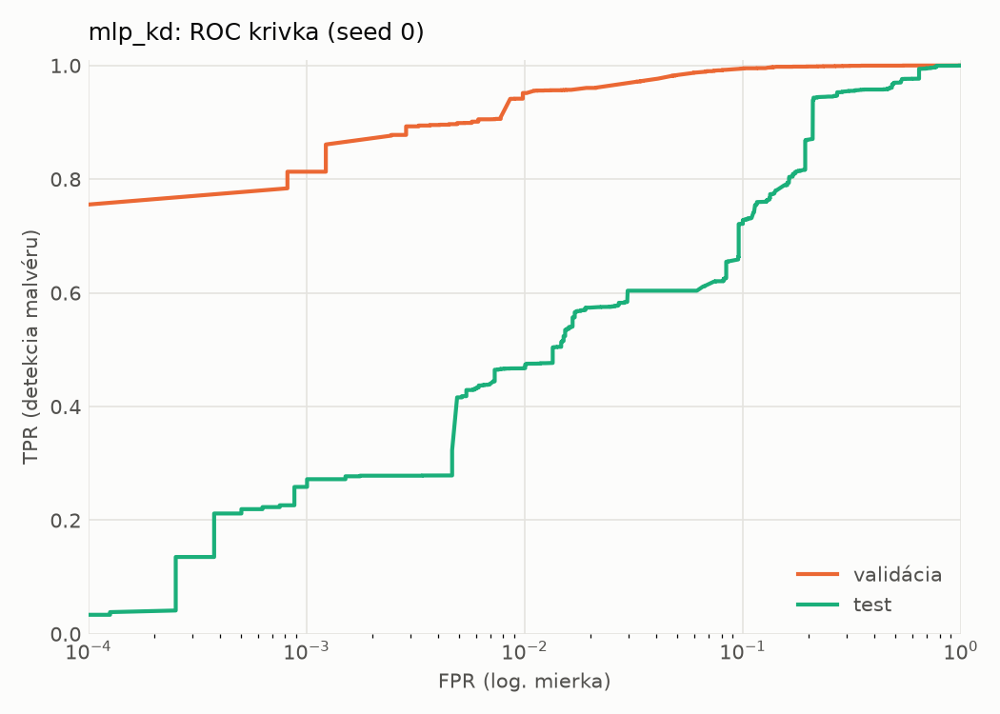
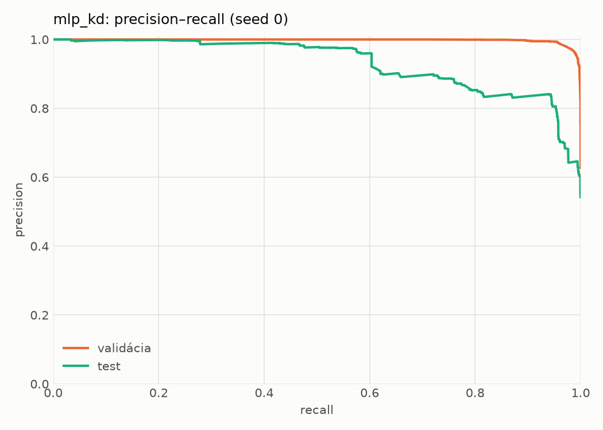
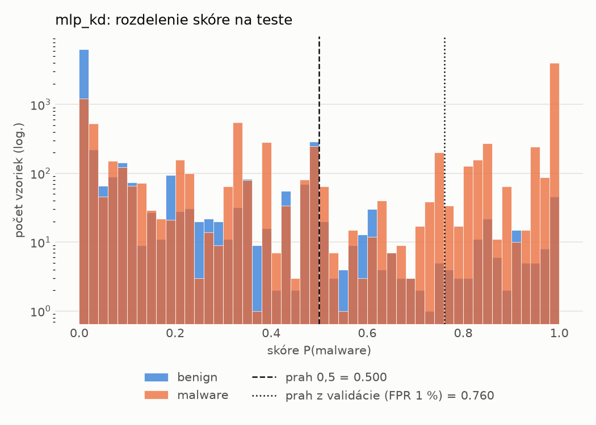
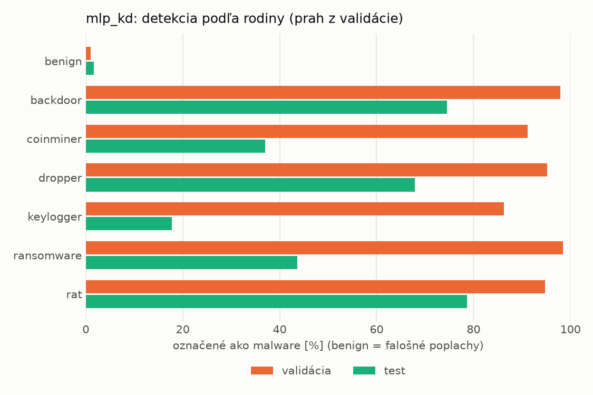
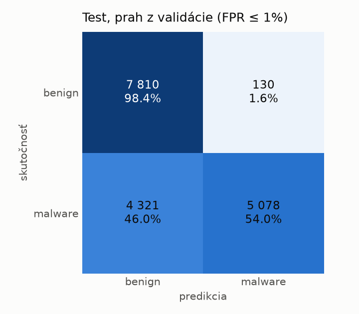
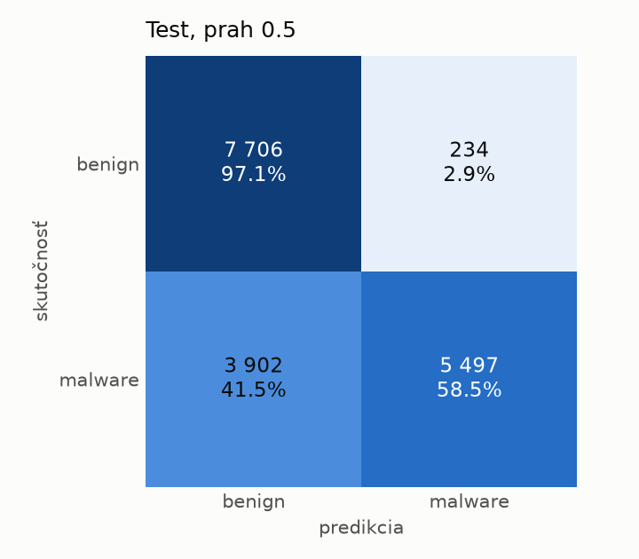
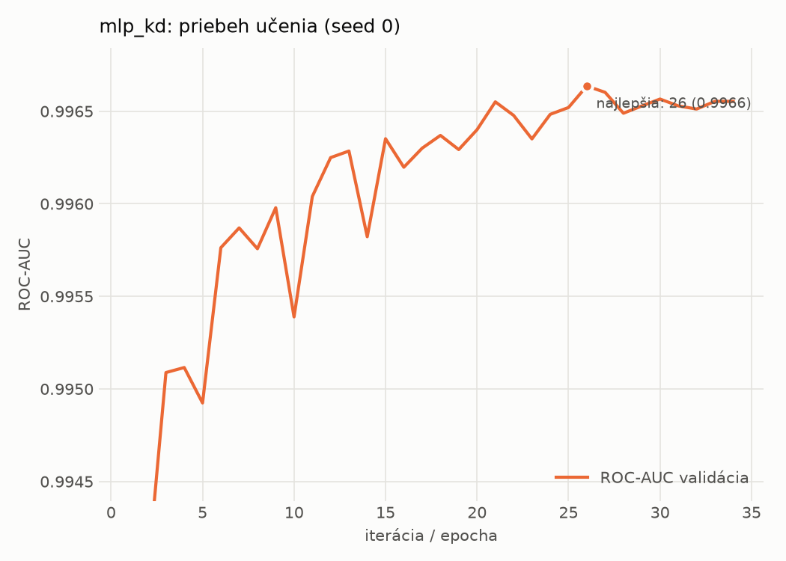

# dynamic/mlp_kd – beh `20261104-204539`

> Automaticky generované (`src/training/run_tabular.py`). Konfigurácia: `config.yaml`, protokol: `protocol.yaml`.

- **Model:** `mlp` – študent – malé MLP učené destiláciou z hybridného učiteľa
- **Ladenie:** bez ladenia – hyperparametre prevzaté z `runs_final/students_dynamic/mlp_kd/20261102-212132`
- **Finálne modely:** seedy [0, 1, 2]; hodnoty sú priemer ± smerodajná odchýlka cez seedy
- **Najlepšie hyperparametre:** `{"hidden_layers": 1, "max_epochs": 100, "patience": 8, "hidden_width": 32, "dropout": 0.14978534481914754, "lr": 0.0015794492400712224, "weight_decay": 1.2553588001973222e-06, "batch_size": 512, "kd_alpha": 0.7118939371172979, "kd_temperature": 1.298431487079528}`

## Detekčná kvalita (bez prahu)
| metrika | train (podvzorka) | validácia | test |
|---|---|---|---|
| ROC-AUC | 0.9980 ± 0.0000 | 0.9966 ± 0.0000 | 0.8979 ± 0.0195 |
| PR-AUC | 0.9987 ± 0.0000 | 0.9979 ± 0.0000 | 0.9206 ± 0.0115 |
| TPR pri FPR 1 % | 0.9490 ± 0.0009 | 0.9463 ± 0.0051 | 0.4632 ± 0.0128 |
| TPR pri FPR 0,1 % | 0.8953 ± 0.0002 | 0.8121 ± 0.0274 | 0.2364 ± 0.0238 |
| log loss | 0.0566 ± 0.0007 | 0.0744 ± 0.0004 | 0.8792 ± 0.1265 |
| Brier skóre | 0.0177 ± 0.0002 | 0.0208 ± 0.0001 | 0.1871 ± 0.0051 |

Rozdiel ROC-AUC train − validácia: **0.0014** (veľký rozdiel = preučenie).

## Pri prahu z validácie (FPR ≤ 1% na validácii)
| metrika | train (podvzorka) | validácia | test |
|---|---|---|---|
| accuracy | 0.9611 ± 0.0037 | 0.9627 ± 0.0032 | 0.7334 ± 0.0088 |
| balanced accuracy | 0.9672 ± 0.0027 | 0.9682 ± 0.0026 | 0.7528 ± 0.0081 |
| precision | 0.9951 ± 0.0009 | 0.9939 ± 0.0000 | 0.9741 ± 0.0034 |
| recall (TPR) | 0.9420 ± 0.0069 | 0.9463 ± 0.0051 | 0.5220 ± 0.0166 |
| FPR | 0.0076 ± 0.0015 | 0.0098 ± 0.0000 | 0.0165 ± 0.0023 |
| F1 | 0.9678 ± 0.0032 | 0.9695 ± 0.0027 | 0.6797 ± 0.0140 |
| MCC | 0.9210 ± 0.0070 | 0.9233 ± 0.0062 | 0.5549 ± 0.0126 |

## Pri pevnom prahu 0.5
| metrika | train (podvzorka) | validácia | test |
|---|---|---|---|
| accuracy | 0.9758 ± 0.0005 | 0.9706 ± 0.0006 | 0.7566 ± 0.0075 |
| balanced accuracy | 0.9758 ± 0.0005 | 0.9702 ± 0.0009 | 0.7709 ± 0.0078 |
| precision | 0.9851 ± 0.0005 | 0.9810 ± 0.0012 | 0.9253 ± 0.0298 |
| recall (TPR) | 0.9758 ± 0.0006 | 0.9720 ± 0.0002 | 0.6002 ± 0.0216 |
| FPR | 0.0241 ± 0.0008 | 0.0317 ± 0.0021 | 0.0584 ± 0.0259 |
| F1 | 0.9804 ± 0.0004 | 0.9765 ± 0.0005 | 0.7277 ± 0.0105 |
| MCC | 0.9489 ± 0.0011 | 0.9375 ± 0.0014 | 0.5658 ± 0.0205 |

## Výpočtové nároky (seed 0, testovacia množina)
| meranie | hodnota |
|---|---|
| tréning finálneho modelu | 6.5 s (priemer cez seedy) |
| ladenie spolu | 0 s |
| počet parametrov / uzlov | 64 129 |
| veľkosť modelu na disku | 0.31 MB |
| transformácia vstupu – latencia (1 vlákno) | 0.018 ms |
| transformácia vstupu – priepustnosť | 48 053 vzoriek/s |
| CPU latencia modelu (batch 1, 1 vlákno) | 0.067 ms (p95 0.076) |
| CPU priepustnosť (24 vlákien) | 138 332 vzoriek/s |
| GPU latencia (batch 1) | 0.461 ms (p95 0.493) |
| GPU priepustnosť | 102 650 vzoriek/s |
| GPU špičková pamäť | 683 MB |

## Grafy
| | |
|---|---|
|  |  |
|  |  |
|  |  |
|  |  |

## Súbory
`metrics.json` (všetky metriky po seedoch vrátane rodín), `timing.json`, `hpo_trials.csv`,
`predictions/<časť>_seed<N>.parquet` (sha256, family, label, score), `model/seed_<N>/`, `log.txt`.
