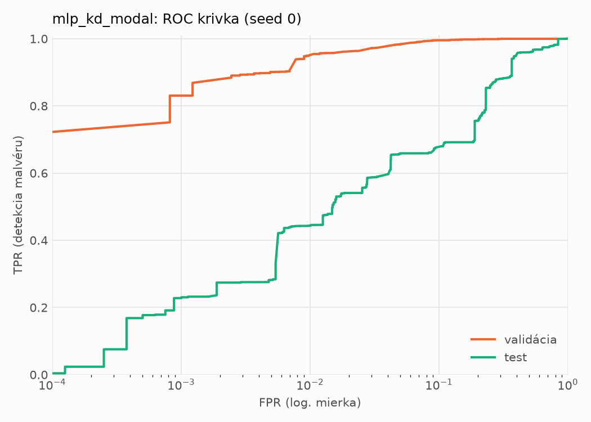
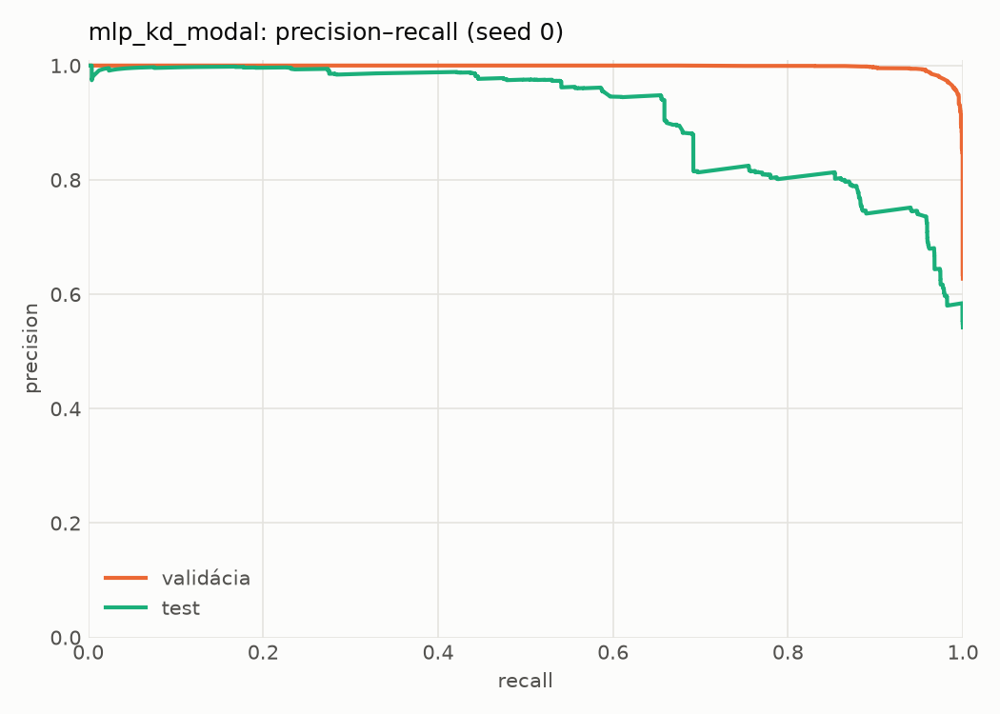
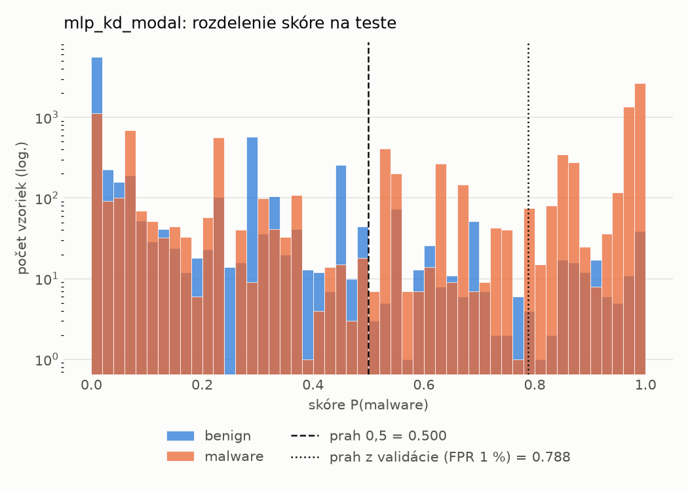
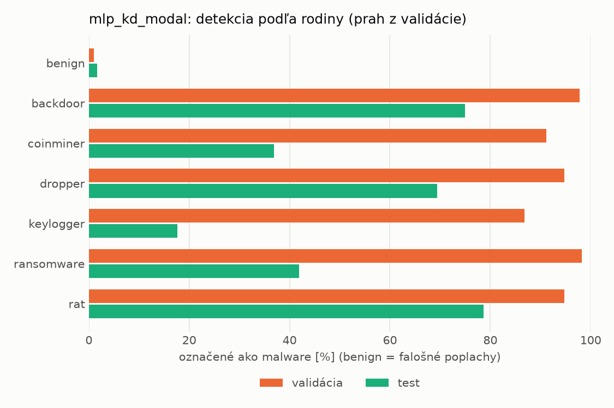
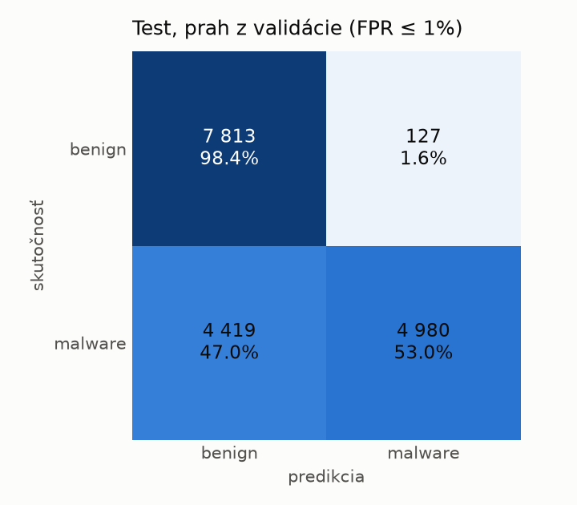
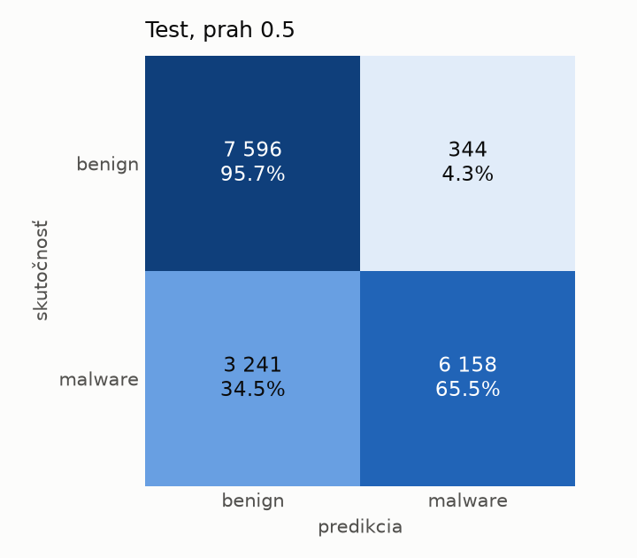
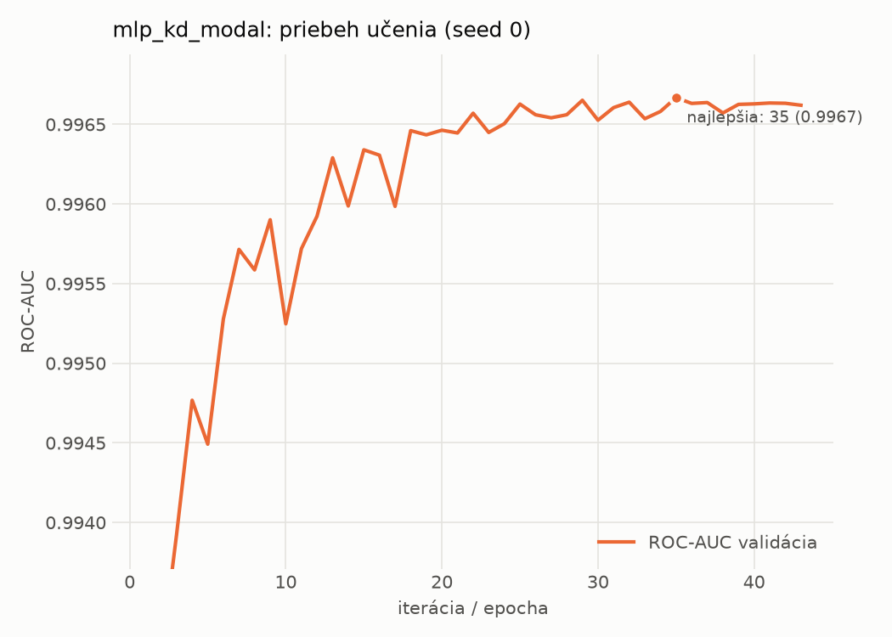

# dynamic/mlp_kd_modal – beh `20261104-204627`

> Automaticky generované (`src/training/run_tabular.py`). Konfigurácia: `config.yaml`, protokol: `protocol.yaml`.

- **Model:** `mlp` – študent – malé MLP učené destiláciou z učiteľa rovnakej modality (variant A)
- **Ladenie:** bez ladenia – hyperparametre prevzaté z `runs_final/students_dynamic/mlp_kd_modal/20261102-212954`
- **Finálne modely:** seedy [0, 1, 2]; hodnoty sú priemer ± smerodajná odchýlka cez seedy
- **Najlepšie hyperparametre:** `{"hidden_layers": 1, "max_epochs": 100, "patience": 8, "hidden_width": 32, "dropout": 0.14040860994340293, "lr": 0.00037778352941027736, "weight_decay": 1.149514965975221e-06, "batch_size": 512, "kd_alpha": 0.8818461482523741, "kd_temperature": 1.583698009756735}`

## Detekčná kvalita (bez prahu)
| metrika | train (podvzorka) | validácia | test |
|---|---|---|---|
| ROC-AUC | 0.9977 ± 0.0004 | 0.9965 ± 0.0002 | 0.8934 ± 0.0049 |
| PR-AUC | 0.9986 ± 0.0002 | 0.9979 ± 0.0001 | 0.9153 ± 0.0004 |
| TPR pri FPR 1 % | 0.9467 ± 0.0072 | 0.9494 ± 0.0011 | 0.4448 ± 0.0229 |
| TPR pri FPR 0,1 % | 0.8909 ± 0.0043 | 0.7788 ± 0.0813 | 0.2497 ± 0.0228 |
| log loss | 0.0617 ± 0.0053 | 0.0736 ± 0.0027 | 0.7147 ± 0.0491 |
| Brier skóre | 0.0189 ± 0.0014 | 0.0211 ± 0.0009 | 0.1847 ± 0.0065 |

Rozdiel ROC-AUC train − validácia: **0.0012** (veľký rozdiel = preučenie).

## Pri prahu z validácie (FPR ≤ 1% na validácii)
| metrika | train (podvzorka) | validácia | test |
|---|---|---|---|
| accuracy | 0.9607 ± 0.0027 | 0.9646 ± 0.0006 | 0.7347 ± 0.0030 |
| balanced accuracy | 0.9666 ± 0.0022 | 0.9699 ± 0.0005 | 0.7533 ± 0.0031 |
| precision | 0.9944 ± 0.0004 | 0.9940 ± 0.0001 | 0.9616 ± 0.0249 |
| recall (TPR) | 0.9419 ± 0.0042 | 0.9494 ± 0.0011 | 0.5324 ± 0.0162 |
| FPR | 0.0086 ± 0.0007 | 0.0097 ± 0.0002 | 0.0258 ± 0.0182 |
| F1 | 0.9674 ± 0.0023 | 0.9712 ± 0.0005 | 0.6850 ± 0.0077 |
| MCC | 0.9200 ± 0.0051 | 0.9272 ± 0.0012 | 0.5509 ± 0.0124 |

## Pri pevnom prahu 0.5
| metrika | train (podvzorka) | validácia | test |
|---|---|---|---|
| accuracy | 0.9726 ± 0.0033 | 0.9694 ± 0.0016 | 0.7677 ± 0.0227 |
| balanced accuracy | 0.9733 ± 0.0032 | 0.9697 ± 0.0012 | 0.7810 ± 0.0220 |
| precision | 0.9852 ± 0.0045 | 0.9824 ± 0.0029 | 0.9234 ± 0.0206 |
| recall (TPR) | 0.9704 ± 0.0066 | 0.9686 ± 0.0047 | 0.6229 ± 0.0303 |
| FPR | 0.0239 ± 0.0075 | 0.0292 ± 0.0050 | 0.0609 ± 0.0156 |
| F1 | 0.9777 ± 0.0027 | 0.9755 ± 0.0013 | 0.7438 ± 0.0277 |
| MCC | 0.9423 ± 0.0068 | 0.9351 ± 0.0031 | 0.5813 ± 0.0423 |

## Výpočtové nároky (seed 0, testovacia množina)
| meranie | hodnota |
|---|---|
| tréning finálneho modelu | 5.7 s (priemer cez seedy) |
| ladenie spolu | 0 s |
| počet parametrov / uzlov | 64 129 |
| veľkosť modelu na disku | 0.31 MB |
| transformácia vstupu – latencia (1 vlákno) | 0.034 ms |
| transformácia vstupu – priepustnosť | 45 370 vzoriek/s |
| CPU latencia modelu (batch 1, 1 vlákno) | 0.067 ms (p95 0.077) |
| CPU priepustnosť (24 vlákien) | 139 796 vzoriek/s |
| GPU latencia (batch 1) | 0.270 ms (p95 0.300) |
| GPU priepustnosť | 101 421 vzoriek/s |
| GPU špičková pamäť | 683 MB |

## Grafy
| | |
|---|---|
|  |  |
|  |  |
|  |  |
|  |  |

## Súbory
`metrics.json` (všetky metriky po seedoch vrátane rodín), `timing.json`, `hpo_trials.csv`,
`predictions/<časť>_seed<N>.parquet` (sha256, family, label, score), `model/seed_<N>/`, `log.txt`.
