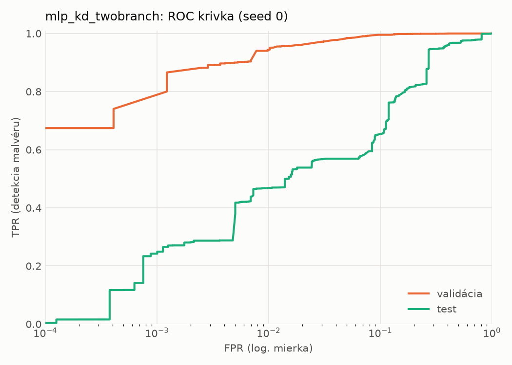
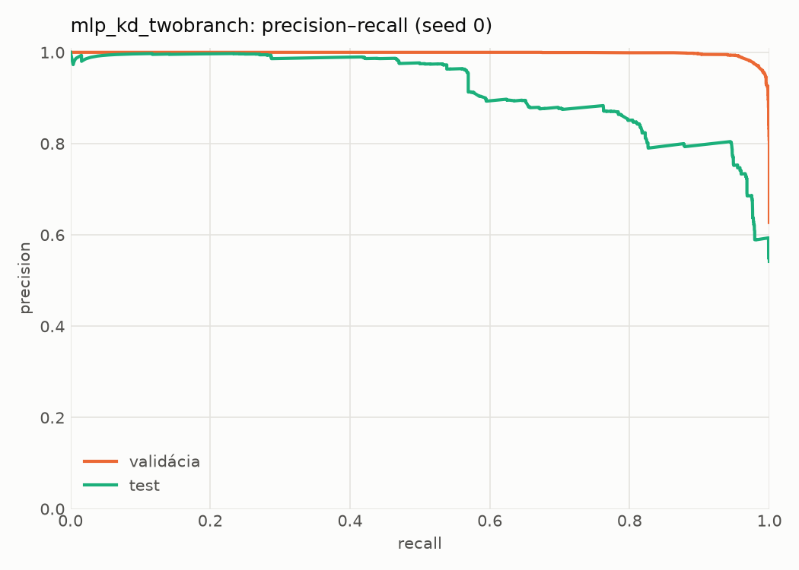
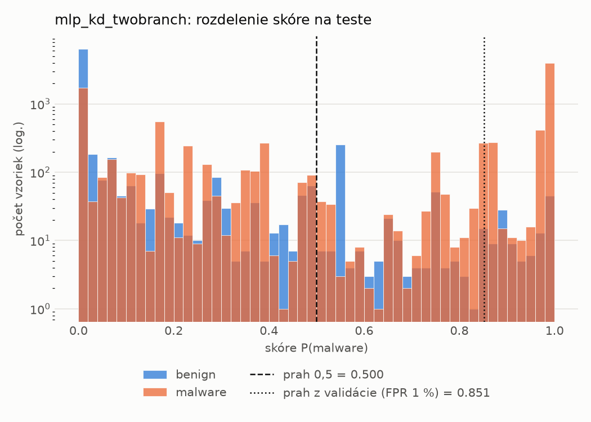
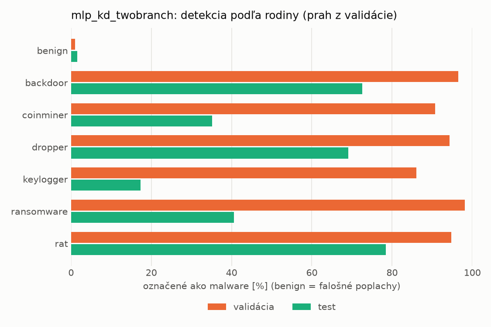
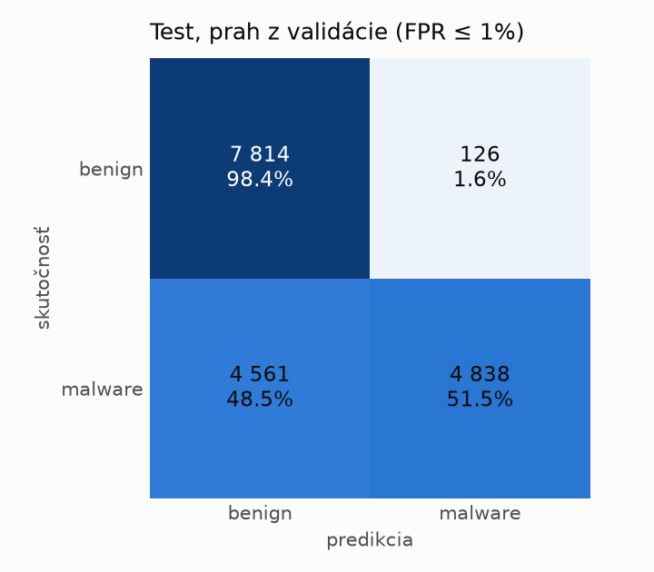
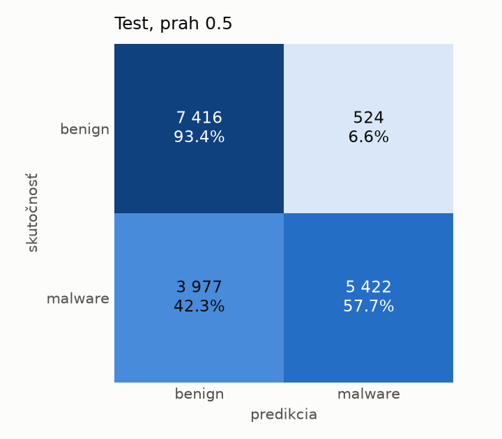
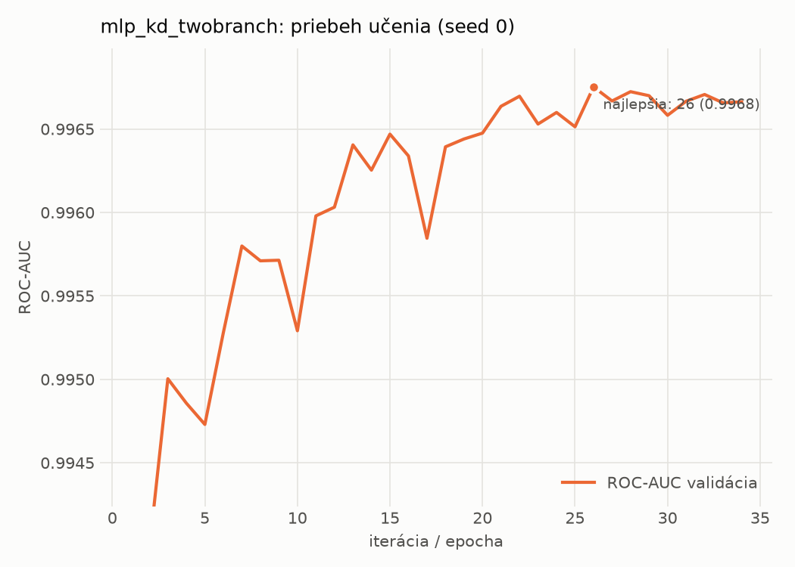

# dynamic/mlp_kd_twobranch – beh `20261104-204652`

> Automaticky generované (`src/training/run_tabular.py`). Konfigurácia: `config.yaml`, protokol: `protocol.yaml`.

- **Model:** `mlp` – študent – malé MLP učené destiláciou z dvojvetvovej siete (V2)
- **Ladenie:** bez ladenia – hyperparametre prevzaté z `runs_v2/full/students_dynamic/mlp_kd_twobranch/20261103-210509`
- **Finálne modely:** seedy [0, 1, 2]; hodnoty sú priemer ± smerodajná odchýlka cez seedy
- **Najlepšie hyperparametre:** `{"hidden_layers": 1, "max_epochs": 100, "patience": 8, "hidden_width": 32, "dropout": 0.20072105080128874, "lr": 0.0007693195243892695, "weight_decay": 5.480532660403751e-05, "batch_size": 512, "kd_alpha": 0.8408369066096718, "kd_temperature": 1.578549465607724}`

## Detekčná kvalita (bez prahu)
| metrika | train (podvzorka) | validácia | test |
|---|---|---|---|
| ROC-AUC | 0.9980 ± 0.0000 | 0.9967 ± 0.0001 | 0.8972 ± 0.0077 |
| PR-AUC | 0.9987 ± 0.0000 | 0.9980 ± 0.0000 | 0.9206 ± 0.0045 |
| TPR pri FPR 1 % | 0.9486 ± 0.0002 | 0.9447 ± 0.0065 | 0.4682 ± 0.0015 |
| TPR pri FPR 0,1 % | 0.8963 ± 0.0017 | 0.7520 ± 0.0531 | 0.2545 ± 0.0109 |
| log loss | 0.0566 ± 0.0006 | 0.0727 ± 0.0006 | 0.9127 ± 0.0464 |
| Brier skóre | 0.0176 ± 0.0002 | 0.0205 ± 0.0001 | 0.1913 ± 0.0056 |

Rozdiel ROC-AUC train − validácia: **0.0013** (veľký rozdiel = preučenie).

## Pri prahu z validácie (FPR ≤ 1% na validácii)
| metrika | train (podvzorka) | validácia | test |
|---|---|---|---|
| accuracy | 0.9594 ± 0.0041 | 0.9616 ± 0.0041 | 0.7324 ± 0.0092 |
| balanced accuracy | 0.9659 ± 0.0029 | 0.9674 ± 0.0032 | 0.7520 ± 0.0085 |
| precision | 0.9953 ± 0.0013 | 0.9939 ± 0.0000 | 0.9761 ± 0.0014 |
| recall (TPR) | 0.9389 ± 0.0078 | 0.9447 ± 0.0065 | 0.5191 ± 0.0177 |
| FPR | 0.0072 ± 0.0021 | 0.0098 ± 0.0000 | 0.0151 ± 0.0012 |
| F1 | 0.9663 ± 0.0035 | 0.9686 ± 0.0034 | 0.6777 ± 0.0149 |
| MCC | 0.9178 ± 0.0075 | 0.9213 ± 0.0079 | 0.5544 ± 0.0129 |

## Pri pevnom prahu 0.5
| metrika | train (podvzorka) | validácia | test |
|---|---|---|---|
| accuracy | 0.9759 ± 0.0006 | 0.9707 ± 0.0003 | 0.7619 ± 0.0189 |
| balanced accuracy | 0.9761 ± 0.0005 | 0.9704 ± 0.0004 | 0.7765 ± 0.0185 |
| precision | 0.9856 ± 0.0005 | 0.9814 ± 0.0005 | 0.9347 ± 0.0197 |
| recall (TPR) | 0.9754 ± 0.0008 | 0.9717 ± 0.0001 | 0.6027 ± 0.0232 |
| FPR | 0.0233 ± 0.0008 | 0.0310 ± 0.0009 | 0.0497 ± 0.0141 |
| F1 | 0.9805 ± 0.0005 | 0.9765 ± 0.0002 | 0.7328 ± 0.0231 |
| MCC | 0.9491 ± 0.0012 | 0.9376 ± 0.0007 | 0.5778 ± 0.0364 |

## Výpočtové nároky (seed 0, testovacia množina)
| meranie | hodnota |
|---|---|
| tréning finálneho modelu | 6.7 s (priemer cez seedy) |
| ladenie spolu | 0 s |
| počet parametrov / uzlov | 64 129 |
| veľkosť modelu na disku | 0.31 MB |
| transformácia vstupu – latencia (1 vlákno) | 0.035 ms |
| transformácia vstupu – priepustnosť | 47 327 vzoriek/s |
| CPU latencia modelu (batch 1, 1 vlákno) | 0.068 ms (p95 0.077) |
| CPU priepustnosť (24 vlákien) | 140 041 vzoriek/s |
| GPU latencia (batch 1) | 0.279 ms (p95 0.326) |
| GPU priepustnosť | 91 343 vzoriek/s |
| GPU špičková pamäť | 1207 MB |

## Grafy
| | |
|---|---|
|  |  |
|  |  |
|  |  |
|  |  |

## Súbory
`metrics.json` (všetky metriky po seedoch vrátane rodín), `timing.json`, `hpo_trials.csv`,
`predictions/<časť>_seed<N>.parquet` (sha256, family, label, score), `model/seed_<N>/`, `log.txt`.
