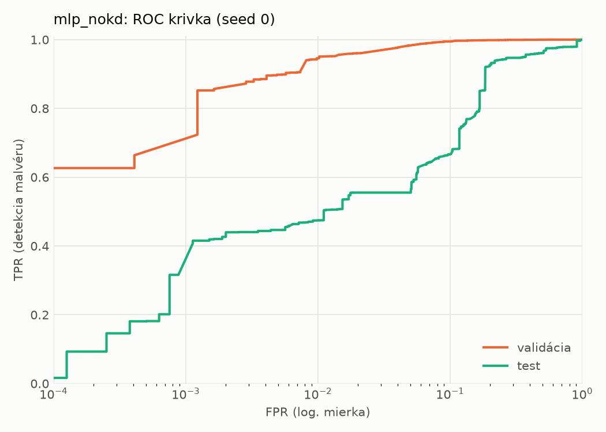
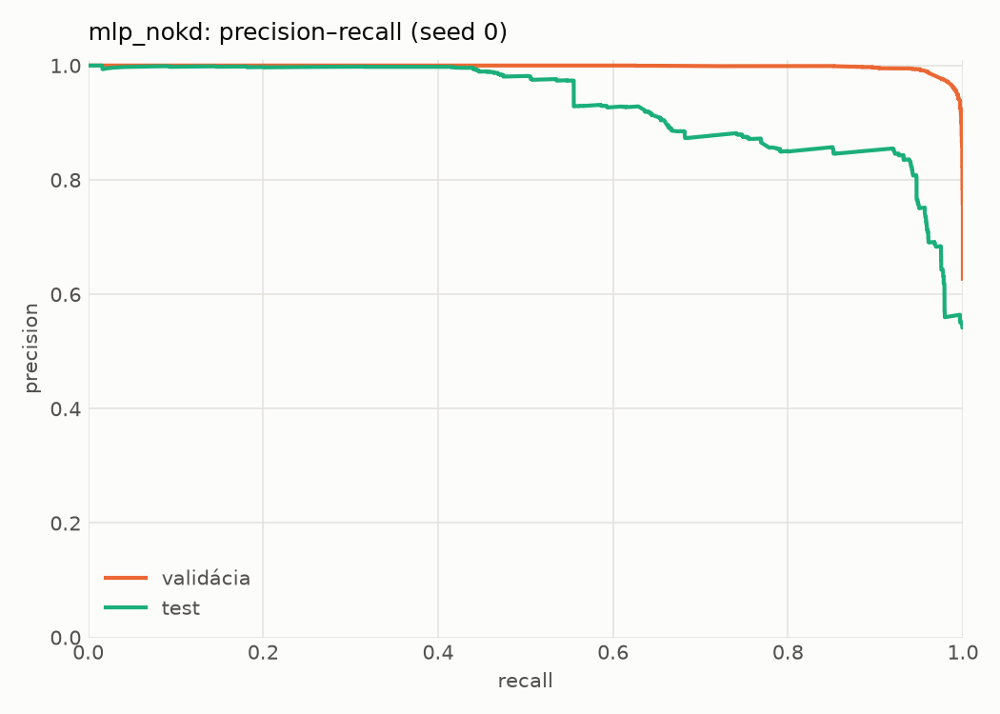
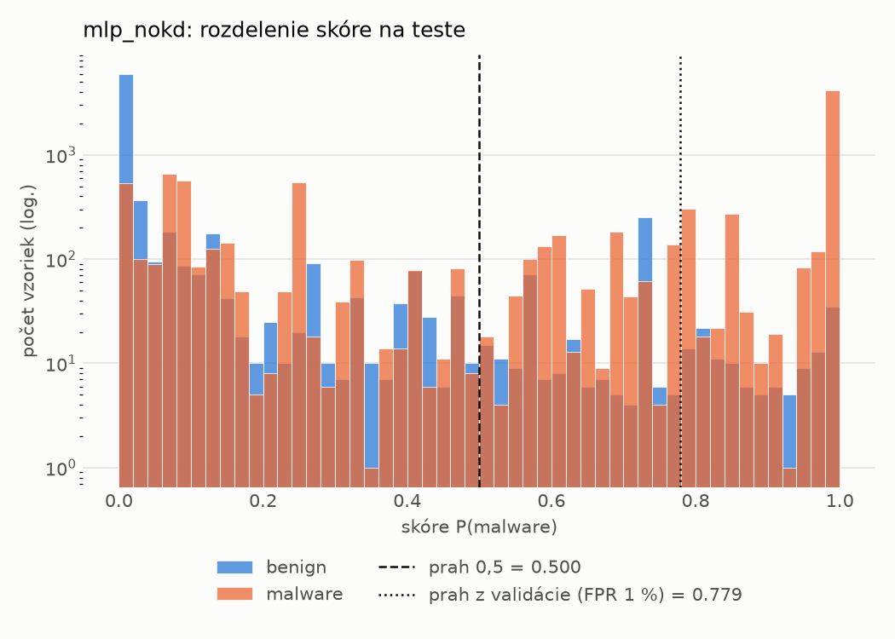
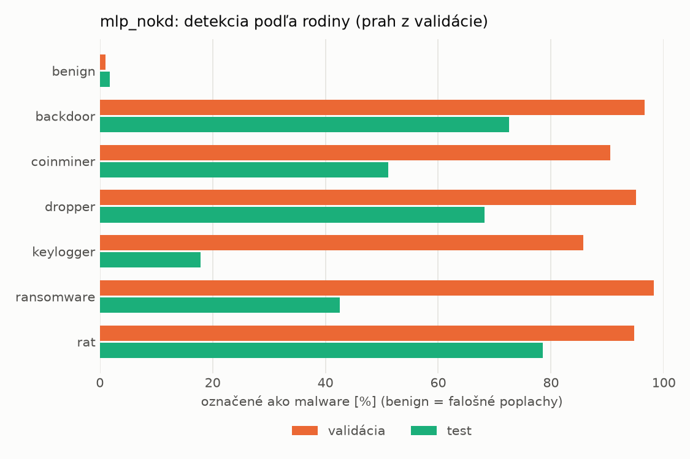
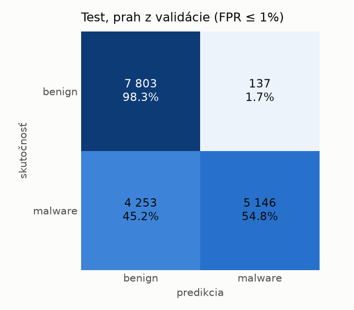
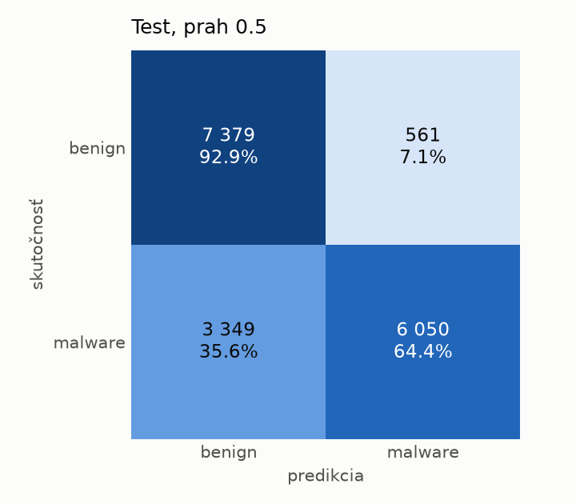
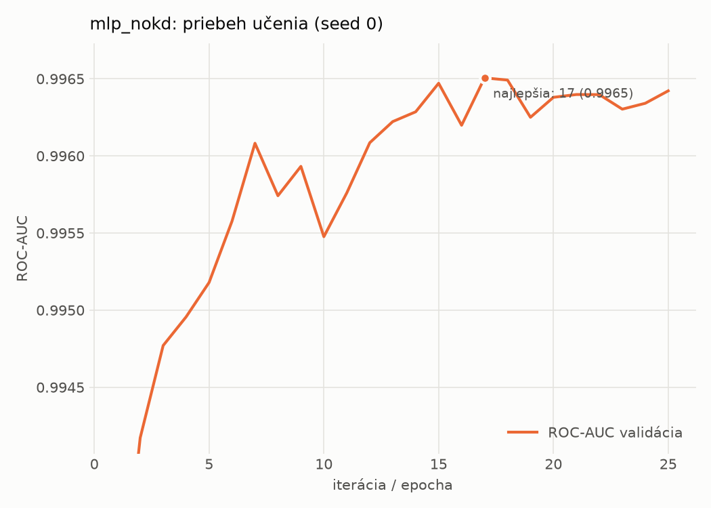

# dynamic/mlp_nokd – beh `20261104-204607`

> Automaticky generované (`src/training/run_tabular.py`). Konfigurácia: `config.yaml`, protokol: `protocol.yaml`.

- **Model:** `mlp` – kontrola – rovnaké malé MLP bez destilácie (iba skutočné označenia)
- **Ladenie:** bez ladenia – hyperparametre prevzaté z `runs_final/students_dynamic/mlp_nokd/20261102-212647`
- **Finálne modely:** seedy [0, 1, 2]; hodnoty sú priemer ± smerodajná odchýlka cez seedy
- **Najlepšie hyperparametre:** `{"hidden_layers": 1, "max_epochs": 100, "patience": 8, "hidden_width": 32, "dropout": 0.27854460554056926, "lr": 0.002048574130711367, "weight_decay": 5.911733622585913e-06, "batch_size": 512}`

## Detekčná kvalita (bez prahu)
| metrika | train (podvzorka) | validácia | test |
|---|---|---|---|
| ROC-AUC | 0.9978 ± 0.0001 | 0.9965 ± 0.0000 | 0.9097 ± 0.0044 |
| PR-AUC | 0.9986 ± 0.0001 | 0.9979 ± 0.0000 | 0.9291 ± 0.0020 |
| TPR pri FPR 1 % | 0.9476 ± 0.0004 | 0.9498 ± 0.0034 | 0.4680 ± 0.0057 |
| TPR pri FPR 0,1 % | 0.8961 ± 0.0005 | 0.7129 ± 0.0501 | 0.2899 ± 0.0228 |
| log loss | 0.0599 ± 0.0013 | 0.0760 ± 0.0008 | 0.7315 ± 0.0245 |
| Brier skóre | 0.0187 ± 0.0003 | 0.0211 ± 0.0002 | 0.1768 ± 0.0092 |

Rozdiel ROC-AUC train − validácia: **0.0013** (veľký rozdiel = preučenie).

## Pri prahu z validácie (FPR ≤ 1% na validácii)
| metrika | train (podvzorka) | validácia | test |
|---|---|---|---|
| accuracy | 0.9626 ± 0.0021 | 0.9648 ± 0.0021 | 0.7453 ± 0.0060 |
| balanced accuracy | 0.9682 ± 0.0016 | 0.9700 ± 0.0017 | 0.7628 ± 0.0069 |
| precision | 0.9946 ± 0.0003 | 0.9939 ± 0.0000 | 0.9581 ± 0.0245 |
| recall (TPR) | 0.9448 ± 0.0037 | 0.9498 ± 0.0034 | 0.5546 ± 0.0064 |
| FPR | 0.0083 ± 0.0005 | 0.0098 ± 0.0000 | 0.0291 ± 0.0182 |
| F1 | 0.9691 ± 0.0018 | 0.9713 ± 0.0018 | 0.7024 ± 0.0043 |
| MCC | 0.9238 ± 0.0040 | 0.9275 ± 0.0041 | 0.5644 ± 0.0196 |

## Pri pevnom prahu 0.5
| metrika | train (podvzorka) | validácia | test |
|---|---|---|---|
| accuracy | 0.9743 ± 0.0007 | 0.9701 ± 0.0003 | 0.7768 ± 0.0216 |
| balanced accuracy | 0.9736 ± 0.0015 | 0.9691 ± 0.0007 | 0.7897 ± 0.0215 |
| precision | 0.9822 ± 0.0031 | 0.9792 ± 0.0022 | 0.9295 ± 0.0271 |
| recall (TPR) | 0.9762 ± 0.0025 | 0.9731 ± 0.0027 | 0.6365 ± 0.0248 |
| FPR | 0.0290 ± 0.0053 | 0.0348 ± 0.0039 | 0.0571 ± 0.0220 |
| F1 | 0.9792 ± 0.0005 | 0.9761 ± 0.0003 | 0.7555 ± 0.0249 |
| MCC | 0.9455 ± 0.0015 | 0.9363 ± 0.0006 | 0.5975 ± 0.0434 |

## Výpočtové nároky (seed 0, testovacia množina)
| meranie | hodnota |
|---|---|
| tréning finálneho modelu | 3.9 s (priemer cez seedy) |
| ladenie spolu | 0 s |
| počet parametrov / uzlov | 64 129 |
| veľkosť modelu na disku | 0.31 MB |
| transformácia vstupu – latencia (1 vlákno) | 0.035 ms |
| transformácia vstupu – priepustnosť | 45 297 vzoriek/s |
| CPU latencia modelu (batch 1, 1 vlákno) | 0.067 ms (p95 0.074) |
| CPU priepustnosť (24 vlákien) | 96 044 vzoriek/s |
| GPU latencia (batch 1) | 0.464 ms (p95 0.521) |
| GPU priepustnosť | 100 866 vzoriek/s |
| GPU špičková pamäť | 1207 MB |

## Grafy
| | |
|---|---|
|  |  |
|  |  |
|  |  |
|  |  |

## Súbory
`metrics.json` (všetky metriky po seedoch vrátane rodín), `timing.json`, `hpo_trials.csv`,
`predictions/<časť>_seed<N>.parquet` (sha256, family, label, score), `model/seed_<N>/`, `log.txt`.
