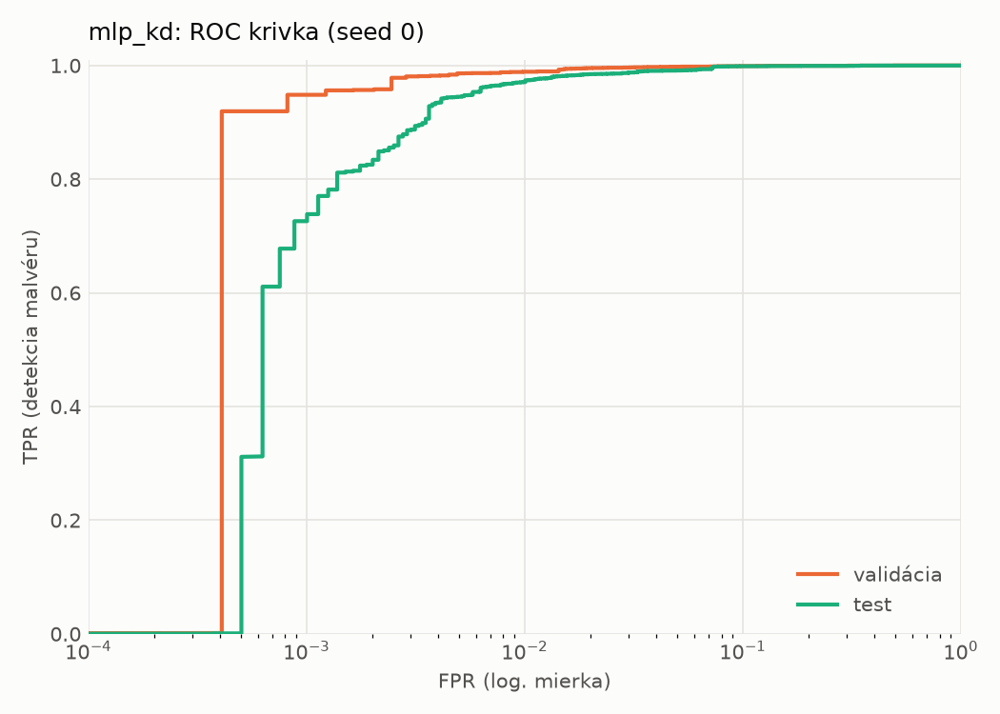
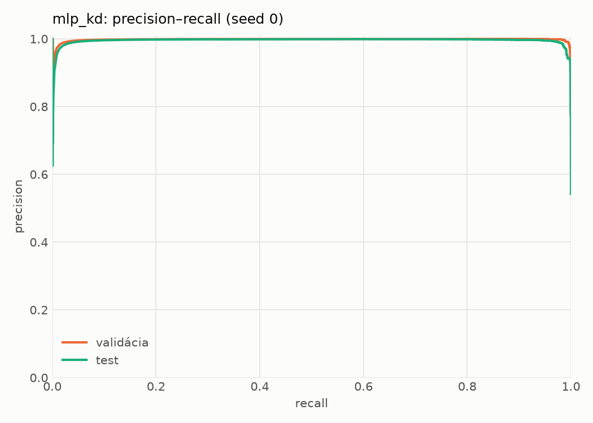
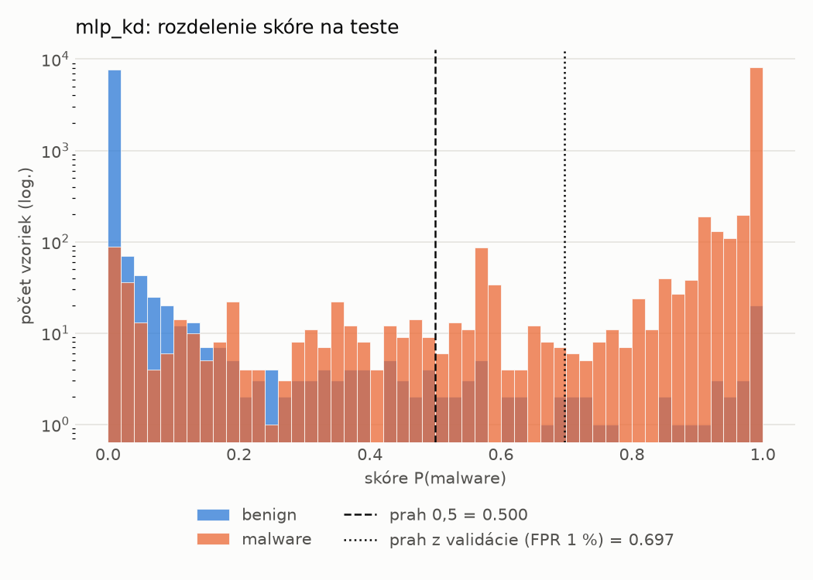
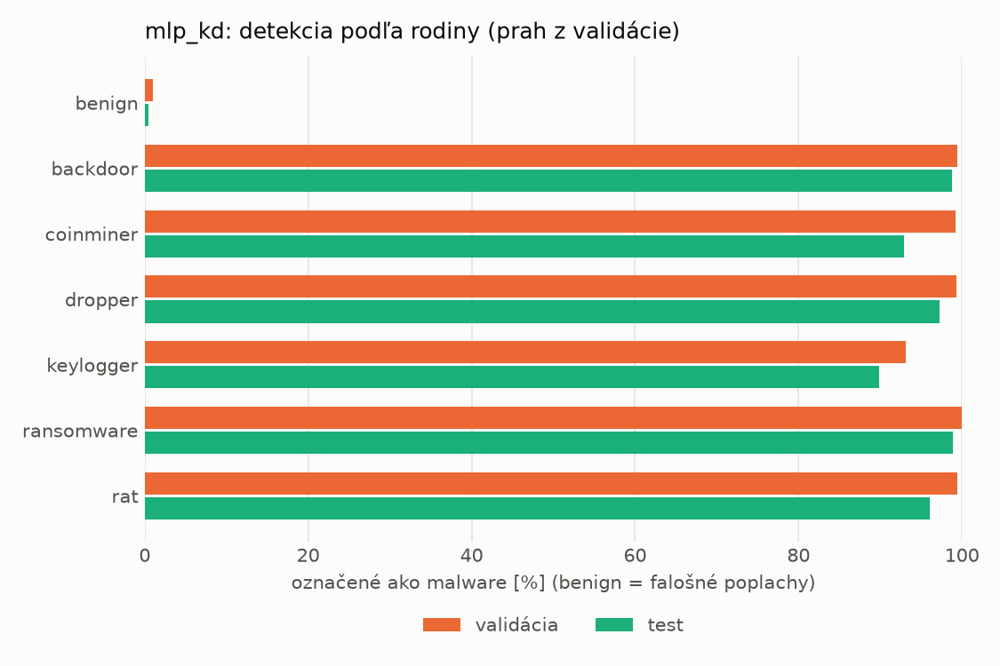
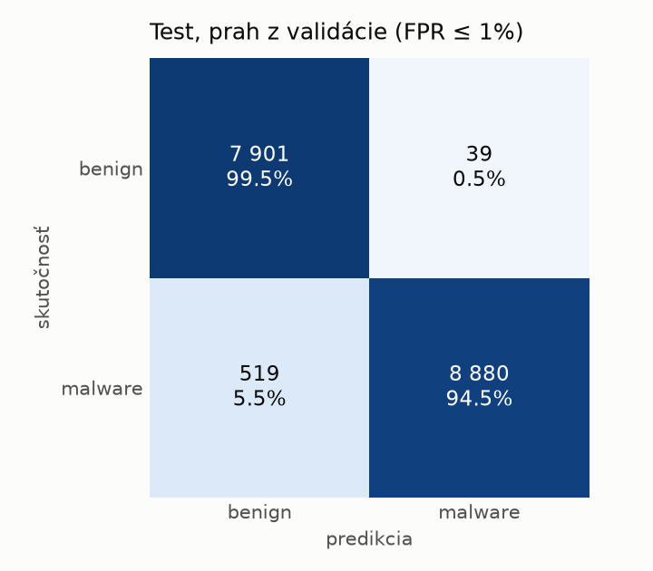
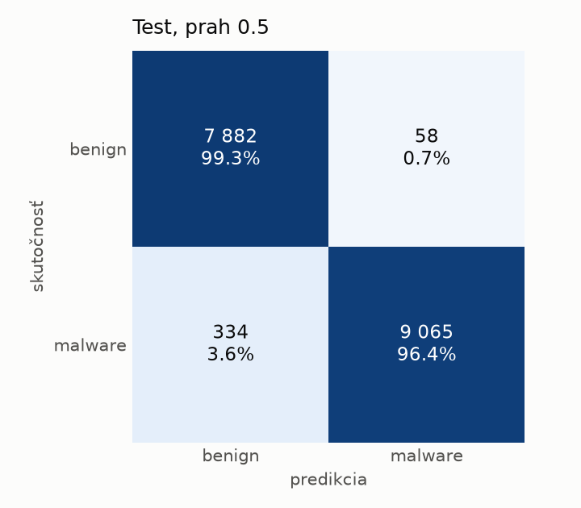
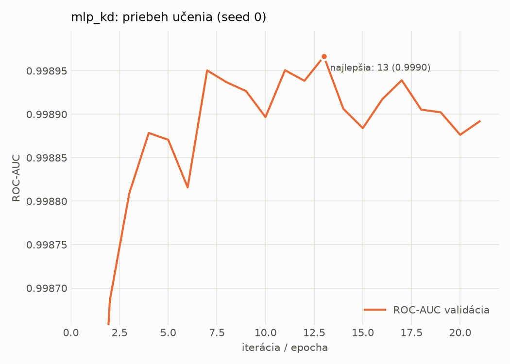

# static/mlp_kd – beh `20261104-204353`

> Automaticky generované (`src/training/run_tabular.py`). Konfigurácia: `config.yaml`, protokol: `protocol.yaml`.

- **Model:** `mlp` – študent – malé MLP učené destiláciou z hybridného učiteľa
- **Ladenie:** bez ladenia – hyperparametre prevzaté z `runs_final/students_static/mlp_kd/20261102-211333`
- **Finálne modely:** seedy [0, 1, 2]; hodnoty sú priemer ± smerodajná odchýlka cez seedy
- **Najlepšie hyperparametre:** `{"hidden_layers": 1, "max_epochs": 100, "patience": 8, "hidden_width": 32, "dropout": 0.0997633477545663, "lr": 0.0015427581570995174, "weight_decay": 0.00017559733451057006, "batch_size": 256, "kd_alpha": 0.604033962068706, "kd_temperature": 6.472658522077935}`

## Detekčná kvalita (bez prahu)
| metrika | train (podvzorka) | validácia | test |
|---|---|---|---|
| ROC-AUC | 0.9999 ± 0.0000 | 0.9991 ± 0.0003 | 0.9974 ± 0.0004 |
| PR-AUC | 0.9999 ± 0.0000 | 0.9989 ± 0.0008 | 0.9954 ± 0.0001 |
| TPR pri FPR 1 % | 0.9975 ± 0.0007 | 0.9873 ± 0.0018 | 0.9675 ± 0.0052 |
| TPR pri FPR 0,1 % | 0.9757 ± 0.0063 | 0.9325 ± 0.0151 | 0.7559 ± 0.0258 |
| log loss | 0.0138 ± 0.0018 | 0.0342 ± 0.0024 | 0.0818 ± 0.0029 |
| Brier skóre | 0.0039 ± 0.0005 | 0.0083 ± 0.0007 | 0.0194 ± 0.0008 |

Rozdiel ROC-AUC train − validácia: **0.0008** (veľký rozdiel = preučenie).

## Pri prahu z validácie (FPR ≤ 1% na validácii)
| metrika | train (podvzorka) | validácia | test |
|---|---|---|---|
| accuracy | 0.9923 ± 0.0012 | 0.9887 ± 0.0008 | 0.9645 ± 0.0045 |
| balanced accuracy | 0.9934 ± 0.0010 | 0.9892 ± 0.0005 | 0.9669 ± 0.0042 |
| precision | 0.9986 ± 0.0002 | 0.9946 ± 0.0005 | 0.9956 ± 0.0001 |
| recall (TPR) | 0.9890 ± 0.0018 | 0.9873 ± 0.0018 | 0.9387 ± 0.0082 |
| FPR | 0.0023 ± 0.0004 | 0.0090 ± 0.0008 | 0.0049 ± 0.0001 |
| F1 | 0.9938 ± 0.0010 | 0.9910 ± 0.0007 | 0.9663 ± 0.0044 |
| MCC | 0.9838 ± 0.0025 | 0.9760 ± 0.0018 | 0.9307 ± 0.0084 |

## Pri pevnom prahu 0.5
| metrika | train (podvzorka) | validácia | test |
|---|---|---|---|
| accuracy | 0.9951 ± 0.0016 | 0.9894 ± 0.0016 | 0.9750 ± 0.0021 |
| balanced accuracy | 0.9952 ± 0.0013 | 0.9884 ± 0.0015 | 0.9763 ± 0.0020 |
| precision | 0.9973 ± 0.0004 | 0.9908 ± 0.0009 | 0.9931 ± 0.0007 |
| recall (TPR) | 0.9948 ± 0.0023 | 0.9923 ± 0.0021 | 0.9605 ± 0.0035 |
| FPR | 0.0045 ± 0.0007 | 0.0156 ± 0.0015 | 0.0079 ± 0.0007 |
| F1 | 0.9960 ± 0.0013 | 0.9915 ± 0.0013 | 0.9765 ± 0.0020 |
| MCC | 0.9895 ± 0.0033 | 0.9773 ± 0.0035 | 0.9503 ± 0.0041 |

## Výpočtové nároky (seed 0, testovacia množina)
| meranie | hodnota |
|---|---|
| tréning finálneho modelu | 7.2 s (priemer cez seedy) |
| ladenie spolu | 0 s |
| počet parametrov / uzlov | 74 305 |
| veľkosť modelu na disku | 0.36 MB |
| transformácia vstupu – latencia (1 vlákno) | 0.041 ms |
| transformácia vstupu – priepustnosť | 43 998 vzoriek/s |
| CPU latencia modelu (batch 1, 1 vlákno) | 0.069 ms (p95 0.075) |
| CPU priepustnosť (24 vlákien) | 107 981 vzoriek/s |
| GPU latencia (batch 1) | 0.287 ms (p95 0.322) |
| GPU priepustnosť | 79 592 vzoriek/s |
| GPU špičková pamäť | 789 MB |

## Grafy
| | |
|---|---|
|  |  |
|  |  |
|  |  |
|  |  |

## Súbory
`metrics.json` (všetky metriky po seedoch vrátane rodín), `timing.json`, `hpo_trials.csv`,
`predictions/<časť>_seed<N>.parquet` (sha256, family, label, score), `model/seed_<N>/`, `log.txt`.
