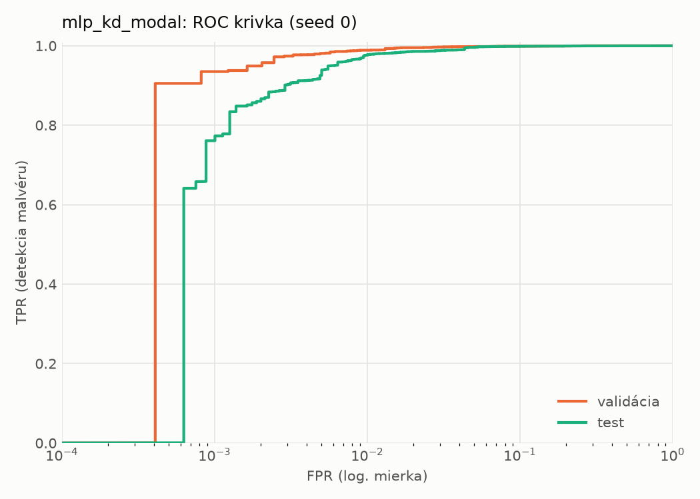
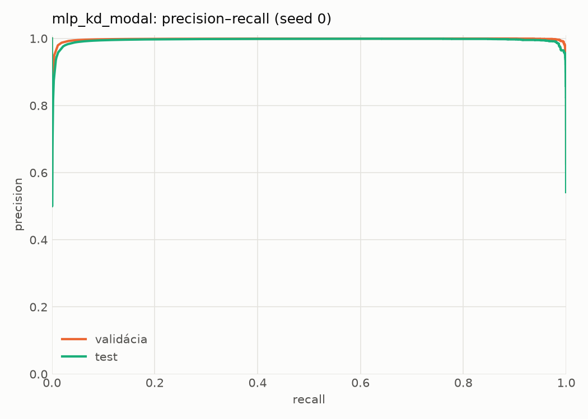
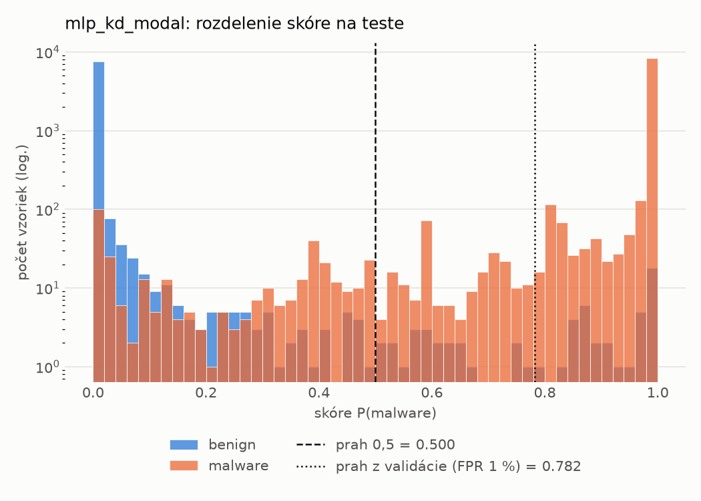
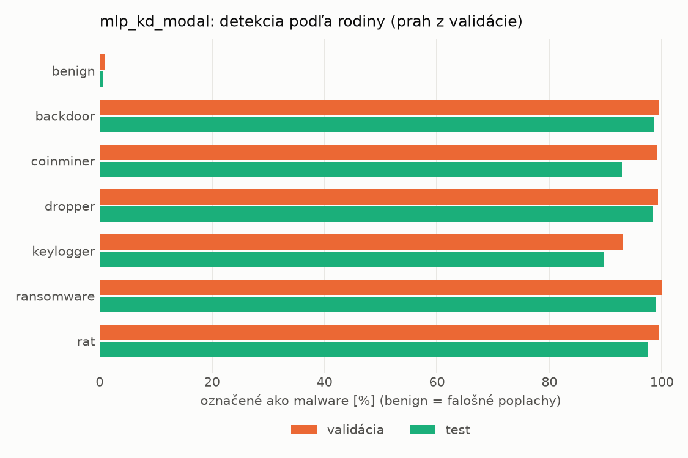
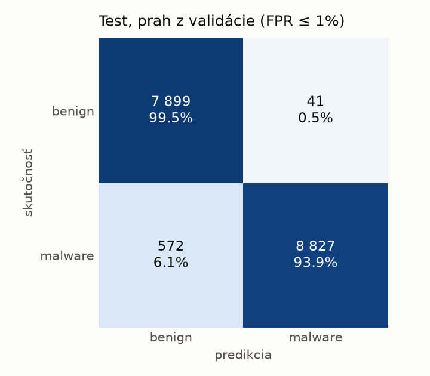
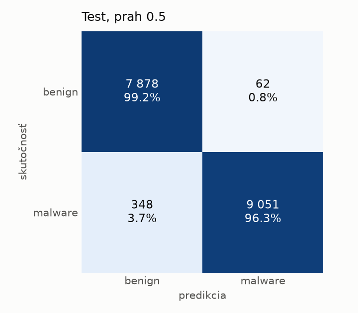
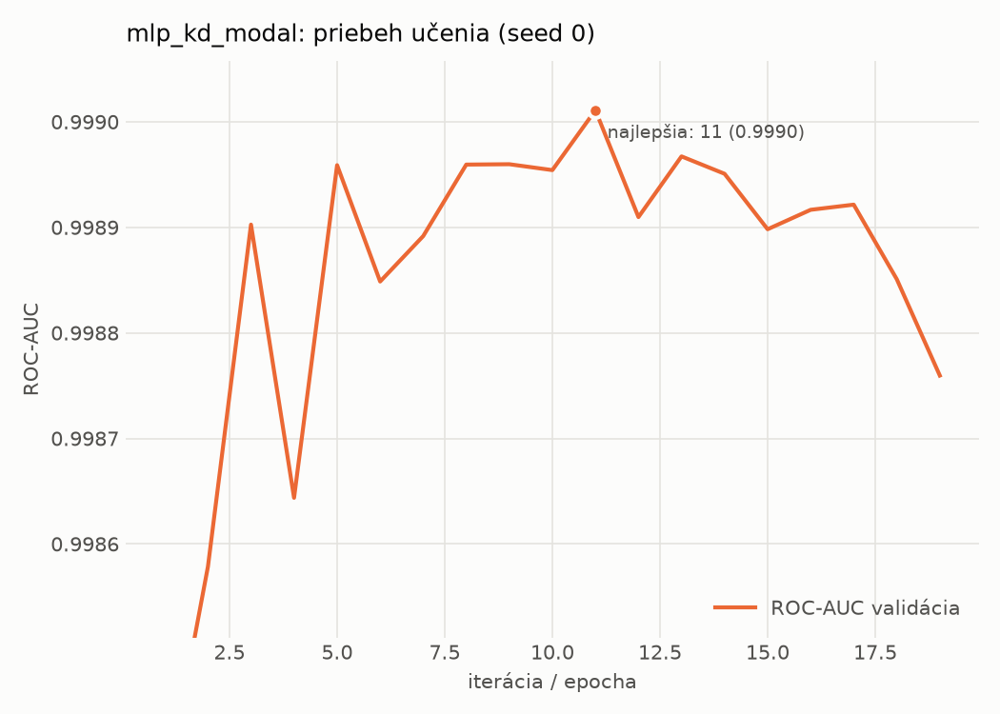

# static/mlp_kd_modal – beh `20261104-204439`

> Automaticky generované (`src/training/run_tabular.py`). Konfigurácia: `config.yaml`, protokol: `protocol.yaml`.

- **Model:** `mlp` – študent – malé MLP učené destiláciou z učiteľa rovnakej modality (variant A)
- **Ladenie:** bez ladenia – hyperparametre prevzaté z `runs_final/students_static/mlp_kd_modal/20261102-211832`
- **Finálne modely:** seedy [0, 1, 2]; hodnoty sú priemer ± smerodajná odchýlka cez seedy
- **Najlepšie hyperparametre:** `{"hidden_layers": 1, "max_epochs": 100, "patience": 8, "hidden_width": 32, "dropout": 0.15602040635334324, "lr": 0.00105640764164036, "weight_decay": 3.5856126103453987e-06, "batch_size": 256, "kd_alpha": 0.815861880342119, "kd_temperature": 5.185299851677596}`

## Detekčná kvalita (bez prahu)
| metrika | train (podvzorka) | validácia | test |
|---|---|---|---|
| ROC-AUC | 0.9999 ± 0.0000 | 0.9991 ± 0.0002 | 0.9976 ± 0.0002 |
| PR-AUC | 1.0000 ± 0.0000 | 0.9986 ± 0.0009 | 0.9967 ± 0.0013 |
| TPR pri FPR 1 % | 0.9988 ± 0.0006 | 0.9888 ± 0.0000 | 0.9736 ± 0.0046 |
| TPR pri FPR 0,1 % | 0.9828 ± 0.0017 | 0.9333 ± 0.0060 | 0.7734 ± 0.0340 |
| log loss | 0.0111 ± 0.0015 | 0.0338 ± 0.0016 | 0.0807 ± 0.0041 |
| Brier skóre | 0.0033 ± 0.0005 | 0.0080 ± 0.0002 | 0.0191 ± 0.0010 |

Rozdiel ROC-AUC train − validácia: **0.0008** (veľký rozdiel = preučenie).

## Pri prahu z validácie (FPR ≤ 1% na validácii)
| metrika | train (podvzorka) | validácia | test |
|---|---|---|---|
| accuracy | 0.9933 ± 0.0007 | 0.9896 ± 0.0001 | 0.9670 ± 0.0023 |
| balanced accuracy | 0.9942 ± 0.0006 | 0.9898 ± 0.0001 | 0.9692 ± 0.0021 |
| precision | 0.9988 ± 0.0002 | 0.9945 ± 0.0001 | 0.9954 ± 0.0001 |
| recall (TPR) | 0.9905 ± 0.0008 | 0.9888 ± 0.0000 | 0.9435 ± 0.0042 |
| FPR | 0.0020 ± 0.0004 | 0.0091 ± 0.0002 | 0.0052 ± 0.0001 |
| F1 | 0.9946 ± 0.0005 | 0.9917 ± 0.0001 | 0.9687 ± 0.0022 |
| MCC | 0.9859 ± 0.0014 | 0.9778 ± 0.0002 | 0.9353 ± 0.0043 |

## Pri pevnom prahu 0.5
| metrika | train (podvzorka) | validácia | test |
|---|---|---|---|
| accuracy | 0.9959 ± 0.0013 | 0.9896 ± 0.0015 | 0.9755 ± 0.0019 |
| balanced accuracy | 0.9960 ± 0.0009 | 0.9886 ± 0.0011 | 0.9768 ± 0.0018 |
| precision | 0.9978 ± 0.0002 | 0.9909 ± 0.0003 | 0.9933 ± 0.0005 |
| recall (TPR) | 0.9956 ± 0.0022 | 0.9926 ± 0.0025 | 0.9612 ± 0.0032 |
| FPR | 0.0035 ± 0.0003 | 0.0154 ± 0.0005 | 0.0076 ± 0.0005 |
| F1 | 0.9967 ± 0.0010 | 0.9917 ± 0.0012 | 0.9770 ± 0.0018 |
| MCC | 0.9914 ± 0.0026 | 0.9778 ± 0.0031 | 0.9513 ± 0.0037 |

## Výpočtové nároky (seed 0, testovacia množina)
| meranie | hodnota |
|---|---|
| tréning finálneho modelu | 6.6 s (priemer cez seedy) |
| ladenie spolu | 0 s |
| počet parametrov / uzlov | 74 305 |
| veľkosť modelu na disku | 0.36 MB |
| transformácia vstupu – latencia (1 vlákno) | 0.043 ms |
| transformácia vstupu – priepustnosť | 40 399 vzoriek/s |
| CPU latencia modelu (batch 1, 1 vlákno) | 0.069 ms (p95 0.084) |
| CPU priepustnosť (24 vlákien) | 55 416 vzoriek/s |
| GPU latencia (batch 1) | 0.284 ms (p95 0.481) |
| GPU priepustnosť | 71 053 vzoriek/s |
| GPU špičková pamäť | 789 MB |

## Grafy
| | |
|---|---|
|  |  |
|  |  |
|  |  |
|  |  |

## Súbory
`metrics.json` (všetky metriky po seedoch vrátane rodín), `timing.json`, `hpo_trials.csv`,
`predictions/<časť>_seed<N>.parquet` (sha256, family, label, score), `model/seed_<N>/`, `log.txt`.
