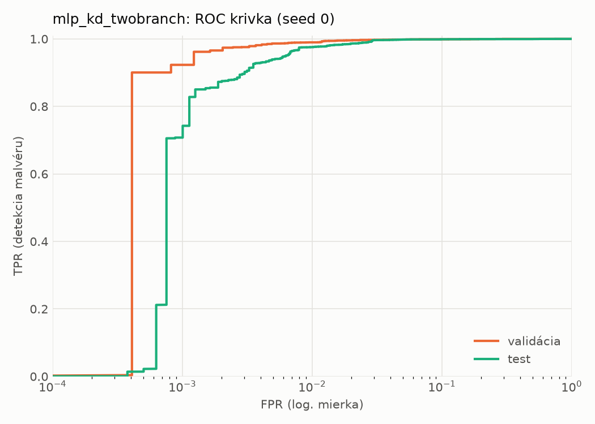
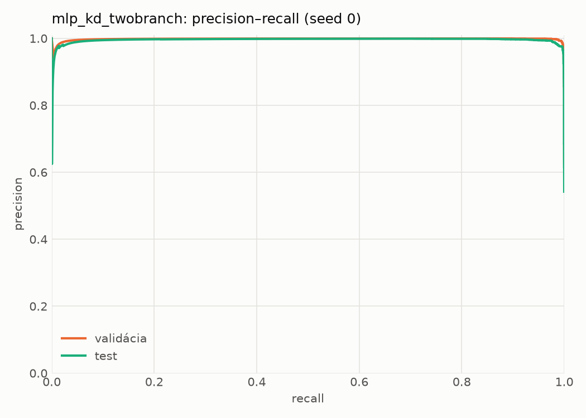
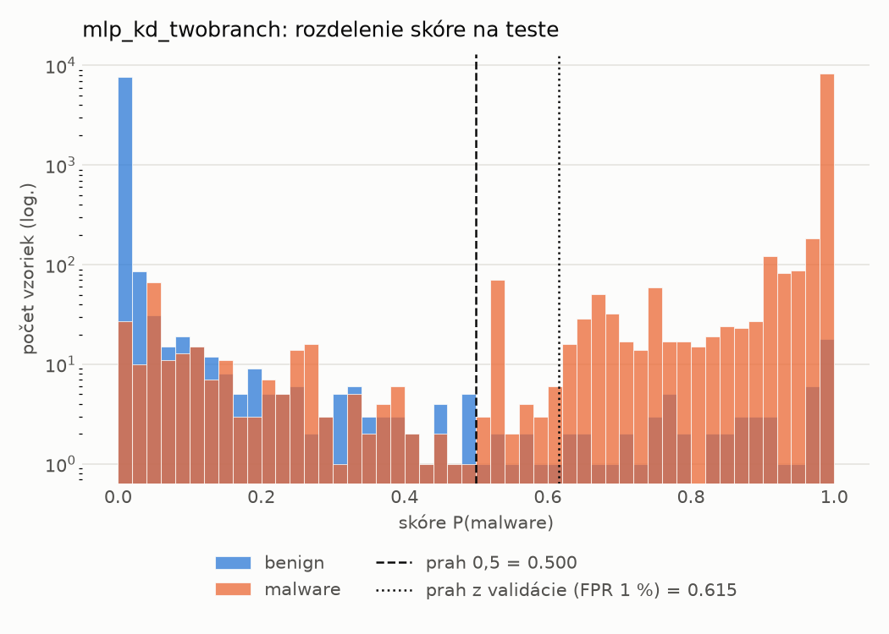
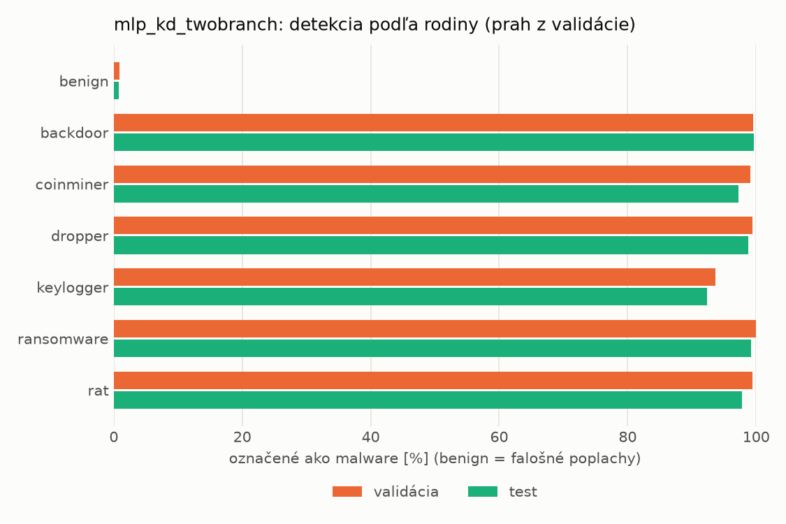
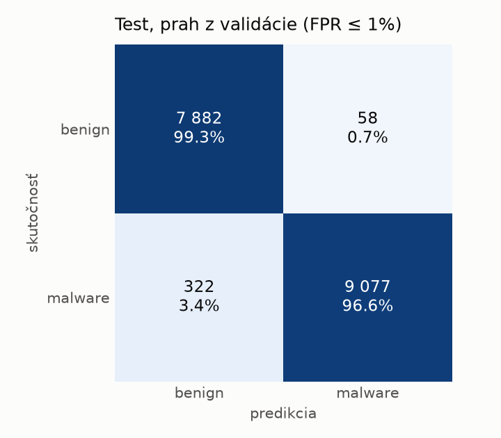
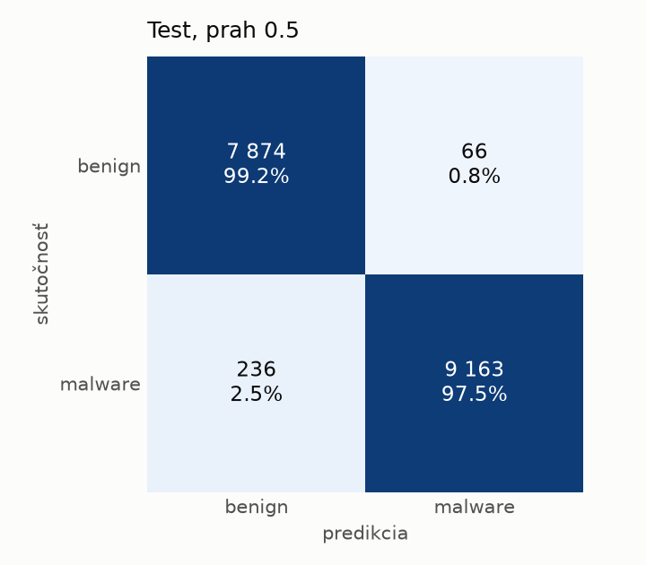
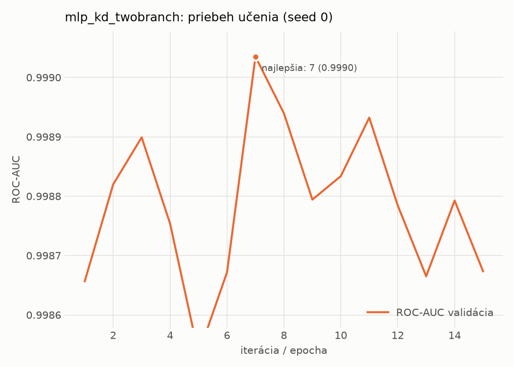

# static/mlp_kd_twobranch – beh `20261104-204508`

> Automaticky generované (`src/training/run_tabular.py`). Konfigurácia: `config.yaml`, protokol: `protocol.yaml`.

- **Model:** `mlp` – študent – malé MLP učené destiláciou z dvojvetvovej siete (V2)
- **Ladenie:** bez ladenia – hyperparametre prevzaté z `runs_v2/full/students_static/mlp_kd_twobranch/20261103-210128`
- **Finálne modely:** seedy [0, 1, 2]; hodnoty sú priemer ± smerodajná odchýlka cez seedy
- **Najlepšie hyperparametre:** `{"hidden_layers": 1, "max_epochs": 100, "patience": 8, "hidden_width": 32, "dropout": 0.11907530604839062, "lr": 0.0013122016832935236, "weight_decay": 1.6321051677063922e-05, "batch_size": 256, "kd_alpha": 0.8749635763069835, "kd_temperature": 3.9893325789148495}`

## Detekčná kvalita (bez prahu)
| metrika | train (podvzorka) | validácia | test |
|---|---|---|---|
| ROC-AUC | 1.0000 ± 0.0000 | 0.9989 ± 0.0002 | 0.9978 ± 0.0001 |
| PR-AUC | 1.0000 ± 0.0000 | 0.9979 ± 0.0008 | 0.9960 ± 0.0003 |
| TPR pri FPR 1 % | 0.9994 ± 0.0002 | 0.9908 ± 0.0016 | 0.9760 ± 0.0003 |
| TPR pri FPR 0,1 % | 0.9886 ± 0.0016 | 0.9328 ± 0.0107 | 0.6441 ± 0.1251 |
| log loss | 0.0097 ± 0.0002 | 0.0299 ± 0.0012 | 0.0656 ± 0.0015 |
| Brier skóre | 0.0027 ± 0.0001 | 0.0070 ± 0.0002 | 0.0165 ± 0.0003 |

Rozdiel ROC-AUC train − validácia: **0.0010** (veľký rozdiel = preučenie).

## Pri prahu z validácie (FPR ≤ 1% na validácii)
| metrika | train (podvzorka) | validácia | test |
|---|---|---|---|
| accuracy | 0.9954 ± 0.0009 | 0.9906 ± 0.0010 | 0.9776 ± 0.0004 |
| balanced accuracy | 0.9959 ± 0.0007 | 0.9906 ± 0.0007 | 0.9788 ± 0.0004 |
| precision | 0.9987 ± 0.0001 | 0.9942 ± 0.0001 | 0.9939 ± 0.0003 |
| recall (TPR) | 0.9939 ± 0.0014 | 0.9908 ± 0.0016 | 0.9646 ± 0.0011 |
| FPR | 0.0022 ± 0.0002 | 0.0097 ± 0.0002 | 0.0070 ± 0.0003 |
| F1 | 0.9963 ± 0.0007 | 0.9925 ± 0.0008 | 0.9791 ± 0.0004 |
| MCC | 0.9903 ± 0.0019 | 0.9800 ± 0.0021 | 0.9555 ± 0.0008 |

## Pri pevnom prahu 0.5
| metrika | train (podvzorka) | validácia | test |
|---|---|---|---|
| accuracy | 0.9961 ± 0.0011 | 0.9907 ± 0.0014 | 0.9799 ± 0.0024 |
| balanced accuracy | 0.9962 ± 0.0007 | 0.9902 ± 0.0012 | 0.9808 ± 0.0022 |
| precision | 0.9979 ± 0.0004 | 0.9928 ± 0.0002 | 0.9930 ± 0.0006 |
| recall (TPR) | 0.9959 ± 0.0021 | 0.9925 ± 0.0022 | 0.9696 ± 0.0047 |
| FPR | 0.0034 ± 0.0007 | 0.0121 ± 0.0002 | 0.0081 ± 0.0007 |
| F1 | 0.9969 ± 0.0009 | 0.9926 ± 0.0011 | 0.9812 ± 0.0023 |
| MCC | 0.9918 ± 0.0022 | 0.9802 ± 0.0030 | 0.9598 ± 0.0046 |

## Výpočtové nároky (seed 0, testovacia množina)
| meranie | hodnota |
|---|---|
| tréning finálneho modelu | 6.2 s (priemer cez seedy) |
| ladenie spolu | 0 s |
| počet parametrov / uzlov | 74 305 |
| veľkosť modelu na disku | 0.36 MB |
| transformácia vstupu – latencia (1 vlákno) | 0.043 ms |
| transformácia vstupu – priepustnosť | 38 027 vzoriek/s |
| CPU latencia modelu (batch 1, 1 vlákno) | 0.068 ms (p95 0.078) |
| CPU priepustnosť (24 vlákien) | 92 656 vzoriek/s |
| GPU latencia (batch 1) | 0.290 ms (p95 0.346) |
| GPU priepustnosť | 79 369 vzoriek/s |
| GPU špičková pamäť | 1397 MB |

## Grafy
| | |
|---|---|
|  |  |
|  |  |
|  |  |
|  |  |

## Súbory
`metrics.json` (všetky metriky po seedoch vrátane rodín), `timing.json`, `hpo_trials.csv`,
`predictions/<časť>_seed<N>.parquet` (sha256, family, label, score), `model/seed_<N>/`, `log.txt`.
