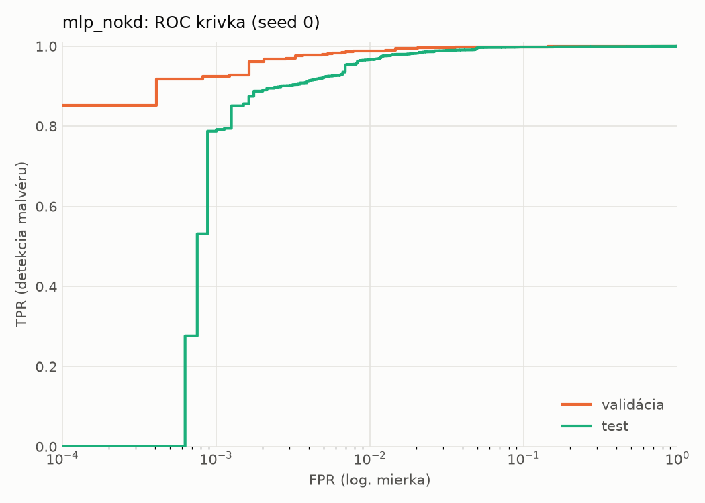
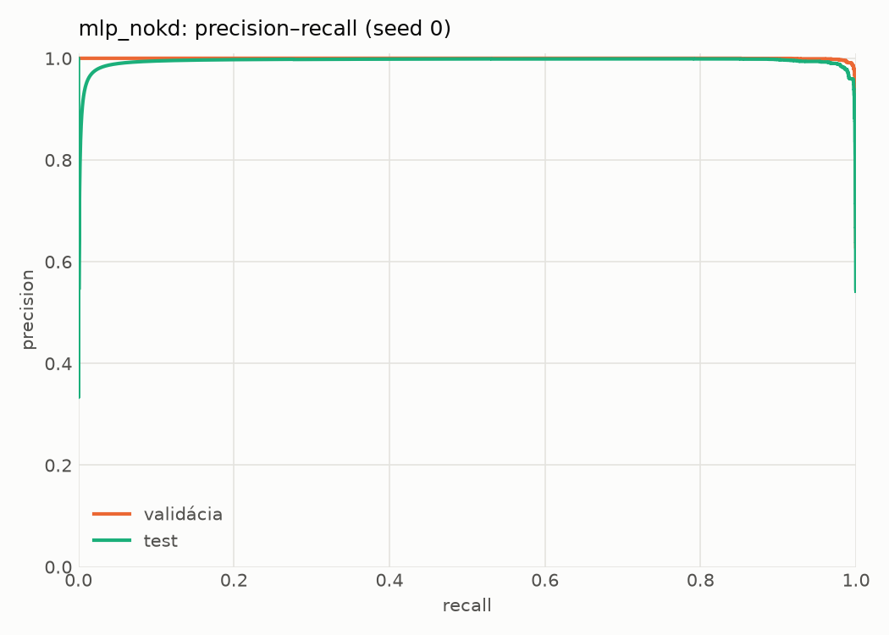
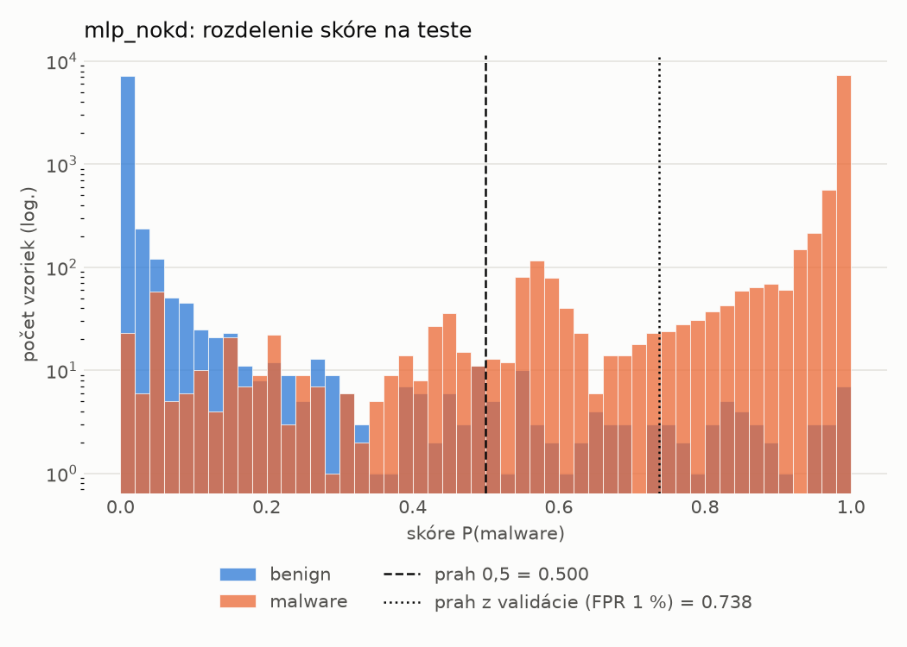
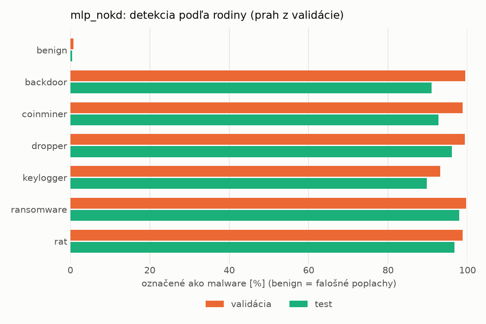
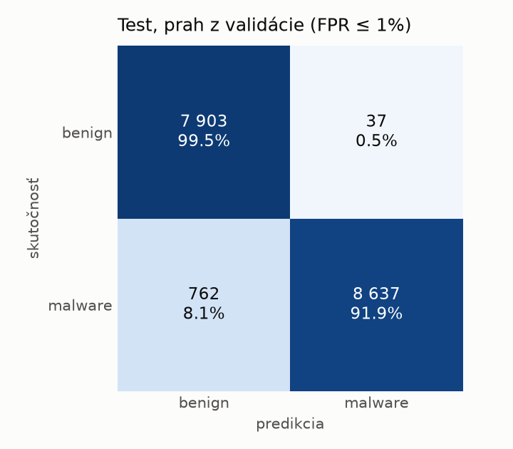
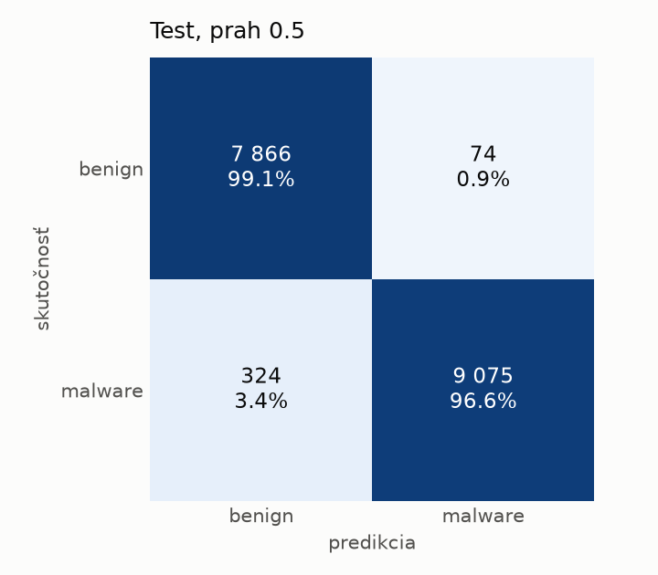
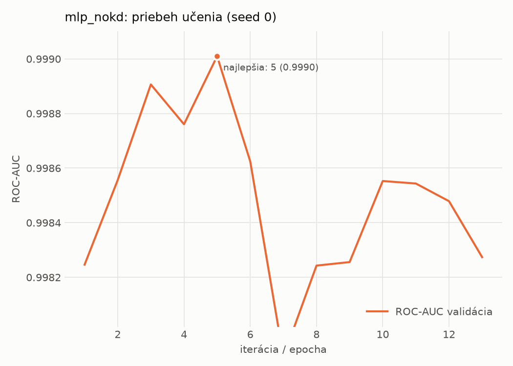

# static/mlp_nokd – beh `20261104-204423`

> Automaticky generované (`src/training/run_tabular.py`). Konfigurácia: `config.yaml`, protokol: `protocol.yaml`.

- **Model:** `mlp` – kontrola – rovnaké malé MLP bez destilácie (iba skutočné označenia)
- **Ladenie:** bez ladenia – hyperparametre prevzaté z `runs_final/students_static/mlp_nokd/20261102-211710`
- **Finálne modely:** seedy [0, 1, 2]; hodnoty sú priemer ± smerodajná odchýlka cez seedy
- **Najlepšie hyperparametre:** `{"hidden_layers": 1, "max_epochs": 100, "patience": 8, "hidden_width": 32, "dropout": 0.137657909519708, "lr": 0.0007042503153050794, "weight_decay": 1.207246112223234e-05, "batch_size": 512}`

## Detekčná kvalita (bez prahu)
| metrika | train (podvzorka) | validácia | test |
|---|---|---|---|
| ROC-AUC | 0.9999 ± 0.0001 | 0.9990 ± 0.0000 | 0.9973 ± 0.0002 |
| PR-AUC | 0.9999 ± 0.0000 | 0.9985 ± 0.0009 | 0.9951 ± 0.0008 |
| TPR pri FPR 1 % | 0.9984 ± 0.0017 | 0.9897 ± 0.0026 | 0.9647 ± 0.0056 |
| TPR pri FPR 0,1 % | 0.9775 ± 0.0113 | 0.9220 ± 0.0043 | 0.6682 ± 0.1068 |
| log loss | 0.0217 ± 0.0116 | 0.0360 ± 0.0075 | 0.0733 ± 0.0046 |
| Brier skóre | 0.0040 ± 0.0017 | 0.0077 ± 0.0008 | 0.0190 ± 0.0009 |

Rozdiel ROC-AUC train − validácia: **0.0009** (veľký rozdiel = preučenie).

## Pri prahu z validácie (FPR ≤ 1% na validácii)
| metrika | train (podvzorka) | validácia | test |
|---|---|---|---|
| accuracy | 0.9937 ± 0.0015 | 0.9901 ± 0.0013 | 0.9658 ± 0.0103 |
| balanced accuracy | 0.9943 ± 0.0016 | 0.9903 ± 0.0009 | 0.9679 ± 0.0094 |
| precision | 0.9979 ± 0.0016 | 0.9945 ± 0.0007 | 0.9939 ± 0.0026 |
| recall (TPR) | 0.9919 ± 0.0016 | 0.9897 ± 0.0026 | 0.9427 ± 0.0210 |
| FPR | 0.0034 ± 0.0026 | 0.0091 ± 0.0012 | 0.0069 ± 0.0030 |
| F1 | 0.9949 ± 0.0012 | 0.9921 ± 0.0010 | 0.9675 ± 0.0102 |
| MCC | 0.9867 ± 0.0031 | 0.9790 ± 0.0027 | 0.9330 ± 0.0192 |

## Pri pevnom prahu 0.5
| metrika | train (podvzorka) | validácia | test |
|---|---|---|---|
| accuracy | 0.9957 ± 0.0018 | 0.9916 ± 0.0012 | 0.9757 ± 0.0017 |
| balanced accuracy | 0.9955 ± 0.0019 | 0.9907 ± 0.0015 | 0.9769 ± 0.0017 |
| precision | 0.9967 ± 0.0016 | 0.9925 ± 0.0017 | 0.9920 ± 0.0019 |
| recall (TPR) | 0.9964 ± 0.0016 | 0.9941 ± 0.0001 | 0.9630 ± 0.0023 |
| FPR | 0.0054 ± 0.0026 | 0.0127 ± 0.0029 | 0.0092 ± 0.0021 |
| F1 | 0.9966 ± 0.0015 | 0.9933 ± 0.0009 | 0.9773 ± 0.0016 |
| MCC | 0.9909 ± 0.0038 | 0.9819 ± 0.0025 | 0.9517 ± 0.0034 |

## Výpočtové nároky (seed 0, testovacia množina)
| meranie | hodnota |
|---|---|
| tréning finálneho modelu | 2.2 s (priemer cez seedy) |
| ladenie spolu | 0 s |
| počet parametrov / uzlov | 74 305 |
| veľkosť modelu na disku | 0.36 MB |
| transformácia vstupu – latencia (1 vlákno) | 0.042 ms |
| transformácia vstupu – priepustnosť | 40 073 vzoriek/s |
| CPU latencia modelu (batch 1, 1 vlákno) | 0.070 ms (p95 0.077) |
| CPU priepustnosť (24 vlákien) | 60 901 vzoriek/s |
| GPU latencia (batch 1) | 0.274 ms (p95 0.319) |
| GPU priepustnosť | 80 132 vzoriek/s |
| GPU špičková pamäť | 1397 MB |

## Grafy
| | |
|---|---|
|  |  |
|  |  |
|  |  |
|  |  |

## Súbory
`metrics.json` (všetky metriky po seedoch vrátane rodín), `timing.json`, `hpo_trials.csv`,
`predictions/<časť>_seed<N>.parquet` (sha256, family, label, score), `model/seed_<N>/`, `log.txt`.
