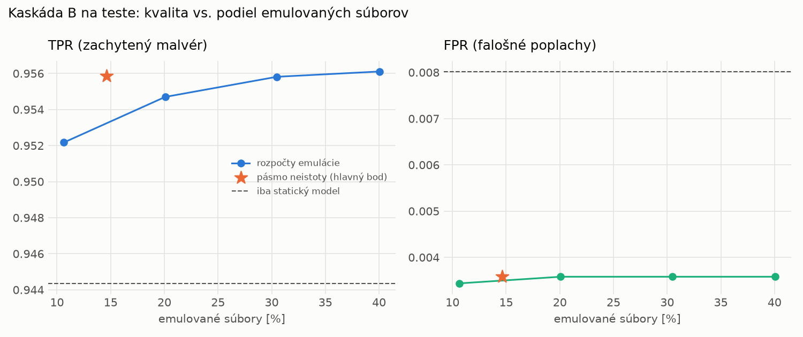

# Kaskáda B `b_baselines` – beh `20261123-211320`

> Generované `src/cascade/evaluate_b.py` (2026-11-23T21:13:21+01:00). Seedy: [0, 1, 2]; hodnoty = priemer ± sm. odchýlka.
> Všetky prahy a pásmo neistoty sú z validácie; test sa na nič nenastavuje. Postup: `docs/09_plan_v2.md`.

| rola | beh |
|---|---|
| static | `runs_v4/emu_p/full/static/lightgbm/20261122-231010` |
| dynamic | `runs_v4/emu_p/full/dynamic/lightgbm/20261123-191933` |
| hybrid | `runs_v4/emu_p/full/hybrid/lightgbm/20261123-195420` |

Druhý stupeň: **dynamic**. Pásmo neistoty statického modelu: FPR ≤ 0.1% nad `hi`,
najviac 1% malvéru validácie pod `lo` (seed 0: lo = 0.0015, hi = 0.9993, seed 1: lo = 0.0042, hi = 0.9983, seed 2: lo = 0.0063, hi = 0.9976).

## Test
| prístup | accuracy | balanced_accuracy | precision | recall_tpr | fpr | f1 | mcc |
|---|---|---|---|---|---|---|---|
| kaskáda B | 0.9782 ± 0.0003 | 0.9761 ± 0.0004 | 0.9954 ± 0.0003 | 0.9559 ± 0.0008 | 0.0036 ± 0.0002 | 0.9752 ± 0.0004 | 0.9565 ± 0.0006 |
| statický | 0.9706 ± 0.0015 | 0.9682 ± 0.0017 | 0.9897 ± 0.0011 | 0.9444 ± 0.0043 | 0.0080 ± 0.0009 | 0.9665 ± 0.0018 | 0.9412 ± 0.0028 |
| dynamický | 0.9230 ± 0.0008 | 0.9150 ± 0.0009 | 0.9884 ± 0.0004 | 0.8381 ± 0.0018 | 0.0080 ± 0.0003 | 0.9071 ± 0.0010 | 0.8505 ± 0.0014 |
| hybrid (každá vzorka) | 0.9802 ± 0.0001 | 0.9786 ± 0.0001 | 0.9924 ± 0.0002 | 0.9632 ± 0.0002 | 0.0060 ± 0.0001 | 0.9775 ± 0.0002 | 0.9601 ± 0.0003 |

- **emulované súbory: 14.62%** (ostatné rozhodne iba statický model); na hybrid ide 3.04% súborov
- chyby pri istom rozhodnutí statického modelu (seed 0): 51
- validácia: emulované 13.61%, na hybrid 3.12%

## Validácia
| prístup | accuracy | balanced_accuracy | precision | recall_tpr | fpr | f1 | mcc |
|---|---|---|---|---|---|---|---|
| kaskáda B | 0.9763 ± 0.0010 | 0.9744 ± 0.0012 | 0.9905 ± 0.0007 | 0.9563 ± 0.0027 | 0.0075 ± 0.0006 | 0.9731 ± 0.0012 | 0.9524 ± 0.0020 |
| statický | 0.9702 ± 0.0025 | 0.9679 ± 0.0028 | 0.9875 ± 0.0001 | 0.9456 ± 0.0056 | 0.0097 ± 0.0000 | 0.9661 ± 0.0030 | 0.9403 ± 0.0050 |
| dynamický | 0.9257 ± 0.0010 | 0.9182 ± 0.0011 | 0.9860 ± 0.0000 | 0.8462 ± 0.0022 | 0.0097 ± 0.0000 | 0.9108 ± 0.0013 | 0.8550 ± 0.0018 |
| hybrid (každá vzorka) | 0.9768 ± 0.0007 | 0.9753 ± 0.0008 | 0.9877 ± 0.0000 | 0.9603 ± 0.0017 | 0.0097 ± 0.0000 | 0.9738 ± 0.0009 | 0.9533 ± 0.0015 |

## Krivka rozpočtu emulácie (test, priemer cez seedy)
| budget_val | emulation_rate | hybrid_rate | recall_tpr | fpr | f1 |
|---|---|---|---|---|---|
| 0.1000 | 0.1064 | 0.0322 | 0.9522 | 0.0034 | 0.9734 |
| 0.2000 | 0.2008 | 0.0450 | 0.9547 | 0.0036 | 0.9746 |
| 0.3000 | 0.3048 | 0.0534 | 0.9558 | 0.0036 | 0.9752 |
| 0.4000 | 0.4006 | 0.0603 | 0.9561 | 0.0036 | 0.9754 |

## Výpočtové nároky
Čas dynamickej analýzy (beh v emulátore alebo na zariadení) dataset neuvádza, preto sa neodhaduje. Úspora kaskády B = podiel súborov s dynamickou analýzou: **14.62%** (ostatné prístupy 100 %).

| meranie | statický | dynamický | hybrid na každej vzorke | kaskáda B (odhad) |
|---|---|---|---|---|
| CPU čas ms/vz. (dávka) | 0.2006 | 0.6350 | 0.2267 | 0.3004 |
| CPU čas ms/vz. (1 vz.) | 0.1489 | 0.3773 | 0.1510 | 0.2087 |

