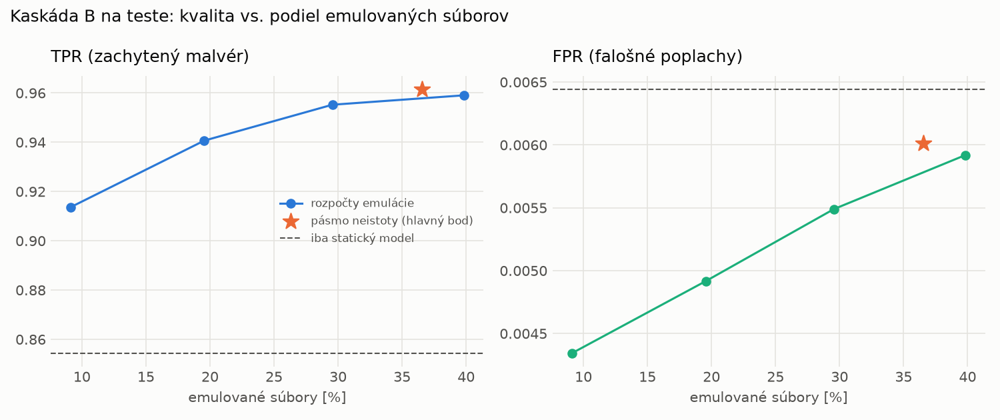

# Kaskáda B `b_direct` – beh `20261123-211317`

> Generované `src/cascade/evaluate_b.py` (2026-11-23T21:13:17+01:00). Seedy: [0, 1, 2]; hodnoty = priemer ± sm. odchýlka.
> Všetky prahy a pásmo neistoty sú z validácie; test sa na nič nenastavuje. Postup: `docs/09_plan_v2.md`.

| rola | beh |
|---|---|
| static | `runs_v4/emu_p/full/students_static/mlp_kd/20261123-203204` |
| hybrid | `runs_v4/emu_p/full/hybrid/lightgbm/20261123-195420` |

Druhý stupeň: **hybrid**. Pásmo neistoty statického modelu: FPR ≤ 0.1% nad `hi`,
najviac 1% malvéru validácie pod `lo` (seed 0: lo = 0.0071, hi = 0.9999, seed 1: lo = 0.0066, hi = 0.9998, seed 2: lo = 0.0073, hi = 0.9998).

## Test
| prístup | accuracy | balanced_accuracy | precision | recall_tpr | fpr | f1 | mcc |
|---|---|---|---|---|---|---|---|
| kaskáda B | 0.9795 ± 0.0004 | 0.9778 ± 0.0004 | 0.9924 ± 0.0000 | 0.9616 ± 0.0008 | 0.0060 ± 0.0000 | 0.9767 ± 0.0004 | 0.9587 ± 0.0007 |
| statický | 0.9312 ± 0.0031 | 0.9240 ± 0.0034 | 0.9908 ± 0.0011 | 0.8544 ± 0.0060 | 0.0064 ± 0.0007 | 0.9176 ± 0.0039 | 0.8660 ± 0.0059 |
| hybrid (každá vzorka) | 0.9802 ± 0.0001 | 0.9786 ± 0.0001 | 0.9924 ± 0.0002 | 0.9632 ± 0.0002 | 0.0060 ± 0.0001 | 0.9775 ± 0.0002 | 0.9601 ± 0.0003 |

- **emulované súbory: 36.53%** (ostatné rozhodne iba statický model); na hybrid ide 36.53% súborov
- chyby pri istom rozhodnutí statického modelu (seed 0): 59
- validácia: emulované 36.55%, na hybrid 36.55%

## Validácia
| prístup | accuracy | balanced_accuracy | precision | recall_tpr | fpr | f1 | mcc |
|---|---|---|---|---|---|---|---|
| kaskáda B | 0.9763 ± 0.0005 | 0.9748 ± 0.0005 | 0.9871 ± 0.0004 | 0.9598 ± 0.0013 | 0.0102 ± 0.0003 | 0.9732 ± 0.0005 | 0.9523 ± 0.0009 |
| statický | 0.9279 ± 0.0046 | 0.9207 ± 0.0051 | 0.9861 ± 0.0002 | 0.8511 ± 0.0102 | 0.0097 ± 0.0000 | 0.9136 ± 0.0059 | 0.8592 ± 0.0086 |
| hybrid (každá vzorka) | 0.9768 ± 0.0007 | 0.9753 ± 0.0008 | 0.9877 ± 0.0000 | 0.9603 ± 0.0017 | 0.0097 ± 0.0000 | 0.9738 ± 0.0009 | 0.9533 ± 0.0015 |

## Krivka rozpočtu emulácie (test, priemer cez seedy)
| budget_val | emulation_rate | hybrid_rate | recall_tpr | fpr | f1 |
|---|---|---|---|---|---|
| 0.1000 | 0.0911 | 0.0911 | 0.9136 | 0.0043 | 0.9522 |
| 0.2000 | 0.1955 | 0.1955 | 0.9407 | 0.0049 | 0.9664 |
| 0.3000 | 0.2955 | 0.2955 | 0.9552 | 0.0055 | 0.9737 |
| 0.4000 | 0.3982 | 0.3982 | 0.9590 | 0.0059 | 0.9755 |

## Výpočtové nároky
Čas dynamickej analýzy (beh v emulátore alebo na zariadení) dataset neuvádza, preto sa neodhaduje. Úspora kaskády B = podiel súborov s dynamickou analýzou: **36.53%** (ostatné prístupy 100 %).

| meranie | statický | hybrid na každej vzorke | kaskáda B (odhad) |
|---|---|---|---|
| CPU čas ms/vz. (dávka) | 0.0313 | 0.2267 | 0.1141 |
| CPU čas ms/vz. (1 vz.) | 0.1131 | 0.1510 | 0.1683 |

