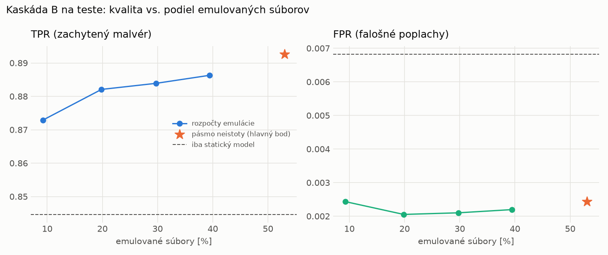

# Kaskáda B `b_heavyteacher` – beh `20261123-211324`

> Generované `src/cascade/evaluate_b.py` (2026-11-23T21:13:24+01:00). Seedy: [0, 1, 2]; hodnoty = priemer ± sm. odchýlka.
> Všetky prahy a pásmo neistoty sú z validácie; test sa na nič nenastavuje. Postup: `docs/09_plan_v2.md`.

| rola | beh |
|---|---|
| static | `runs_v4/emu_p/full/students_static/mlp_kd_heavy/20261123-204329` |
| dynamic | `runs_v4/emu_p/full/students_dynamic/mlp_kd_heavy/20261123-210504` |
| hybrid | `runs_v4/emu_p/full/hybrid/lightgbm/20261123-195420` |

Druhý stupeň: **dynamic**. Pásmo neistoty statického modelu: FPR ≤ 0.1% nad `hi`,
najviac 1% malvéru validácie pod `lo` (seed 0: lo = 0.0403, hi = 0.9980, seed 1: lo = 0.0414, hi = 0.9984, seed 2: lo = 0.0437, hi = 0.9975).

## Test
| prístup | accuracy | balanced_accuracy | precision | recall_tpr | fpr | f1 | mcc |
|---|---|---|---|---|---|---|---|
| kaskáda B | 0.9505 ± 0.0023 | 0.9451 ± 0.0026 | 0.9967 ± 0.0004 | 0.8926 ± 0.0056 | 0.0024 ± 0.0003 | 0.9418 ± 0.0029 | 0.9031 ± 0.0044 |
| statický | 0.9266 ± 0.0019 | 0.9189 ± 0.0022 | 0.9902 ± 0.0010 | 0.8446 ± 0.0049 | 0.0068 ± 0.0007 | 0.9116 ± 0.0025 | 0.8574 ± 0.0033 |
| dynamický | 0.8189 ± 0.0040 | 0.7990 ± 0.0045 | 0.9832 ± 0.0015 | 0.6063 ± 0.0097 | 0.0084 ± 0.0009 | 0.7501 ± 0.0071 | 0.6649 ± 0.0067 |
| hybrid (každá vzorka) | 0.9802 ± 0.0001 | 0.9786 ± 0.0001 | 0.9924 ± 0.0002 | 0.9632 ± 0.0002 | 0.0060 ± 0.0001 | 0.9775 ± 0.0002 | 0.9601 ± 0.0003 |

- **emulované súbory: 53.01%** (ostatné rozhodne iba statický model); na hybrid ide 13.25% súborov
- chyby pri istom rozhodnutí statického modelu (seed 0): 59
- validácia: emulované 52.91%, na hybrid 13.41%

## Validácia
| prístup | accuracy | balanced_accuracy | precision | recall_tpr | fpr | f1 | mcc |
|---|---|---|---|---|---|---|---|
| kaskáda B | 0.9474 ± 0.0015 | 0.9419 ± 0.0016 | 0.9928 ± 0.0008 | 0.8891 ± 0.0026 | 0.0053 ± 0.0006 | 0.9381 ± 0.0018 | 0.8967 ± 0.0029 |
| statický | 0.9222 ± 0.0014 | 0.9144 ± 0.0016 | 0.9859 ± 0.0001 | 0.8384 ± 0.0032 | 0.0097 ± 0.0000 | 0.9062 ± 0.0019 | 0.8485 ± 0.0026 |
| dynamický | 0.8209 ± 0.0046 | 0.8014 ± 0.0051 | 0.9808 ± 0.0003 | 0.6126 ± 0.0103 | 0.0097 ± 0.0000 | 0.7541 ± 0.0079 | 0.6677 ± 0.0080 |
| hybrid (každá vzorka) | 0.9768 ± 0.0007 | 0.9753 ± 0.0008 | 0.9877 ± 0.0000 | 0.9603 ± 0.0017 | 0.0097 ± 0.0000 | 0.9738 ± 0.0009 | 0.9533 ± 0.0015 |

## Krivka rozpočtu emulácie (test, priemer cez seedy)
| budget_val | emulation_rate | hybrid_rate | recall_tpr | fpr | f1 |
|---|---|---|---|---|---|
| 0.1000 | 0.0924 | 0.0438 | 0.8729 | 0.0024 | 0.9306 |
| 0.2000 | 0.1983 | 0.0781 | 0.8821 | 0.0021 | 0.9361 |
| 0.3000 | 0.2972 | 0.1025 | 0.8839 | 0.0021 | 0.9371 |
| 0.4000 | 0.3944 | 0.1274 | 0.8863 | 0.0022 | 0.9384 |

## Výpočtové nároky
Čas dynamickej analýzy (beh v emulátore alebo na zariadení) dataset neuvádza, preto sa neodhaduje. Úspora kaskády B = podiel súborov s dynamickou analýzou: **53.01%** (ostatné prístupy 100 %).

| meranie | statický | dynamický | hybrid na každej vzorke | kaskáda B (odhad) |
|---|---|---|---|---|
| CPU čas ms/vz. (dávka) | 0.0324 | 0.0331 | 0.2267 | 0.0800 |
| CPU čas ms/vz. (1 vz.) | 0.1083 | 0.1134 | 0.1510 | 0.1884 |

