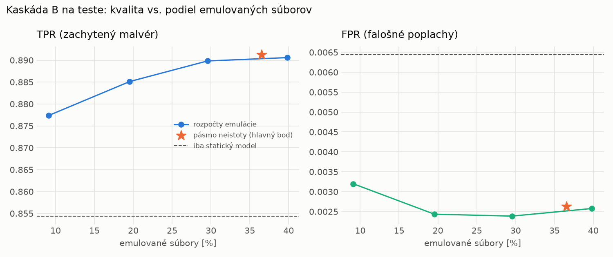

# Kaskáda B `b_main` – beh `20261123-211315`

> Generované `src/cascade/evaluate_b.py` (2026-11-23T21:13:15+01:00). Seedy: [0, 1, 2]; hodnoty = priemer ± sm. odchýlka.
> Všetky prahy a pásmo neistoty sú z validácie; test sa na nič nenastavuje. Postup: `docs/09_plan_v2.md`.

| rola | beh |
|---|---|
| static | `runs_v4/emu_p/full/students_static/mlp_kd/20261123-203204` |
| dynamic | `runs_v4/emu_p/full/students_dynamic/mlp_kd/20261123-204643` |
| hybrid | `runs_v4/emu_p/full/hybrid/lightgbm/20261123-195420` |

Druhý stupeň: **dynamic**. Pásmo neistoty statického modelu: FPR ≤ 0.1% nad `hi`,
najviac 1% malvéru validácie pod `lo` (seed 0: lo = 0.0071, hi = 0.9999, seed 1: lo = 0.0066, hi = 0.9998, seed 2: lo = 0.0073, hi = 0.9998).

## Test
| prístup | accuracy | balanced_accuracy | precision | recall_tpr | fpr | f1 | mcc |
|---|---|---|---|---|---|---|---|
| kaskáda B | 0.9498 ± 0.0007 | 0.9443 ± 0.0008 | 0.9964 ± 0.0001 | 0.8913 ± 0.0015 | 0.0026 ± 0.0001 | 0.9409 ± 0.0009 | 0.9018 ± 0.0013 |
| statický | 0.9312 ± 0.0031 | 0.9240 ± 0.0034 | 0.9908 ± 0.0011 | 0.8544 ± 0.0060 | 0.0064 ± 0.0007 | 0.9176 ± 0.0039 | 0.8660 ± 0.0059 |
| dynamický | 0.8170 ± 0.0032 | 0.7968 ± 0.0035 | 0.9830 ± 0.0009 | 0.6020 ± 0.0066 | 0.0084 ± 0.0004 | 0.7467 ± 0.0053 | 0.6615 ± 0.0057 |
| hybrid (každá vzorka) | 0.9802 ± 0.0001 | 0.9786 ± 0.0001 | 0.9924 ± 0.0002 | 0.9632 ± 0.0002 | 0.0060 ± 0.0001 | 0.9775 ± 0.0002 | 0.9601 ± 0.0003 |

- **emulované súbory: 36.53%** (ostatné rozhodne iba statický model); na hybrid ide 9.33% súborov
- chyby pri istom rozhodnutí statického modelu (seed 0): 59
- validácia: emulované 36.55%, na hybrid 9.91%

## Validácia
| prístup | accuracy | balanced_accuracy | precision | recall_tpr | fpr | f1 | mcc |
|---|---|---|---|---|---|---|---|
| kaskáda B | 0.9487 ± 0.0011 | 0.9434 ± 0.0011 | 0.9919 ± 0.0005 | 0.8928 ± 0.0020 | 0.0059 ± 0.0003 | 0.9397 ± 0.0013 | 0.8990 ± 0.0021 |
| statický | 0.9279 ± 0.0046 | 0.9207 ± 0.0051 | 0.9861 ± 0.0002 | 0.8511 ± 0.0102 | 0.0097 ± 0.0000 | 0.9136 ± 0.0059 | 0.8592 ± 0.0086 |
| dynamický | 0.8204 ± 0.0031 | 0.8008 ± 0.0034 | 0.9808 ± 0.0002 | 0.6114 ± 0.0068 | 0.0097 ± 0.0000 | 0.7532 ± 0.0052 | 0.6668 ± 0.0053 |
| hybrid (každá vzorka) | 0.9768 ± 0.0007 | 0.9753 ± 0.0008 | 0.9877 ± 0.0000 | 0.9603 ± 0.0017 | 0.0097 ± 0.0000 | 0.9738 ± 0.0009 | 0.9533 ± 0.0015 |

## Krivka rozpočtu emulácie (test, priemer cez seedy)
| budget_val | emulation_rate | hybrid_rate | recall_tpr | fpr | f1 |
|---|---|---|---|---|---|
| 0.1000 | 0.0911 | 0.0421 | 0.8774 | 0.0032 | 0.9327 |
| 0.2000 | 0.1955 | 0.0743 | 0.8851 | 0.0024 | 0.9376 |
| 0.3000 | 0.2955 | 0.1028 | 0.8898 | 0.0024 | 0.9402 |
| 0.4000 | 0.3982 | 0.1219 | 0.8906 | 0.0026 | 0.9406 |

## Výpočtové nároky
Čas dynamickej analýzy (beh v emulátore alebo na zariadení) dataset neuvádza, preto sa neodhaduje. Úspora kaskády B = podiel súborov s dynamickou analýzou: **36.53%** (ostatné prístupy 100 %).

| meranie | statický | dynamický | hybrid na každej vzorke | kaskáda B (odhad) |
|---|---|---|---|---|
| CPU čas ms/vz. (dávka) | 0.0313 | 0.0332 | 0.2267 | 0.0646 |
| CPU čas ms/vz. (1 vz.) | 0.1131 | 0.1138 | 0.1510 | 0.1688 |

