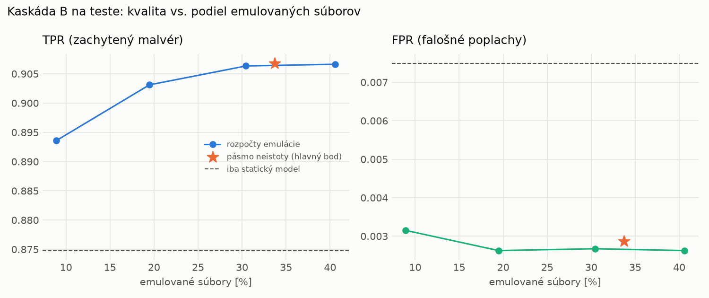

# Kaskáda B `b_nokd` – beh `20261123-211322`

> Generované `src/cascade/evaluate_b.py` (2026-11-23T21:13:23+01:00). Seedy: [0, 1, 2]; hodnoty = priemer ± sm. odchýlka.
> Všetky prahy a pásmo neistoty sú z validácie; test sa na nič nenastavuje. Postup: `docs/09_plan_v2.md`.

| rola | beh |
|---|---|
| static | `runs_v4/emu_p/full/students_static/mlp_nokd/20261123-203547` |
| dynamic | `runs_v4/emu_p/full/students_dynamic/mlp_nokd/20261123-205230` |
| hybrid | `runs_v4/emu_p/full/hybrid/lightgbm/20261123-195420` |

Druhý stupeň: **dynamic**. Pásmo neistoty statického modelu: FPR ≤ 0.1% nad `hi`,
najviac 1% malvéru validácie pod `lo` (seed 0: lo = 0.0306, hi = 0.9992, seed 1: lo = 0.0277, hi = 0.9973, seed 2: lo = 0.0314, hi = 0.9970).

## Test
| prístup | accuracy | balanced_accuracy | precision | recall_tpr | fpr | f1 | mcc |
|---|---|---|---|---|---|---|---|
| kaskáda B | 0.9566 ± 0.0012 | 0.9520 ± 0.0013 | 0.9961 ± 0.0006 | 0.9068 ± 0.0025 | 0.0029 ± 0.0004 | 0.9494 ± 0.0014 | 0.9147 ± 0.0023 |
| statický | 0.9397 ± 0.0013 | 0.9336 ± 0.0014 | 0.9896 ± 0.0009 | 0.8748 ± 0.0033 | 0.0075 ± 0.0007 | 0.9286 ± 0.0016 | 0.8818 ± 0.0023 |
| dynamický | 0.8262 ± 0.0020 | 0.8070 ± 0.0024 | 0.9843 ± 0.0031 | 0.6221 ± 0.0061 | 0.0081 ± 0.0017 | 0.7624 ± 0.0038 | 0.6777 ± 0.0029 |
| hybrid (každá vzorka) | 0.9802 ± 0.0001 | 0.9786 ± 0.0001 | 0.9924 ± 0.0002 | 0.9632 ± 0.0002 | 0.0060 ± 0.0001 | 0.9775 ± 0.0002 | 0.9601 ± 0.0003 |

- **emulované súbory: 33.69%** (ostatné rozhodne iba statický model); na hybrid ide 7.31% súborov
- chyby pri istom rozhodnutí statického modelu (seed 0): 47
- validácia: emulované 33.38%, na hybrid 7.78%

## Validácia
| prístup | accuracy | balanced_accuracy | precision | recall_tpr | fpr | f1 | mcc |
|---|---|---|---|---|---|---|---|
| kaskáda B | 0.9561 ± 0.0022 | 0.9516 ± 0.0025 | 0.9933 ± 0.0002 | 0.9082 ± 0.0051 | 0.0050 ± 0.0002 | 0.9488 ± 0.0028 | 0.9133 ± 0.0043 |
| statický | 0.9353 ± 0.0044 | 0.9290 ± 0.0049 | 0.9864 ± 0.0002 | 0.8677 ± 0.0097 | 0.0097 ± 0.0000 | 0.9232 ± 0.0056 | 0.8731 ± 0.0082 |
| dynamický | 0.8310 ± 0.0050 | 0.8126 ± 0.0056 | 0.9815 ± 0.0003 | 0.6350 ± 0.0111 | 0.0097 ± 0.0000 | 0.7711 ± 0.0083 | 0.6853 ± 0.0087 |
| hybrid (každá vzorka) | 0.9768 ± 0.0007 | 0.9753 ± 0.0008 | 0.9877 ± 0.0000 | 0.9603 ± 0.0017 | 0.0097 ± 0.0000 | 0.9738 ± 0.0009 | 0.9533 ± 0.0015 |

## Krivka rozpočtu emulácie (test, priemer cez seedy)
| budget_val | emulation_rate | hybrid_rate | recall_tpr | fpr | f1 |
|---|---|---|---|---|---|
| 0.1000 | 0.0891 | 0.0402 | 0.8936 | 0.0032 | 0.9419 |
| 0.2000 | 0.1948 | 0.0682 | 0.9031 | 0.0026 | 0.9475 |
| 0.3000 | 0.3044 | 0.0825 | 0.9063 | 0.0027 | 0.9492 |
| 0.4000 | 0.4059 | 0.0945 | 0.9066 | 0.0026 | 0.9494 |

## Výpočtové nároky
Čas dynamickej analýzy (beh v emulátore alebo na zariadení) dataset neuvádza, preto sa neodhaduje. Úspora kaskády B = podiel súborov s dynamickou analýzou: **33.69%** (ostatné prístupy 100 %).

| meranie | statický | dynamický | hybrid na každej vzorke | kaskáda B (odhad) |
|---|---|---|---|---|
| CPU čas ms/vz. (dávka) | 0.0353 | 0.0330 | 0.2267 | 0.0630 |
| CPU čas ms/vz. (1 vz.) | 0.1109 | 0.1168 | 0.1510 | 0.1613 |

