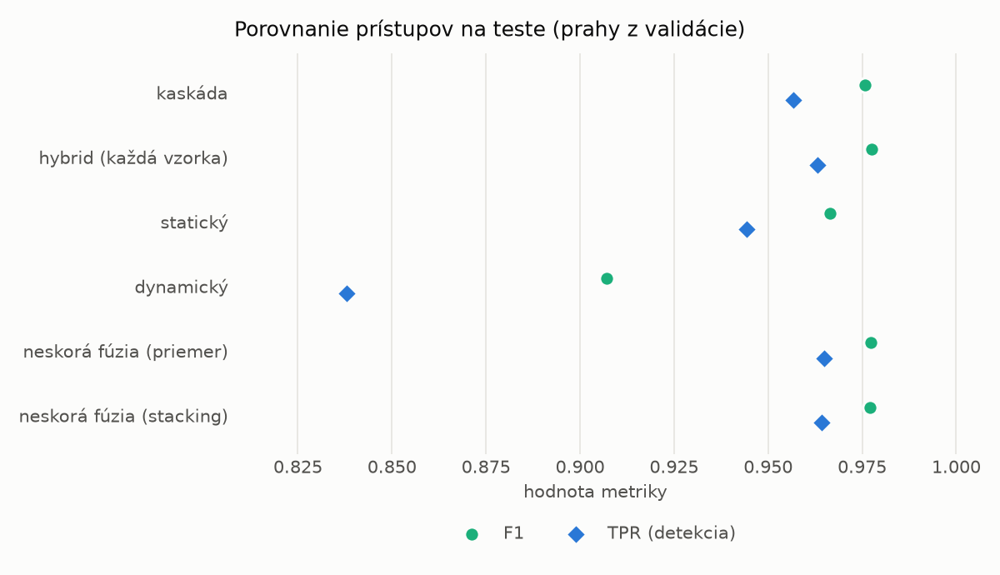
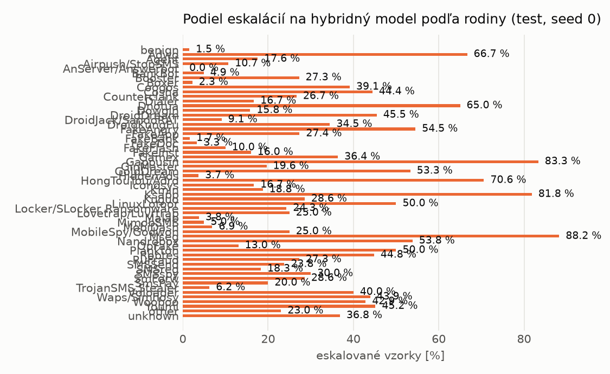

# Kaskáda `baselines` – beh `20261123-211311`

> Generované `src/cascade/evaluate.py` (2026-11-23T21:13:11+01:00). Seedy: [0, 1, 2]; hodnoty = priemer ± sm. odchýlka.
> Všetky prahy sú určené na validácii (FPR ≤ 1 %); test sa na nič nenastavuje.

| rola | beh |
|---|---|
| static | `runs_v4/emu_p/full/static/lightgbm/20261122-231010` |
| dynamic | `runs_v4/emu_p/full/dynamic/lightgbm/20261123-191933` |
| hybrid | `runs_v4/emu_p/full/hybrid/lightgbm/20261123-195420` |

## Test
| prístup | accuracy | balanced_accuracy | precision | recall_tpr | fpr | f1 | mcc |
|---|---|---|---|---|---|---|---|
| kaskáda | 0.9786 ± 0.0003 | 0.9766 ± 0.0004 | 0.9954 ± 0.0003 | 0.9567 ± 0.0009 | 0.0036 ± 0.0002 | 0.9757 ± 0.0004 | 0.9572 ± 0.0006 |
| hybrid (každá vzorka) | 0.9802 ± 0.0001 | 0.9786 ± 0.0001 | 0.9924 ± 0.0002 | 0.9632 ± 0.0002 | 0.0060 ± 0.0001 | 0.9775 ± 0.0002 | 0.9601 ± 0.0003 |
| statický | 0.9706 ± 0.0015 | 0.9682 ± 0.0017 | 0.9897 ± 0.0011 | 0.9444 ± 0.0043 | 0.0080 ± 0.0009 | 0.9665 ± 0.0018 | 0.9412 ± 0.0028 |
| dynamický | 0.9230 ± 0.0008 | 0.9150 ± 0.0009 | 0.9884 ± 0.0004 | 0.8381 ± 0.0018 | 0.0080 ± 0.0003 | 0.9071 ± 0.0010 | 0.8505 ± 0.0014 |
| neskorá fúzia (priemer) | 0.9799 ± 0.0003 | 0.9785 ± 0.0004 | 0.9900 ± 0.0001 | 0.9649 ± 0.0007 | 0.0079 ± 0.0001 | 0.9773 ± 0.0004 | 0.9595 ± 0.0006 |
| neskorá fúzia (stacking) | 0.9798 ± 0.0002 | 0.9783 ± 0.0003 | 0.9905 ± 0.0006 | 0.9642 ± 0.0010 | 0.0075 ± 0.0005 | 0.9772 ± 0.0002 | 0.9593 ± 0.0003 |

## Validácia
| prístup | accuracy | balanced_accuracy | precision | recall_tpr | fpr | f1 | mcc |
|---|---|---|---|---|---|---|---|
| kaskáda | 0.9764 ± 0.0010 | 0.9745 ± 0.0012 | 0.9909 ± 0.0007 | 0.9563 ± 0.0027 | 0.0072 ± 0.0006 | 0.9733 ± 0.0012 | 0.9527 ± 0.0020 |
| hybrid (každá vzorka) | 0.9768 ± 0.0007 | 0.9753 ± 0.0008 | 0.9877 ± 0.0000 | 0.9603 ± 0.0017 | 0.0097 ± 0.0000 | 0.9738 ± 0.0009 | 0.9533 ± 0.0015 |
| statický | 0.9702 ± 0.0025 | 0.9679 ± 0.0028 | 0.9875 ± 0.0001 | 0.9456 ± 0.0056 | 0.0097 ± 0.0000 | 0.9661 ± 0.0030 | 0.9403 ± 0.0050 |
| dynamický | 0.9257 ± 0.0010 | 0.9182 ± 0.0011 | 0.9860 ± 0.0000 | 0.8462 ± 0.0022 | 0.0097 ± 0.0000 | 0.9108 ± 0.0013 | 0.8550 ± 0.0018 |
| neskorá fúzia (priemer) | 0.9819 ± 0.0006 | 0.9809 ± 0.0007 | 0.9880 ± 0.0002 | 0.9714 ± 0.0014 | 0.0096 ± 0.0002 | 0.9797 ± 0.0007 | 0.9635 ± 0.0013 |
| neskorá fúzia (stacking) | 0.9814 ± 0.0008 | 0.9804 ± 0.0009 | 0.9879 ± 0.0002 | 0.9704 ± 0.0018 | 0.0096 ± 0.0002 | 0.9791 ± 0.0009 | 0.9624 ± 0.0016 |

## Správanie kaskády (test, seed 0)
- podiel eskalácií na hybrid: **7.82%** (990 vzoriek)
- chyby pri zhode študentov (kaskáda ich nemôže opraviť): **173**
  (1.483% zo zhôd; FP 5, FN 168)
- úspešnosť na eskalovaných vzorkách: hybrid 0.906060606060606, statický 0.8181818181818182,
  dynamický 0.18181818181818182  → prínos hybridu pri nezhode

## Výpočtové nároky (odhad z benchmarkov komponentov)
| meranie | statický | dynamický | hybrid na každej vzorke | neskorá fúzia | kaskáda (odhad) |
|---|---|---|---|---|---|
| CPU čas ms/vz. (dávka) | 0.2006 | 0.6350 | 0.2267 | 0.8356 | 0.8532 |
| CPU čas ms/vz. (1 vz.) | 0.1489 | 0.3773 | 0.1510 | 0.5262 | 0.5379 |
| latencia ms (1 vz., postupne) | 0.1485 | 0.3764 | 0.1519 | 0.5249 | 0.5367 |

