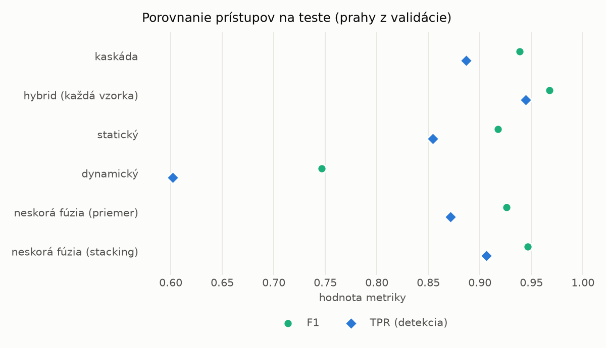
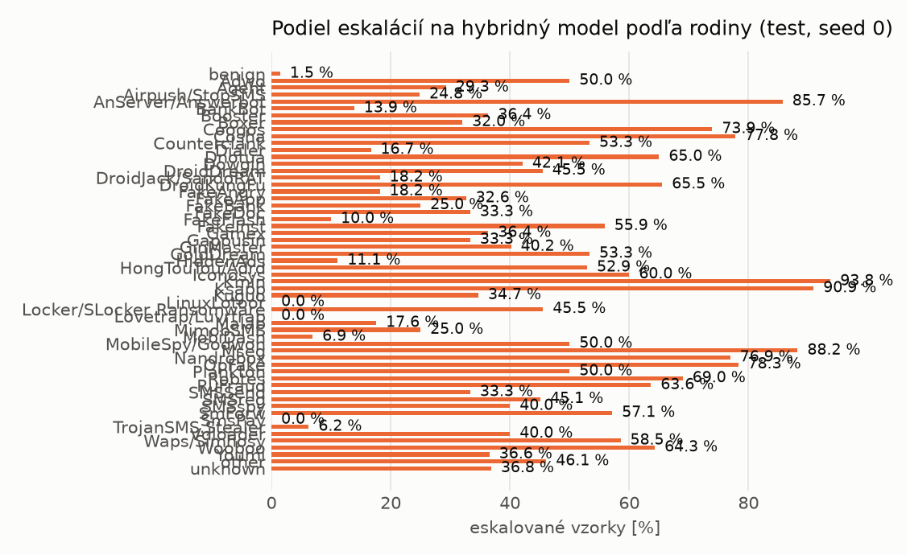

# Kaskáda `heavy` – beh `20261123-211309`

> Generované `src/cascade/evaluate.py` (2026-11-23T21:13:09+01:00). Seedy: [0, 1, 2]; hodnoty = priemer ± sm. odchýlka.
> Všetky prahy sú určené na validácii (FPR ≤ 1 %); test sa na nič nenastavuje.

| rola | beh |
|---|---|
| static | `runs_v4/emu_p/full/students_static/mlp_kd/20261123-203204` |
| dynamic | `runs_v4/emu_p/full/students_dynamic/mlp_kd/20261123-204643` |
| hybrid | `runs_v4/emu_p/full/hybrid/mlp_large/20261123-200933` |

## Test
| prístup | accuracy | balanced_accuracy | precision | recall_tpr | fpr | f1 | mcc |
|---|---|---|---|---|---|---|---|
| kaskáda | 0.9479 ± 0.0008 | 0.9421 ± 0.0009 | 0.9964 ± 0.0001 | 0.8869 ± 0.0017 | 0.0026 ± 0.0001 | 0.9384 ± 0.0010 | 0.8980 ± 0.0016 |
| hybrid (každá vzorka) | 0.9716 ± 0.0005 | 0.9691 ± 0.0005 | 0.9919 ± 0.0003 | 0.9445 ± 0.0011 | 0.0063 ± 0.0002 | 0.9676 ± 0.0006 | 0.9433 ± 0.0010 |
| statický | 0.9312 ± 0.0031 | 0.9240 ± 0.0034 | 0.9908 ± 0.0011 | 0.8544 ± 0.0060 | 0.0064 ± 0.0007 | 0.9176 ± 0.0039 | 0.8660 ± 0.0059 |
| dynamický | 0.8170 ± 0.0032 | 0.7968 ± 0.0035 | 0.9830 ± 0.0009 | 0.6020 ± 0.0066 | 0.0084 ± 0.0004 | 0.7467 ± 0.0053 | 0.6615 ± 0.0057 |
| neskorá fúzia (priemer) | 0.9373 ± 0.0035 | 0.9311 ± 0.0040 | 0.9875 ± 0.0014 | 0.8713 ± 0.0089 | 0.0090 ± 0.0011 | 0.9257 ± 0.0046 | 0.8770 ± 0.0065 |
| neskorá fúzia (stacking) | 0.9540 ± 0.0021 | 0.9495 ± 0.0024 | 0.9904 ± 0.0013 | 0.9061 ± 0.0056 | 0.0071 ± 0.0010 | 0.9464 ± 0.0026 | 0.9090 ± 0.0038 |

## Validácia
| prístup | accuracy | balanced_accuracy | precision | recall_tpr | fpr | f1 | mcc |
|---|---|---|---|---|---|---|---|
| kaskáda | 0.9464 ± 0.0010 | 0.9409 ± 0.0010 | 0.9920 ± 0.0008 | 0.8877 ± 0.0017 | 0.0058 ± 0.0006 | 0.9370 ± 0.0012 | 0.8948 ± 0.0019 |
| hybrid (každá vzorka) | 0.9690 ± 0.0007 | 0.9665 ± 0.0007 | 0.9874 ± 0.0000 | 0.9427 ± 0.0015 | 0.0097 ± 0.0000 | 0.9646 ± 0.0008 | 0.9378 ± 0.0013 |
| statický | 0.9279 ± 0.0046 | 0.9207 ± 0.0051 | 0.9861 ± 0.0002 | 0.8511 ± 0.0102 | 0.0097 ± 0.0000 | 0.9136 ± 0.0059 | 0.8592 ± 0.0086 |
| dynamický | 0.8204 ± 0.0031 | 0.8008 ± 0.0034 | 0.9808 ± 0.0002 | 0.6114 ± 0.0068 | 0.0097 ± 0.0000 | 0.7532 ± 0.0052 | 0.6668 ± 0.0053 |
| neskorá fúzia (priemer) | 0.9406 ± 0.0025 | 0.9349 ± 0.0028 | 0.9865 ± 0.0001 | 0.8796 ± 0.0057 | 0.0097 ± 0.0000 | 0.9300 ± 0.0032 | 0.8831 ± 0.0048 |
| neskorá fúzia (stacking) | 0.9532 ± 0.0031 | 0.9490 ± 0.0034 | 0.9871 ± 0.0001 | 0.9076 ± 0.0070 | 0.0096 ± 0.0002 | 0.9457 ± 0.0038 | 0.9072 ± 0.0059 |

## Správanie kaskády (test, seed 0)
- podiel eskalácií na hybrid: **16.09%** (2036 vzoriek)
- chyby pri zhode študentov (kaskáda ich nemôže opraviť): **575**
  (5.414% zo zhôd; FP 0, FN 575)
- úspešnosť na eskalovaných vzorkách: hybrid 0.9607072691552063, statický 0.8698428290766208,
  dynamický 0.13015717092337917  → prínos hybridu pri nezhode

## Výpočtové nároky (odhad z benchmarkov komponentov)
| meranie | statický | dynamický | hybrid na každej vzorke | neskorá fúzia | kaskáda (odhad) |
|---|---|---|---|---|---|
| CPU čas ms/vz. (dávka) | 0.0313 | 0.0332 | 0.1076 | 0.0645 | 0.0816 |
| CPU čas ms/vz. (1 vz.) | 0.1131 | 0.1138 | 0.3154 | 0.2269 | 0.2772 |
| latencia ms (1 vz., postupne) | 0.0624 | 0.0632 | 0.1790 | 0.1256 | 0.1542 |

