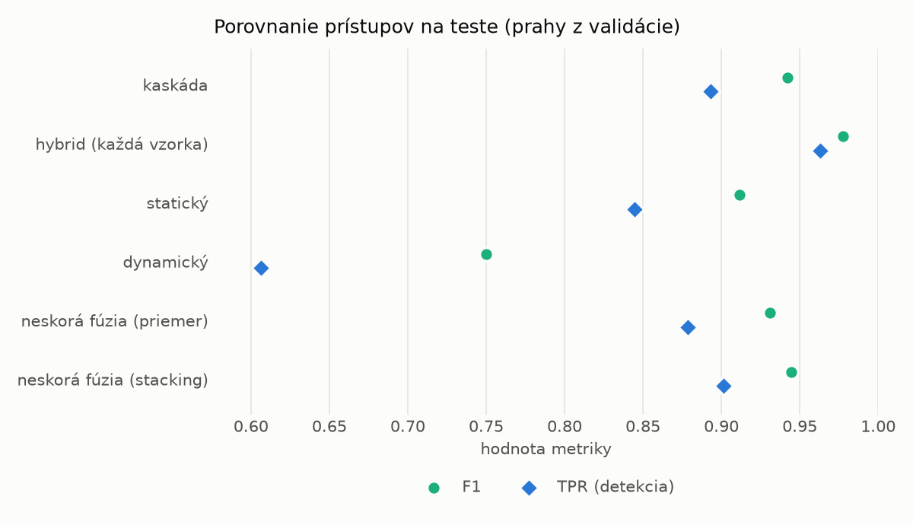
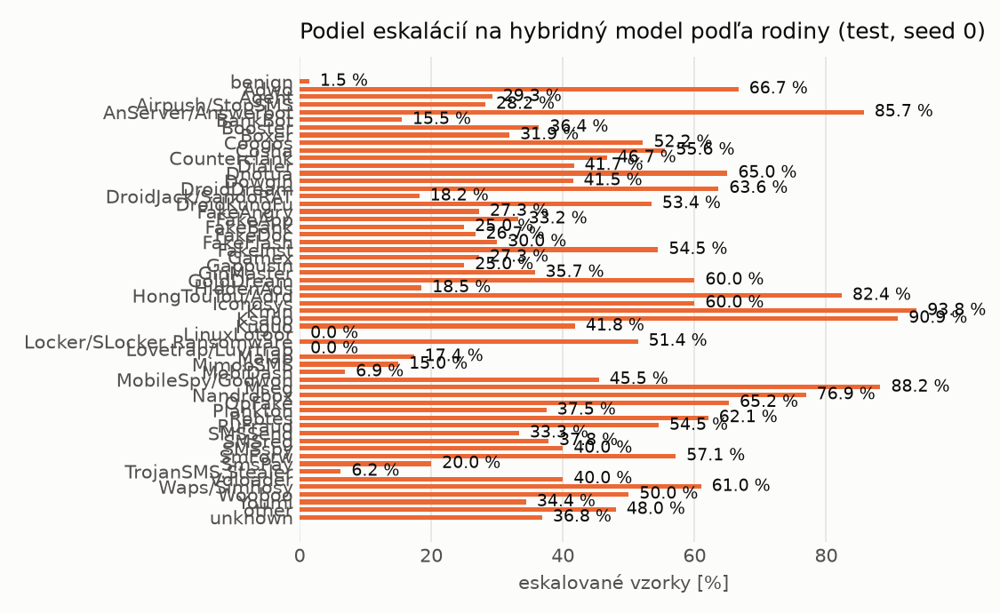

# Kaskáda `heavyteacher` – beh `20261123-211313`

> Generované `src/cascade/evaluate.py` (2026-11-23T21:13:14+01:00). Seedy: [0, 1, 2]; hodnoty = priemer ± sm. odchýlka.
> Všetky prahy sú určené na validácii (FPR ≤ 1 %); test sa na nič nenastavuje.

| rola | beh |
|---|---|
| static | `runs_v4/emu_p/full/students_static/mlp_kd_heavy/20261123-204329` |
| dynamic | `runs_v4/emu_p/full/students_dynamic/mlp_kd_heavy/20261123-210504` |
| hybrid | `runs_v4/emu_p/full/hybrid/lightgbm/20261123-195420` |

## Test
| prístup | accuracy | balanced_accuracy | precision | recall_tpr | fpr | f1 | mcc |
|---|---|---|---|---|---|---|---|
| kaskáda | 0.9509 ± 0.0021 | 0.9455 ± 0.0024 | 0.9969 ± 0.0005 | 0.8932 ± 0.0051 | 0.0023 ± 0.0004 | 0.9422 ± 0.0026 | 0.9038 ± 0.0039 |
| hybrid (každá vzorka) | 0.9802 ± 0.0001 | 0.9786 ± 0.0001 | 0.9924 ± 0.0002 | 0.9632 ± 0.0002 | 0.0060 ± 0.0001 | 0.9775 ± 0.0002 | 0.9601 ± 0.0003 |
| statický | 0.9266 ± 0.0019 | 0.9189 ± 0.0022 | 0.9902 ± 0.0010 | 0.8446 ± 0.0049 | 0.0068 ± 0.0007 | 0.9116 ± 0.0025 | 0.8574 ± 0.0033 |
| dynamický | 0.8189 ± 0.0040 | 0.7990 ± 0.0045 | 0.9832 ± 0.0015 | 0.6063 ± 0.0097 | 0.0084 ± 0.0009 | 0.7501 ± 0.0071 | 0.6649 ± 0.0067 |
| neskorá fúzia (priemer) | 0.9416 ± 0.0023 | 0.9356 ± 0.0026 | 0.9901 ± 0.0002 | 0.8784 ± 0.0051 | 0.0071 ± 0.0002 | 0.9309 ± 0.0029 | 0.8853 ± 0.0044 |
| neskorá fúzia (stacking) | 0.9527 ± 0.0004 | 0.9480 ± 0.0005 | 0.9923 ± 0.0004 | 0.9016 ± 0.0010 | 0.0057 ± 0.0003 | 0.9448 ± 0.0005 | 0.9068 ± 0.0008 |

## Validácia
| prístup | accuracy | balanced_accuracy | precision | recall_tpr | fpr | f1 | mcc |
|---|---|---|---|---|---|---|---|
| kaskáda | 0.9478 ± 0.0014 | 0.9423 ± 0.0015 | 0.9934 ± 0.0009 | 0.8895 ± 0.0022 | 0.0048 ± 0.0007 | 0.9386 ± 0.0017 | 0.8976 ± 0.0027 |
| hybrid (každá vzorka) | 0.9768 ± 0.0007 | 0.9753 ± 0.0008 | 0.9877 ± 0.0000 | 0.9603 ± 0.0017 | 0.0097 ± 0.0000 | 0.9738 ± 0.0009 | 0.9533 ± 0.0015 |
| statický | 0.9222 ± 0.0014 | 0.9144 ± 0.0016 | 0.9859 ± 0.0001 | 0.8384 ± 0.0032 | 0.0097 ± 0.0000 | 0.9062 ± 0.0019 | 0.8485 ± 0.0026 |
| dynamický | 0.8209 ± 0.0046 | 0.8014 ± 0.0051 | 0.9808 ± 0.0003 | 0.6126 ± 0.0103 | 0.0097 ± 0.0000 | 0.7541 ± 0.0079 | 0.6677 ± 0.0080 |
| neskorá fúzia (priemer) | 0.9409 ± 0.0020 | 0.9352 ± 0.0022 | 0.9867 ± 0.0003 | 0.8801 ± 0.0043 | 0.0096 ± 0.0002 | 0.9303 ± 0.0025 | 0.8837 ± 0.0038 |
| neskorá fúzia (stacking) | 0.9479 ± 0.0005 | 0.9430 ± 0.0005 | 0.9868 ± 0.0000 | 0.8957 ± 0.0010 | 0.0097 ± 0.0000 | 0.9390 ± 0.0006 | 0.8969 ± 0.0009 |

## Správanie kaskády (test, seed 0)
- podiel eskalácií na hybrid: **16.42%** (2078 vzoriek)
- chyby pri zhode študentov (kaskáda ich nemôže opraviť): **598**
  (5.653% zo zhôd; FP 0, FN 598)
- úspešnosť na eskalovaných vzorkách: hybrid 0.9783445620789221, statický 0.8325312800769971,
  dynamický 0.16746871992300288  → prínos hybridu pri nezhode

## Výpočtové nároky (odhad z benchmarkov komponentov)
| meranie | statický | dynamický | hybrid na každej vzorke | neskorá fúzia | kaskáda (odhad) |
|---|---|---|---|---|---|
| CPU čas ms/vz. (dávka) | 0.0324 | 0.0331 | 0.2267 | 0.0655 | 0.1027 |
| CPU čas ms/vz. (1 vz.) | 0.1083 | 0.1134 | 0.1510 | 0.2217 | 0.2465 |
| latencia ms (1 vz., postupne) | 0.0615 | 0.0618 | 0.1519 | 0.1233 | 0.1482 |

