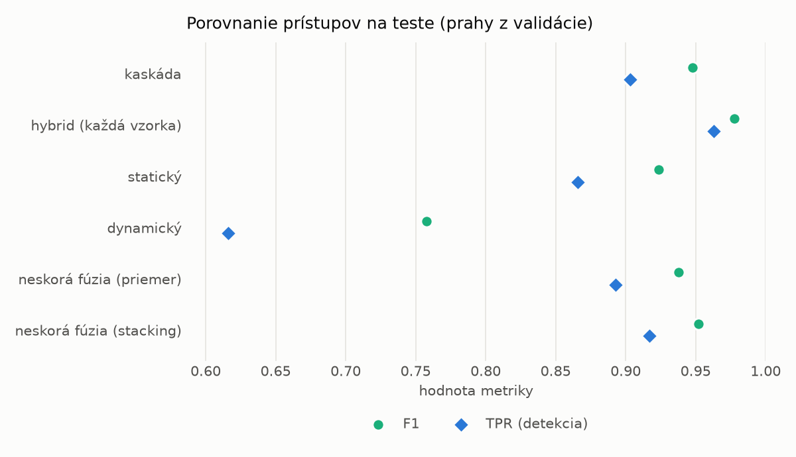
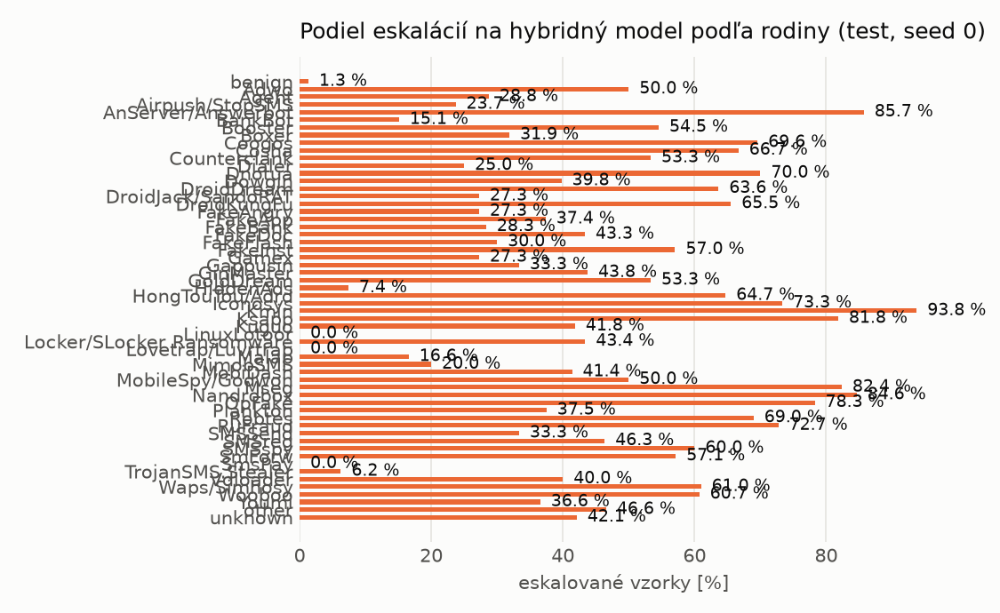

# Kaskáda `modal` – beh `20261123-211307`

> Generované `src/cascade/evaluate.py` (2026-11-23T21:13:07+01:00). Seedy: [0, 1, 2]; hodnoty = priemer ± sm. odchýlka.
> Všetky prahy sú určené na validácii (FPR ≤ 1 %); test sa na nič nenastavuje.

| rola | beh |
|---|---|
| static | `runs_v4/emu_p/full/students_static/mlp_kd_modal/20261123-203932` |
| dynamic | `runs_v4/emu_p/full/students_dynamic/mlp_kd_modal/20261123-210004` |
| hybrid | `runs_v4/emu_p/full/hybrid/lightgbm/20261123-195420` |

## Test
| prístup | accuracy | balanced_accuracy | precision | recall_tpr | fpr | f1 | mcc |
|---|---|---|---|---|---|---|---|
| kaskáda | 0.9553 ± 0.0010 | 0.9504 ± 0.0012 | 0.9968 ± 0.0002 | 0.9031 ± 0.0025 | 0.0023 ± 0.0002 | 0.9477 ± 0.0013 | 0.9122 ± 0.0019 |
| hybrid (každá vzorka) | 0.9802 ± 0.0001 | 0.9786 ± 0.0001 | 0.9924 ± 0.0002 | 0.9632 ± 0.0002 | 0.0060 ± 0.0001 | 0.9775 ± 0.0002 | 0.9601 ± 0.0003 |
| statický | 0.9360 ± 0.0028 | 0.9294 ± 0.0031 | 0.9903 ± 0.0003 | 0.8657 ± 0.0063 | 0.0069 ± 0.0002 | 0.9238 ± 0.0036 | 0.8749 ± 0.0052 |
| dynamický | 0.8234 ± 0.0068 | 0.8040 ± 0.0078 | 0.9838 ± 0.0029 | 0.6163 ± 0.0174 | 0.0083 ± 0.0017 | 0.7577 ± 0.0122 | 0.6729 ± 0.0109 |
| neskorá fúzia (priemer) | 0.9470 ± 0.0043 | 0.9419 ± 0.0049 | 0.9879 ± 0.0014 | 0.8928 ± 0.0105 | 0.0089 ± 0.0011 | 0.9379 ± 0.0054 | 0.8954 ± 0.0081 |
| neskorá fúzia (stacking) | 0.9586 ± 0.0013 | 0.9547 ± 0.0015 | 0.9899 ± 0.0017 | 0.9170 ± 0.0039 | 0.0076 ± 0.0013 | 0.9521 ± 0.0016 | 0.9178 ± 0.0024 |

## Validácia
| prístup | accuracy | balanced_accuracy | precision | recall_tpr | fpr | f1 | mcc |
|---|---|---|---|---|---|---|---|
| kaskáda | 0.9528 ± 0.0007 | 0.9479 ± 0.0007 | 0.9931 ± 0.0008 | 0.9009 ± 0.0009 | 0.0051 ± 0.0006 | 0.9448 ± 0.0009 | 0.9070 ± 0.0015 |
| hybrid (každá vzorka) | 0.9768 ± 0.0007 | 0.9753 ± 0.0008 | 0.9877 ± 0.0000 | 0.9603 ± 0.0017 | 0.0097 ± 0.0000 | 0.9738 ± 0.0009 | 0.9533 ± 0.0015 |
| statický | 0.9322 ± 0.0028 | 0.9255 ± 0.0031 | 0.9863 ± 0.0001 | 0.8607 ± 0.0062 | 0.0097 ± 0.0000 | 0.9192 ± 0.0036 | 0.8671 ± 0.0053 |
| dynamický | 0.8283 ± 0.0125 | 0.8096 ± 0.0140 | 0.9813 ± 0.0008 | 0.6289 ± 0.0280 | 0.0097 ± 0.0000 | 0.7663 ± 0.0209 | 0.6805 ± 0.0219 |
| neskorá fúzia (priemer) | 0.9462 ± 0.0032 | 0.9412 ± 0.0036 | 0.9867 ± 0.0001 | 0.8921 ± 0.0071 | 0.0097 ± 0.0000 | 0.9370 ± 0.0040 | 0.8938 ± 0.0061 |
| neskorá fúzia (stacking) | 0.9560 ± 0.0026 | 0.9521 ± 0.0029 | 0.9870 ± 0.0001 | 0.9139 ± 0.0058 | 0.0097 ± 0.0000 | 0.9491 ± 0.0031 | 0.9126 ± 0.0050 |

## Správanie kaskády (test, seed 0)
- podiel eskalácií na hybrid: **16.21%** (2051 vzoriek)
- chyby pri zhode študentov (kaskáda ich nemôže opraviť): **516**
  (4.866% zo zhôd; FP 1, FN 515)
- úspešnosť na eskalovaných vzorkách: hybrid 0.9785470502194051, statický 0.8717698683568991,
  dynamický 0.12823013164310093  → prínos hybridu pri nezhode

## Výpočtové nároky (odhad z benchmarkov komponentov)
| meranie | statický | dynamický | hybrid na každej vzorke | neskorá fúzia | kaskáda (odhad) |
|---|---|---|---|---|---|
| CPU čas ms/vz. (dávka) | 0.0350 | 0.0297 | 0.2267 | 0.0648 | 0.1006 |
| CPU čas ms/vz. (1 vz.) | 0.1106 | 0.1115 | 0.1510 | 0.2221 | 0.2460 |
| latencia ms (1 vz., postupne) | 0.0615 | 0.0623 | 0.1519 | 0.1238 | 0.1478 |

