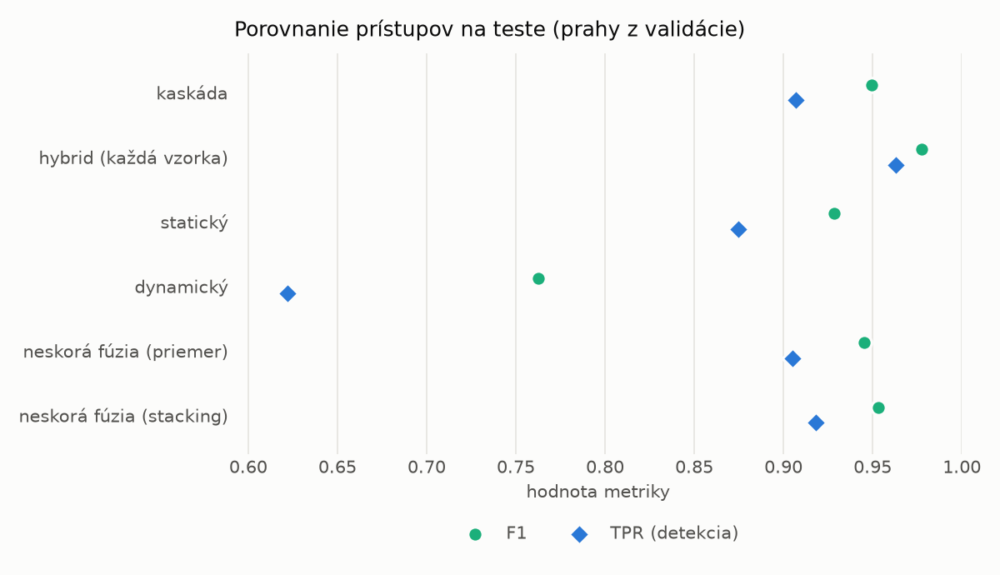
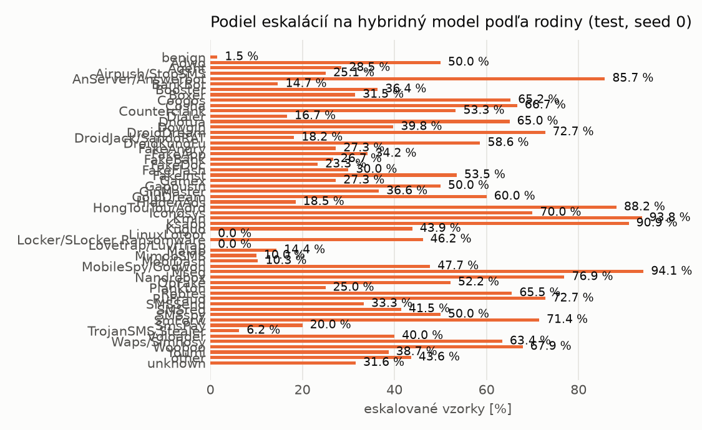

# Kaskáda `nokd` – beh `20261123-211305`

> Generované `src/cascade/evaluate.py` (2026-11-23T21:13:05+01:00). Seedy: [0, 1, 2]; hodnoty = priemer ± sm. odchýlka.
> Všetky prahy sú určené na validácii (FPR ≤ 1 %); test sa na nič nenastavuje.

| rola | beh |
|---|---|
| static | `runs_v4/emu_p/full/students_static/mlp_nokd/20261123-203547` |
| dynamic | `runs_v4/emu_p/full/students_dynamic/mlp_nokd/20261123-205230` |
| hybrid | `runs_v4/emu_p/full/hybrid/lightgbm/20261123-195420` |

## Test
| prístup | accuracy | balanced_accuracy | precision | recall_tpr | fpr | f1 | mcc |
|---|---|---|---|---|---|---|---|
| kaskáda | 0.9569 ± 0.0012 | 0.9522 ± 0.0014 | 0.9965 ± 0.0004 | 0.9070 ± 0.0026 | 0.0026 ± 0.0003 | 0.9496 ± 0.0015 | 0.9152 ± 0.0024 |
| hybrid (každá vzorka) | 0.9802 ± 0.0001 | 0.9786 ± 0.0001 | 0.9924 ± 0.0002 | 0.9632 ± 0.0002 | 0.0060 ± 0.0001 | 0.9775 ± 0.0002 | 0.9601 ± 0.0003 |
| statický | 0.9397 ± 0.0013 | 0.9336 ± 0.0014 | 0.9896 ± 0.0009 | 0.8748 ± 0.0033 | 0.0075 ± 0.0007 | 0.9286 ± 0.0016 | 0.8818 ± 0.0023 |
| dynamický | 0.8262 ± 0.0020 | 0.8070 ± 0.0024 | 0.9843 ± 0.0031 | 0.6221 ± 0.0061 | 0.0081 ± 0.0017 | 0.7624 ± 0.0038 | 0.6777 ± 0.0029 |
| neskorá fúzia (priemer) | 0.9529 ± 0.0037 | 0.9484 ± 0.0042 | 0.9888 ± 0.0014 | 0.9052 ± 0.0095 | 0.0084 ± 0.0012 | 0.9451 ± 0.0045 | 0.9067 ± 0.0069 |
| neskorá fúzia (stacking) | 0.9595 ± 0.0011 | 0.9556 ± 0.0012 | 0.9906 ± 0.0009 | 0.9183 ± 0.0021 | 0.0071 ± 0.0007 | 0.9531 ± 0.0014 | 0.9195 ± 0.0023 |

## Validácia
| prístup | accuracy | balanced_accuracy | precision | recall_tpr | fpr | f1 | mcc |
|---|---|---|---|---|---|---|---|
| kaskáda | 0.9563 ± 0.0021 | 0.9518 ± 0.0024 | 0.9938 ± 0.0004 | 0.9082 ± 0.0051 | 0.0046 ± 0.0003 | 0.9491 ± 0.0027 | 0.9138 ± 0.0041 |
| hybrid (každá vzorka) | 0.9768 ± 0.0007 | 0.9753 ± 0.0008 | 0.9877 ± 0.0000 | 0.9603 ± 0.0017 | 0.0097 ± 0.0000 | 0.9738 ± 0.0009 | 0.9533 ± 0.0015 |
| statický | 0.9353 ± 0.0044 | 0.9290 ± 0.0049 | 0.9864 ± 0.0002 | 0.8677 ± 0.0097 | 0.0097 ± 0.0000 | 0.9232 ± 0.0056 | 0.8731 ± 0.0082 |
| dynamický | 0.8310 ± 0.0050 | 0.8126 ± 0.0056 | 0.9815 ± 0.0003 | 0.6350 ± 0.0111 | 0.0097 ± 0.0000 | 0.7711 ± 0.0083 | 0.6853 ± 0.0087 |
| neskorá fúzia (priemer) | 0.9527 ± 0.0050 | 0.9484 ± 0.0056 | 0.9871 ± 0.0002 | 0.9064 ± 0.0113 | 0.0096 ± 0.0002 | 0.9450 ± 0.0062 | 0.9062 ± 0.0097 |
| neskorá fúzia (stacking) | 0.9585 ± 0.0016 | 0.9548 ± 0.0018 | 0.9872 ± 0.0002 | 0.9192 ± 0.0036 | 0.0096 ± 0.0002 | 0.9520 ± 0.0019 | 0.9173 ± 0.0031 |

## Správanie kaskády (test, seed 0)
- podiel eskalácií na hybrid: **15.94%** (2017 vzoriek)
- chyby pri zhode študentov (kaskáda ich nemôže opraviť): **491**
  (4.615% zo zhôd; FP 1, FN 490)
- úspešnosť na eskalovaných vzorkách: hybrid 0.9717402082300446, statický 0.858701041150223,
  dynamický 0.1412989588497769  → prínos hybridu pri nezhode

## Výpočtové nároky (odhad z benchmarkov komponentov)
| meranie | statický | dynamický | hybrid na každej vzorke | neskorá fúzia | kaskáda (odhad) |
|---|---|---|---|---|---|
| CPU čas ms/vz. (dávka) | 0.0353 | 0.0330 | 0.2267 | 0.0683 | 0.1040 |
| CPU čas ms/vz. (1 vz.) | 0.1109 | 0.1168 | 0.1510 | 0.2277 | 0.2515 |
| latencia ms (1 vz., postupne) | 0.0616 | 0.0622 | 0.1519 | 0.1238 | 0.1477 |

