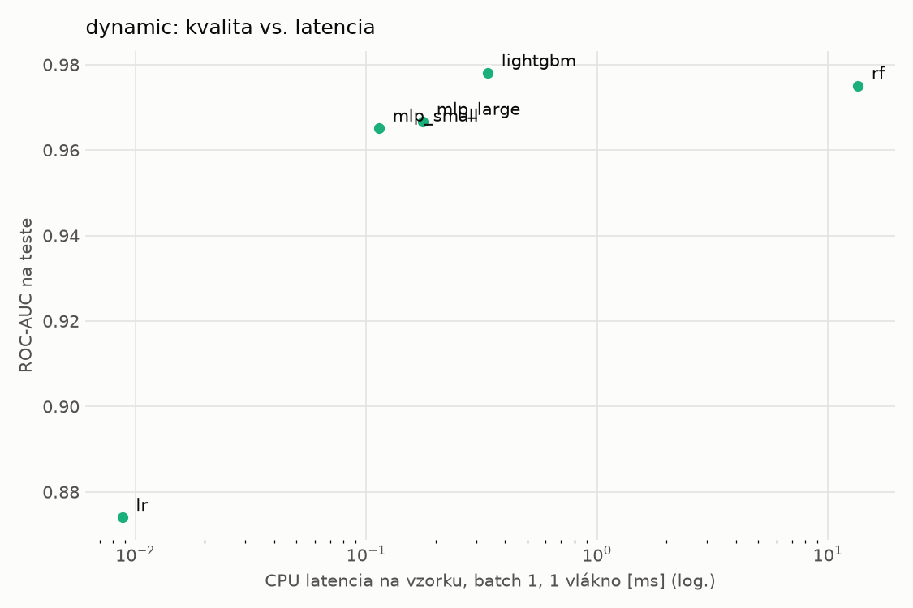
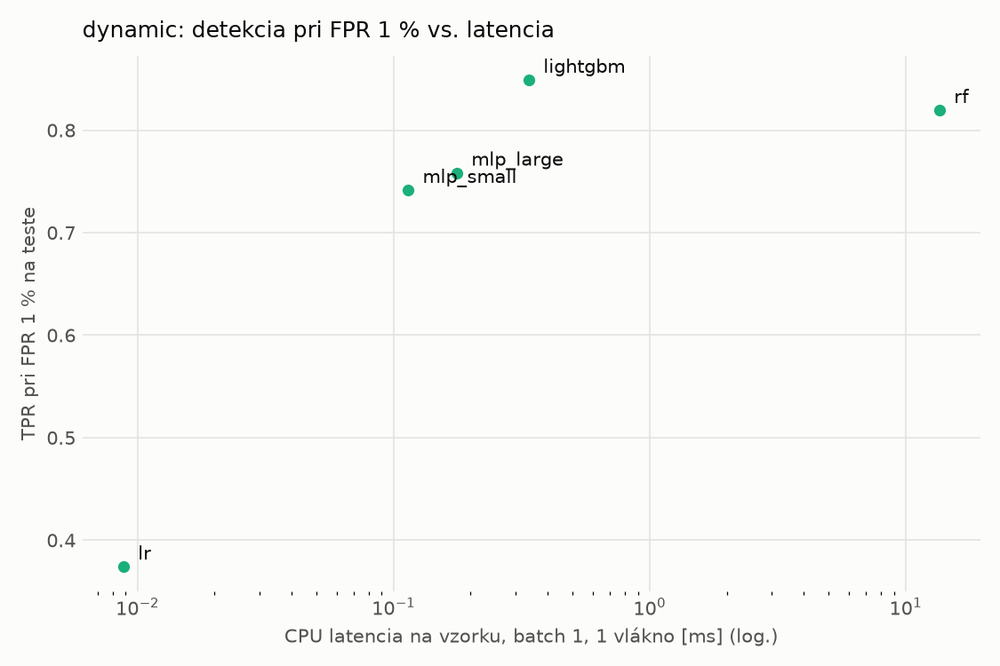
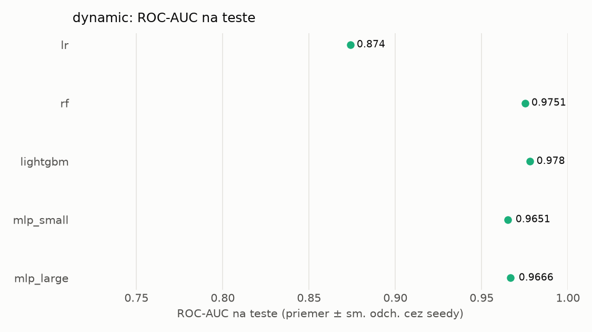
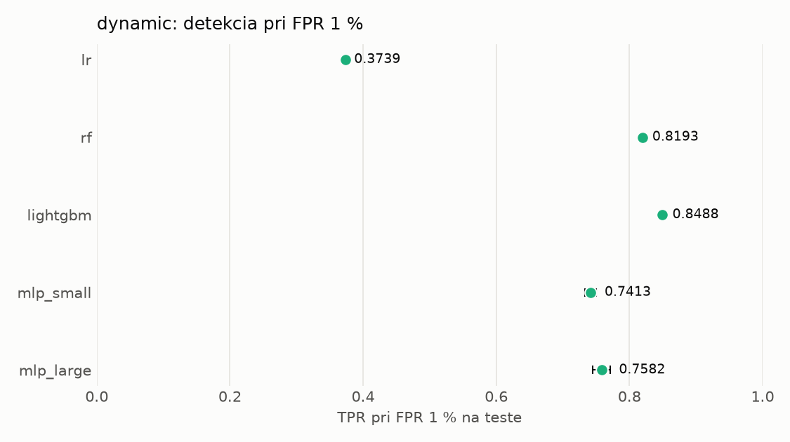

# Porovnanie modelov – dynamic

> Generované `src/evaluation/compare.py` (2026-11-23T19:52:57+01:00); použitý je posledný beh každého modelu.
> Metriky sú priemer cez seedy. \* = pri prahu určenom na validácii (FPR ≤ 1 %).
> CPU ms/vz. = medián latencie jednej vzorky na 1 vlákne vrátane transformácie vstupu (meranie hneď po tréningu,
> orientačné). Oficiálne merania spotreby sú v časti „Spotreba zdrojov pri inferencii“.

## Detekčná kvalita a orientačné časy
| model | ROC-AUC val | ROC-AUC test | TPR@FPR 1 % test | TPR@FPR 0,1 % test | F1 test* | FPR test* | gap train−val | CPU ms/vz. | CPU vz./s | GPU ms/vz. | parametre | MB | tréning s | ladenie min |
|---|---|---|---|---|---|---|---|---|---|---|---|---|---|---|
| [lr](../../dynamic/lr/20261123-191800/README.md) | 0.8765 | 0.8740 ± 0.0000 | 0.3739 | 0.1237 | 0.5440 | 0.0105 | -0.0017 | 0.009 | 4 335 434 | – | 124 | 0.01 | 0.4 | 0.1 |
| [rf](../../dynamic/rf/20261123-191811/README.md) | 0.9763 | 0.9751 ± 0.0001 | 0.8193 | 0.6864 | 0.8767 | 0.0066 | 0.0235 | 13.511 | 109 770 | – | 4 230 276 | 338.78 | 3.0 | 1.0 |
| [lightgbm](../../dynamic/lightgbm/20261123-191933/README.md) | 0.9809 | 0.9780 ± 0.0001 | 0.8488 | 0.7359 | 0.9071 | 0.0080 | 0.0191 | 0.337 | 35 871 | – | 972 512 | 54.10 | 27.7 | 18.0 |
| [mlp_small](../../dynamic/mlp_small/20261123-193925/README.md) | 0.9672 | 0.9651 ± 0.0009 | 0.7413 | 0.3551 | 0.8350 | 0.0086 | 0.0246 | 0.114 | 2 660 724 | 0.633 | 65 537 | 0.27 | 20.3 | 6.0 |
| [mlp_large](../../dynamic/mlp_large/20261123-194626/README.md) | 0.9684 | 0.9666 ± 0.0012 | 0.7582 | 0.4820 | 0.8500 | 0.0087 | 0.0253 | 0.176 | 430 042 | 0.518 | 786 945 | 3.17 | 9.5 | 6.0 |

## Nízka prevalencia malvéru (test, prah z validácie)
| model | TPR | FPR | precision @ 1 % | falošné na 1 skutočný poplach @ 1 % | precision @ 0.1 % | falošné na 1 skutočný poplach @ 0.1 % |
|---|---|---|---|---|---|---|
| lr | 0.3785 | 0.0105 | 0.268 | 2.73 | 0.035 | 27.59 |
| rf | 0.7868 | 0.0066 | 0.547 | 0.83 | 0.107 | 8.36 |
| lightgbm | 0.8381 | 0.0080 | 0.515 | 0.94 | 0.095 | 9.50 |
| mlp_small | 0.7244 | 0.0086 | 0.460 | 1.17 | 0.078 | 11.85 |
| mlp_large | 0.7472 | 0.0087 | 0.464 | 1.16 | 0.079 | 11.68 |

Prepočet: TPR a FPR nezávisia od podielu malvéru, preto sa dajú preniesť na nízku prevalenciu (v reálnej prevádzke je malvéru ~1 % alebo menej; v teste 54 %). „Falošné na 1 skutočný poplach“ = koľko neškodných súborov je označených na každý zachytený malvér.

## Spotreba zdrojov pri inferencii (benchmark, testovacia množina)
_Benchmark zatiaľ nebol spustený (`python -m src.evaluation.benchmark --approach dynamic`)._

## Grafy

