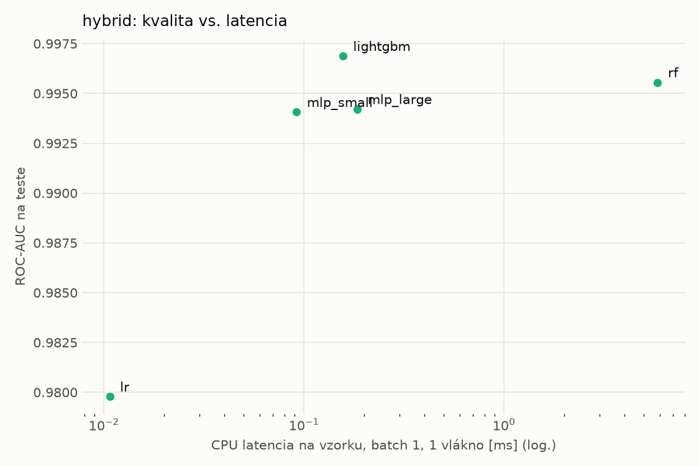
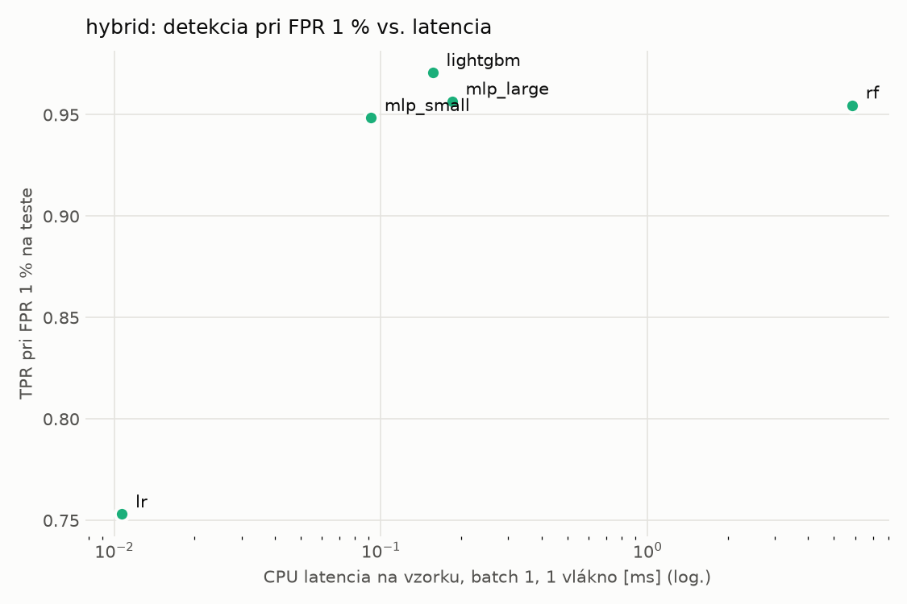
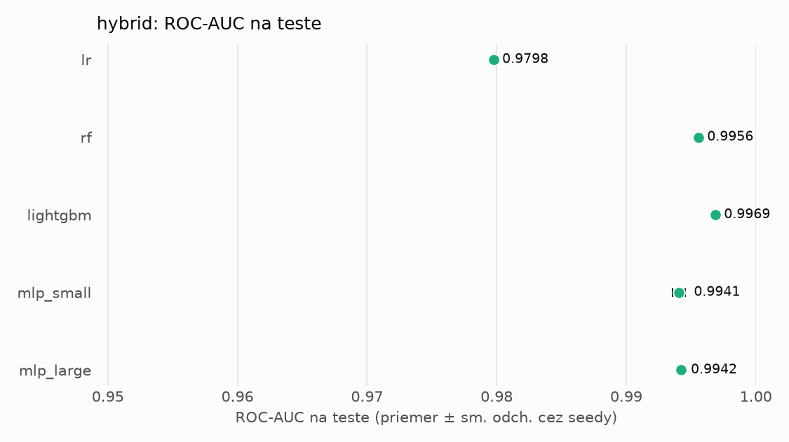
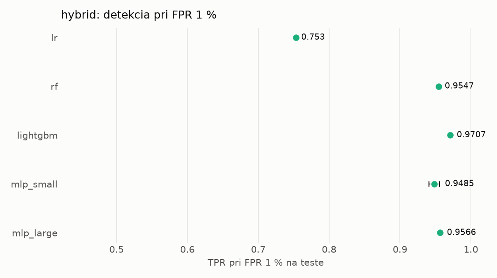

# Porovnanie modelov – hybrid

> Generované `src/evaluation/compare.py` (2026-11-23T20:13:44+01:00); použitý je posledný beh každého modelu.
> Metriky sú priemer cez seedy. \* = pri prahu určenom na validácii (FPR ≤ 1 %).
> CPU ms/vz. = medián latencie jednej vzorky na 1 vlákne vrátane transformácie vstupu (meranie hneď po tréningu,
> orientačné). Oficiálne merania spotreby sú v časti „Spotreba zdrojov pri inferencii“.

## Detekčná kvalita a orientačné časy
| model | ROC-AUC val | ROC-AUC test | TPR@FPR 1 % test | TPR@FPR 0,1 % test | F1 test* | FPR test* | gap train−val | CPU ms/vz. | CPU vz./s | GPU ms/vz. | parametre | MB | tréning s | ladenie min |
|---|---|---|---|---|---|---|---|---|---|---|---|---|---|---|
| [lr](../../hybrid/lr/20261123-195300/README.md) | 0.9782 | 0.9798 ± 0.0000 | 0.7530 | 0.4313 | 0.8381 | 0.0089 | 0.0044 | 0.011 | 2 321 180 | – | 287 | 0.01 | 0.5 | 0.2 |
| [rf](../../hybrid/rf/20261123-195313/README.md) | 0.9946 | 0.9956 ± 0.0000 | 0.9547 | 0.8897 | 0.9680 | 0.0066 | 0.0054 | 5.859 | 167 132 | – | 1 023 500 | 82.14 | 1.6 | 1.0 |
| [lightgbm](../../hybrid/lightgbm/20261123-195420/README.md) | 0.9960 | 0.9969 ± 0.0000 | 0.9707 | 0.9134 | 0.9775 | 0.0060 | 0.0040 | 0.156 | 87 382 | – | 396 683 | 22.29 | 18.3 | 11.0 |
| [mlp_small](../../hybrid/mlp_small/20261123-200627/README.md) | 0.9925 | 0.9941 ± 0.0005 | 0.9485 | 0.7763 | 0.9605 | 0.0060 | 0.0060 | 0.092 | 1 246 663 | 0.601 | 107 265 | 0.45 | 3.5 | 2.9 |
| [mlp_large](../../hybrid/mlp_large/20261123-200933/README.md) | 0.9933 | 0.9942 ± 0.0001 | 0.9566 | 0.8043 | 0.9676 | 0.0063 | 0.0054 | 0.185 | 608 318 | 0.589 | 323 521 | 1.32 | 9.7 | 3.7 |

## Nízka prevalencia malvéru (test, prah z validácie)
| model | TPR | FPR | precision @ 1 % | falošné na 1 skutočný poplach @ 1 % | precision @ 0.1 % | falošné na 1 skutočný poplach @ 0.1 % |
|---|---|---|---|---|---|---|
| lr | 0.7292 | 0.0089 | 0.453 | 1.21 | 0.076 | 12.16 |
| rf | 0.9456 | 0.0066 | 0.592 | 0.69 | 0.126 | 6.96 |
| lightgbm | 0.9632 | 0.0060 | 0.618 | 0.62 | 0.138 | 6.24 |
| mlp_small | 0.9309 | 0.0060 | 0.610 | 0.64 | 0.134 | 6.45 |
| mlp_large | 0.9445 | 0.0063 | 0.602 | 0.66 | 0.130 | 6.66 |

Prepočet: TPR a FPR nezávisia od podielu malvéru, preto sa dajú preniesť na nízku prevalenciu (v reálnej prevádzke je malvéru ~1 % alebo menej; v teste 54 %). „Falošné na 1 skutočný poplach“ = koľko neškodných súborov je označených na každý zachytený malvér.

## Spotreba zdrojov pri inferencii (benchmark, testovacia množina)
_Benchmark zatiaľ nebol spustený (`python -m src.evaluation.benchmark --approach hybrid`)._

## Grafy

