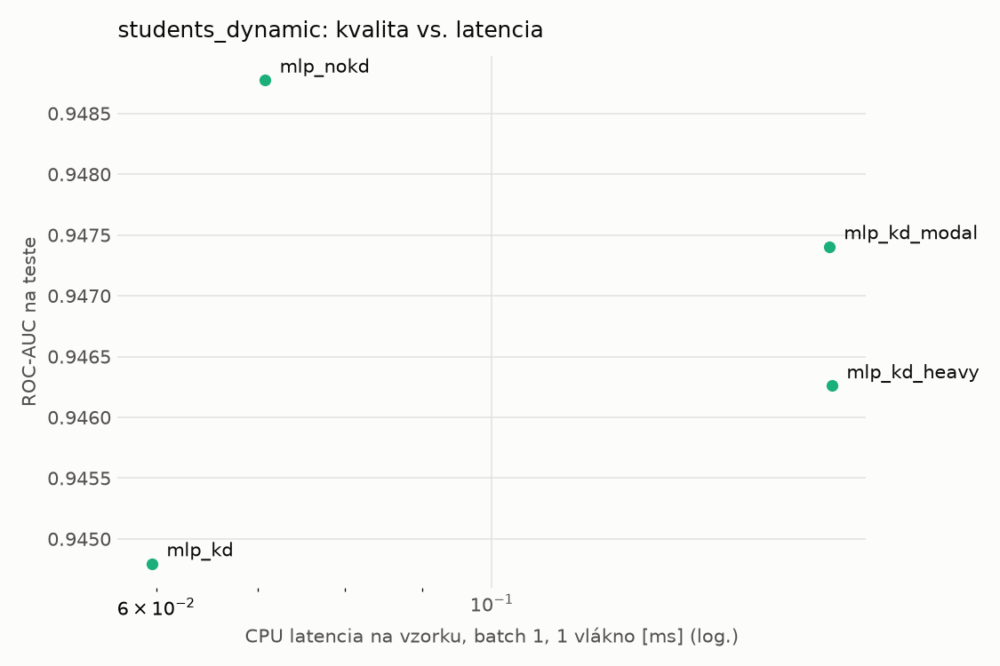
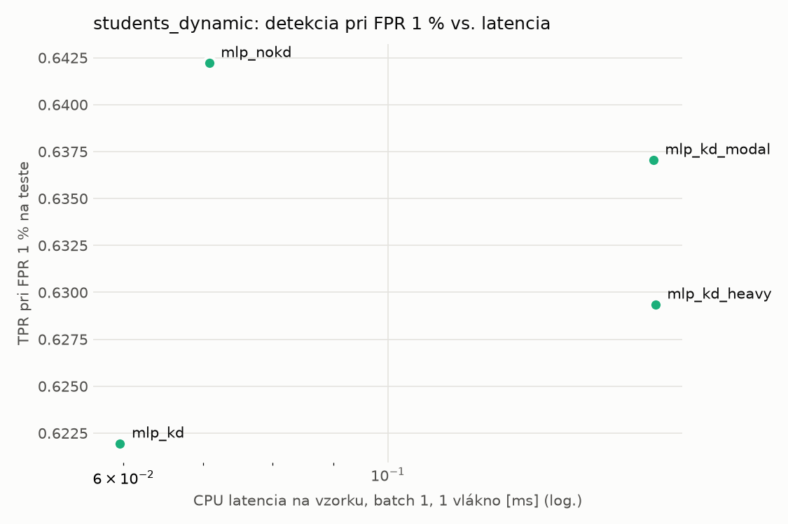
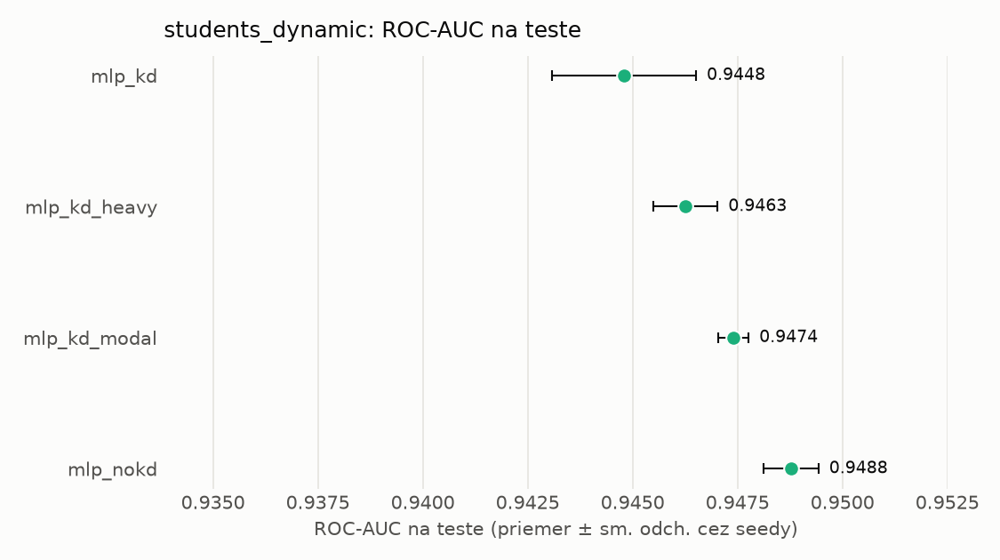
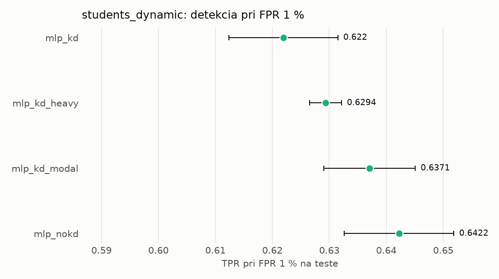

# Porovnanie modelov – students_dynamic

> Generované `src/evaluation/compare.py` (2026-11-23T21:09:47+01:00); použitý je posledný beh každého modelu.
> Metriky sú priemer cez seedy. \* = pri prahu určenom na validácii (FPR ≤ 1 %).
> CPU ms/vz. = medián latencie jednej vzorky na 1 vlákne vrátane transformácie vstupu (meranie hneď po tréningu,
> orientačné). Oficiálne merania spotreby sú v časti „Spotreba zdrojov pri inferencii“.

## Detekčná kvalita a orientačné časy
| model | ROC-AUC val | ROC-AUC test | TPR@FPR 1 % test | TPR@FPR 0,1 % test | F1 test* | FPR test* | gap train−val | CPU ms/vz. | CPU vz./s | GPU ms/vz. | parametre | MB | tréning s | ladenie min |
|---|---|---|---|---|---|---|---|---|---|---|---|---|---|---|
| [mlp_kd](../../students_dynamic/mlp_kd/20261123-204643/README.md) | 0.9469 | 0.9448 ± 0.0017 | 0.6220 | 0.3480 | 0.7467 | 0.0084 | 0.0092 | 0.060 | 5 045 246 | 0.268 | 8 129 | 0.04 | 7.6 | 5.4 |
| [mlp_kd_heavy](../../students_dynamic/mlp_kd_heavy/20261123-210504/README.md) | 0.9481 | 0.9463 ± 0.0008 | 0.6294 | 0.2799 | 0.7501 | 0.0084 | 0.0104 | 0.168 | 6 028 963 | 0.282 | 8 129 | 0.04 | 6.4 | 4.4 |
| [mlp_kd_modal](../../students_dynamic/mlp_kd_modal/20261123-210004/README.md) | 0.9499 | 0.9474 ± 0.0004 | 0.6371 | 0.3224 | 0.7577 | 0.0083 | 0.0093 | 0.167 | 5 910 152 | 0.442 | 8 129 | 0.04 | 6.5 | 4.6 |
| [mlp_nokd](../../students_dynamic/mlp_nokd/20261123-205230/README.md) | 0.9501 | 0.9488 ± 0.0007 | 0.6422 | 0.2999 | 0.7624 | 0.0081 | 0.0142 | 0.071 | 7 408 535 | 0.285 | 8 129 | 0.04 | 14.4 | 6.8 |

## Nízka prevalencia malvéru (test, prah z validácie)
| model | TPR | FPR | precision @ 1 % | falošné na 1 skutočný poplach @ 1 % | precision @ 0.1 % | falošné na 1 skutočný poplach @ 0.1 % |
|---|---|---|---|---|---|---|
| mlp_kd | 0.6020 | 0.0084 | 0.419 | 1.39 | 0.067 | 14.02 |
| mlp_kd_heavy | 0.6063 | 0.0084 | 0.422 | 1.37 | 0.067 | 13.84 |
| mlp_kd_modal | 0.6163 | 0.0083 | 0.430 | 1.33 | 0.070 | 13.39 |
| mlp_nokd | 0.6221 | 0.0081 | 0.438 | 1.28 | 0.072 | 12.95 |

Prepočet: TPR a FPR nezávisia od podielu malvéru, preto sa dajú preniesť na nízku prevalenciu (v reálnej prevádzke je malvéru ~1 % alebo menej; v teste 54 %). „Falošné na 1 skutočný poplach“ = koľko neškodných súborov je označených na každý zachytený malvér.

## Spotreba zdrojov pri inferencii (benchmark, testovacia množina)
_Benchmark zatiaľ nebol spustený (`python -m src.evaluation.benchmark --approach students_dynamic`)._

## Grafy

