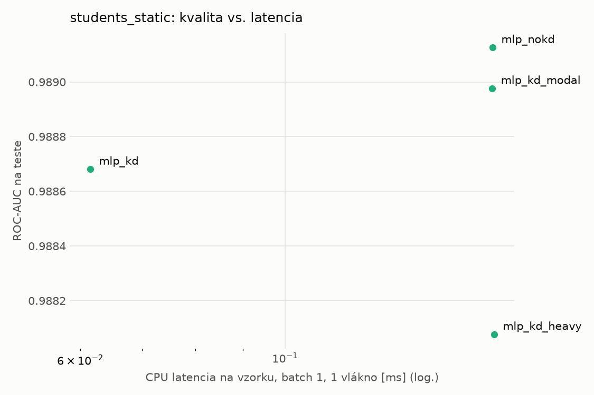
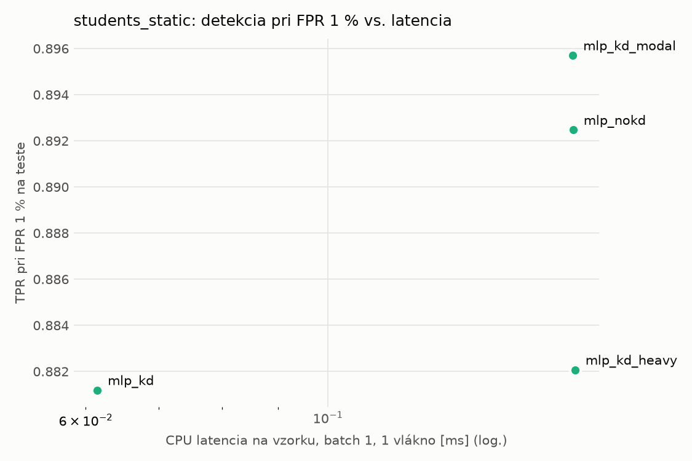
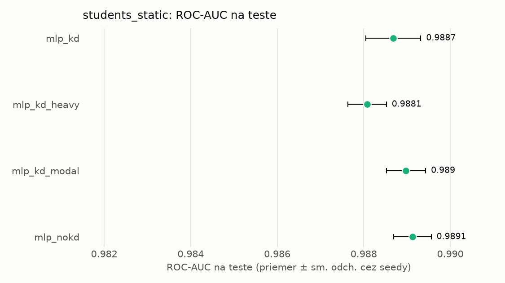
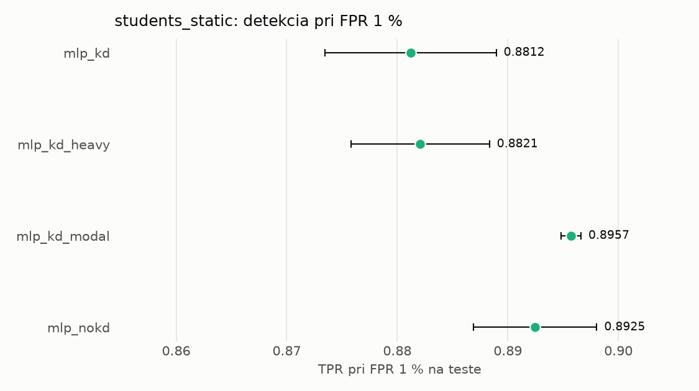

# Porovnanie modelov – students_static

> Generované `src/evaluation/compare.py` (2026-11-23T20:46:40+01:00); použitý je posledný beh každého modelu.
> Metriky sú priemer cez seedy. \* = pri prahu určenom na validácii (FPR ≤ 1 %).
> CPU ms/vz. = medián latencie jednej vzorky na 1 vlákne vrátane transformácie vstupu (meranie hneď po tréningu,
> orientačné). Oficiálne merania spotreby sú v časti „Spotreba zdrojov pri inferencii“.

## Detekčná kvalita a orientačné časy
| model | ROC-AUC val | ROC-AUC test | TPR@FPR 1 % test | TPR@FPR 0,1 % test | F1 test* | FPR test* | gap train−val | CPU ms/vz. | CPU vz./s | GPU ms/vz. | parametre | MB | tréning s | ladenie min |
|---|---|---|---|---|---|---|---|---|---|---|---|---|---|---|
| [mlp_kd](../../students_static/mlp_kd/20261123-203204/README.md) | 0.9876 | 0.9887 ± 0.0006 | 0.8812 | 0.5674 | 0.9176 | 0.0064 | 0.0052 | 0.062 | 3 317 866 | 0.265 | 10 689 | 0.05 | 4.3 | 3.5 |
| [mlp_kd_heavy](../../students_static/mlp_kd_heavy/20261123-204329/README.md) | 0.9862 | 0.9881 ± 0.0004 | 0.8821 | 0.6419 | 0.9116 | 0.0068 | 0.0058 | 0.169 | 4 850 529 | 0.272 | 10 689 | 0.05 | 4.1 | 2.9 |
| [mlp_kd_modal](../../students_static/mlp_kd_modal/20261123-203932/README.md) | 0.9881 | 0.9890 ± 0.0005 | 0.8957 | 0.7114 | 0.9238 | 0.0069 | 0.0044 | 0.168 | 4 575 560 | 0.452 | 10 689 | 0.05 | 9.2 | 3.5 |
| [mlp_nokd](../../students_static/mlp_nokd/20261123-203547/README.md) | 0.9882 | 0.9891 ± 0.0004 | 0.8925 | 0.6198 | 0.9286 | 0.0075 | 0.0064 | 0.168 | 5 157 925 | 0.442 | 10 689 | 0.05 | 9.7 | 3.2 |

## Nízka prevalencia malvéru (test, prah z validácie)
| model | TPR | FPR | precision @ 1 % | falošné na 1 skutočný poplach @ 1 % | precision @ 0.1 % | falošné na 1 skutočný poplach @ 0.1 % |
|---|---|---|---|---|---|---|
| mlp_kd | 0.8544 | 0.0064 | 0.573 | 0.75 | 0.117 | 7.53 |
| mlp_kd_heavy | 0.8446 | 0.0068 | 0.556 | 0.80 | 0.110 | 8.07 |
| mlp_kd_modal | 0.8657 | 0.0069 | 0.558 | 0.79 | 0.111 | 7.99 |
| mlp_nokd | 0.8748 | 0.0075 | 0.541 | 0.85 | 0.105 | 8.56 |

Prepočet: TPR a FPR nezávisia od podielu malvéru, preto sa dajú preniesť na nízku prevalenciu (v reálnej prevádzke je malvéru ~1 % alebo menej; v teste 54 %). „Falošné na 1 skutočný poplach“ = koľko neškodných súborov je označených na každý zachytený malvér.

## Spotreba zdrojov pri inferencii (benchmark, testovacia množina)
_Benchmark zatiaľ nebol spustený (`python -m src.evaluation.benchmark --approach students_static`)._

## Grafy

