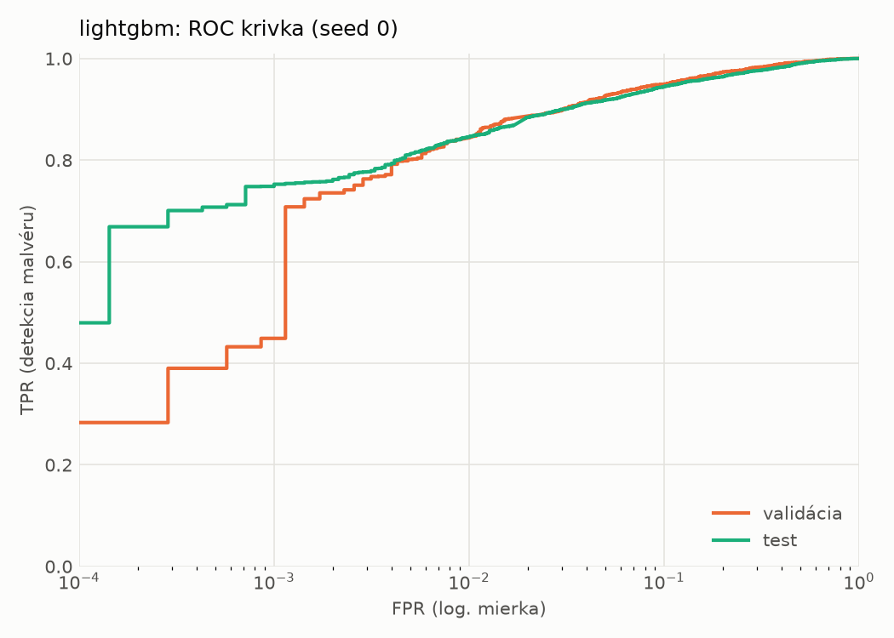
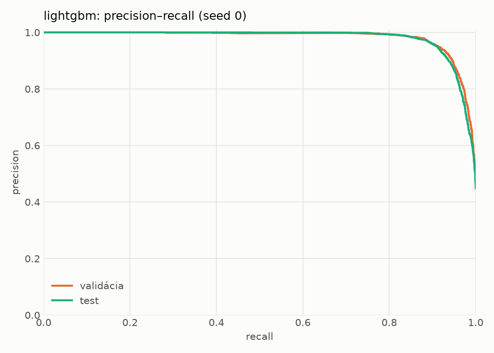
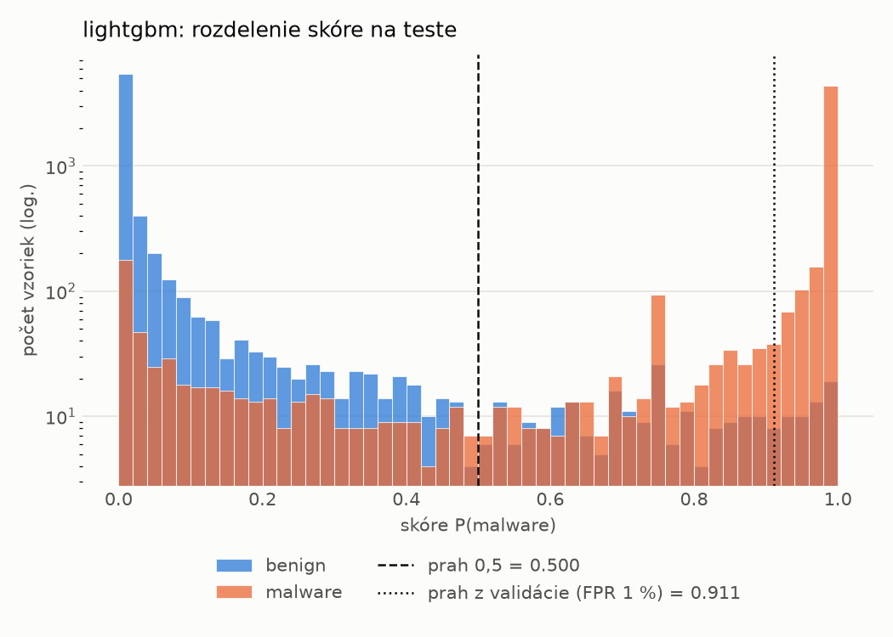
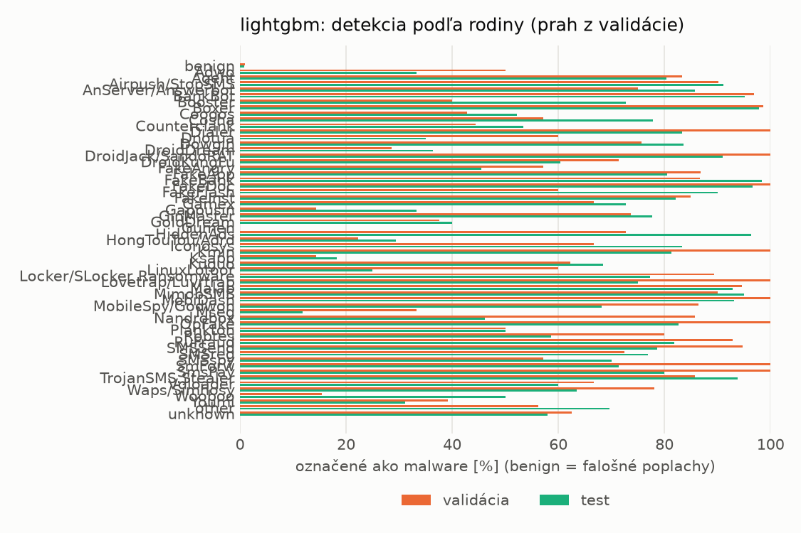
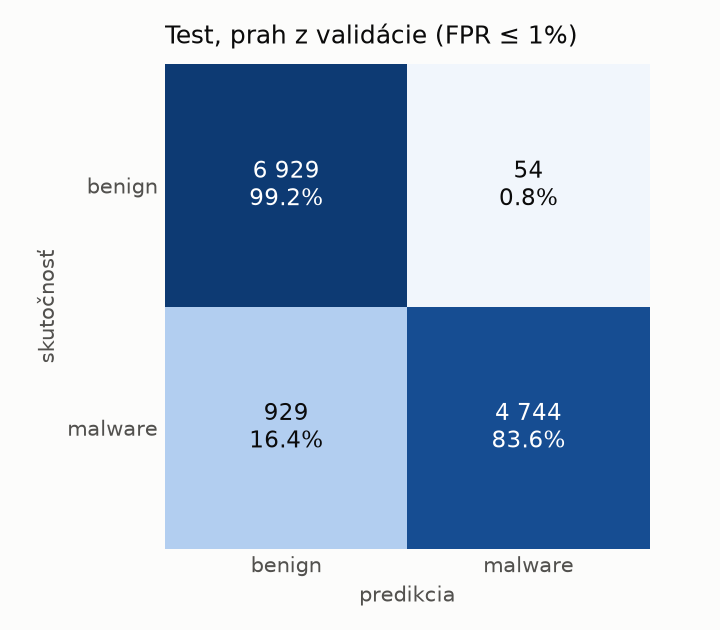
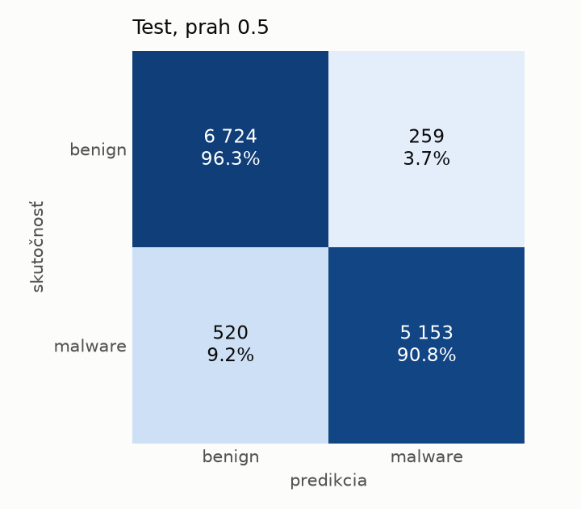
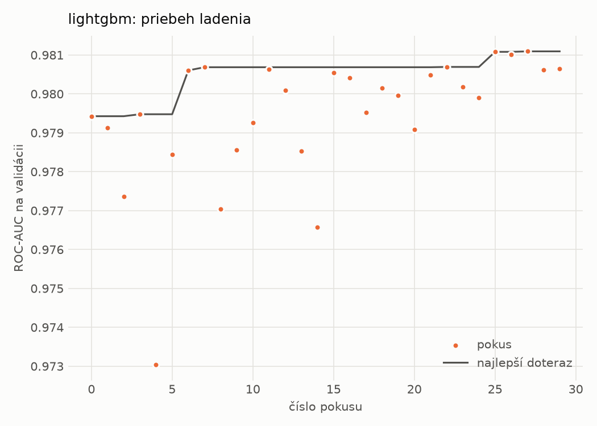
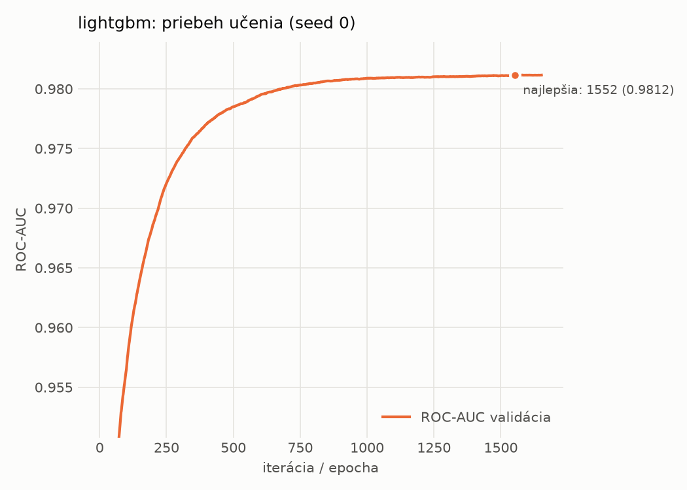

# dynamic/lightgbm – beh `20261123-191933`

> Automaticky generované (`src/training/run_tabular.py`). Konfigurácia: `config.yaml`, protokol: `protocol.yaml`.

- **Model:** `lightgbm` – LightGBM, gradient boosting stromov s early stopping na validácii (pôvodné hodnoty príznakov)
- **Ladenie:** 30 dokončených pokusov (Optuna TPE), cieľ ROC-AUC na validácii, 18.0 min
- **Finálne modely:** seedy [0, 1, 2]; hodnoty sú priemer ± smerodajná odchýlka cez seedy
- **Najlepšie hyperparametre:** `{"num_boost_round": 5000, "early_stopping_rounds": 100, "learning_rate": 0.020757076290036595, "num_leaves": 469, "min_child_samples": 116, "feature_fraction": 0.9578728497385997, "bagging_fraction": 0.9870779948179744, "lambda_l1": 0.002495609179699052, "lambda_l2": 0.0024900497451761272}`

## Detekčná kvalita (bez prahu)
| metrika | train (podvzorka) | validácia | test |
|---|---|---|---|
| ROC-AUC | 0.9999 ± 0.0000 | 0.9809 ± 0.0002 | 0.9780 ± 0.0001 |
| PR-AUC | 0.9999 ± 0.0000 | 0.9811 ± 0.0003 | 0.9797 ± 0.0001 |
| TPR pri FPR 1 % | 0.9996 ± 0.0001 | 0.8462 ± 0.0022 | 0.8488 ± 0.0031 |
| TPR pri FPR 0,1 % | 0.9842 ± 0.0013 | 0.5045 ± 0.0503 | 0.7359 ± 0.0133 |
| log loss | 0.0139 ± 0.0031 | 0.1818 ± 0.0060 | 0.1923 ± 0.0083 |
| Brier skóre | 0.0027 ± 0.0003 | 0.0475 ± 0.0003 | 0.0492 ± 0.0004 |

Rozdiel ROC-AUC train − validácia: **0.0191** (veľký rozdiel = preučenie).

## Pri prahu z validácie (FPR ≤ 1% na validácii)
| metrika | train (podvzorka) | validácia | test |
|---|---|---|---|
| accuracy | 0.9889 ± 0.0009 | 0.9257 ± 0.0010 | 0.9230 ± 0.0008 |
| balanced accuracy | 0.9873 ± 0.0010 | 0.9182 ± 0.0011 | 0.9150 ± 0.0009 |
| precision | 0.9998 ± 0.0000 | 0.9860 ± 0.0000 | 0.9884 ± 0.0004 |
| recall (TPR) | 0.9747 ± 0.0020 | 0.8462 ± 0.0022 | 0.8381 ± 0.0018 |
| FPR | 0.0002 ± 0.0000 | 0.0097 ± 0.0000 | 0.0080 ± 0.0003 |
| F1 | 0.9871 ± 0.0010 | 0.9108 ± 0.0013 | 0.9071 ± 0.0010 |
| MCC | 0.9776 ± 0.0018 | 0.8550 ± 0.0018 | 0.8505 ± 0.0014 |

## Pri pevnom prahu 0.5
| metrika | train (podvzorka) | validácia | test |
|---|---|---|---|
| accuracy | 0.9968 ± 0.0003 | 0.9385 ± 0.0008 | 0.9381 ± 0.0004 |
| balanced accuracy | 0.9969 ± 0.0003 | 0.9362 ± 0.0007 | 0.9352 ± 0.0004 |
| precision | 0.9949 ± 0.0003 | 0.9478 ± 0.0014 | 0.9519 ± 0.0002 |
| recall (TPR) | 0.9978 ± 0.0004 | 0.9132 ± 0.0004 | 0.9076 ± 0.0007 |
| FPR | 0.0040 ± 0.0002 | 0.0409 ± 0.0012 | 0.0372 ± 0.0001 |
| F1 | 0.9963 ± 0.0003 | 0.9302 ± 0.0008 | 0.9293 ± 0.0004 |
| MCC | 0.9935 ± 0.0005 | 0.8758 ± 0.0016 | 0.8750 ± 0.0007 |

## Výpočtové nároky (seed 0, testovacia množina)
| meranie | hodnota |
|---|---|
| tréning finálneho modelu | 27.7 s (priemer cez seedy) |
| ladenie spolu | 1081 s |
| počet parametrov / uzlov | 972 512 |
| veľkosť modelu na disku | 54.10 MB |
| CPU latencia modelu (batch 1, 1 vlákno) | 0.337 ms (p95 0.426) |
| CPU priepustnosť (24 vlákien) | 35 871 vzoriek/s |

## Grafy
| | |
|---|---|
|  |  |
|  |  |
|  |  |
|  |  |

## Súbory
`metrics.json` (všetky metriky po seedoch vrátane rodín), `timing.json`, `hpo_trials.csv`,
`predictions/<časť>_seed<N>.parquet` (sha256, family, label, score), `model/seed_<N>/`, `log.txt`.
