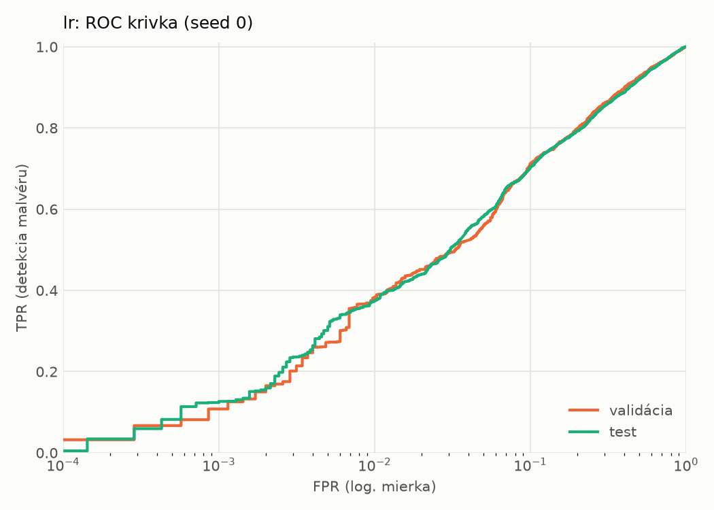
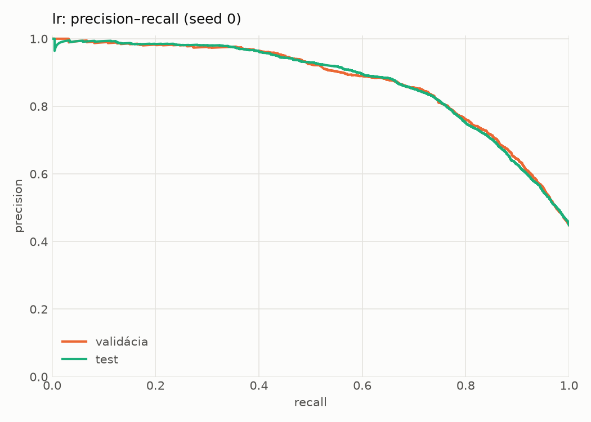
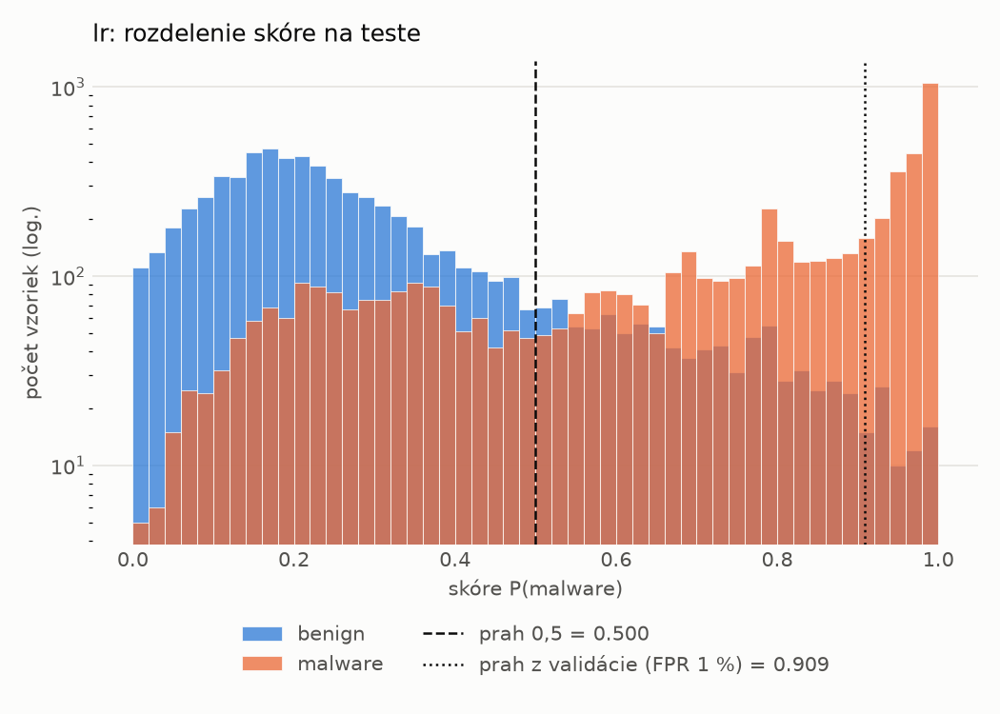
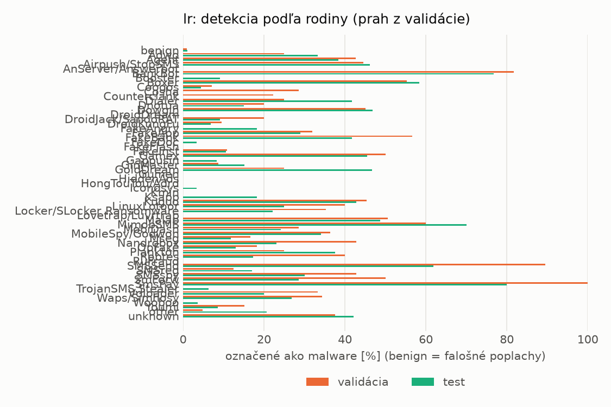
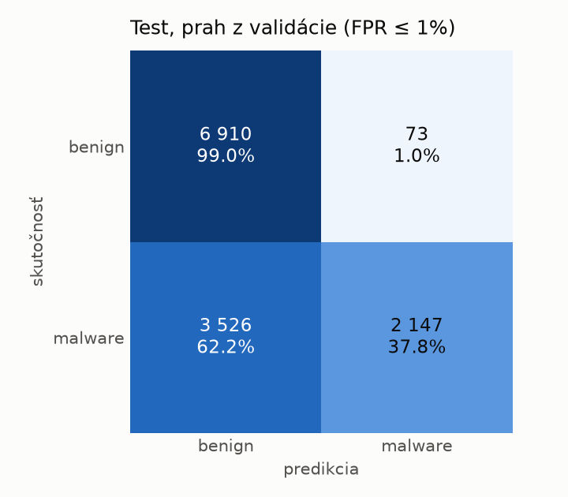
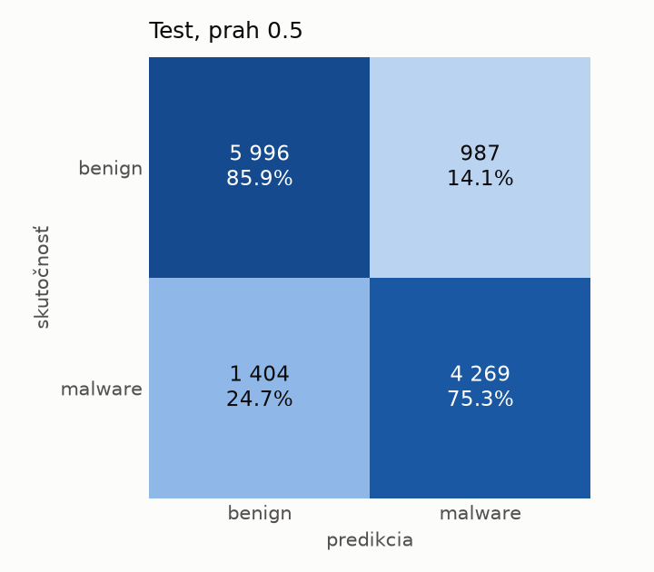
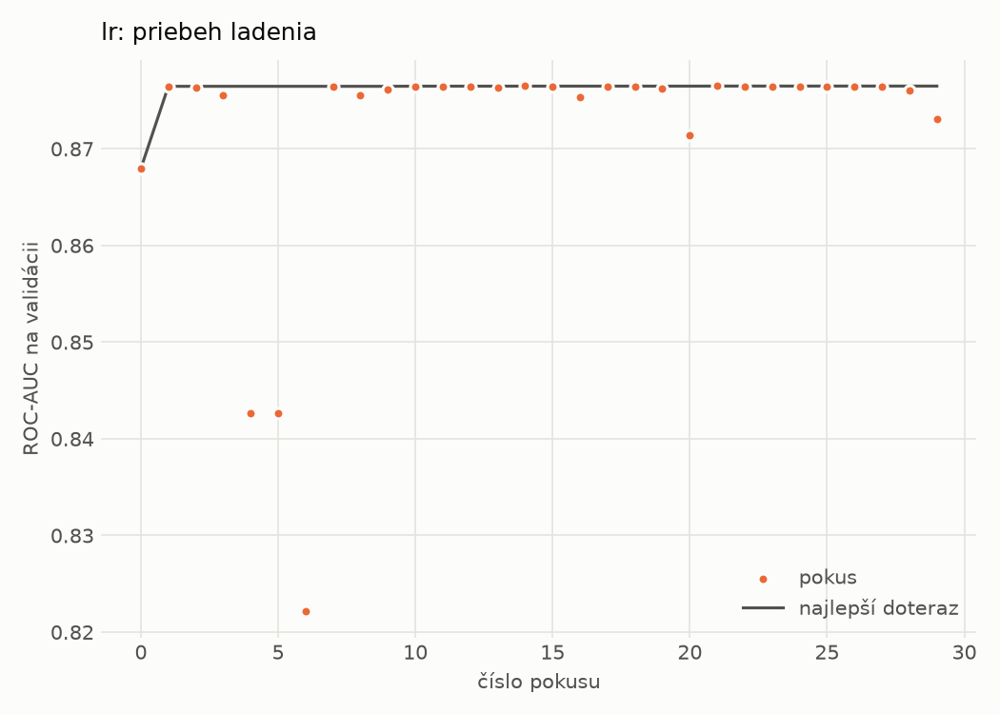

# dynamic/lr – beh `20261123-191800`

> Automaticky generované (`src/training/run_tabular.py`). Konfigurácia: `config.yaml`, protokol: `protocol.yaml`.

- **Model:** `logreg` – logistická regresia s L2 regularizáciou (vstup signed log1p + štandardizácia)
- **Ladenie:** 30 dokončených pokusov (Optuna TPE), cieľ ROC-AUC na validácii, 0.1 min
- **Finálne modely:** seedy [0, 1, 2]; hodnoty sú priemer ± smerodajná odchýlka cez seedy
- **Najlepšie hyperparametre:** `{"max_iter": 2000, "C": 7.504621081078761}`

## Detekčná kvalita (bez prahu)
| metrika | train (podvzorka) | validácia | test |
|---|---|---|---|
| ROC-AUC | 0.8748 ± 0.0000 | 0.8765 ± 0.0000 | 0.8740 ± 0.0000 |
| PR-AUC | 0.8670 ± 0.0000 | 0.8732 ± 0.0000 | 0.8725 ± 0.0000 |
| TPR pri FPR 1 % | 0.3848 ± 0.0000 | 0.3813 ± 0.0000 | 0.3739 ± 0.0000 |
| TPR pri FPR 0,1 % | 0.0735 ± 0.0000 | 0.1079 ± 0.0000 | 0.1237 ± 0.0000 |
| log loss | 0.4352 ± 0.0000 | 0.4338 ± 0.0000 | 0.4345 ± 0.0000 |
| Brier skóre | 0.1377 ± 0.0000 | 0.1379 ± 0.0000 | 0.1385 ± 0.0000 |

Rozdiel ROC-AUC train − validácia: **-0.0017** (veľký rozdiel = preučenie).

## Pri prahu z validácie (FPR ≤ 1% na validácii)
| metrika | train (podvzorka) | validácia | test |
|---|---|---|---|
| accuracy | 0.7300 ± 0.0000 | 0.7173 ± 0.0000 | 0.7156 ± 0.0000 |
| balanced accuracy | 0.6917 ± 0.0000 | 0.6858 ± 0.0000 | 0.6840 ± 0.0000 |
| precision | 0.9657 ± 0.0000 | 0.9695 ± 0.0000 | 0.9671 ± 0.0000 |
| recall (TPR) | 0.3942 ± 0.0000 | 0.3813 ± 0.0000 | 0.3785 ± 0.0000 |
| FPR | 0.0108 ± 0.0000 | 0.0097 ± 0.0000 | 0.0105 ± 0.0000 |
| F1 | 0.5598 ± 0.0000 | 0.5473 ± 0.0000 | 0.5440 ± 0.0000 |
| MCC | 0.4972 ± 0.0000 | 0.4849 ± 0.0000 | 0.4812 ± 0.0000 |

## Pri pevnom prahu 0.5
| metrika | train (podvzorka) | validácia | test |
|---|---|---|---|
| accuracy | 0.8106 ± 0.0000 | 0.8101 ± 0.0000 | 0.8111 ± 0.0000 |
| balanced accuracy | 0.8045 ± 0.0000 | 0.8048 ± 0.0000 | 0.8056 ± 0.0000 |
| precision | 0.7979 ± 0.0000 | 0.8097 ± 0.0000 | 0.8122 ± 0.0000 |
| recall (TPR) | 0.7569 ± 0.0000 | 0.7534 ± 0.0000 | 0.7525 ± 0.0000 |
| FPR | 0.1479 ± 0.0000 | 0.1439 ± 0.0000 | 0.1413 ± 0.0000 |
| F1 | 0.7769 ± 0.0000 | 0.7806 ± 0.0000 | 0.7812 ± 0.0000 |
| MCC | 0.6132 ± 0.0000 | 0.6148 ± 0.0000 | 0.6168 ± 0.0000 |

## Výpočtové nároky (seed 0, testovacia množina)
| meranie | hodnota |
|---|---|
| tréning finálneho modelu | 0.4 s (priemer cez seedy) |
| ladenie spolu | 9 s |
| počet parametrov / uzlov | 124 |
| veľkosť modelu na disku | 0.01 MB |
| transformácia vstupu – latencia (1 vlákno) | 0.005 ms |
| transformácia vstupu – priepustnosť | 1 306 304 vzoriek/s |
| CPU latencia modelu (batch 1, 1 vlákno) | 0.004 ms (p95 0.005) |
| CPU priepustnosť (24 vlákien) | 4 335 434 vzoriek/s |

## Grafy
| | |
|---|---|
|  |  |
|  |  |
|  |  |
|  |  |

## Súbory
`metrics.json` (všetky metriky po seedoch vrátane rodín), `timing.json`, `hpo_trials.csv`,
`predictions/<časť>_seed<N>.parquet` (sha256, family, label, score), `model/seed_<N>/`, `log.txt`.
