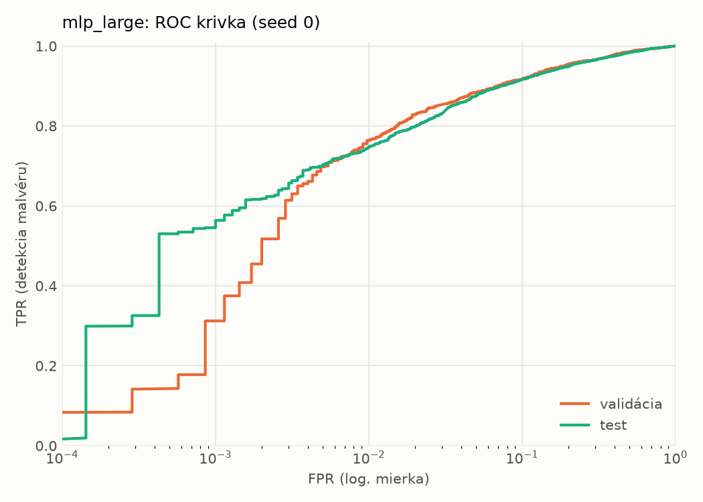
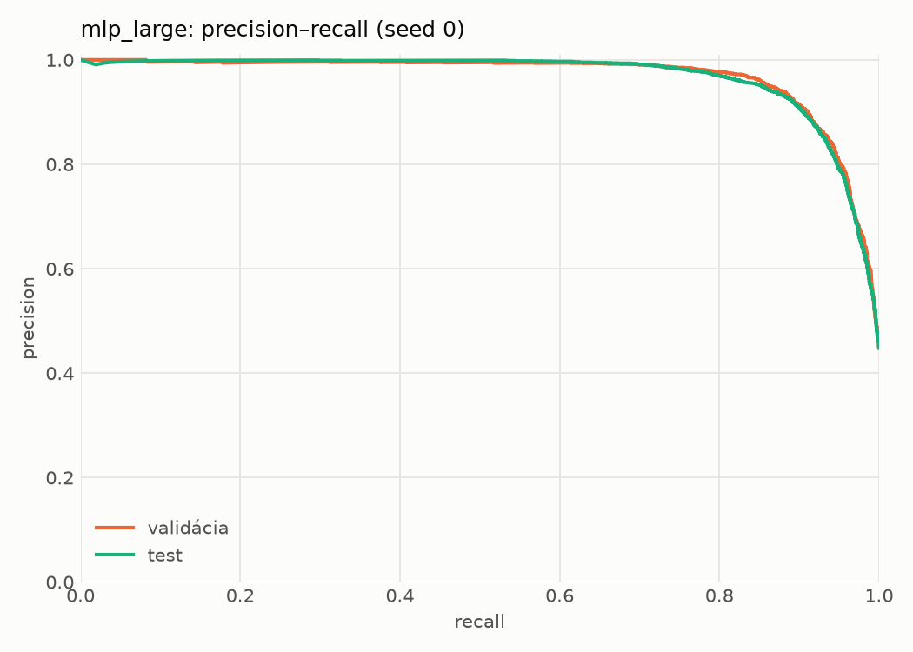
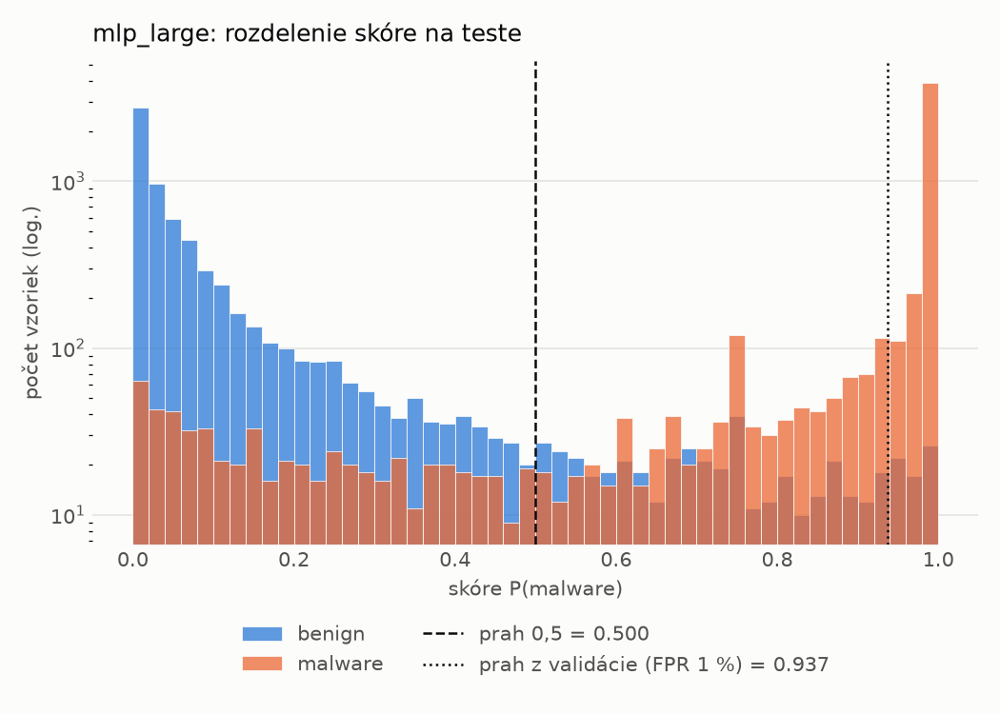
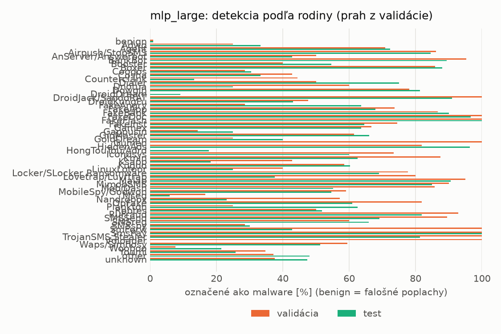
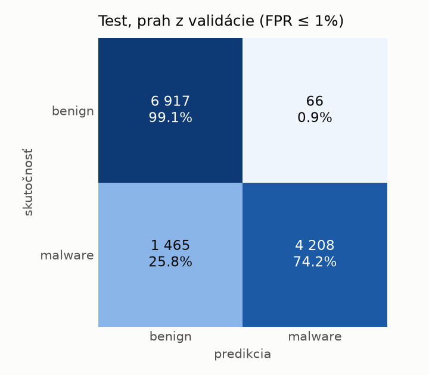
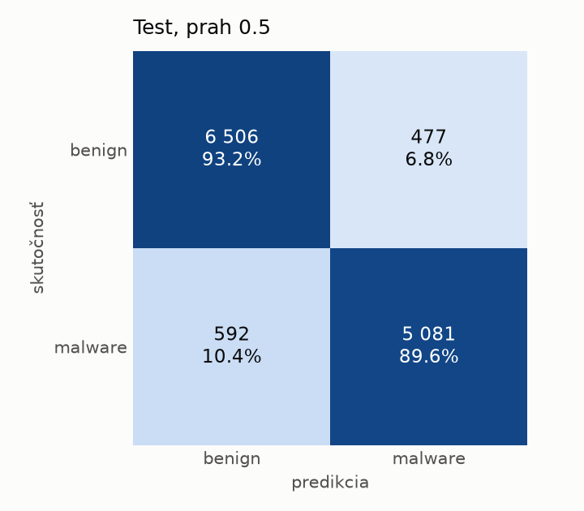
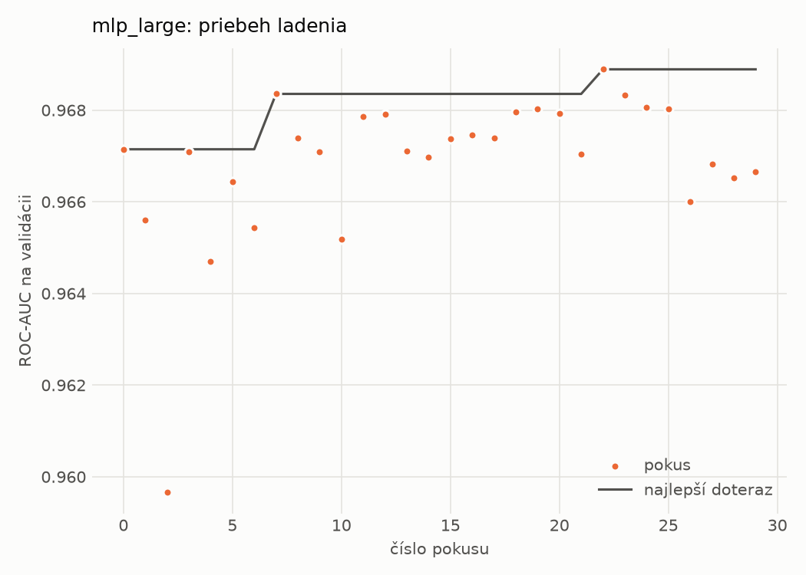
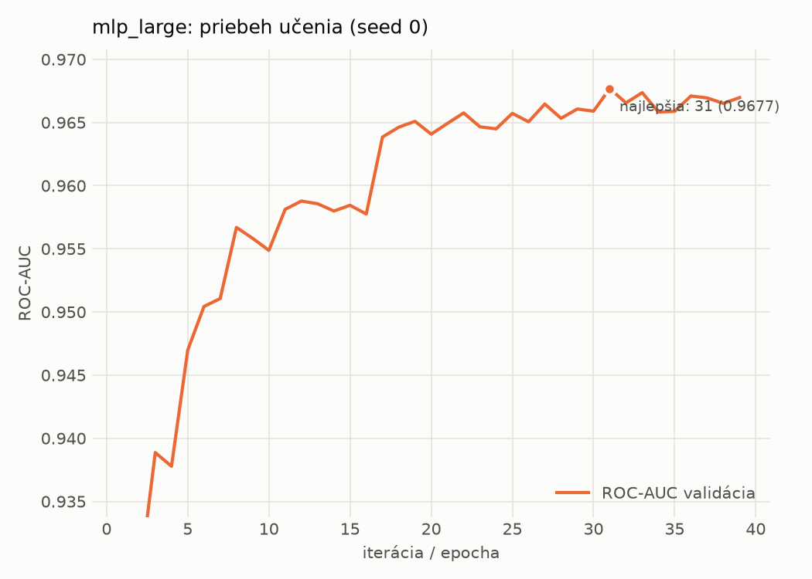

# dynamic/mlp_large – beh `20261123-194626`

> Automaticky generované (`src/training/run_tabular.py`). Konfigurácia: `config.yaml`, protokol: `protocol.yaml`.

- **Model:** `mlp` – veľká neurónová sieť (3–5 skrytých vrstiev, 512–2048 neurónov), kandidát na učiteľa
- **Ladenie:** 30 dokončených pokusov (Optuna TPE), cieľ ROC-AUC na validácii, 6.0 min
- **Finálne modely:** seedy [0, 1, 2]; hodnoty sú priemer ± smerodajná odchýlka cez seedy
- **Najlepšie hyperparametre:** `{"max_epochs": 100, "patience": 8, "hidden_layers": 3, "hidden_width": 1024, "width_decay": 0.5, "dropout": 0.11628417924821868, "lr": 0.0004582958225587737, "weight_decay": 0.0007705605519981878, "batch_size": 512}`

## Detekčná kvalita (bez prahu)
| metrika | train (podvzorka) | validácia | test |
|---|---|---|---|
| ROC-AUC | 0.9938 ± 0.0029 | 0.9684 ± 0.0007 | 0.9666 ± 0.0012 |
| PR-AUC | 0.9931 ± 0.0030 | 0.9691 ± 0.0012 | 0.9682 ± 0.0013 |
| TPR pri FPR 1 % | 0.9136 ± 0.0298 | 0.7670 ± 0.0057 | 0.7582 ± 0.0133 |
| TPR pri FPR 0,1 % | 0.8431 ± 0.0447 | 0.3753 ± 0.0657 | 0.4820 ± 0.0572 |
| log loss | 0.0988 ± 0.0210 | 0.2345 ± 0.0090 | 0.2359 ± 0.0057 |
| Brier skóre | 0.0276 ± 0.0062 | 0.0615 ± 0.0011 | 0.0636 ± 0.0019 |

Rozdiel ROC-AUC train − validácia: **0.0253** (veľký rozdiel = preučenie).

## Pri prahu z validácie (FPR ≤ 1% na validácii)
| metrika | train (podvzorka) | validácia | test |
|---|---|---|---|
| accuracy | 0.9115 ± 0.0053 | 0.8902 ± 0.0025 | 0.8818 ± 0.0036 |
| balanced accuracy | 0.8985 ± 0.0060 | 0.8787 ± 0.0028 | 0.8692 ± 0.0041 |
| precision | 0.9995 ± 0.0006 | 0.9848 ± 0.0002 | 0.9858 ± 0.0027 |
| recall (TPR) | 0.7973 ± 0.0117 | 0.7670 ± 0.0057 | 0.7472 ± 0.0092 |
| FPR | 0.0003 ± 0.0004 | 0.0096 ± 0.0002 | 0.0087 ± 0.0018 |
| F1 | 0.8870 ± 0.0074 | 0.8623 ± 0.0036 | 0.8500 ± 0.0054 |
| MCC | 0.8299 ± 0.0098 | 0.7901 ± 0.0045 | 0.7754 ± 0.0062 |

## Pri pevnom prahu 0.5
| metrika | train (podvzorka) | validácia | test |
|---|---|---|---|
| accuracy | 0.9648 ± 0.0085 | 0.9200 ± 0.0025 | 0.9175 ± 0.0032 |
| balanced accuracy | 0.9635 ± 0.0088 | 0.9188 ± 0.0028 | 0.9161 ± 0.0033 |
| precision | 0.9653 ± 0.0084 | 0.9134 ± 0.0036 | 0.9129 ± 0.0043 |
| recall (TPR) | 0.9535 ± 0.0114 | 0.9076 ± 0.0067 | 0.9021 ± 0.0058 |
| FPR | 0.0265 ± 0.0063 | 0.0699 ± 0.0035 | 0.0699 ± 0.0038 |
| F1 | 0.9593 ± 0.0099 | 0.9105 ± 0.0031 | 0.9075 ± 0.0037 |
| MCC | 0.9284 ± 0.0173 | 0.8382 ± 0.0052 | 0.8332 ± 0.0065 |

## Výpočtové nároky (seed 0, testovacia množina)
| meranie | hodnota |
|---|---|
| tréning finálneho modelu | 9.5 s (priemer cez seedy) |
| ladenie spolu | 359 s |
| počet parametrov / uzlov | 786 945 |
| veľkosť modelu na disku | 3.17 MB |
| transformácia vstupu – latencia (1 vlákno) | 0.015 ms |
| transformácia vstupu – priepustnosť | 777 009 vzoriek/s |
| CPU latencia modelu (batch 1, 1 vlákno) | 0.162 ms (p95 0.378) |
| CPU priepustnosť (24 vlákien) | 430 042 vzoriek/s |
| GPU latencia (batch 1) | 0.518 ms (p95 0.558) |
| GPU priepustnosť | 1 400 108 vzoriek/s |
| GPU špičková pamäť | 147 MB |

## Grafy
| | |
|---|---|
|  |  |
|  |  |
|  |  |
|  |  |

## Súbory
`metrics.json` (všetky metriky po seedoch vrátane rodín), `timing.json`, `hpo_trials.csv`,
`predictions/<časť>_seed<N>.parquet` (sha256, family, label, score), `model/seed_<N>/`, `log.txt`.
