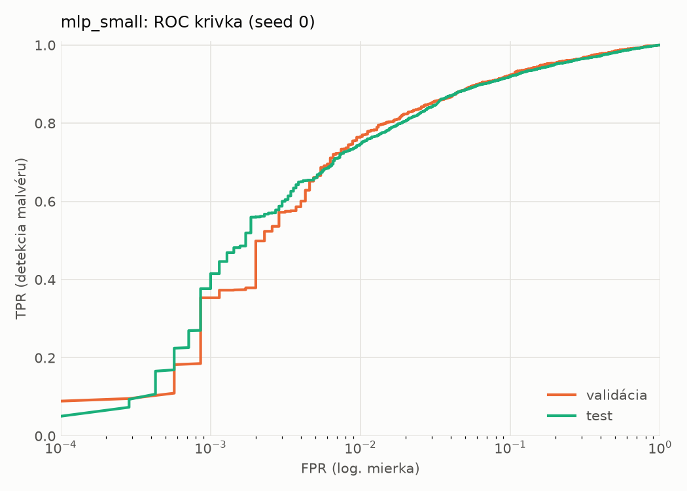
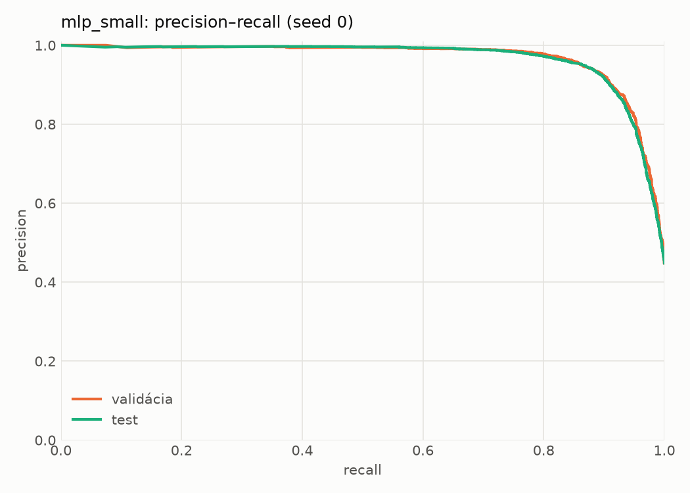
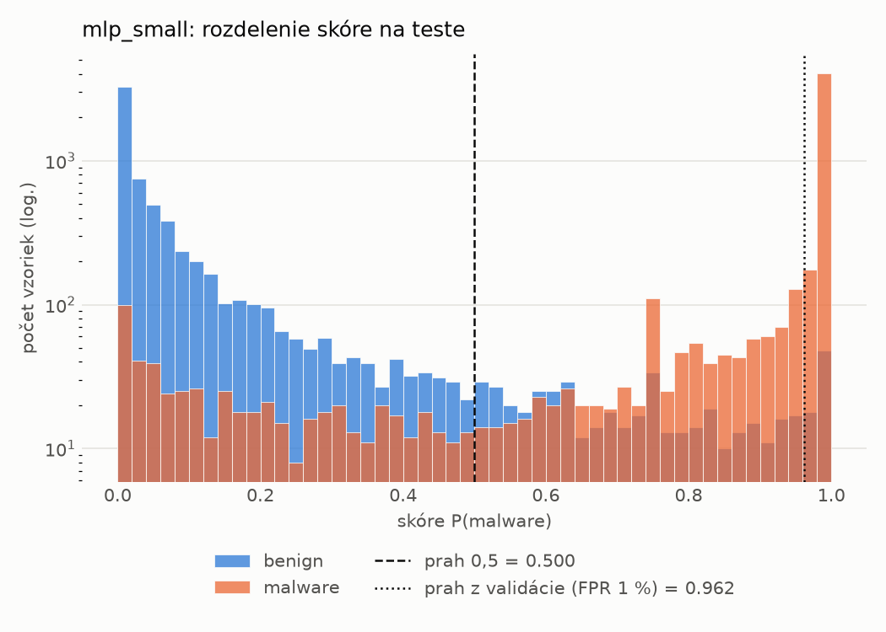
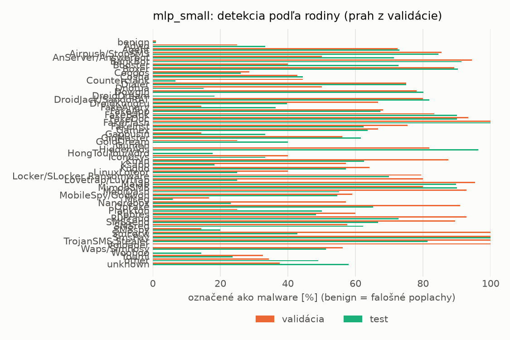
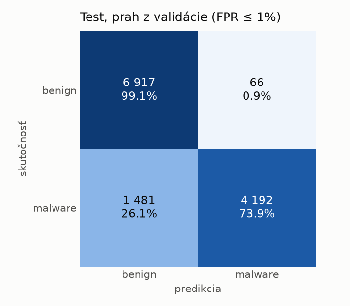
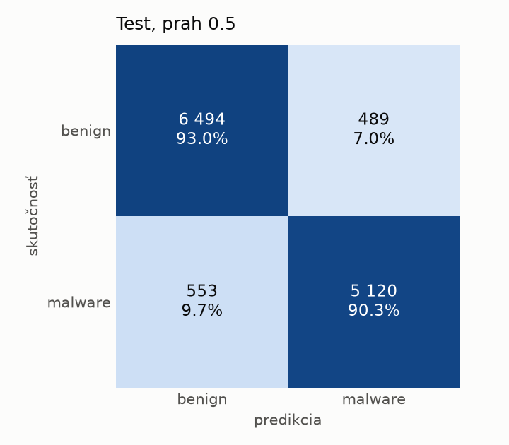
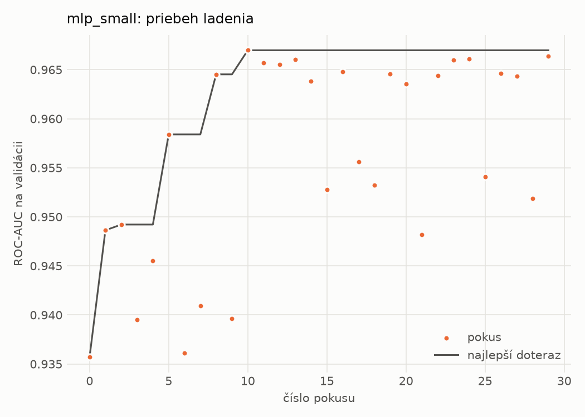
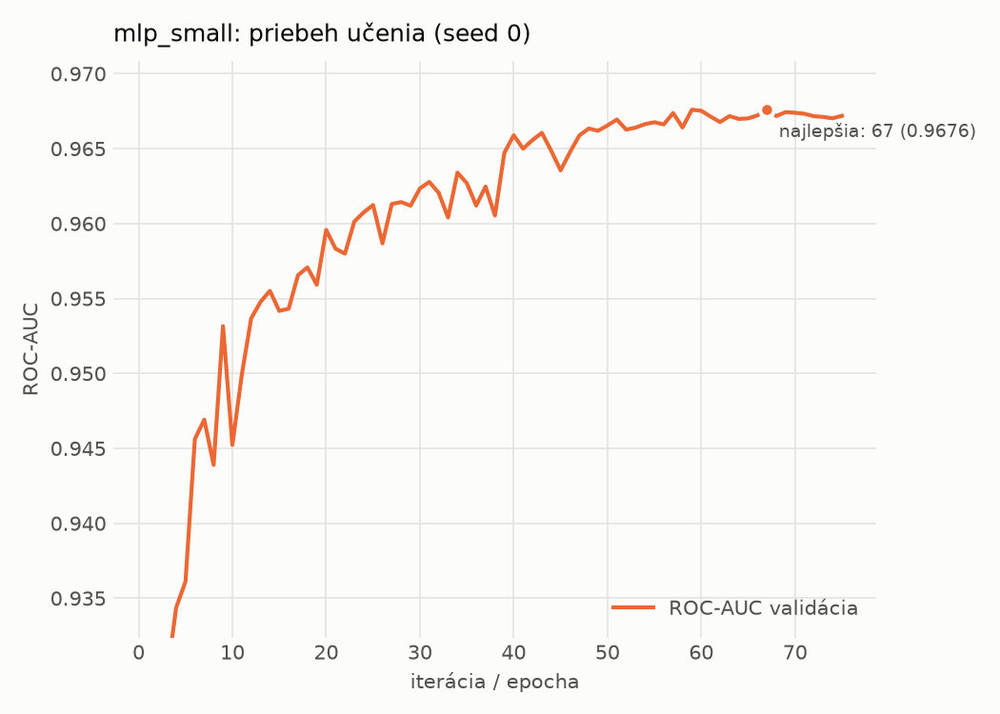

# dynamic/mlp_small – beh `20261123-193925`

> Automaticky generované (`src/training/run_tabular.py`). Konfigurácia: `config.yaml`, protokol: `protocol.yaml`.

- **Model:** `mlp` – malá neurónová sieť (1–2 skryté vrstvy), kandidát na ľahkého študenta
- **Ladenie:** 30 dokončených pokusov (Optuna TPE), cieľ ROC-AUC na validácii, 6.0 min
- **Finálne modely:** seedy [0, 1, 2]; hodnoty sú priemer ± smerodajná odchýlka cez seedy
- **Najlepšie hyperparametre:** `{"width_decay": 0.5, "max_epochs": 100, "patience": 8, "hidden_layers": 2, "hidden_width": 256, "dropout": 0.06125761383416514, "lr": 0.0018225597913134257, "weight_decay": 9.759441755448828e-06, "batch_size": 256}`

## Detekčná kvalita (bez prahu)
| metrika | train (podvzorka) | validácia | test |
|---|---|---|---|
| ROC-AUC | 0.9917 ± 0.0015 | 0.9672 ± 0.0008 | 0.9651 ± 0.0009 |
| PR-AUC | 0.9911 ± 0.0016 | 0.9662 ± 0.0014 | 0.9654 ± 0.0011 |
| TPR pri FPR 1 % | 0.9016 ± 0.0148 | 0.7507 ± 0.0115 | 0.7413 ± 0.0087 |
| TPR pri FPR 0,1 % | 0.7947 ± 0.0160 | 0.2554 ± 0.0851 | 0.3551 ± 0.0673 |
| log loss | 0.1127 ± 0.0094 | 0.2390 ± 0.0027 | 0.2409 ± 0.0063 |
| Brier skóre | 0.0317 ± 0.0029 | 0.0631 ± 0.0006 | 0.0646 ± 0.0013 |

Rozdiel ROC-AUC train − validácia: **0.0246** (veľký rozdiel = preučenie).

## Pri prahu z validácie (FPR ≤ 1% na validácii)
| metrika | train (podvzorka) | validácia | test |
|---|---|---|---|
| accuracy | 0.9022 ± 0.0065 | 0.8829 ± 0.0053 | 0.8717 ± 0.0052 |
| balanced accuracy | 0.8878 ± 0.0075 | 0.8705 ± 0.0058 | 0.8579 ± 0.0059 |
| precision | 0.9994 ± 0.0003 | 0.9844 ± 0.0005 | 0.9856 ± 0.0012 |
| recall (TPR) | 0.7759 ± 0.0149 | 0.7507 ± 0.0115 | 0.7244 ± 0.0126 |
| FPR | 0.0004 ± 0.0002 | 0.0096 ± 0.0002 | 0.0086 ± 0.0009 |
| F1 | 0.8736 ± 0.0094 | 0.8518 ± 0.0076 | 0.8350 ± 0.0080 |
| MCC | 0.8129 ± 0.0118 | 0.7770 ± 0.0095 | 0.7574 ± 0.0090 |

## Pri pevnom prahu 0.5
| metrika | train (podvzorka) | validácia | test |
|---|---|---|---|
| accuracy | 0.9596 ± 0.0035 | 0.9165 ± 0.0015 | 0.9163 ± 0.0014 |
| balanced accuracy | 0.9580 ± 0.0038 | 0.9152 ± 0.0015 | 0.9144 ± 0.0017 |
| precision | 0.9605 ± 0.0048 | 0.9100 ± 0.0057 | 0.9155 ± 0.0041 |
| recall (TPR) | 0.9461 ± 0.0072 | 0.9030 ± 0.0061 | 0.8959 ± 0.0061 |
| FPR | 0.0300 ± 0.0038 | 0.0726 ± 0.0055 | 0.0672 ± 0.0039 |
| F1 | 0.9532 ± 0.0041 | 0.9065 ± 0.0016 | 0.9056 ± 0.0018 |
| MCC | 0.9177 ± 0.0071 | 0.8310 ± 0.0029 | 0.8306 ± 0.0028 |

## Výpočtové nároky (seed 0, testovacia množina)
| meranie | hodnota |
|---|---|
| tréning finálneho modelu | 20.3 s (priemer cez seedy) |
| ladenie spolu | 358 s |
| počet parametrov / uzlov | 65 537 |
| veľkosť modelu na disku | 0.27 MB |
| transformácia vstupu – latencia (1 vlákno) | 0.014 ms |
| transformácia vstupu – priepustnosť | 779 555 vzoriek/s |
| CPU latencia modelu (batch 1, 1 vlákno) | 0.099 ms (p95 0.112) |
| CPU priepustnosť (24 vlákien) | 2 660 724 vzoriek/s |
| GPU latencia (batch 1) | 0.633 ms (p95 0.664) |
| GPU priepustnosť | 1 454 445 vzoriek/s |
| GPU špičková pamäť | 66 MB |

## Grafy
| | |
|---|---|
|  |  |
|  |  |
|  |  |
|  |  |

## Súbory
`metrics.json` (všetky metriky po seedoch vrátane rodín), `timing.json`, `hpo_trials.csv`,
`predictions/<časť>_seed<N>.parquet` (sha256, family, label, score), `model/seed_<N>/`, `log.txt`.
