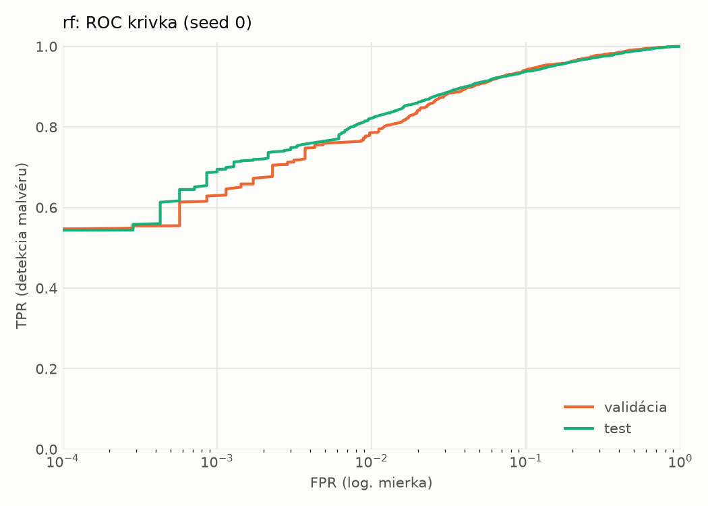
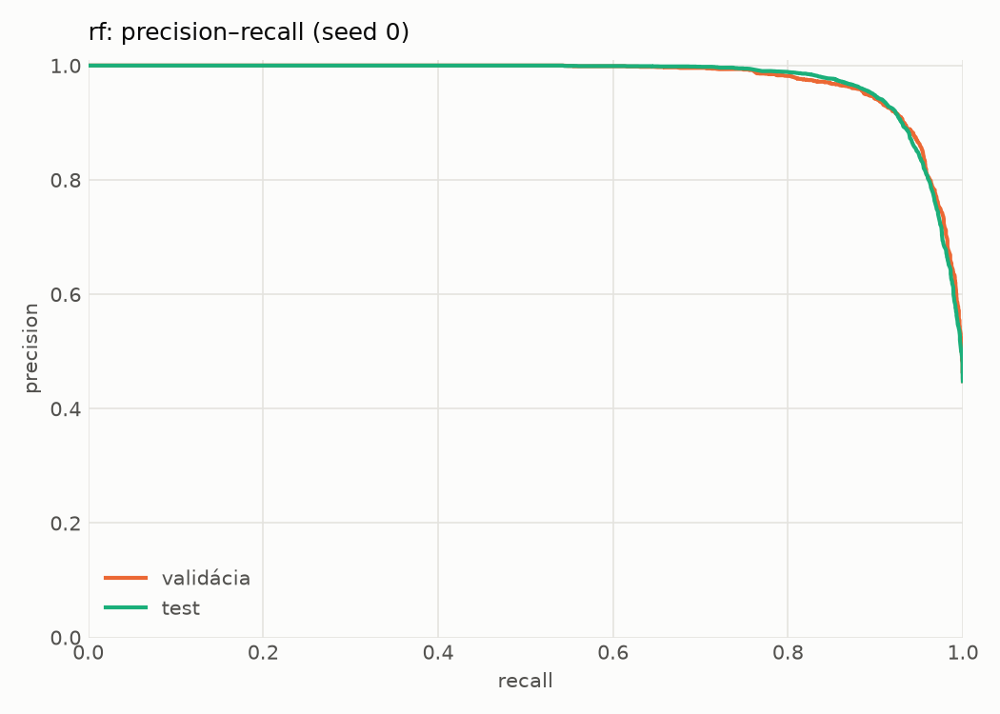
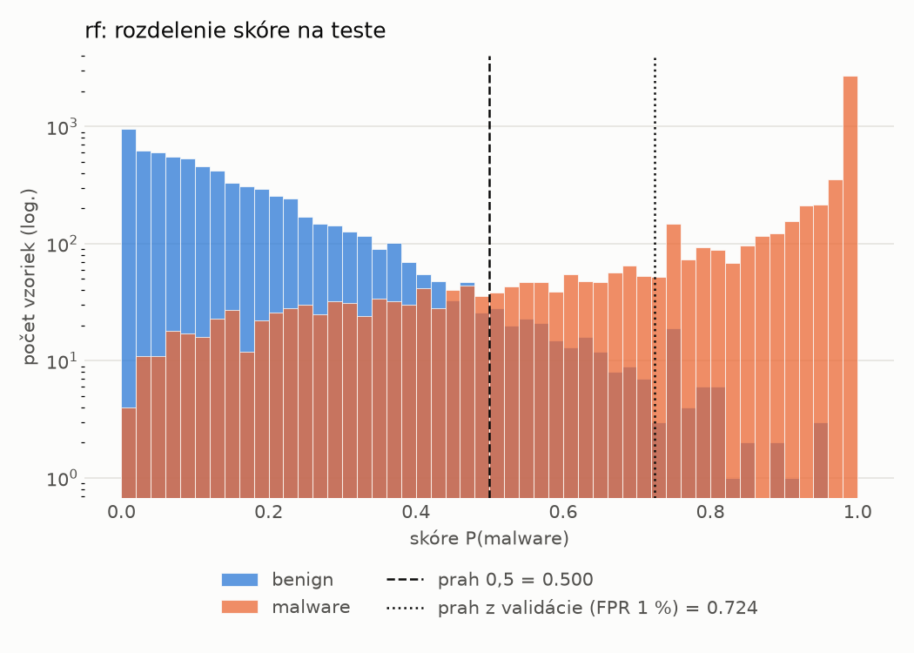
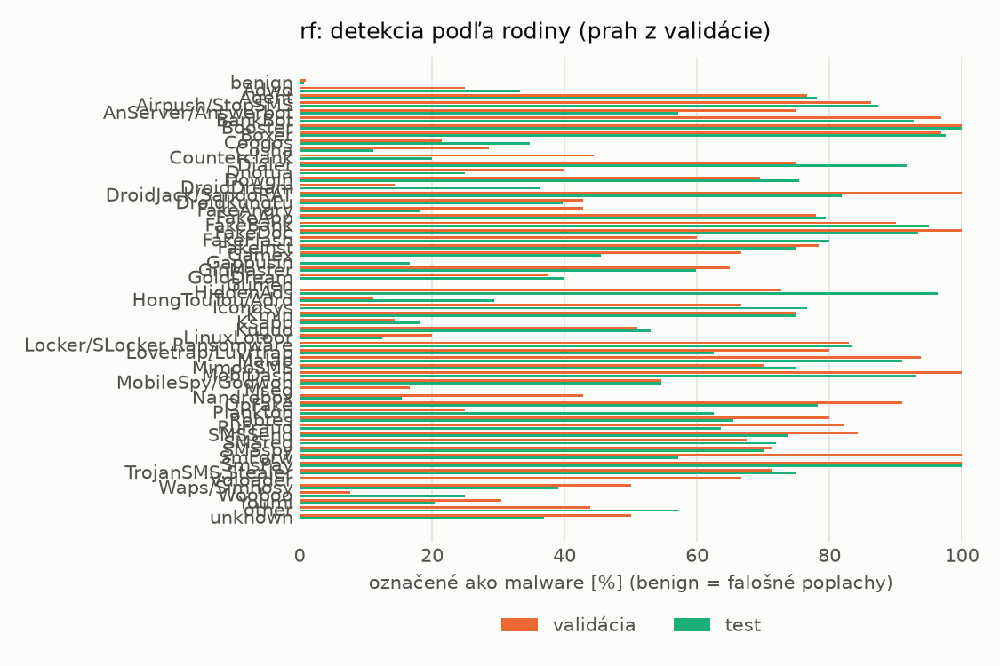
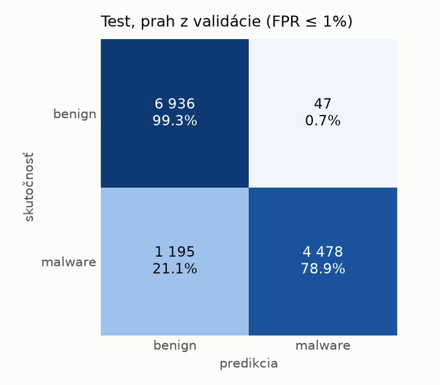
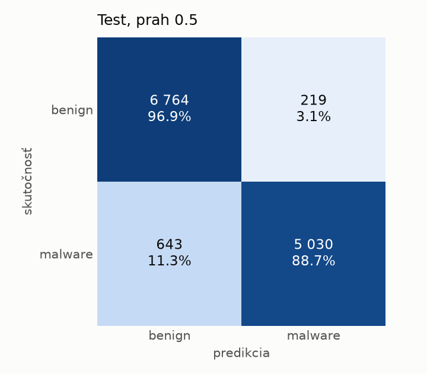
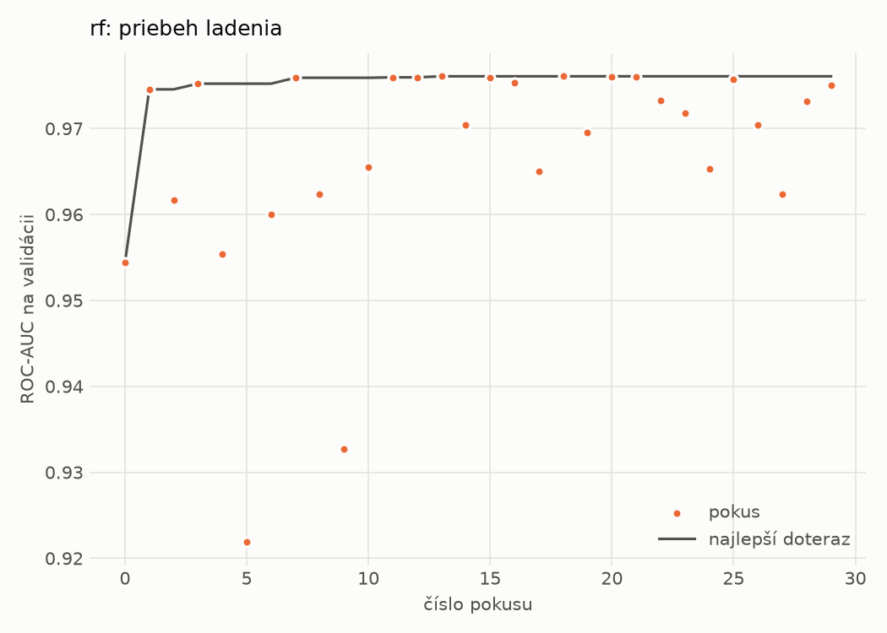

# dynamic/rf – beh `20261123-191811`

> Automaticky generované (`src/training/run_tabular.py`). Konfigurácia: `config.yaml`, protokol: `protocol.yaml`.

- **Model:** `random_forest` – Random Forest (pôvodné hodnoty príznakov)
- **Ladenie:** 30 dokončených pokusov (Optuna TPE), cieľ ROC-AUC na validácii, 1.0 min
- **Finálne modely:** seedy [0, 1, 2]; hodnoty sú priemer ± smerodajná odchýlka cez seedy
- **Najlepšie hyperparametre:** `{"n_estimators": 450, "max_depth": null, "min_samples_leaf": 1, "max_features": "sqrt"}`

## Detekčná kvalita (bez prahu)
| metrika | train (podvzorka) | validácia | test |
|---|---|---|---|
| ROC-AUC | 0.9998 ± 0.0000 | 0.9763 ± 0.0001 | 0.9751 ± 0.0001 |
| PR-AUC | 0.9997 ± 0.0000 | 0.9768 ± 0.0000 | 0.9768 ± 0.0001 |
| TPR pri FPR 1 % | 0.9991 ± 0.0000 | 0.7824 ± 0.0034 | 0.8193 ± 0.0023 |
| TPR pri FPR 0,1 % | 0.9514 ± 0.0014 | 0.6218 ± 0.0183 | 0.6864 ± 0.0033 |
| log loss | 0.0627 ± 0.0001 | 0.2081 ± 0.0003 | 0.2101 ± 0.0006 |
| Brier skóre | 0.0090 ± 0.0000 | 0.0587 ± 0.0001 | 0.0583 ± 0.0001 |

Rozdiel ROC-AUC train − validácia: **0.0235** (veľký rozdiel = preučenie).

## Pri prahu z validácie (FPR ≤ 1% na validácii)
| metrika | train (podvzorka) | validácia | test |
|---|---|---|---|
| accuracy | 0.9882 ± 0.0014 | 0.8971 ± 0.0015 | 0.9008 ± 0.0013 |
| balanced accuracy | 0.9870 ± 0.0016 | 0.8863 ± 0.0017 | 0.8901 ± 0.0014 |
| precision | 0.9958 ± 0.0000 | 0.9849 ± 0.0001 | 0.9898 ± 0.0003 |
| recall (TPR) | 0.9771 ± 0.0032 | 0.7824 ± 0.0034 | 0.7868 ± 0.0031 |
| FPR | 0.0032 ± 0.0000 | 0.0097 ± 0.0000 | 0.0066 ± 0.0002 |
| F1 | 0.9864 ± 0.0017 | 0.8720 ± 0.0021 | 0.8767 ± 0.0018 |
| MCC | 0.9762 ± 0.0028 | 0.8024 ± 0.0027 | 0.8102 ± 0.0022 |

## Pri pevnom prahu 0.5
| metrika | train (podvzorka) | validácia | test |
|---|---|---|---|
| accuracy | 0.9976 ± 0.0000 | 0.9306 ± 0.0009 | 0.9320 ± 0.0006 |
| balanced accuracy | 0.9977 ± 0.0000 | 0.9265 ± 0.0008 | 0.9278 ± 0.0006 |
| precision | 0.9957 ± 0.0000 | 0.9556 ± 0.0015 | 0.9584 ± 0.0005 |
| recall (TPR) | 0.9989 ± 0.0000 | 0.8864 ± 0.0006 | 0.8869 ± 0.0008 |
| FPR | 0.0034 ± 0.0000 | 0.0334 ± 0.0012 | 0.0313 ± 0.0004 |
| F1 | 0.9972 ± 0.0000 | 0.9197 ± 0.0010 | 0.9213 ± 0.0007 |
| MCC | 0.9951 ± 0.0000 | 0.8607 ± 0.0018 | 0.8637 ± 0.0011 |

## Výpočtové nároky (seed 0, testovacia množina)
| meranie | hodnota |
|---|---|
| tréning finálneho modelu | 3.0 s (priemer cez seedy) |
| ladenie spolu | 63 s |
| počet parametrov / uzlov | 4 230 276 |
| veľkosť modelu na disku | 338.78 MB |
| CPU latencia modelu (batch 1, 1 vlákno) | 13.511 ms (p95 13.952) |
| CPU priepustnosť (24 vlákien) | 109 770 vzoriek/s |

## Grafy
| | |
|---|---|
|  |  |
|  |  |
|  |  |
|  |  |

## Súbory
`metrics.json` (všetky metriky po seedoch vrátane rodín), `timing.json`, `hpo_trials.csv`,
`predictions/<časť>_seed<N>.parquet` (sha256, family, label, score), `model/seed_<N>/`, `log.txt`.
