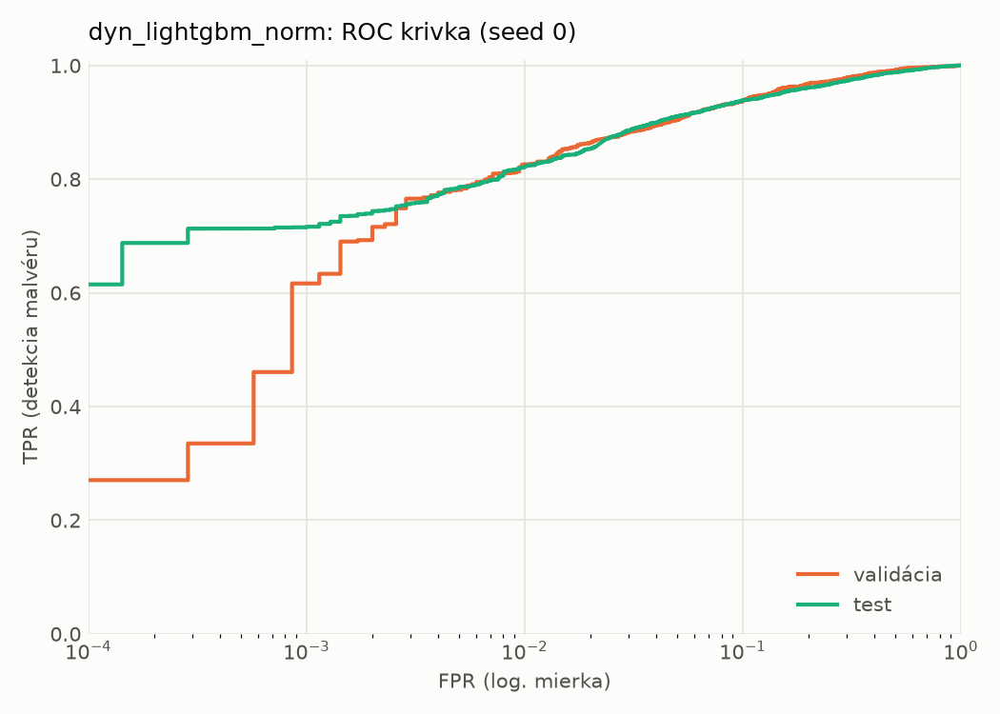
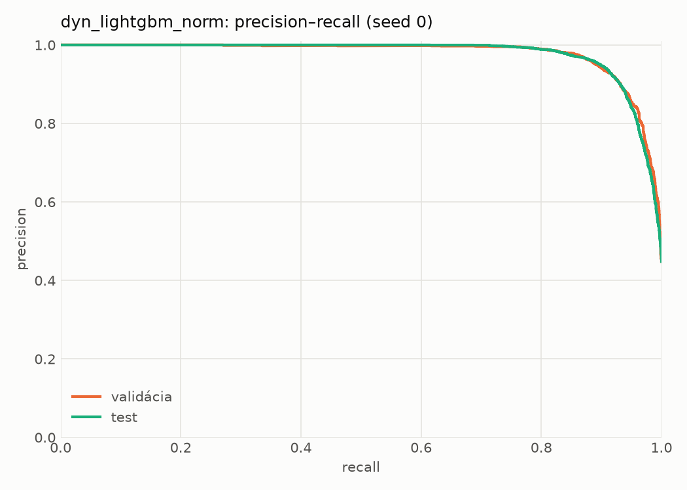
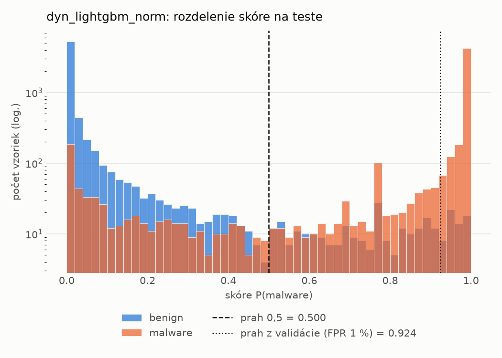
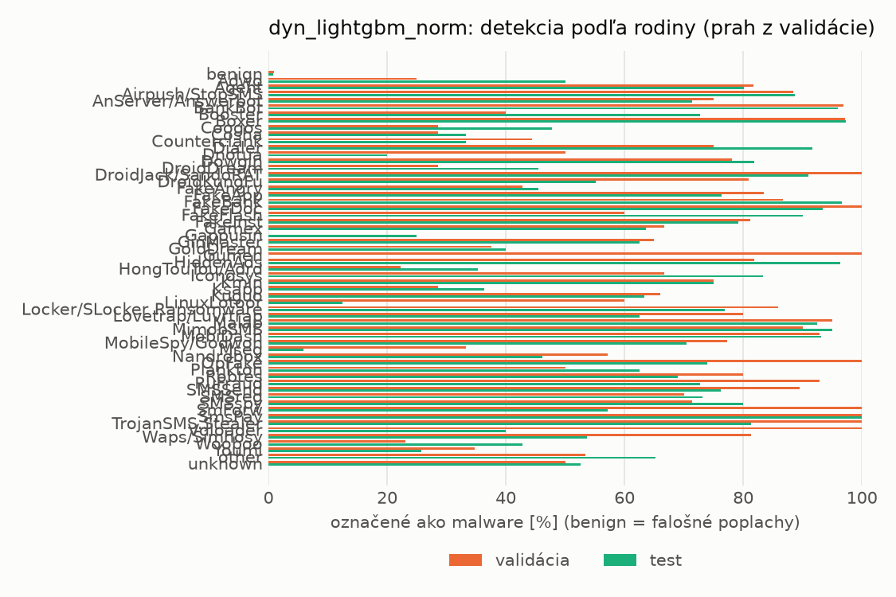
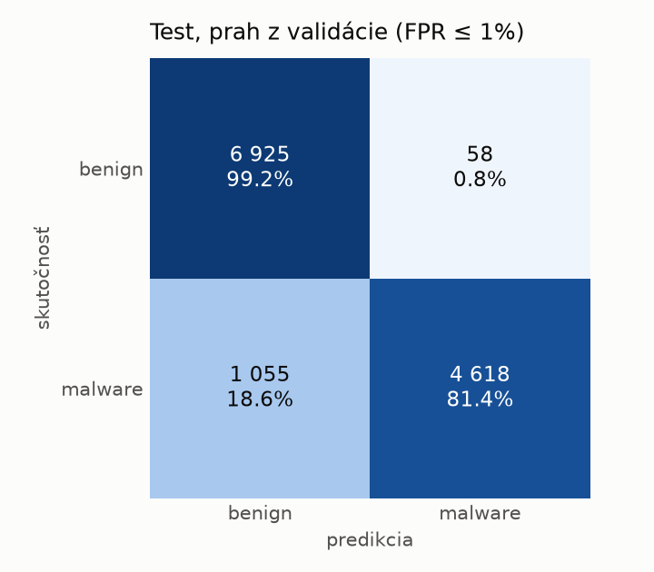
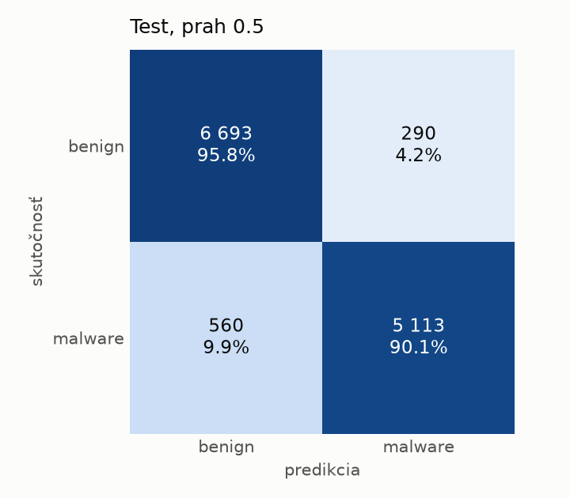
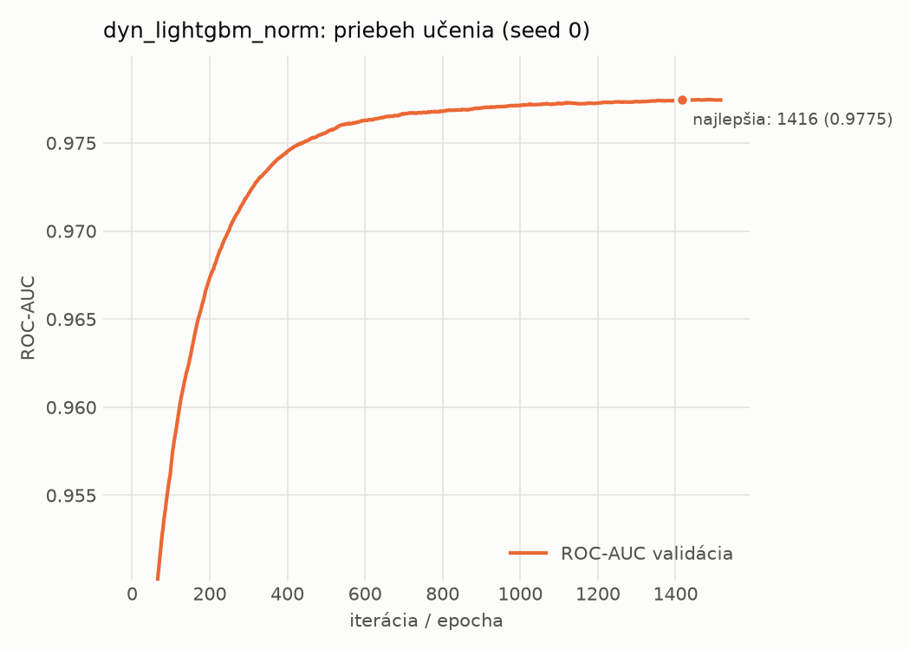

# dynamic_norm/dyn_lightgbm_norm – beh `20261123-201347`

> Automaticky generované (`src/training/run_tabular.py`). Konfigurácia: `config.yaml`, protokol: `protocol.yaml`.

- **Model:** `lightgbm` – dynamic lightgbm s dynamikou ako podiely systémových volaní (kontrola artefaktu množstva aktivity)
- **Ladenie:** bez ladenia – hyperparametre prevzaté z `runs_v4/emu_p/full/dynamic/lightgbm/20261123-191933`
- **Finálne modely:** seedy [0, 1, 2]; hodnoty sú priemer ± smerodajná odchýlka cez seedy
- **Najlepšie hyperparametre:** `{"num_boost_round": 5000, "early_stopping_rounds": 100, "learning_rate": 0.020757076290036595, "num_leaves": 469, "min_child_samples": 116, "feature_fraction": 0.9578728497385997, "bagging_fraction": 0.9870779948179744, "lambda_l1": 0.002495609179699052, "lambda_l2": 0.0024900497451761272}`

## Detekčná kvalita (bez prahu)
| metrika | train (podvzorka) | validácia | test |
|---|---|---|---|
| ROC-AUC | 1.0000 ± 0.0000 | 0.9776 ± 0.0001 | 0.9752 ± 0.0000 |
| PR-AUC | 0.9999 ± 0.0000 | 0.9779 ± 0.0001 | 0.9771 ± 0.0001 |
| TPR pri FPR 1 % | 1.0000 ± 0.0000 | 0.8234 ± 0.0023 | 0.8227 ± 0.0017 |
| TPR pri FPR 0,1 % | 0.9880 ± 0.0005 | 0.6201 ± 0.0031 | 0.7165 ± 0.0012 |
| log loss | 0.0095 ± 0.0024 | 0.2137 ± 0.0158 | 0.2200 ± 0.0170 |
| Brier skóre | 0.0020 ± 0.0001 | 0.0543 ± 0.0007 | 0.0541 ± 0.0006 |

Rozdiel ROC-AUC train − validácia: **0.0224** (veľký rozdiel = preučenie).

## Pri prahu z validácie (FPR ≤ 1% na validácii)
| metrika | train (podvzorka) | validácia | test |
|---|---|---|---|
| accuracy | 0.9914 ± 0.0005 | 0.9155 ± 0.0010 | 0.9108 ± 0.0014 |
| balanced accuracy | 0.9901 ± 0.0006 | 0.9069 ± 0.0011 | 0.9014 ± 0.0015 |
| precision | 0.9998 ± 0.0001 | 0.9858 ± 0.0002 | 0.9877 ± 0.0001 |
| recall (TPR) | 0.9804 ± 0.0011 | 0.8234 ± 0.0023 | 0.8111 ± 0.0031 |
| FPR | 0.0001 ± 0.0001 | 0.0096 ± 0.0002 | 0.0082 ± 0.0001 |
| F1 | 0.9900 ± 0.0006 | 0.8973 ± 0.0013 | 0.8907 ± 0.0018 |
| MCC | 0.9826 ± 0.0010 | 0.8362 ± 0.0017 | 0.8279 ± 0.0025 |

## Pri pevnom prahu 0.5
| metrika | train (podvzorka) | validácia | test |
|---|---|---|---|
| accuracy | 0.9974 ± 0.0001 | 0.9310 ± 0.0011 | 0.9335 ± 0.0008 |
| balanced accuracy | 0.9976 ± 0.0001 | 0.9283 ± 0.0010 | 0.9304 ± 0.0007 |
| precision | 0.9957 ± 0.0000 | 0.9405 ± 0.0022 | 0.9482 ± 0.0018 |
| recall (TPR) | 0.9985 ± 0.0001 | 0.9031 ± 0.0004 | 0.9008 ± 0.0007 |
| FPR | 0.0034 ± 0.0000 | 0.0464 ± 0.0018 | 0.0400 ± 0.0014 |
| F1 | 0.9971 ± 0.0001 | 0.9214 ± 0.0012 | 0.9239 ± 0.0008 |
| MCC | 0.9948 ± 0.0001 | 0.8605 ± 0.0023 | 0.8658 ± 0.0016 |

## Výpočtové nároky (seed 0, testovacia množina)
| meranie | hodnota |
|---|---|
| tréning finálneho modelu | 38.8 s (priemer cez seedy) |
| ladenie spolu | 0 s |
| počet parametrov / uzlov | 881 450 |
| veľkosť modelu na disku | 49.96 MB |
| CPU latencia modelu (batch 1, 1 vlákno) | 0.346 ms (p95 0.479) |
| CPU priepustnosť (24 vlákien) | 32 422 vzoriek/s |

## Grafy
| | |
|---|---|
|  |  |
|  |  |
|  |  |
|  |  |

## Súbory
`metrics.json` (všetky metriky po seedoch vrátane rodín), `timing.json`, `hpo_trials.csv`,
`predictions/<časť>_seed<N>.parquet` (sha256, family, label, score), `model/seed_<N>/`, `log.txt`.
