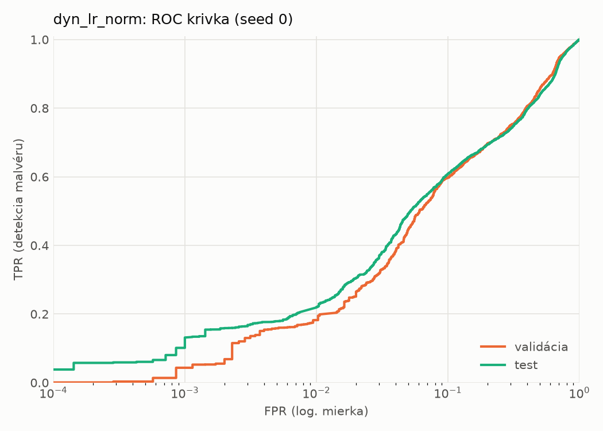
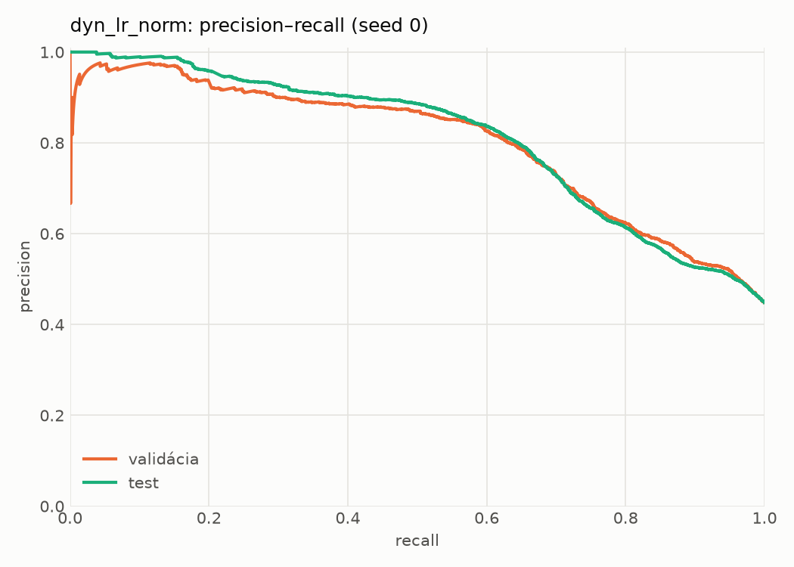
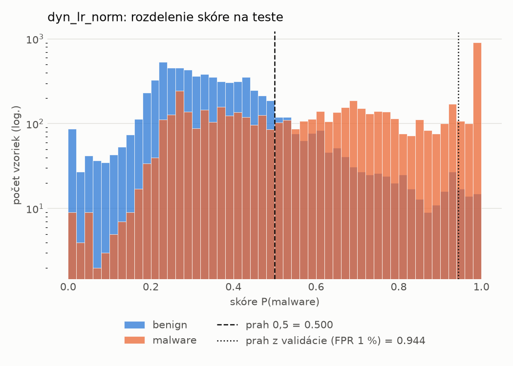
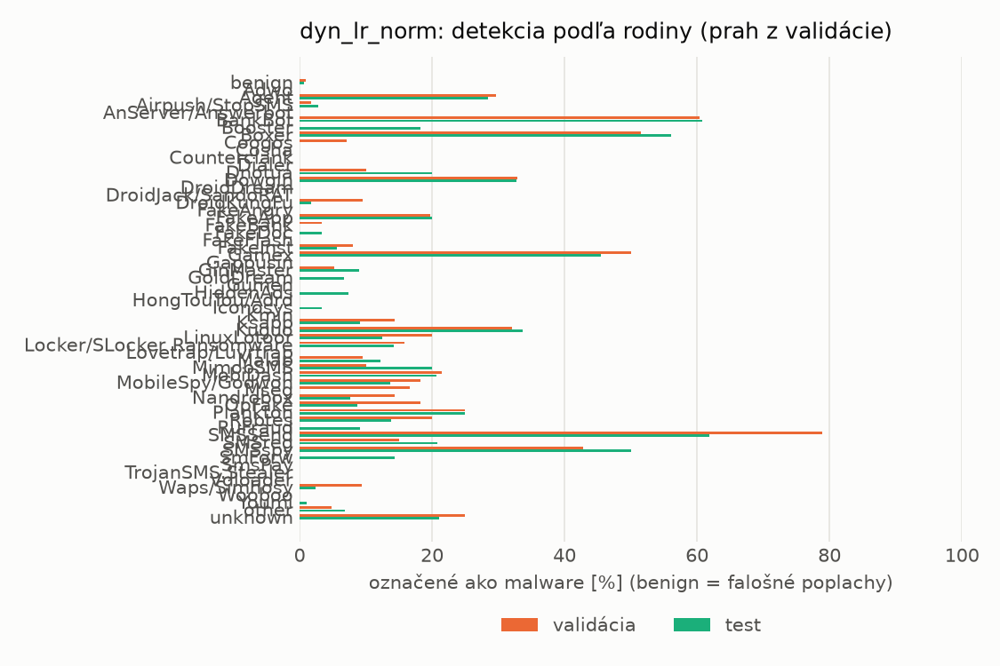
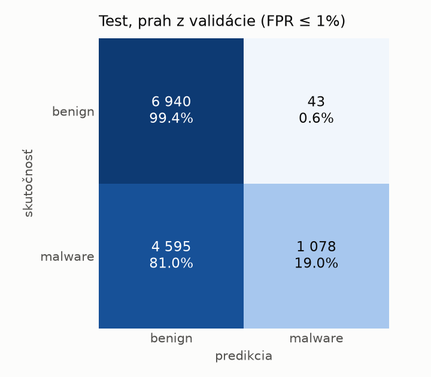
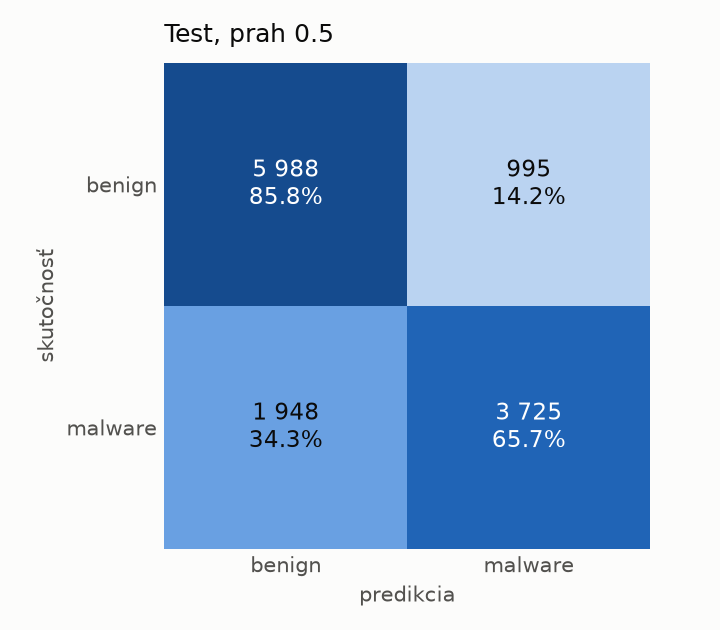

# dynamic_norm/dyn_lr_norm – beh `20261123-201614`

> Automaticky generované (`src/training/run_tabular.py`). Konfigurácia: `config.yaml`, protokol: `protocol.yaml`.

- **Model:** `logreg` – dynamic lr s dynamikou ako podiely systémových volaní (kontrola artefaktu množstva aktivity)
- **Ladenie:** bez ladenia – hyperparametre prevzaté z `runs_v4/emu_p/full/dynamic/lr/20261123-191800`
- **Finálne modely:** seedy [0, 1, 2]; hodnoty sú priemer ± smerodajná odchýlka cez seedy
- **Najlepšie hyperparametre:** `{"max_iter": 2000, "C": 7.504621081078761}`

## Detekčná kvalita (bez prahu)
| metrika | train (podvzorka) | validácia | test |
|---|---|---|---|
| ROC-AUC | 0.8127 ± 0.0000 | 0.8099 ± 0.0000 | 0.8071 ± 0.0000 |
| PR-AUC | 0.8038 ± 0.0000 | 0.7996 ± 0.0000 | 0.8101 ± 0.0000 |
| TPR pri FPR 1 % | 0.2133 ± 0.0000 | 0.1824 ± 0.0000 | 0.2052 ± 0.0000 |
| TPR pri FPR 0,1 % | 0.0275 ± 0.0000 | 0.0434 ± 0.0000 | 0.1014 ± 0.0000 |
| log loss | 0.5264 ± 0.0000 | 0.5378 ± 0.0000 | 0.5238 ± 0.0000 |
| Brier skóre | 0.1708 ± 0.0000 | 0.1743 ± 0.0000 | 0.1728 ± 0.0000 |

Rozdiel ROC-AUC train − validácia: **0.0028** (veľký rozdiel = preučenie).

## Pri prahu z validácie (FPR ≤ 1% na validácii)
| metrika | train (podvzorka) | validácia | test |
|---|---|---|---|
| accuracy | 0.6472 ± 0.0000 | 0.6281 ± 0.0000 | 0.6335 ± 0.0000 |
| balanced accuracy | 0.5962 ± 0.0000 | 0.5863 ± 0.0000 | 0.5919 ± 0.0000 |
| precision | 0.9520 ± 0.0000 | 0.9383 ± 0.0000 | 0.9616 ± 0.0000 |
| recall (TPR) | 0.2002 ± 0.0000 | 0.1824 ± 0.0000 | 0.1900 ± 0.0000 |
| FPR | 0.0078 ± 0.0000 | 0.0097 ± 0.0000 | 0.0062 ± 0.0000 |
| F1 | 0.3308 ± 0.0000 | 0.3054 ± 0.0000 | 0.3173 ± 0.0000 |
| MCC | 0.3307 ± 0.0000 | 0.3044 ± 0.0000 | 0.3218 ± 0.0000 |

## Pri pevnom prahu 0.5
| metrika | train (podvzorka) | validácia | test |
|---|---|---|---|
| accuracy | 0.7742 ± 0.0000 | 0.7641 ± 0.0000 | 0.7675 ± 0.0000 |
| balanced accuracy | 0.7621 ± 0.0000 | 0.7535 ± 0.0000 | 0.7571 ± 0.0000 |
| precision | 0.7818 ± 0.0000 | 0.7861 ± 0.0000 | 0.7892 ± 0.0000 |
| recall (TPR) | 0.6680 ± 0.0000 | 0.6508 ± 0.0000 | 0.6566 ± 0.0000 |
| FPR | 0.1439 ± 0.0000 | 0.1439 ± 0.0000 | 0.1425 ± 0.0000 |
| F1 | 0.7205 ± 0.0000 | 0.7121 ± 0.0000 | 0.7168 ± 0.0000 |
| MCC | 0.5377 ± 0.0000 | 0.5218 ± 0.0000 | 0.5287 ± 0.0000 |

## Výpočtové nároky (seed 0, testovacia množina)
| meranie | hodnota |
|---|---|
| tréning finálneho modelu | 0.4 s (priemer cez seedy) |
| ladenie spolu | 0 s |
| počet parametrov / uzlov | 123 |
| veľkosť modelu na disku | 0.01 MB |
| transformácia vstupu – latencia (1 vlákno) | 0.005 ms |
| transformácia vstupu – priepustnosť | 1 284 299 vzoriek/s |
| CPU latencia modelu (batch 1, 1 vlákno) | 0.004 ms (p95 0.005) |
| CPU priepustnosť (24 vlákien) | 4 458 850 vzoriek/s |

## Grafy
| | |
|---|---|
|  |  |
|  |  |
|  |  |
|  |  |

## Súbory
`metrics.json` (všetky metriky po seedoch vrátane rodín), `timing.json`, `hpo_trials.csv`,
`predictions/<časť>_seed<N>.parquet` (sha256, family, label, score), `model/seed_<N>/`, `log.txt`.
