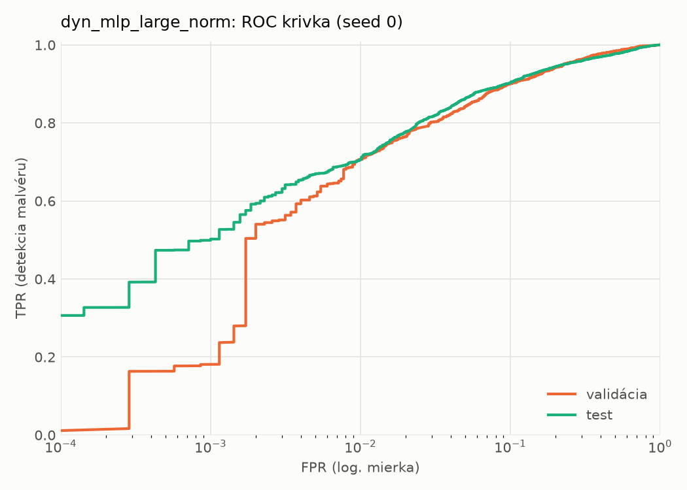
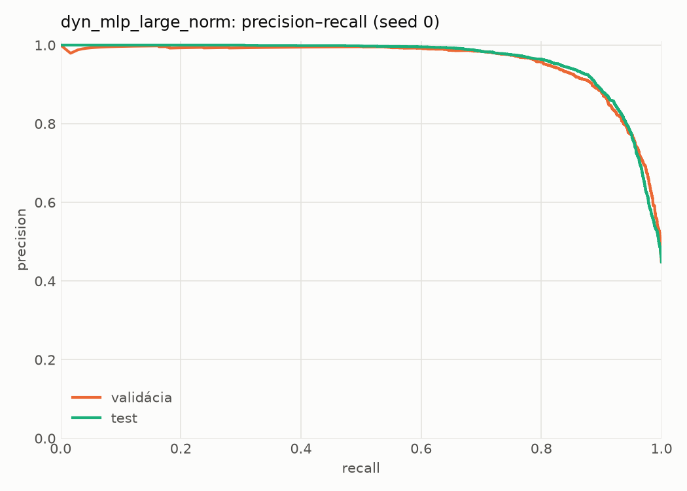
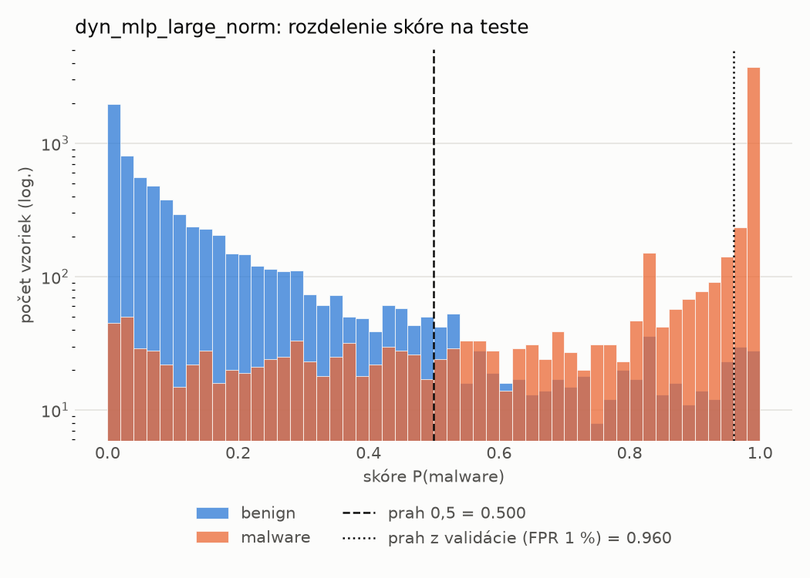
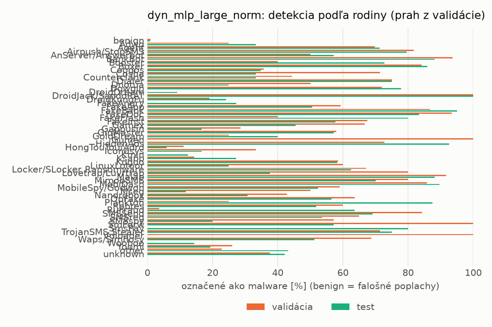
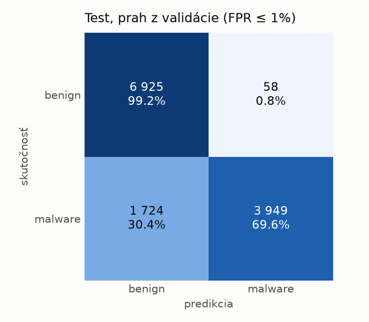
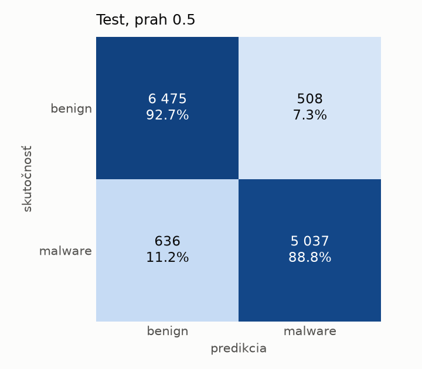
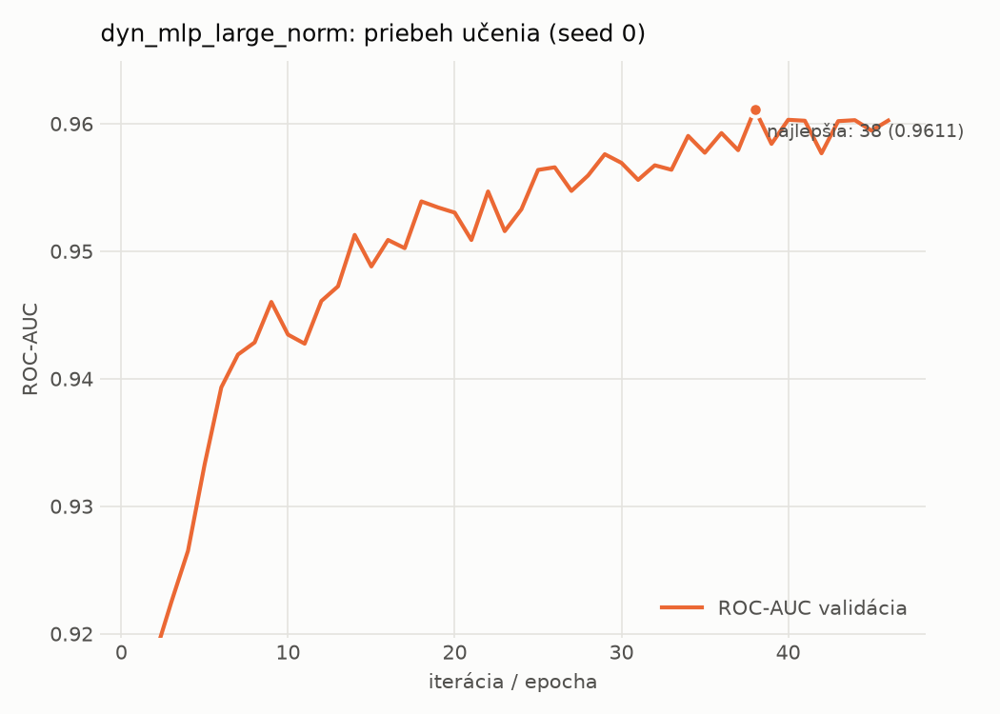

# dynamic_norm/dyn_mlp_large_norm – beh `20261123-201617`

> Automaticky generované (`src/training/run_tabular.py`). Konfigurácia: `config.yaml`, protokol: `protocol.yaml`.

- **Model:** `mlp` – dynamic mlp_large s dynamikou ako podiely systémových volaní (kontrola artefaktu množstva aktivity)
- **Ladenie:** bez ladenia – hyperparametre prevzaté z `runs_v4/emu_p/full/dynamic/mlp_large/20261123-194626`
- **Finálne modely:** seedy [0, 1, 2]; hodnoty sú priemer ± smerodajná odchýlka cez seedy
- **Najlepšie hyperparametre:** `{"max_epochs": 100, "patience": 8, "hidden_layers": 3, "hidden_width": 1024, "width_decay": 0.5, "dropout": 0.11628417924821868, "lr": 0.0004582958225587737, "weight_decay": 0.0007705605519981878, "batch_size": 512}`

## Detekčná kvalita (bez prahu)
| metrika | train (podvzorka) | validácia | test |
|---|---|---|---|
| ROC-AUC | 0.9859 ± 0.0018 | 0.9617 ± 0.0005 | 0.9611 ± 0.0006 |
| PR-AUC | 0.9849 ± 0.0018 | 0.9606 ± 0.0013 | 0.9637 ± 0.0006 |
| TPR pri FPR 1 % | 0.8549 ± 0.0150 | 0.7118 ± 0.0052 | 0.7228 ± 0.0158 |
| TPR pri FPR 0,1 % | 0.7627 ± 0.0075 | 0.2520 ± 0.0739 | 0.5203 ± 0.0200 |
| log loss | 0.1512 ± 0.0099 | 0.2573 ± 0.0020 | 0.2463 ± 0.0017 |
| Brier skóre | 0.0437 ± 0.0030 | 0.0723 ± 0.0014 | 0.0694 ± 0.0011 |

Rozdiel ROC-AUC train − validácia: **0.0242** (veľký rozdiel = preučenie).

## Pri prahu z validácie (FPR ≤ 1% na validácii)
| metrika | train (podvzorka) | validácia | test |
|---|---|---|---|
| accuracy | 0.8819 ± 0.0034 | 0.8654 ± 0.0023 | 0.8594 ± 0.0023 |
| balanced accuracy | 0.8645 ± 0.0039 | 0.8510 ± 0.0026 | 0.8440 ± 0.0026 |
| precision | 0.9990 ± 0.0004 | 0.9834 ± 0.0001 | 0.9875 ± 0.0017 |
| recall (TPR) | 0.7296 ± 0.0078 | 0.7118 ± 0.0052 | 0.6951 ± 0.0054 |
| FPR | 0.0006 ± 0.0002 | 0.0097 ± 0.0000 | 0.0072 ± 0.0010 |
| F1 | 0.8433 ± 0.0053 | 0.8259 ± 0.0035 | 0.8159 ± 0.0037 |
| MCC | 0.7761 ± 0.0062 | 0.7458 ± 0.0041 | 0.7362 ± 0.0041 |

## Pri pevnom prahu 0.5
| metrika | train (podvzorka) | validácia | test |
|---|---|---|---|
| accuracy | 0.9448 ± 0.0022 | 0.9053 ± 0.0022 | 0.9108 ± 0.0015 |
| balanced accuracy | 0.9431 ± 0.0026 | 0.9040 ± 0.0022 | 0.9089 ± 0.0014 |
| precision | 0.9420 ± 0.0009 | 0.8965 ± 0.0033 | 0.9084 ± 0.0042 |
| recall (TPR) | 0.9304 ± 0.0056 | 0.8917 ± 0.0034 | 0.8909 ± 0.0034 |
| FPR | 0.0442 ± 0.0009 | 0.0837 ± 0.0030 | 0.0730 ± 0.0039 |
| F1 | 0.9362 ± 0.0027 | 0.8941 ± 0.0025 | 0.8995 ± 0.0016 |
| MCC | 0.8876 ± 0.0044 | 0.8084 ± 0.0045 | 0.8195 ± 0.0031 |

## Výpočtové nároky (seed 0, testovacia množina)
| meranie | hodnota |
|---|---|
| tréning finálneho modelu | 10.6 s (priemer cez seedy) |
| ladenie spolu | 0 s |
| počet parametrov / uzlov | 785 921 |
| veľkosť modelu na disku | 3.17 MB |
| transformácia vstupu – latencia (1 vlákno) | 0.006 ms |
| transformácia vstupu – priepustnosť | 1 221 433 vzoriek/s |
| CPU latencia modelu (batch 1, 1 vlákno) | 0.169 ms (p95 0.190) |
| CPU priepustnosť (24 vlákien) | 395 891 vzoriek/s |
| GPU latencia (batch 1) | 0.533 ms (p95 0.600) |
| GPU priepustnosť | 1 502 321 vzoriek/s |
| GPU špičková pamäť | 121 MB |

## Grafy
| | |
|---|---|
|  |  |
|  |  |
|  |  |
|  |  |

## Súbory
`metrics.json` (všetky metriky po seedoch vrátane rodín), `timing.json`, `hpo_trials.csv`,
`predictions/<časť>_seed<N>.parquet` (sha256, family, label, score), `model/seed_<N>/`, `log.txt`.
