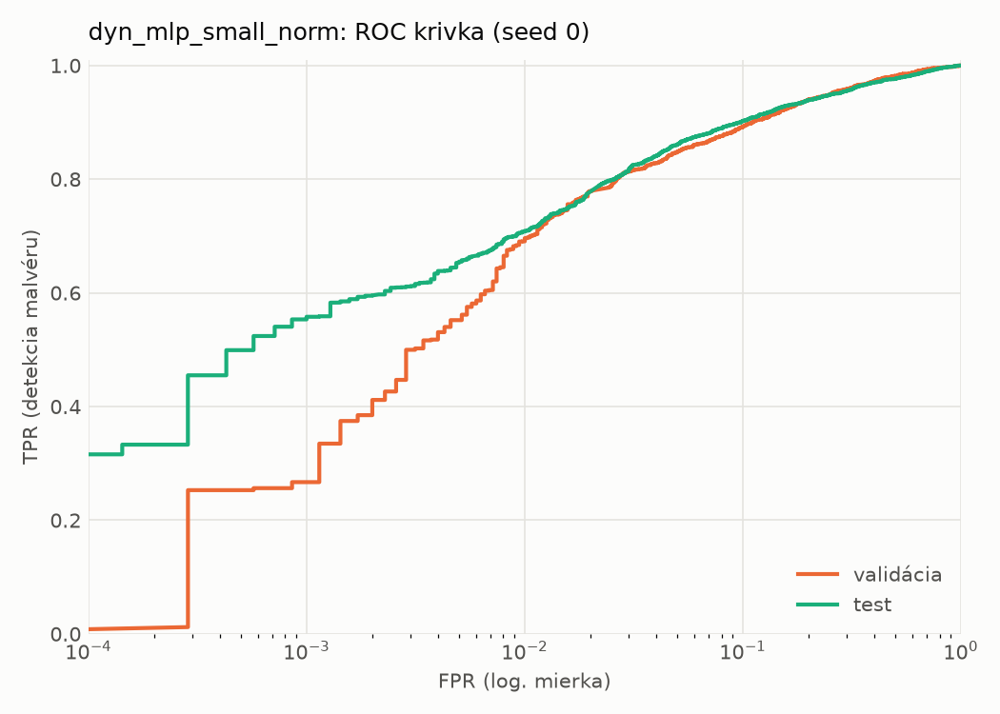
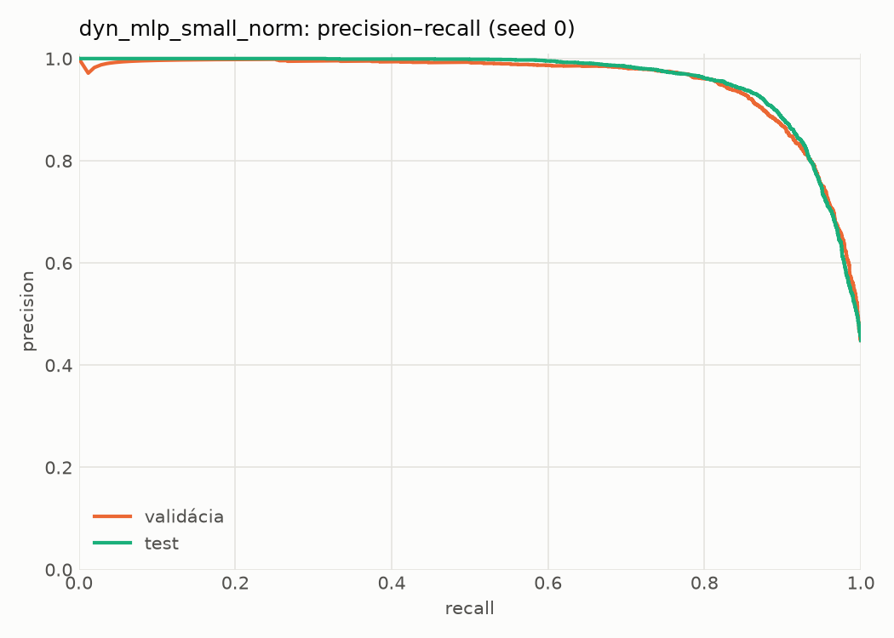
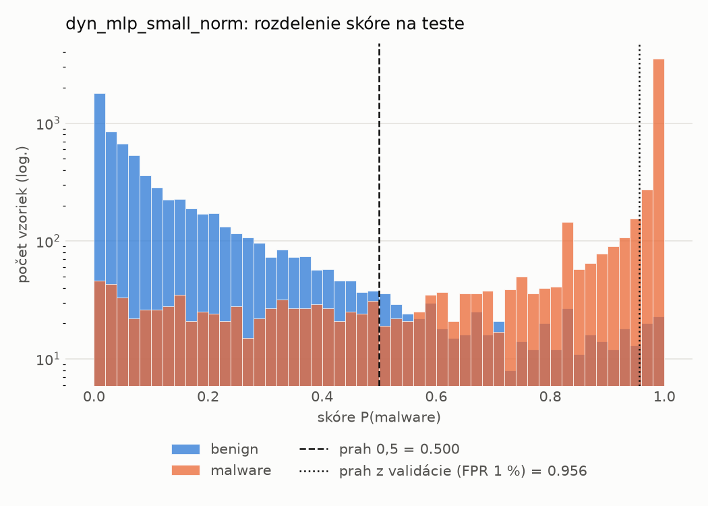
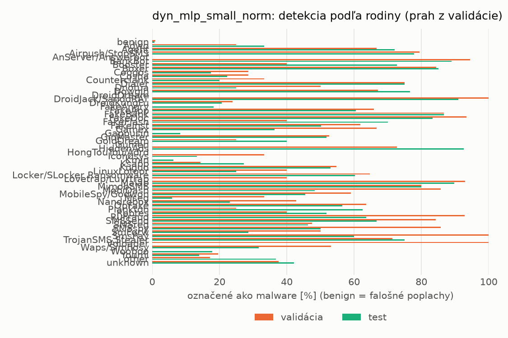
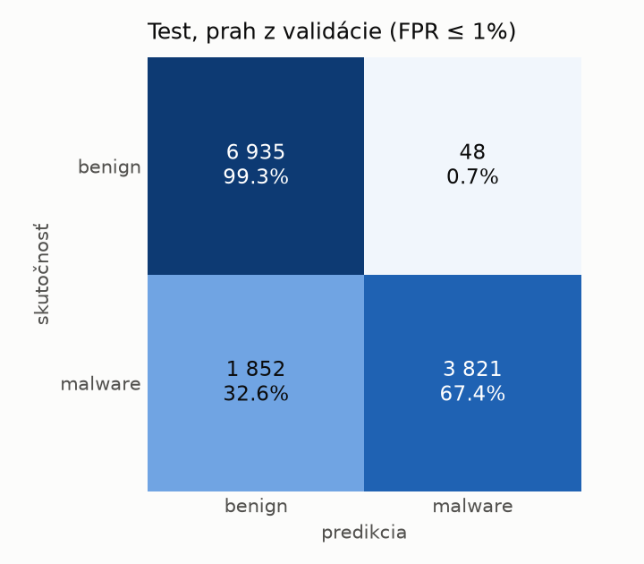
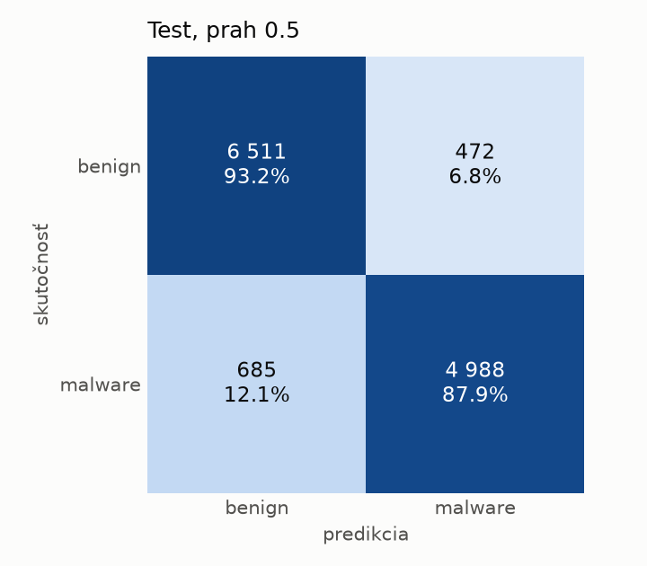
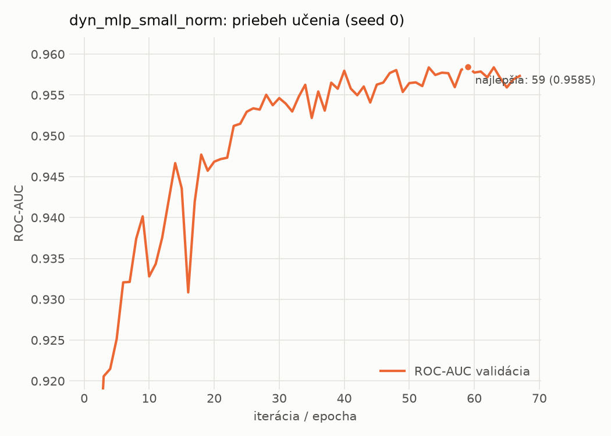

# dynamic_norm/dyn_mlp_small_norm – beh `20261123-201651`

> Automaticky generované (`src/training/run_tabular.py`). Konfigurácia: `config.yaml`, protokol: `protocol.yaml`.

- **Model:** `mlp` – dynamic mlp_small s dynamikou ako podiely systémových volaní (kontrola artefaktu množstva aktivity)
- **Ladenie:** bez ladenia – hyperparametre prevzaté z `runs_v4/emu_p/full/dynamic/mlp_small/20261123-193925`
- **Finálne modely:** seedy [0, 1, 2]; hodnoty sú priemer ± smerodajná odchýlka cez seedy
- **Najlepšie hyperparametre:** `{"width_decay": 0.5, "max_epochs": 100, "patience": 8, "hidden_layers": 2, "hidden_width": 256, "dropout": 0.06125761383416514, "lr": 0.0018225597913134257, "weight_decay": 9.759441755448828e-06, "batch_size": 256}`

## Detekčná kvalita (bez prahu)
| metrika | train (podvzorka) | validácia | test |
|---|---|---|---|
| ROC-AUC | 0.9806 ± 0.0010 | 0.9587 ± 0.0006 | 0.9595 ± 0.0005 |
| PR-AUC | 0.9795 ± 0.0010 | 0.9573 ± 0.0002 | 0.9619 ± 0.0001 |
| TPR pri FPR 1 % | 0.8066 ± 0.0091 | 0.6772 ± 0.0194 | 0.7097 ± 0.0050 |
| TPR pri FPR 0,1 % | 0.7010 ± 0.0038 | 0.2499 ± 0.0472 | 0.5196 ± 0.0300 |
| log loss | 0.1776 ± 0.0025 | 0.2660 ± 0.0052 | 0.2498 ± 0.0038 |
| Brier skóre | 0.0517 ± 0.0007 | 0.0747 ± 0.0008 | 0.0719 ± 0.0009 |

Rozdiel ROC-AUC train − validácia: **0.0219** (veľký rozdiel = preučenie).

## Pri prahu z validácie (FPR ≤ 1% na validácii)
| metrika | train (podvzorka) | validácia | test |
|---|---|---|---|
| accuracy | 0.8638 ± 0.0086 | 0.8499 ± 0.0087 | 0.8442 ± 0.0094 |
| balanced accuracy | 0.8439 ± 0.0099 | 0.8338 ± 0.0097 | 0.8268 ± 0.0106 |
| precision | 0.9981 ± 0.0007 | 0.9826 ± 0.0005 | 0.9898 ± 0.0022 |
| recall (TPR) | 0.6887 ± 0.0201 | 0.6772 ± 0.0194 | 0.6591 ± 0.0224 |
| FPR | 0.0010 ± 0.0004 | 0.0097 ± 0.0000 | 0.0055 ± 0.0014 |
| F1 | 0.8149 ± 0.0140 | 0.8017 ± 0.0138 | 0.7912 ± 0.0157 |
| MCC | 0.7437 ± 0.0152 | 0.7184 ± 0.0153 | 0.7104 ± 0.0156 |

## Pri pevnom prahu 0.5
| metrika | train (podvzorka) | validácia | test |
|---|---|---|---|
| accuracy | 0.9337 ± 0.0015 | 0.9000 ± 0.0002 | 0.9067 ± 0.0017 |
| balanced accuracy | 0.9318 ± 0.0012 | 0.8985 ± 0.0008 | 0.9049 ± 0.0008 |
| precision | 0.9300 ± 0.0083 | 0.8922 ± 0.0073 | 0.9033 ± 0.0103 |
| recall (TPR) | 0.9169 ± 0.0073 | 0.8838 ± 0.0092 | 0.8870 ± 0.0083 |
| FPR | 0.0533 ± 0.0071 | 0.0868 ± 0.0075 | 0.0772 ± 0.0098 |
| F1 | 0.9234 ± 0.0014 | 0.8880 ± 0.0010 | 0.8950 ± 0.0009 |
| MCC | 0.8651 ± 0.0030 | 0.7978 ± 0.0004 | 0.8113 ± 0.0034 |

## Výpočtové nároky (seed 0, testovacia množina)
| meranie | hodnota |
|---|---|
| tréning finálneho modelu | 18.8 s (priemer cez seedy) |
| ladenie spolu | 0 s |
| počet parametrov / uzlov | 65 281 |
| veľkosť modelu na disku | 0.27 MB |
| transformácia vstupu – latencia (1 vlákno) | 0.015 ms |
| transformácia vstupu – priepustnosť | 800 977 vzoriek/s |
| CPU latencia modelu (batch 1, 1 vlákno) | 0.082 ms (p95 0.231) |
| CPU priepustnosť (24 vlákien) | 3 196 686 vzoriek/s |
| GPU latencia (batch 1) | 0.634 ms (p95 0.670) |
| GPU priepustnosť | 1 832 795 vzoriek/s |
| GPU špičková pamäť | 90 MB |

## Grafy
| | |
|---|---|
|  |  |
|  |  |
|  |  |
|  |  |

## Súbory
`metrics.json` (všetky metriky po seedoch vrátane rodín), `timing.json`, `hpo_trials.csv`,
`predictions/<časť>_seed<N>.parquet` (sha256, family, label, score), `model/seed_<N>/`, `log.txt`.
