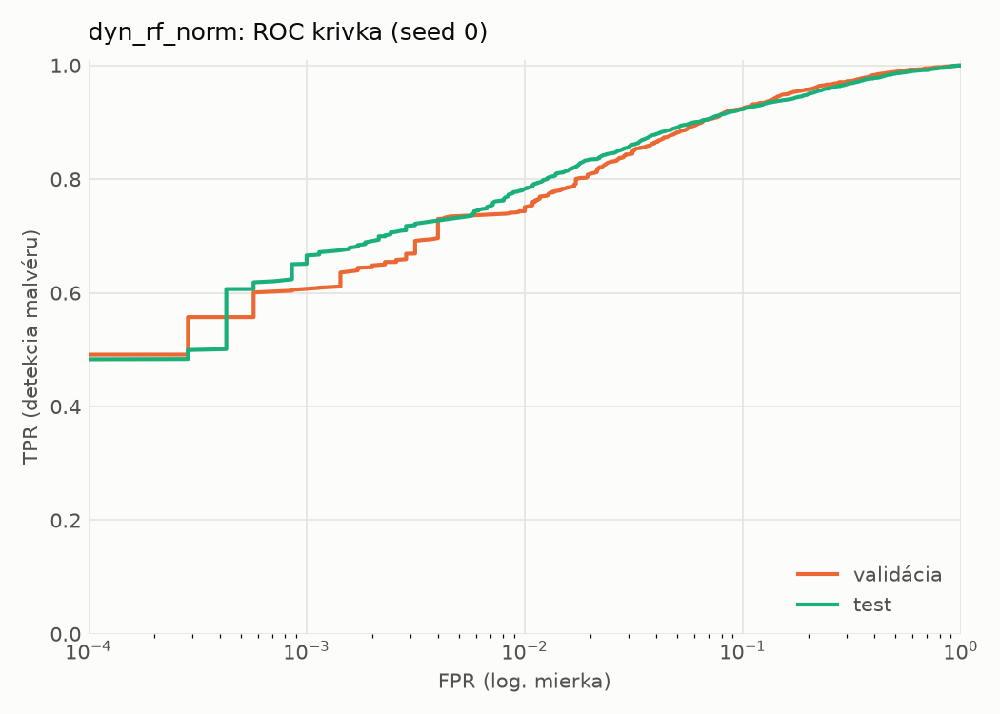
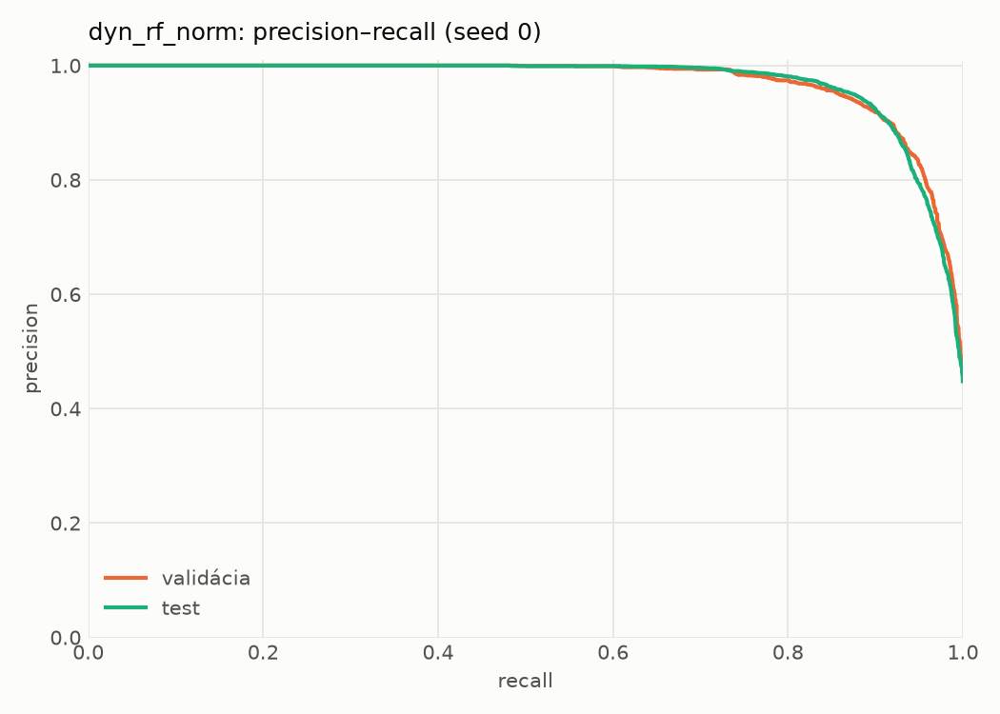
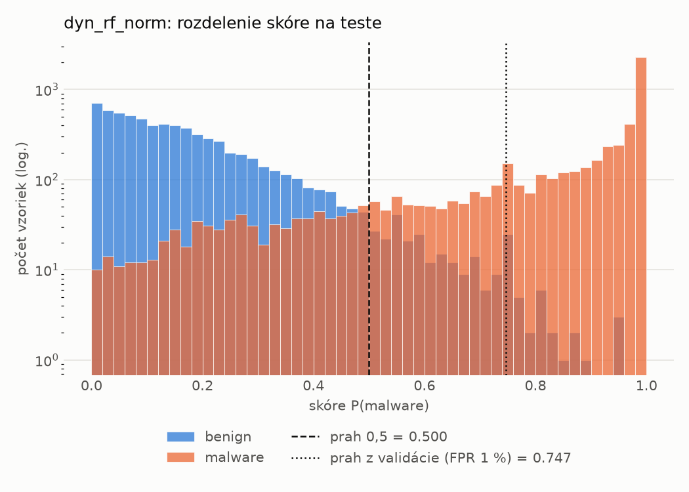
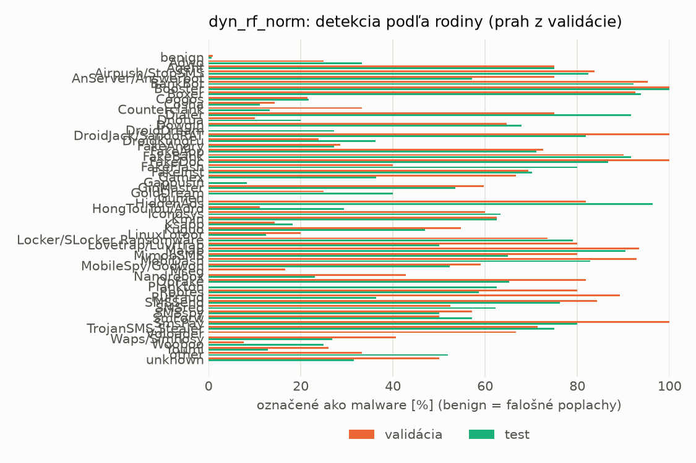
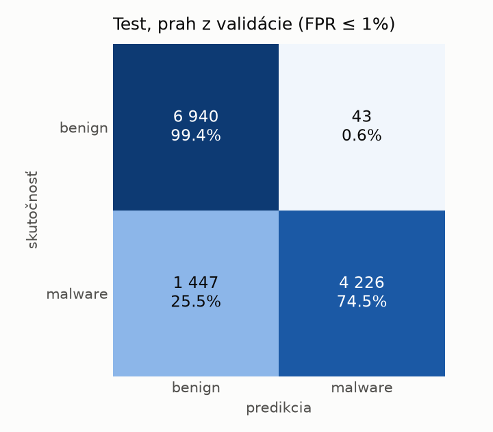
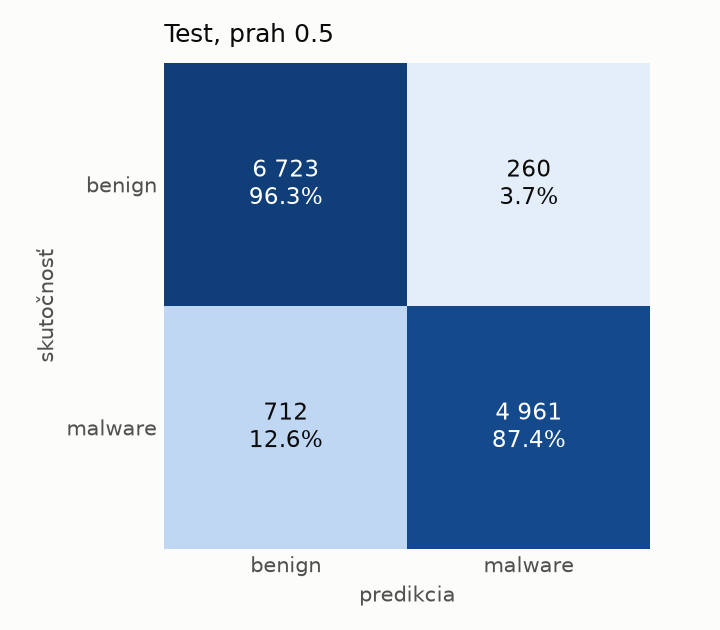

# dynamic_norm/dyn_rf_norm – beh `20261123-201749`

> Automaticky generované (`src/training/run_tabular.py`). Konfigurácia: `config.yaml`, protokol: `protocol.yaml`.

- **Model:** `random_forest` – dynamic rf s dynamikou ako podiely systémových volaní (kontrola artefaktu množstva aktivity)
- **Ladenie:** bez ladenia – hyperparametre prevzaté z `runs_v4/emu_p/full/dynamic/rf/20261123-191811`
- **Finálne modely:** seedy [0, 1, 2]; hodnoty sú priemer ± smerodajná odchýlka cez seedy
- **Najlepšie hyperparametre:** `{"n_estimators": 450, "max_depth": null, "min_samples_leaf": 1, "max_features": "sqrt"}`

## Detekčná kvalita (bez prahu)
| metrika | train (podvzorka) | validácia | test |
|---|---|---|---|
| ROC-AUC | 0.9998 ± 0.0000 | 0.9709 ± 0.0001 | 0.9689 ± 0.0001 |
| PR-AUC | 0.9996 ± 0.0000 | 0.9716 ± 0.0001 | 0.9712 ± 0.0000 |
| TPR pri FPR 1 % | 0.9991 ± 0.0000 | 0.7485 ± 0.0043 | 0.7795 ± 0.0039 |
| TPR pri FPR 0,1 % | 0.9483 ± 0.0024 | 0.6119 ± 0.0062 | 0.6455 ± 0.0045 |
| log loss | 0.0709 ± 0.0002 | 0.2318 ± 0.0004 | 0.2357 ± 0.0005 |
| Brier skóre | 0.0102 ± 0.0000 | 0.0663 ± 0.0001 | 0.0666 ± 0.0001 |

Rozdiel ROC-AUC train − validácia: **0.0289** (veľký rozdiel = preučenie).

## Pri prahu z validácie (FPR ≤ 1% na validácii)
| metrika | train (podvzorka) | validácia | test |
|---|---|---|---|
| accuracy | 0.9847 ± 0.0010 | 0.8819 ± 0.0019 | 0.8832 ± 0.0008 |
| balanced accuracy | 0.9829 ± 0.0011 | 0.8694 ± 0.0021 | 0.8705 ± 0.0010 |
| precision | 0.9958 ± 0.0000 | 0.9844 ± 0.0002 | 0.9893 ± 0.0007 |
| recall (TPR) | 0.9690 ± 0.0022 | 0.7485 ± 0.0043 | 0.7476 ± 0.0023 |
| FPR | 0.0032 ± 0.0000 | 0.0096 ± 0.0002 | 0.0066 ± 0.0004 |
| F1 | 0.9822 ± 0.0011 | 0.8504 ± 0.0027 | 0.8516 ± 0.0013 |
| MCC | 0.9691 ± 0.0019 | 0.7752 ± 0.0033 | 0.7786 ± 0.0013 |

## Pri pevnom prahu 0.5
| metrika | train (podvzorka) | validácia | test |
|---|---|---|---|
| accuracy | 0.9976 ± 0.0001 | 0.9190 ± 0.0008 | 0.9232 ± 0.0002 |
| balanced accuracy | 0.9977 ± 0.0001 | 0.9150 ± 0.0008 | 0.9186 ± 0.0003 |
| precision | 0.9957 ± 0.0000 | 0.9389 ± 0.0008 | 0.9510 ± 0.0007 |
| recall (TPR) | 0.9988 ± 0.0001 | 0.8763 ± 0.0011 | 0.8737 ± 0.0009 |
| FPR | 0.0034 ± 0.0000 | 0.0463 ± 0.0006 | 0.0366 ± 0.0005 |
| F1 | 0.9972 ± 0.0001 | 0.9065 ± 0.0009 | 0.9107 ± 0.0003 |
| MCC | 0.9951 ± 0.0001 | 0.8367 ± 0.0016 | 0.8459 ± 0.0005 |

## Výpočtové nároky (seed 0, testovacia množina)
| meranie | hodnota |
|---|---|
| tréning finálneho modelu | 3.8 s (priemer cez seedy) |
| ladenie spolu | 0 s |
| počet parametrov / uzlov | 3 892 428 |
| veľkosť modelu na disku | 311.75 MB |
| CPU latencia modelu (batch 1, 1 vlákno) | 13.725 ms (p95 14.212) |
| CPU priepustnosť (24 vlákien) | 110 264 vzoriek/s |

## Grafy
| | |
|---|---|
|  |  |
|  |  |
|  |  |
|  |  |

## Súbory
`metrics.json` (všetky metriky po seedoch vrátane rodín), `timing.json`, `hpo_trials.csv`,
`predictions/<časť>_seed<N>.parquet` (sha256, family, label, score), `model/seed_<N>/`, `log.txt`.
