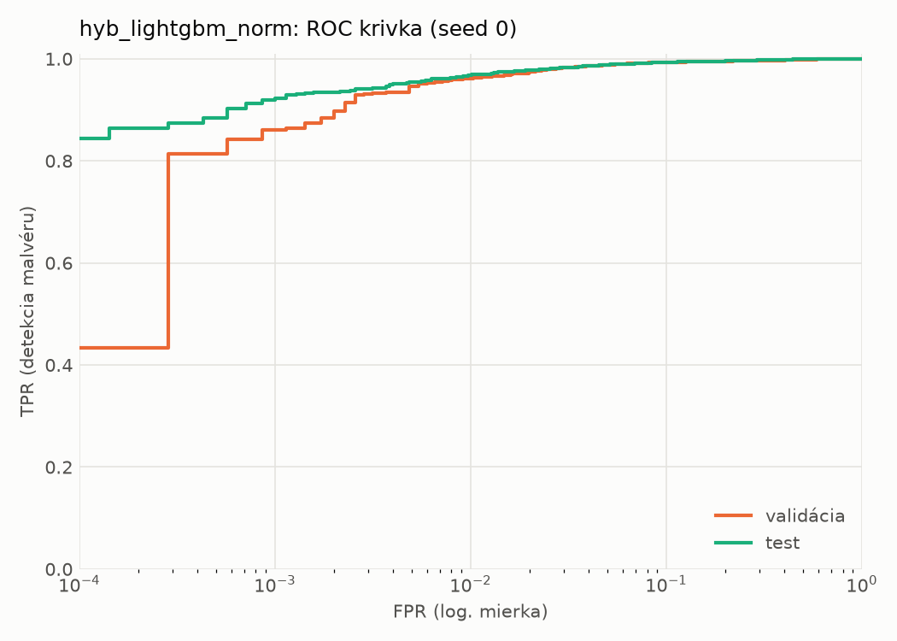
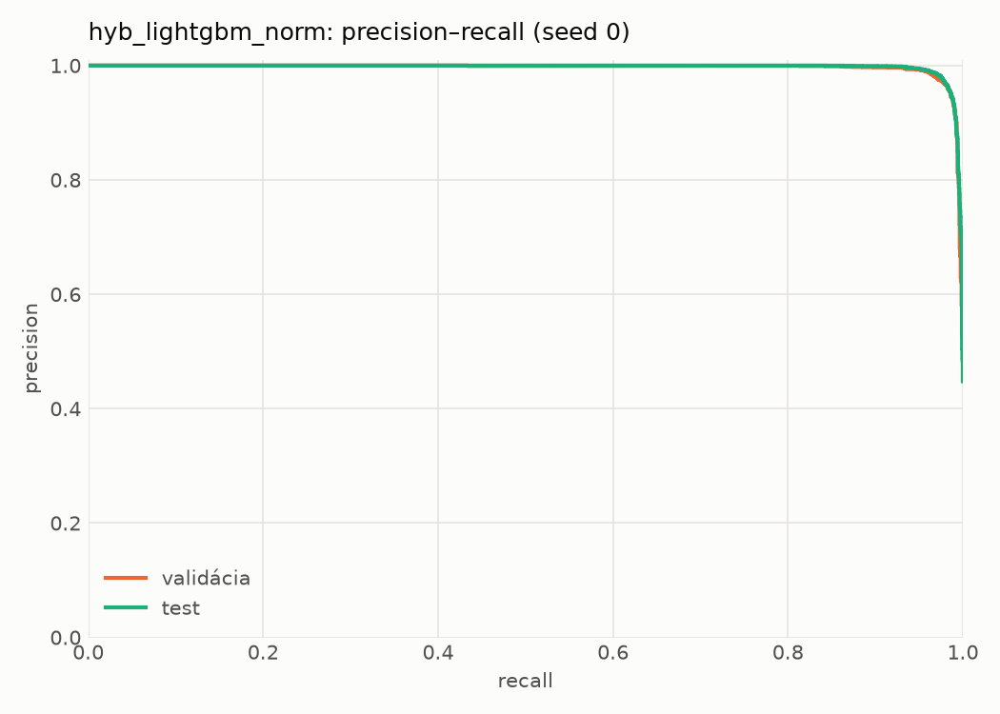
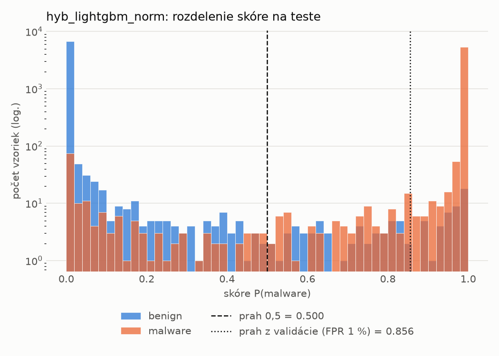
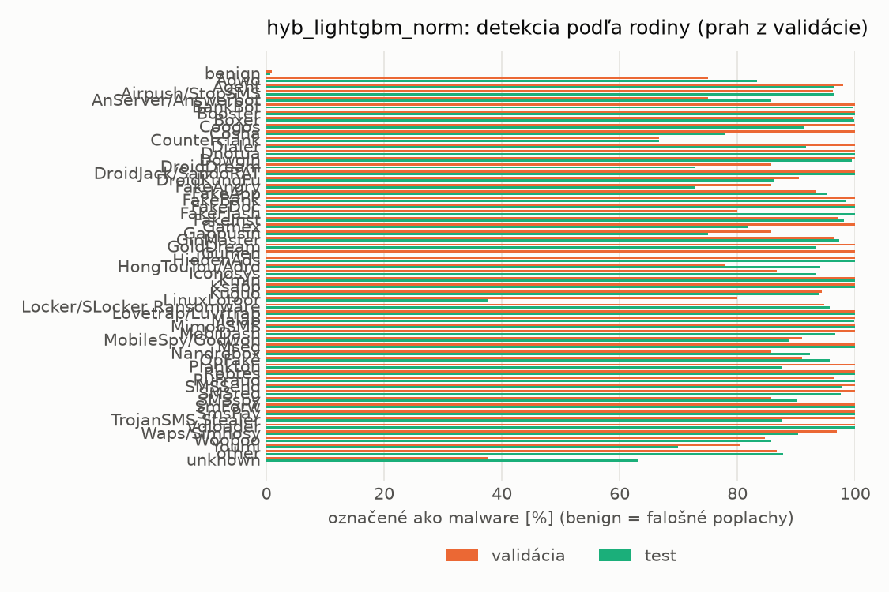
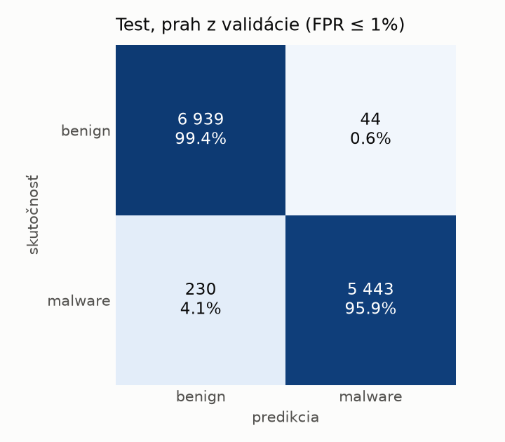
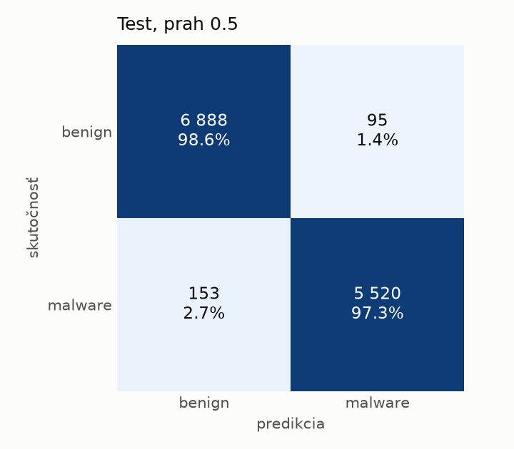
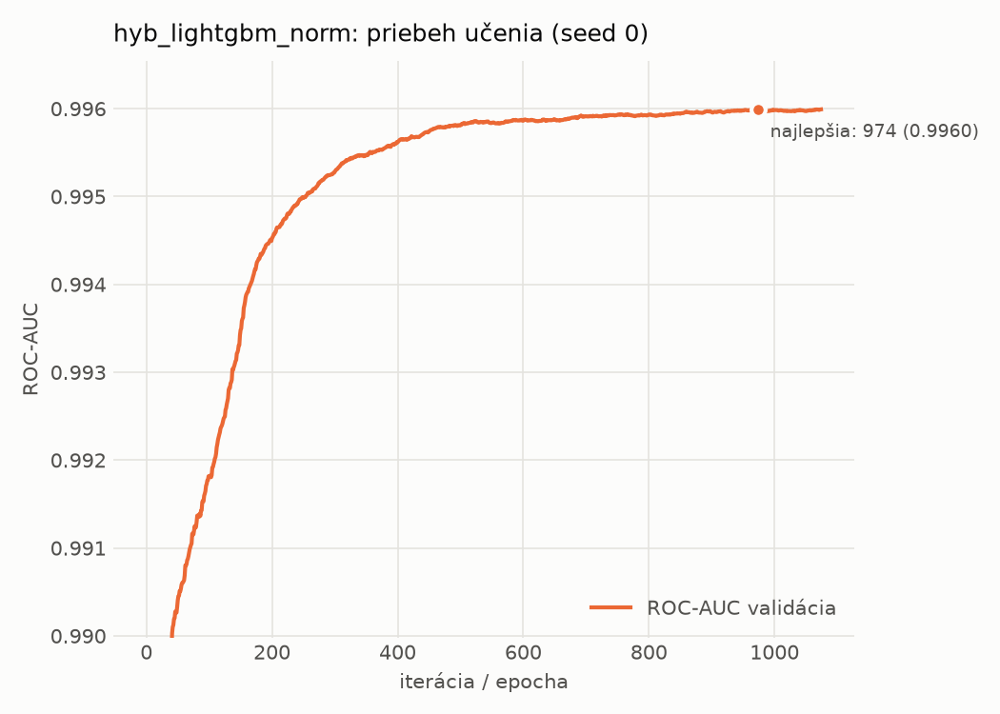

# hybrid_norm/hyb_lightgbm_norm – beh `20261123-201810`

> Automaticky generované (`src/training/run_tabular.py`). Konfigurácia: `config.yaml`, protokol: `protocol.yaml`.

- **Model:** `lightgbm` – hybrid lightgbm s dynamikou ako podiely systémových volaní (kontrola artefaktu množstva aktivity)
- **Ladenie:** bez ladenia – hyperparametre prevzaté z `runs_v4/emu_p/full/hybrid/lightgbm/20261123-195420`
- **Finálne modely:** seedy [0, 1, 2]; hodnoty sú priemer ± smerodajná odchýlka cez seedy
- **Najlepšie hyperparametre:** `{"num_boost_round": 5000, "early_stopping_rounds": 100, "learning_rate": 0.021805367982090686, "num_leaves": 214, "min_child_samples": 11, "feature_fraction": 0.7934614803684483, "bagging_fraction": 0.9747297177039957, "lambda_l1": 3.6112431454858456e-05, "lambda_l2": 1.814656418208834e-05}`

## Detekčná kvalita (bez prahu)
| metrika | train (podvzorka) | validácia | test |
|---|---|---|---|
| ROC-AUC | 1.0000 ± 0.0000 | 0.9960 ± 0.0000 | 0.9967 ± 0.0000 |
| PR-AUC | 1.0000 ± 0.0000 | 0.9961 ± 0.0000 | 0.9969 ± 0.0000 |
| TPR pri FPR 1 % | 1.0000 ± 0.0000 | 0.9610 ± 0.0009 | 0.9664 ± 0.0007 |
| TPR pri FPR 0,1 % | 1.0000 ± 0.0000 | 0.8573 ± 0.0101 | 0.9181 ± 0.0007 |
| log loss | 0.0002 ± 0.0001 | 0.0885 ± 0.0050 | 0.0779 ± 0.0033 |
| Brier skóre | 0.0000 ± 0.0000 | 0.0186 ± 0.0002 | 0.0168 ± 0.0002 |

Rozdiel ROC-AUC train − validácia: **0.0040** (veľký rozdiel = preučenie).

## Pri prahu z validácie (FPR ≤ 1% na validácii)
| metrika | train (podvzorka) | validácia | test |
|---|---|---|---|
| accuracy | 1.0000 ± 0.0000 | 0.9772 ± 0.0004 | 0.9781 ± 0.0004 |
| balanced accuracy | 1.0000 ± 0.0000 | 0.9757 ± 0.0004 | 0.9763 ± 0.0005 |
| precision | 1.0000 ± 0.0000 | 0.9878 ± 0.0002 | 0.9922 ± 0.0003 |
| recall (TPR) | 1.0000 ± 0.0000 | 0.9610 ± 0.0009 | 0.9586 ± 0.0011 |
| FPR | 0.0000 ± 0.0000 | 0.0096 ± 0.0002 | 0.0061 ± 0.0002 |
| F1 | 1.0000 ± 0.0000 | 0.9742 ± 0.0005 | 0.9751 ± 0.0005 |
| MCC | 1.0000 ± 0.0000 | 0.9540 ± 0.0008 | 0.9560 ± 0.0008 |

## Pri pevnom prahu 0.5
| metrika | train (podvzorka) | validácia | test |
|---|---|---|---|
| accuracy | 1.0000 ± 0.0000 | 0.9773 ± 0.0002 | 0.9796 ± 0.0008 |
| balanced accuracy | 1.0000 ± 0.0000 | 0.9767 ± 0.0002 | 0.9789 ± 0.0008 |
| precision | 1.0000 ± 0.0000 | 0.9790 ± 0.0007 | 0.9824 ± 0.0011 |
| recall (TPR) | 1.0000 ± 0.0000 | 0.9703 ± 0.0004 | 0.9720 ± 0.0009 |
| FPR | 0.0000 ± 0.0000 | 0.0169 ± 0.0006 | 0.0142 ± 0.0009 |
| F1 | 1.0000 ± 0.0000 | 0.9746 ± 0.0002 | 0.9771 ± 0.0009 |
| MCC | 1.0000 ± 0.0000 | 0.9542 ± 0.0004 | 0.9588 ± 0.0017 |

## Výpočtové nároky (seed 0, testovacia množina)
| meranie | hodnota |
|---|---|
| tréning finálneho modelu | 28.1 s (priemer cez seedy) |
| ladenie spolu | 0 s |
| počet parametrov / uzlov | 415 898 |
| veľkosť modelu na disku | 23.72 MB |
| CPU latencia modelu (batch 1, 1 vlákno) | 0.161 ms (p95 0.191) |
| CPU priepustnosť (24 vlákien) | 80 516 vzoriek/s |

## Grafy
| | |
|---|---|
|  |  |
|  |  |
|  |  |
|  |  |

## Súbory
`metrics.json` (všetky metriky po seedoch vrátane rodín), `timing.json`, `hpo_trials.csv`,
`predictions/<časť>_seed<N>.parquet` (sha256, family, label, score), `model/seed_<N>/`, `log.txt`.
