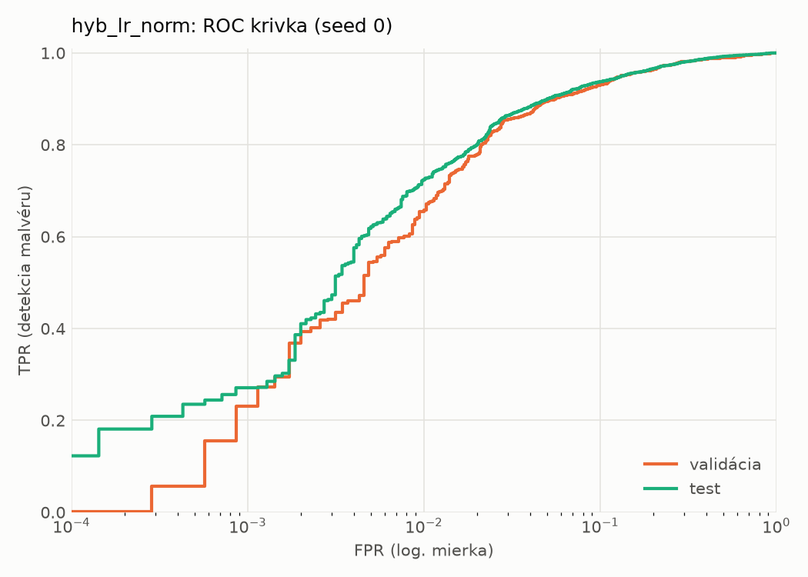
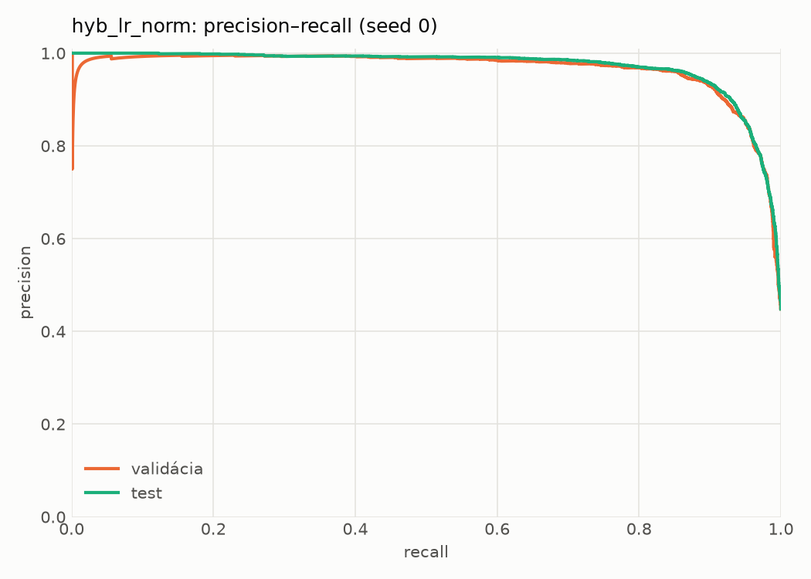
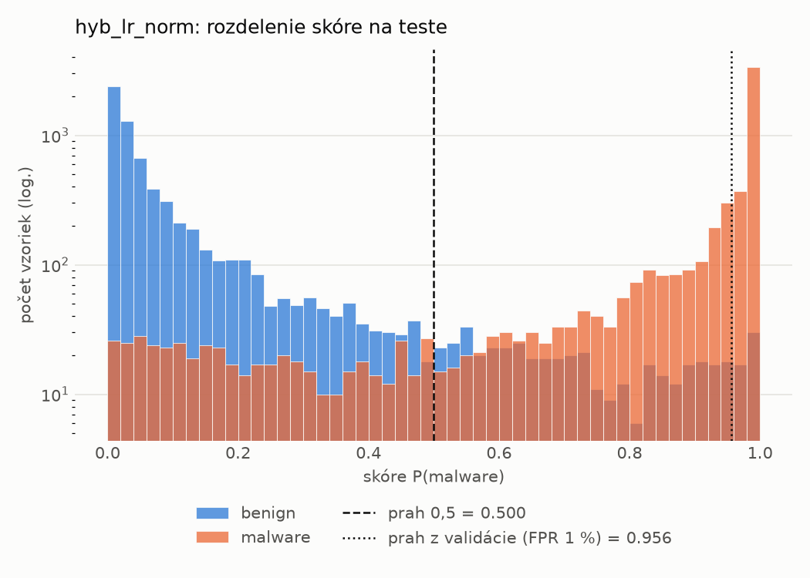
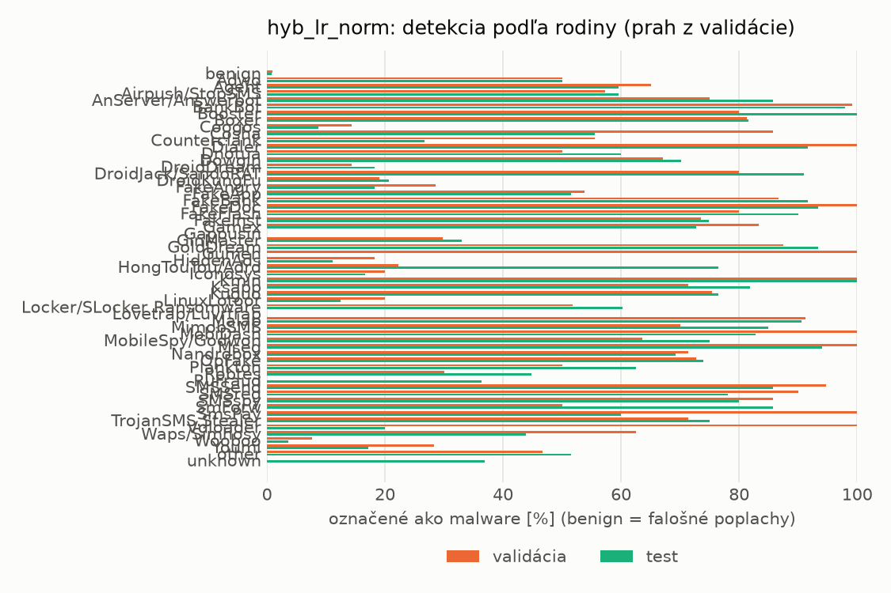
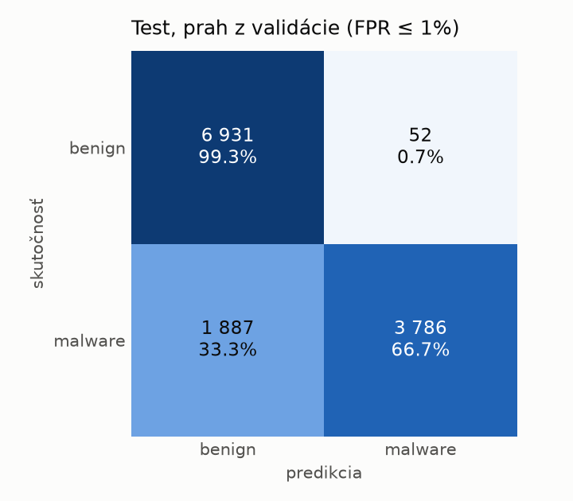
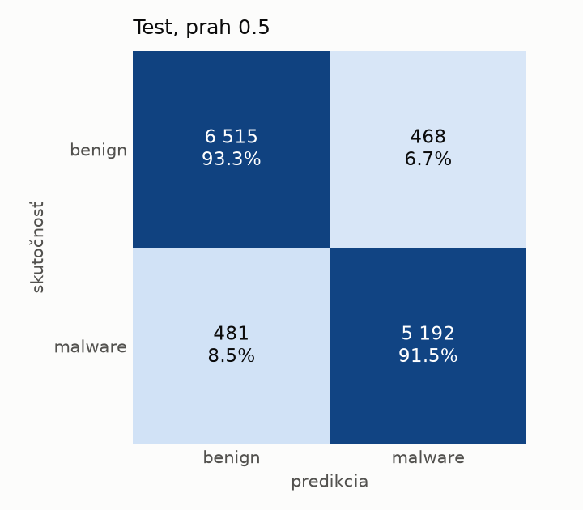

# hybrid_norm/hyb_lr_norm – beh `20261123-201947`

> Automaticky generované (`src/training/run_tabular.py`). Konfigurácia: `config.yaml`, protokol: `protocol.yaml`.

- **Model:** `logreg` – hybrid lr s dynamikou ako podiely systémových volaní (kontrola artefaktu množstva aktivity)
- **Ladenie:** bez ladenia – hyperparametre prevzaté z `runs_v4/emu_p/full/hybrid/lr/20261123-195300`
- **Finálne modely:** seedy [0, 1, 2]; hodnoty sú priemer ± smerodajná odchýlka cez seedy
- **Najlepšie hyperparametre:** `{"max_iter": 2000, "C": 7.106361724509844}`

## Detekčná kvalita (bez prahu)
| metrika | train (podvzorka) | validácia | test |
|---|---|---|---|
| ROC-AUC | 0.9761 ± 0.0000 | 0.9707 ± 0.0000 | 0.9737 ± 0.0000 |
| PR-AUC | 0.9740 ± 0.0000 | 0.9662 ± 0.0000 | 0.9713 ± 0.0000 |
| TPR pri FPR 1 % | 0.7344 ± 0.0000 | 0.6554 ± 0.0000 | 0.7234 ± 0.0000 |
| TPR pri FPR 0,1 % | 0.4213 ± 0.0000 | 0.2303 ± 0.0000 | 0.2711 ± 0.0000 |
| log loss | 0.1901 ± 0.0000 | 0.2161 ± 0.0000 | 0.2023 ± 0.0000 |
| Brier skóre | 0.0535 ± 0.0000 | 0.0591 ± 0.0000 | 0.0570 ± 0.0000 |

Rozdiel ROC-AUC train − validácia: **0.0054** (veľký rozdiel = preučenie).

## Pri prahu z validácie (FPR ≤ 1% na validácii)
| metrika | train (podvzorka) | validácia | test |
|---|---|---|---|
| accuracy | 0.8435 ± 0.0000 | 0.8403 ± 0.0000 | 0.8468 ± 0.0000 |
| balanced accuracy | 0.8213 ± 0.0000 | 0.8230 ± 0.0000 | 0.8300 ± 0.0000 |
| precision | 0.9878 ± 0.0000 | 0.9825 ± 0.0000 | 0.9865 ± 0.0000 |
| recall (TPR) | 0.6488 ± 0.0000 | 0.6554 ± 0.0000 | 0.6674 ± 0.0000 |
| FPR | 0.0062 ± 0.0000 | 0.0095 ± 0.0000 | 0.0074 ± 0.0000 |
| F1 | 0.7832 ± 0.0000 | 0.7863 ± 0.0000 | 0.7961 ± 0.0000 |
| MCC | 0.7050 ± 0.0000 | 0.7016 ± 0.0000 | 0.7140 ± 0.0000 |

## Pri pevnom prahu 0.5
| metrika | train (podvzorka) | validácia | test |
|---|---|---|---|
| accuracy | 0.9317 ± 0.0000 | 0.9238 ± 0.0000 | 0.9250 ± 0.0000 |
| balanced accuracy | 0.9305 ± 0.0000 | 0.9223 ± 0.0000 | 0.9241 ± 0.0000 |
| precision | 0.9223 ± 0.0000 | 0.9209 ± 0.0000 | 0.9173 ± 0.0000 |
| recall (TPR) | 0.9208 ± 0.0000 | 0.9079 ± 0.0000 | 0.9152 ± 0.0000 |
| FPR | 0.0599 ± 0.0000 | 0.0633 ± 0.0000 | 0.0670 ± 0.0000 |
| F1 | 0.9215 ± 0.0000 | 0.9144 ± 0.0000 | 0.9163 ± 0.0000 |
| MCC | 0.8611 ± 0.0000 | 0.8458 ± 0.0000 | 0.8484 ± 0.0000 |

## Výpočtové nároky (seed 0, testovacia množina)
| meranie | hodnota |
|---|---|
| tréning finálneho modelu | 0.4 s (priemer cez seedy) |
| ladenie spolu | 0 s |
| počet parametrov / uzlov | 286 |
| veľkosť modelu na disku | 0.01 MB |
| transformácia vstupu – latencia (1 vlákno) | 0.006 ms |
| transformácia vstupu – priepustnosť | 502 041 vzoriek/s |
| CPU latencia modelu (batch 1, 1 vlákno) | 0.004 ms (p95 0.005) |
| CPU priepustnosť (24 vlákien) | 2 371 992 vzoriek/s |

## Grafy
| | |
|---|---|
|  |  |
|  |  |
|  |  |
|  |  |

## Súbory
`metrics.json` (všetky metriky po seedoch vrátane rodín), `timing.json`, `hpo_trials.csv`,
`predictions/<časť>_seed<N>.parquet` (sha256, family, label, score), `model/seed_<N>/`, `log.txt`.
