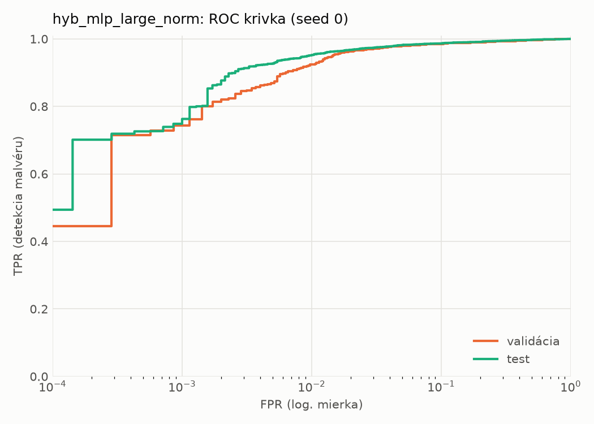
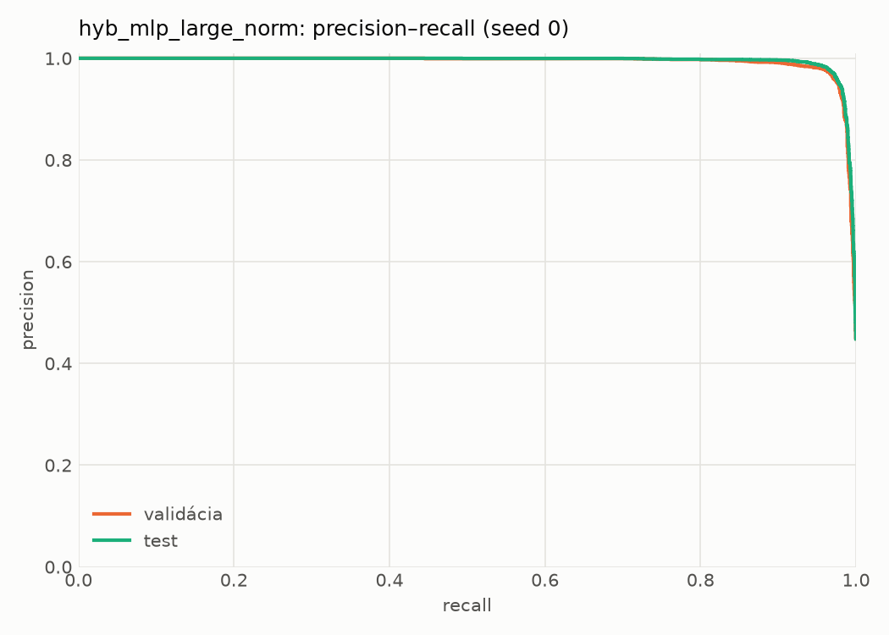
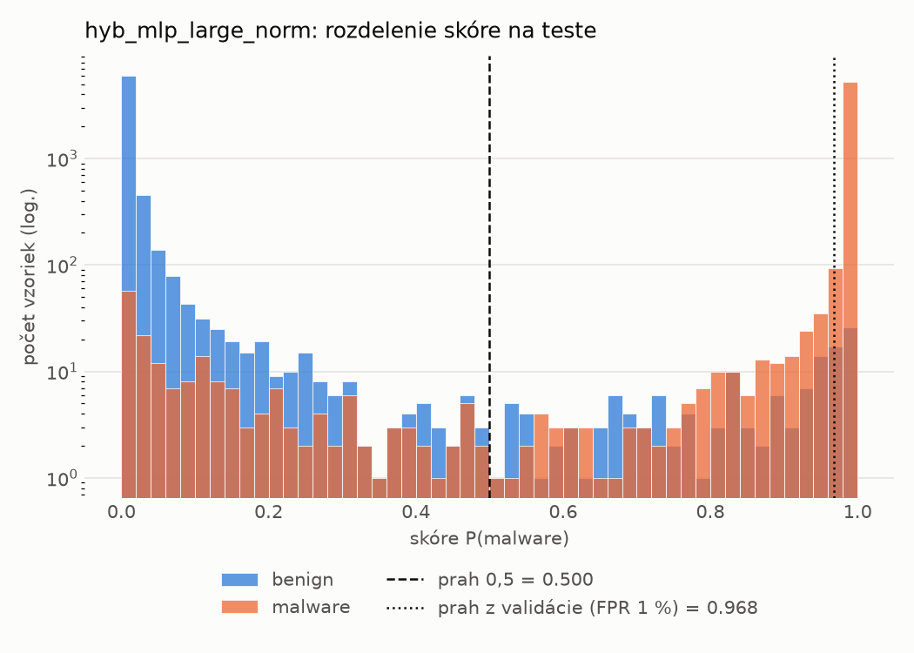
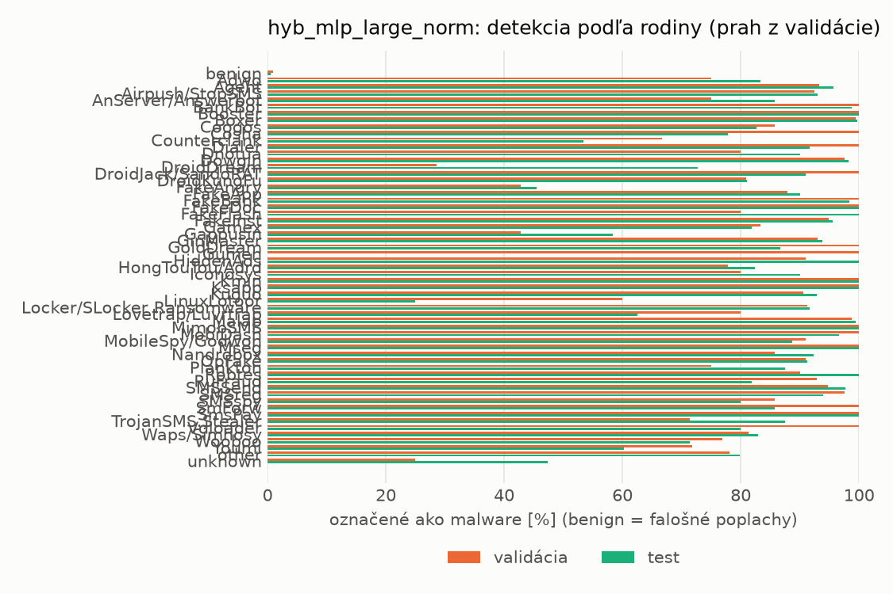
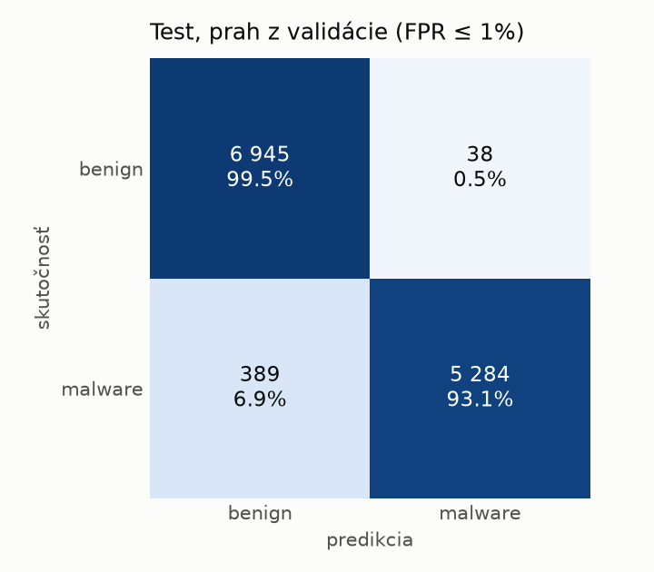
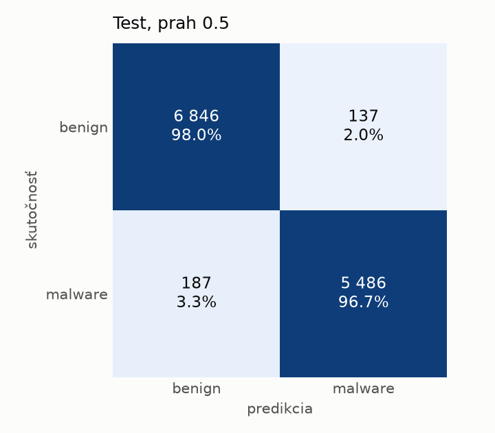
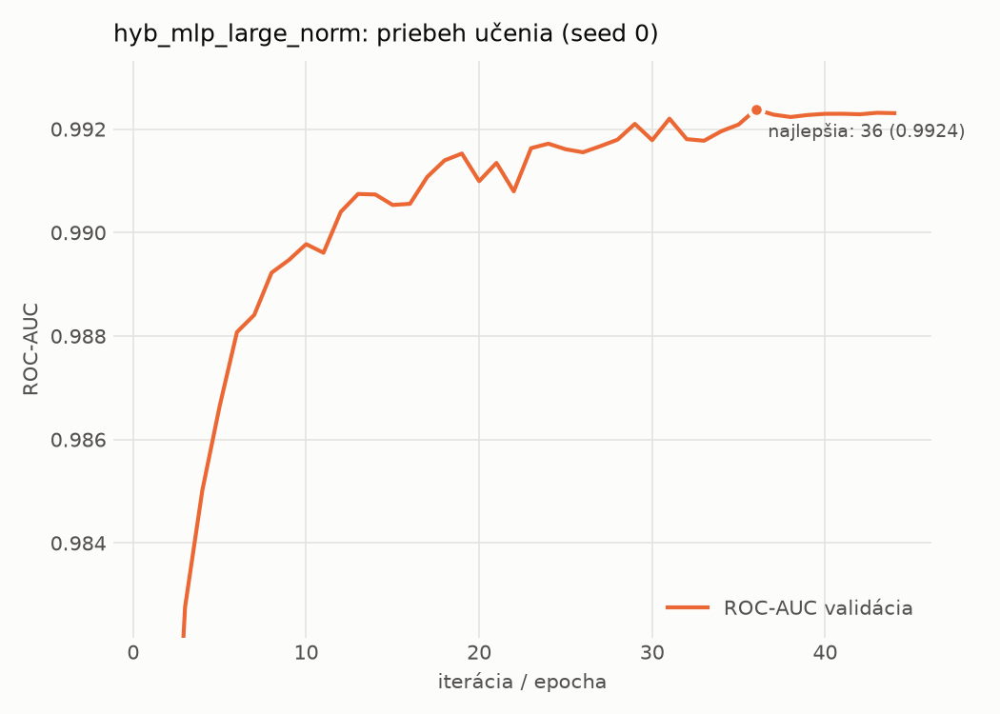

# hybrid_norm/hyb_mlp_large_norm – beh `20261123-201950`

> Automaticky generované (`src/training/run_tabular.py`). Konfigurácia: `config.yaml`, protokol: `protocol.yaml`.

- **Model:** `mlp` – hybrid mlp_large s dynamikou ako podiely systémových volaní (kontrola artefaktu množstva aktivity)
- **Ladenie:** bez ladenia – hyperparametre prevzaté z `runs_v4/emu_p/full/hybrid/mlp_large/20261123-200933`
- **Finálne modely:** seedy [0, 1, 2]; hodnoty sú priemer ± smerodajná odchýlka cez seedy
- **Najlepšie hyperparametre:** `{"max_epochs": 100, "patience": 8, "hidden_layers": 5, "hidden_width": 512, "width_decay": 0.5, "dropout": 0.18561035972653261, "lr": 0.00013117672209273214, "weight_decay": 3.948210593203141e-06, "batch_size": 512}`

## Detekčná kvalita (bez prahu)
| metrika | train (podvzorka) | validácia | test |
|---|---|---|---|
| ROC-AUC | 0.9981 ± 0.0007 | 0.9921 ± 0.0005 | 0.9939 ± 0.0004 |
| PR-AUC | 0.9983 ± 0.0007 | 0.9927 ± 0.0004 | 0.9942 ± 0.0005 |
| TPR pri FPR 1 % | 0.9880 ± 0.0053 | 0.9300 ± 0.0084 | 0.9518 ± 0.0047 |
| TPR pri FPR 0,1 % | 0.9683 ± 0.0150 | 0.7255 ± 0.0222 | 0.7701 ± 0.0227 |
| log loss | 0.0372 ± 0.0135 | 0.1004 ± 0.0019 | 0.0856 ± 0.0056 |
| Brier skóre | 0.0079 ± 0.0029 | 0.0244 ± 0.0007 | 0.0213 ± 0.0014 |

Rozdiel ROC-AUC train − validácia: **0.0060** (veľký rozdiel = preučenie).

## Pri prahu z validácie (FPR ≤ 1% na validácii)
| metrika | train (podvzorka) | validácia | test |
|---|---|---|---|
| accuracy | 0.9823 ± 0.0034 | 0.9633 ± 0.0038 | 0.9668 ± 0.0037 |
| balanced accuracy | 0.9798 ± 0.0038 | 0.9601 ± 0.0042 | 0.9637 ± 0.0042 |
| precision | 0.9993 ± 0.0006 | 0.9873 ± 0.0001 | 0.9918 ± 0.0010 |
| recall (TPR) | 0.9601 ± 0.0073 | 0.9300 ± 0.0084 | 0.9337 ± 0.0083 |
| FPR | 0.0005 ± 0.0005 | 0.0097 ± 0.0000 | 0.0063 ± 0.0007 |
| F1 | 0.9793 ± 0.0040 | 0.9578 ± 0.0045 | 0.9619 ± 0.0045 |
| MCC | 0.9645 ± 0.0067 | 0.9266 ± 0.0074 | 0.9339 ± 0.0073 |

## Pri pevnom prahu 0.5
| metrika | train (podvzorka) | validácia | test |
|---|---|---|---|
| accuracy | 0.9909 ± 0.0034 | 0.9705 ± 0.0009 | 0.9737 ± 0.0018 |
| balanced accuracy | 0.9903 ± 0.0034 | 0.9702 ± 0.0008 | 0.9730 ± 0.0018 |
| precision | 0.9928 ± 0.0039 | 0.9664 ± 0.0027 | 0.9751 ± 0.0027 |
| recall (TPR) | 0.9861 ± 0.0039 | 0.9678 ± 0.0017 | 0.9660 ± 0.0015 |
| FPR | 0.0055 ± 0.0030 | 0.0273 ± 0.0023 | 0.0200 ± 0.0022 |
| F1 | 0.9895 ± 0.0039 | 0.9671 ± 0.0010 | 0.9705 ± 0.0020 |
| MCC | 0.9814 ± 0.0069 | 0.9403 ± 0.0018 | 0.9468 ± 0.0037 |

## Výpočtové nároky (seed 0, testovacia množina)
| meranie | hodnota |
|---|---|
| tréning finálneho modelu | 10.0 s (priemer cez seedy) |
| ladenie spolu | 0 s |
| počet parametrov / uzlov | 323 009 |
| veľkosť modelu na disku | 1.32 MB |
| transformácia vstupu – latencia (1 vlákno) | 0.017 ms |
| transformácia vstupu – priepustnosť | 288 341 vzoriek/s |
| CPU latencia modelu (batch 1, 1 vlákno) | 0.167 ms (p95 0.190) |
| CPU priepustnosť (24 vlákien) | 755 176 vzoriek/s |
| GPU latencia (batch 1) | 0.686 ms (p95 0.818) |
| GPU priepustnosť | 1 065 383 vzoriek/s |
| GPU špičková pamäť | 126 MB |

## Grafy
| | |
|---|---|
|  |  |
|  |  |
|  |  |
|  |  |

## Súbory
`metrics.json` (všetky metriky po seedoch vrátane rodín), `timing.json`, `hpo_trials.csv`,
`predictions/<časť>_seed<N>.parquet` (sha256, family, label, score), `model/seed_<N>/`, `log.txt`.
