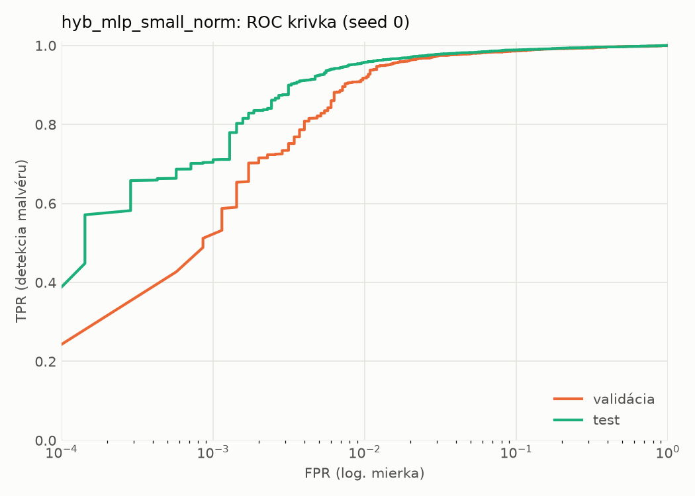
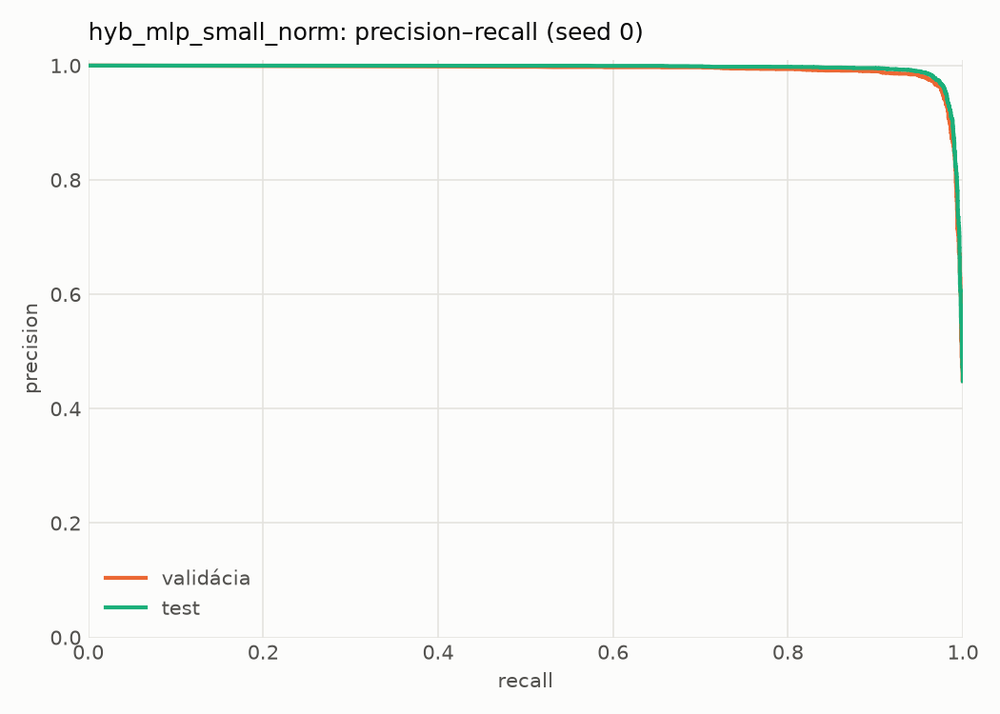
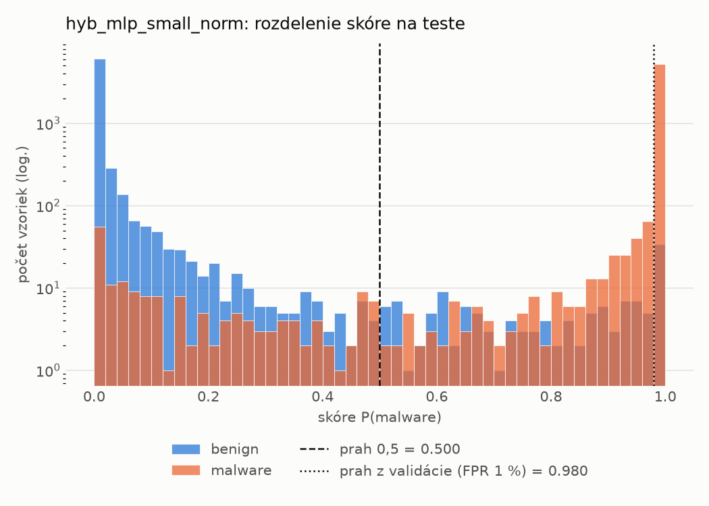
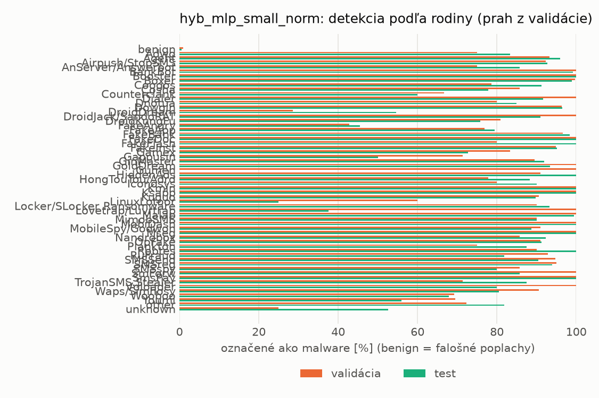
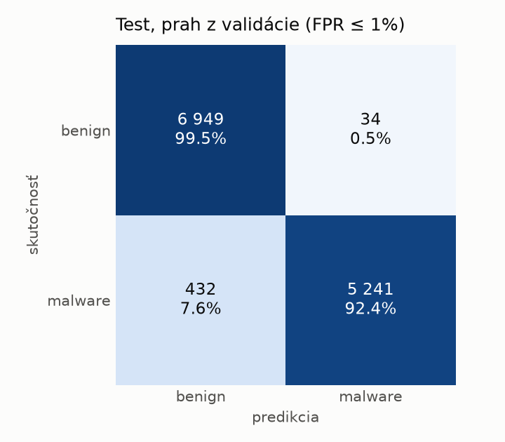
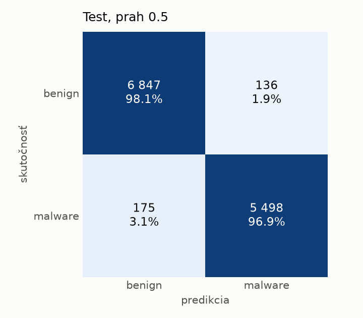
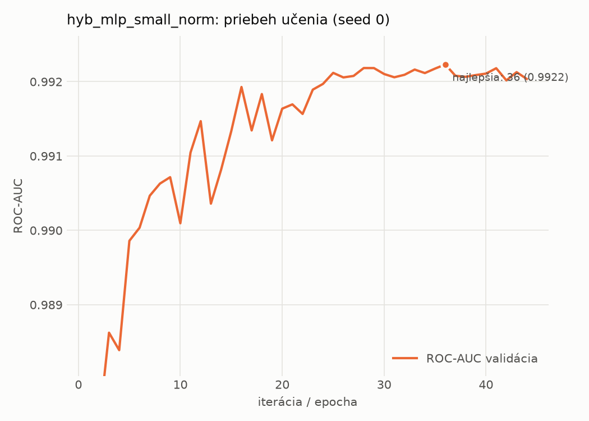

# hybrid_norm/hyb_mlp_small_norm – beh `20261123-202022`

> Automaticky generované (`src/training/run_tabular.py`). Konfigurácia: `config.yaml`, protokol: `protocol.yaml`.

- **Model:** `mlp` – hybrid mlp_small s dynamikou ako podiely systémových volaní (kontrola artefaktu množstva aktivity)
- **Ladenie:** bez ladenia – hyperparametre prevzaté z `runs_v4/emu_p/full/hybrid/mlp_small/20261123-200627`
- **Finálne modely:** seedy [0, 1, 2]; hodnoty sú priemer ± smerodajná odchýlka cez seedy
- **Najlepšie hyperparametre:** `{"width_decay": 0.5, "max_epochs": 100, "patience": 8, "hidden_layers": 2, "hidden_width": 256, "dropout": 0.2736594475747717, "lr": 0.0019631646658614973, "weight_decay": 0.0007425190310675283, "batch_size": 512}`

## Detekčná kvalita (bez prahu)
| metrika | train (podvzorka) | validácia | test |
|---|---|---|---|
| ROC-AUC | 0.9985 ± 0.0005 | 0.9919 ± 0.0003 | 0.9937 ± 0.0005 |
| PR-AUC | 0.9986 ± 0.0005 | 0.9909 ± 0.0005 | 0.9938 ± 0.0006 |
| TPR pri FPR 1 % | 0.9865 ± 0.0060 | 0.9202 ± 0.0035 | 0.9518 ± 0.0050 |
| TPR pri FPR 0,1 % | 0.9630 ± 0.0150 | 0.5131 ± 0.0439 | 0.7213 ± 0.0286 |
| log loss | 0.0349 ± 0.0090 | 0.1134 ± 0.0059 | 0.0894 ± 0.0028 |
| Brier skóre | 0.0087 ± 0.0025 | 0.0242 ± 0.0010 | 0.0208 ± 0.0011 |

Rozdiel ROC-AUC train − validácia: **0.0066** (veľký rozdiel = preučenie).

## Pri prahu z validácie (FPR ≤ 1% na validácii)
| metrika | train (podvzorka) | validácia | test |
|---|---|---|---|
| accuracy | 0.9761 ± 0.0020 | 0.9588 ± 0.0016 | 0.9643 ± 0.0024 |
| balanced accuracy | 0.9726 ± 0.0022 | 0.9552 ± 0.0018 | 0.9608 ± 0.0028 |
| precision | 0.9997 ± 0.0003 | 0.9871 ± 0.0000 | 0.9929 ± 0.0013 |
| recall (TPR) | 0.9455 ± 0.0045 | 0.9202 ± 0.0035 | 0.9270 ± 0.0067 |
| FPR | 0.0002 ± 0.0002 | 0.0097 ± 0.0000 | 0.0054 ± 0.0010 |
| F1 | 0.9718 ± 0.0024 | 0.9525 ± 0.0019 | 0.9588 ± 0.0029 |
| MCC | 0.9523 ± 0.0038 | 0.9180 ± 0.0031 | 0.9291 ± 0.0046 |

## Pri pevnom prahu 0.5
| metrika | train (podvzorka) | validácia | test |
|---|---|---|---|
| accuracy | 0.9891 ± 0.0030 | 0.9701 ± 0.0021 | 0.9738 ± 0.0014 |
| balanced accuracy | 0.9886 ± 0.0030 | 0.9699 ± 0.0019 | 0.9732 ± 0.0014 |
| precision | 0.9904 ± 0.0043 | 0.9655 ± 0.0039 | 0.9735 ± 0.0021 |
| recall (TPR) | 0.9845 ± 0.0029 | 0.9679 ± 0.0007 | 0.9679 ± 0.0018 |
| FPR | 0.0074 ± 0.0033 | 0.0281 ± 0.0033 | 0.0214 ± 0.0017 |
| F1 | 0.9875 ± 0.0035 | 0.9667 ± 0.0022 | 0.9707 ± 0.0016 |
| MCC | 0.9778 ± 0.0062 | 0.9396 ± 0.0041 | 0.9470 ± 0.0029 |

## Výpočtové nároky (seed 0, testovacia množina)
| meranie | hodnota |
|---|---|
| tréning finálneho modelu | 4.4 s (priemer cez seedy) |
| ladenie spolu | 0 s |
| počet parametrov / uzlov | 107 009 |
| veľkosť modelu na disku | 0.44 MB |
| transformácia vstupu – latencia (1 vlákno) | 0.017 ms |
| transformácia vstupu – priepustnosť | 288 047 vzoriek/s |
| CPU latencia modelu (batch 1, 1 vlákno) | 0.077 ms (p95 0.091) |
| CPU priepustnosť (24 vlákien) | 1 183 014 vzoriek/s |
| GPU latencia (batch 1) | 0.385 ms (p95 0.415) |
| GPU priepustnosť | 828 657 vzoriek/s |
| GPU špičková pamäť | 165 MB |

## Grafy
| | |
|---|---|
|  |  |
|  |  |
|  |  |
|  |  |

## Súbory
`metrics.json` (všetky metriky po seedoch vrátane rodín), `timing.json`, `hpo_trials.csv`,
`predictions/<časť>_seed<N>.parquet` (sha256, family, label, score), `model/seed_<N>/`, `log.txt`.
