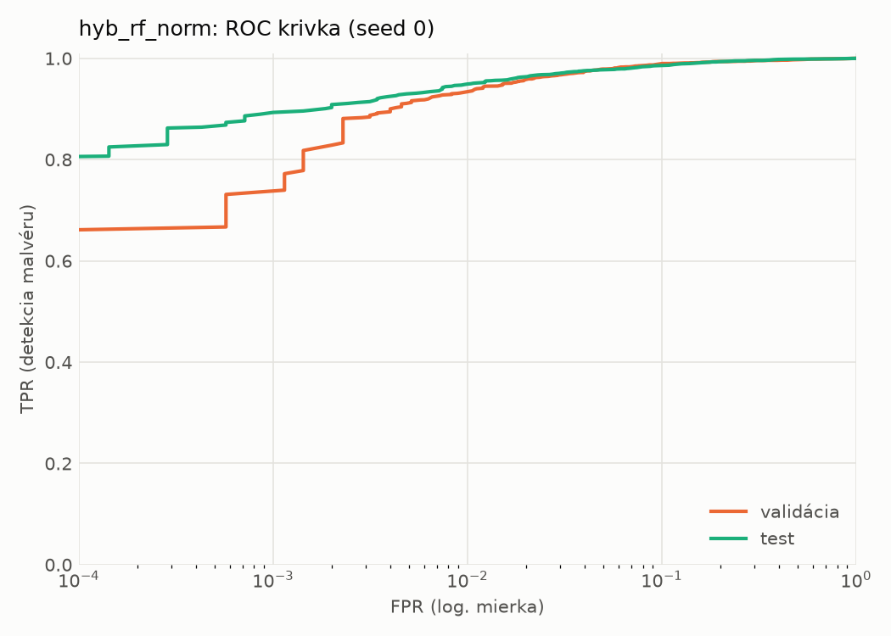
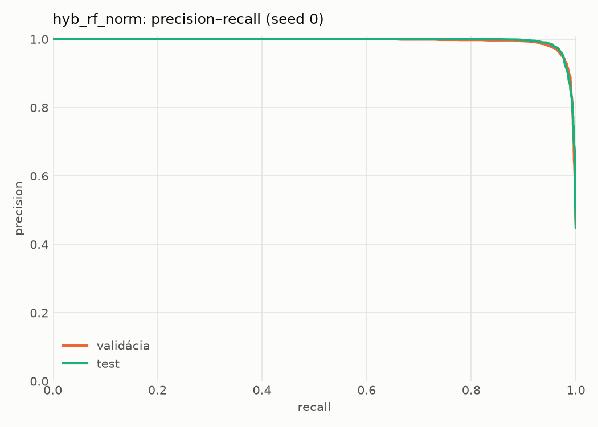
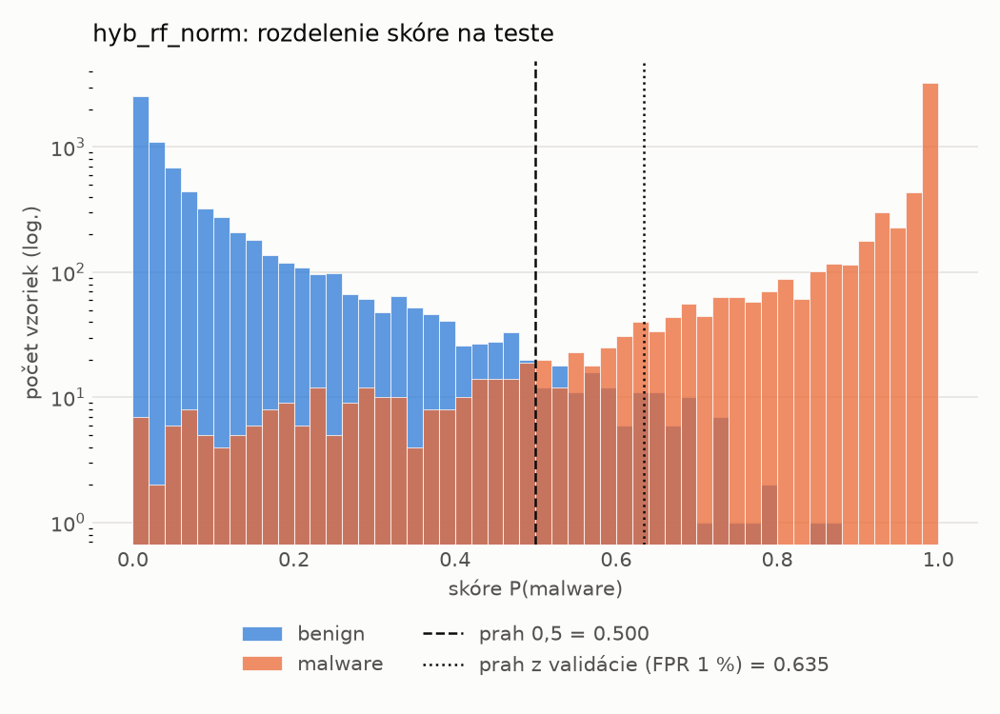
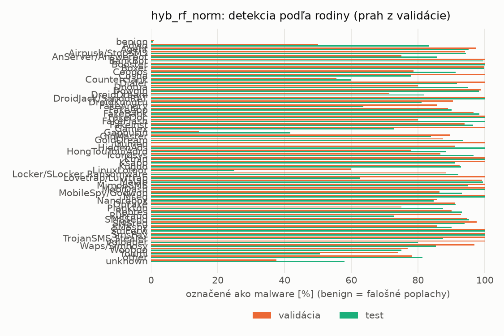
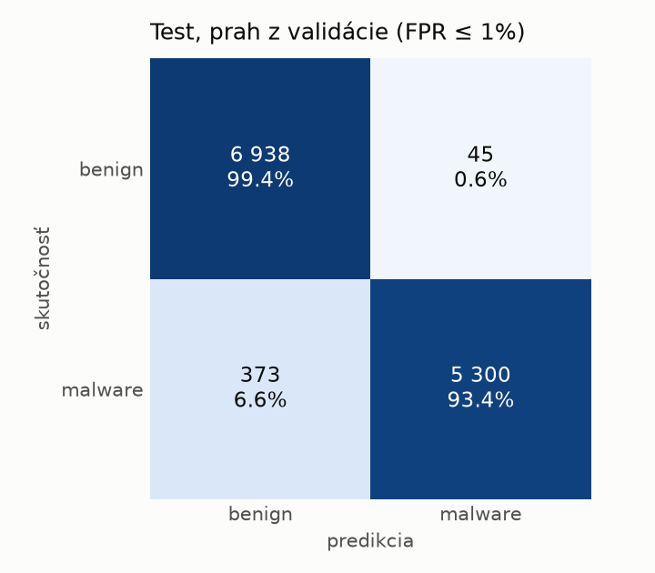
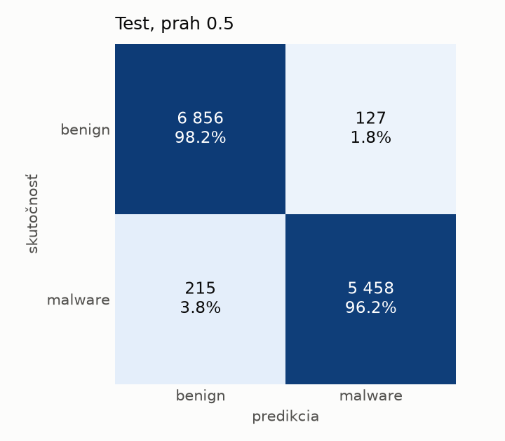

# hybrid_norm/hyb_rf_norm – beh `20261123-202038`

> Automaticky generované (`src/training/run_tabular.py`). Konfigurácia: `config.yaml`, protokol: `protocol.yaml`.

- **Model:** `random_forest` – hybrid rf s dynamikou ako podiely systémových volaní (kontrola artefaktu množstva aktivity)
- **Ladenie:** bez ladenia – hyperparametre prevzaté z `runs_v4/emu_p/full/hybrid/rf/20261123-195313`
- **Finálne modely:** seedy [0, 1, 2]; hodnoty sú priemer ± smerodajná odchýlka cez seedy
- **Najlepšie hyperparametre:** `{"n_estimators": 200, "max_depth": null, "min_samples_leaf": 1, "max_features": "sqrt"}`

## Detekčná kvalita (bez prahu)
| metrika | train (podvzorka) | validácia | test |
|---|---|---|---|
| ROC-AUC | 1.0000 ± 0.0000 | 0.9939 ± 0.0001 | 0.9946 ± 0.0001 |
| PR-AUC | 1.0000 ± 0.0000 | 0.9940 ± 0.0001 | 0.9948 ± 0.0001 |
| TPR pri FPR 1 % | 1.0000 ± 0.0000 | 0.9345 ± 0.0012 | 0.9491 ± 0.0017 |
| TPR pri FPR 0,1 % | 1.0000 ± 0.0000 | 0.7601 ± 0.0264 | 0.8801 ± 0.0091 |
| log loss | 0.0323 ± 0.0002 | 0.1154 ± 0.0012 | 0.1132 ± 0.0008 |
| Brier skóre | 0.0036 ± 0.0001 | 0.0279 ± 0.0001 | 0.0273 ± 0.0002 |

Rozdiel ROC-AUC train − validácia: **0.0061** (veľký rozdiel = preučenie).

## Pri prahu z validácie (FPR ≤ 1% na validácii)
| metrika | train (podvzorka) | validácia | test |
|---|---|---|---|
| accuracy | 0.9999 ± 0.0001 | 0.9654 ± 0.0006 | 0.9673 ± 0.0004 |
| balanced accuracy | 0.9999 ± 0.0001 | 0.9625 ± 0.0007 | 0.9643 ± 0.0004 |
| precision | 1.0000 ± 0.0000 | 0.9876 ± 0.0002 | 0.9915 ± 0.0001 |
| recall (TPR) | 0.9998 ± 0.0002 | 0.9345 ± 0.0012 | 0.9350 ± 0.0008 |
| FPR | 0.0000 ± 0.0000 | 0.0096 ± 0.0002 | 0.0065 ± 0.0001 |
| F1 | 0.9999 ± 0.0001 | 0.9603 ± 0.0007 | 0.9624 ± 0.0004 |
| MCC | 0.9998 ± 0.0002 | 0.9308 ± 0.0012 | 0.9348 ± 0.0007 |

## Pri pevnom prahu 0.5
| metrika | train (podvzorka) | validácia | test |
|---|---|---|---|
| accuracy | 1.0000 ± 0.0000 | 0.9704 ± 0.0010 | 0.9732 ± 0.0005 |
| balanced accuracy | 1.0000 ± 0.0000 | 0.9698 ± 0.0010 | 0.9723 ± 0.0005 |
| precision | 1.0000 ± 0.0000 | 0.9704 ± 0.0014 | 0.9770 ± 0.0003 |
| recall (TPR) | 1.0000 ± 0.0000 | 0.9634 ± 0.0009 | 0.9630 ± 0.0011 |
| FPR | 0.0000 ± 0.0000 | 0.0239 ± 0.0012 | 0.0184 ± 0.0002 |
| F1 | 1.0000 ± 0.0000 | 0.9669 ± 0.0012 | 0.9699 ± 0.0005 |
| MCC | 1.0000 ± 0.0000 | 0.9402 ± 0.0021 | 0.9459 ± 0.0009 |

## Výpočtové nároky (seed 0, testovacia množina)
| meranie | hodnota |
|---|---|
| tréning finálneho modelu | 1.8 s (priemer cez seedy) |
| ladenie spolu | 0 s |
| počet parametrov / uzlov | 981 250 |
| veľkosť modelu na disku | 78.76 MB |
| CPU latencia modelu (batch 1, 1 vlákno) | 6.068 ms (p95 6.532) |
| CPU priepustnosť (24 vlákien) | 164 822 vzoriek/s |

## Grafy
| | |
|---|---|
|  |  |
|  |  |
|  |  |
|  |  |

## Súbory
`metrics.json` (všetky metriky po seedoch vrátane rodín), `timing.json`, `hpo_trials.csv`,
`predictions/<časť>_seed<N>.parquet` (sha256, family, label, score), `model/seed_<N>/`, `log.txt`.
