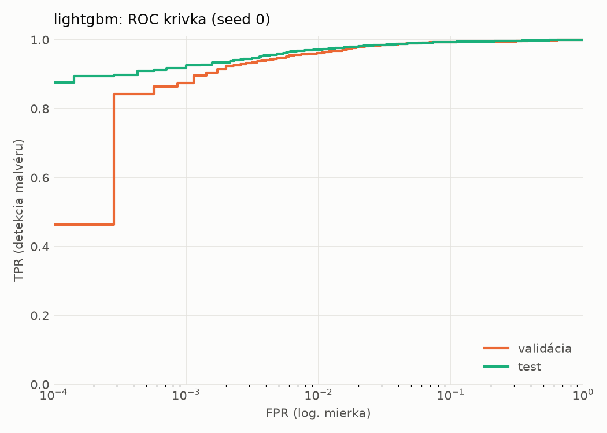
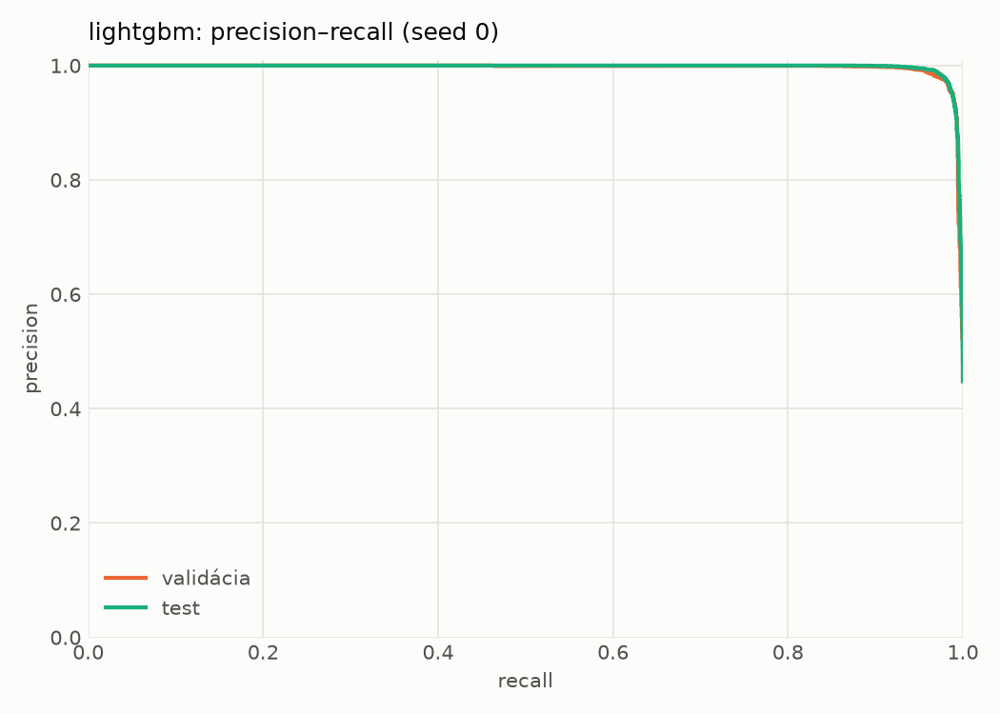
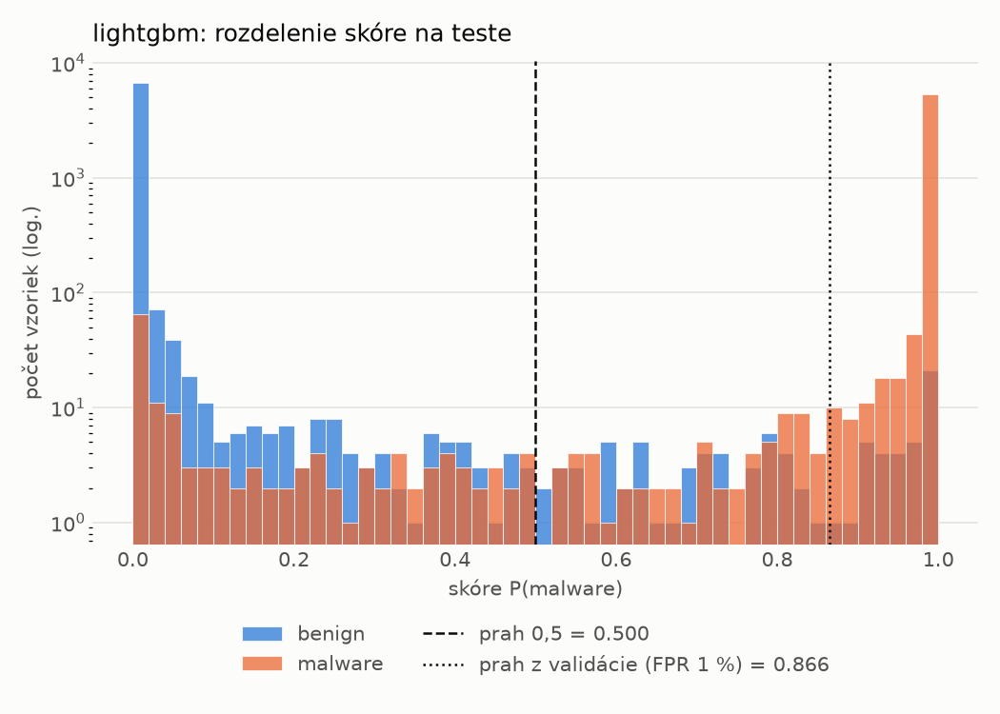
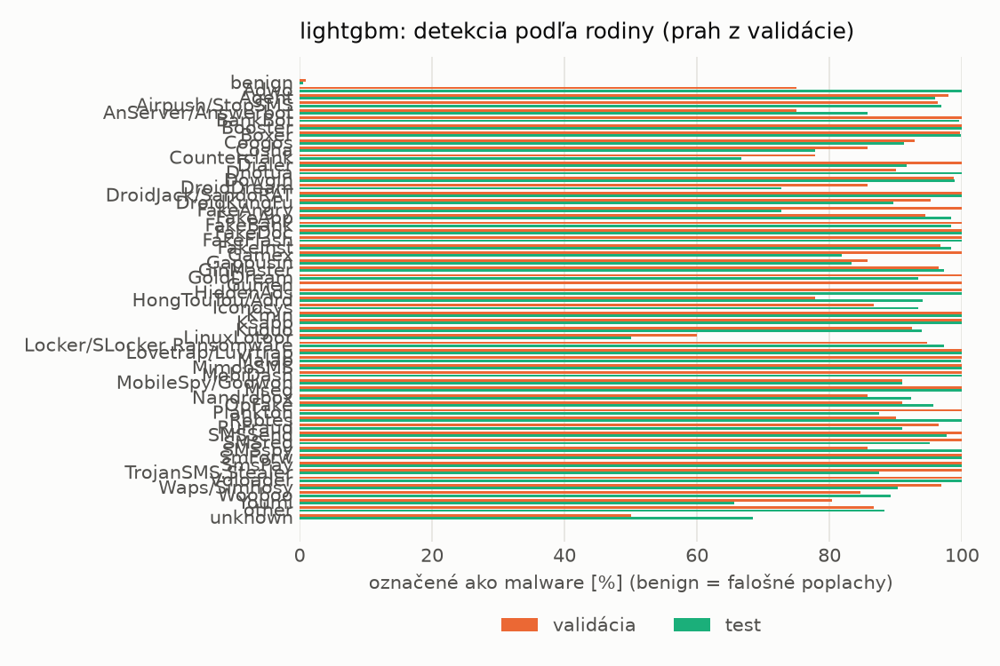
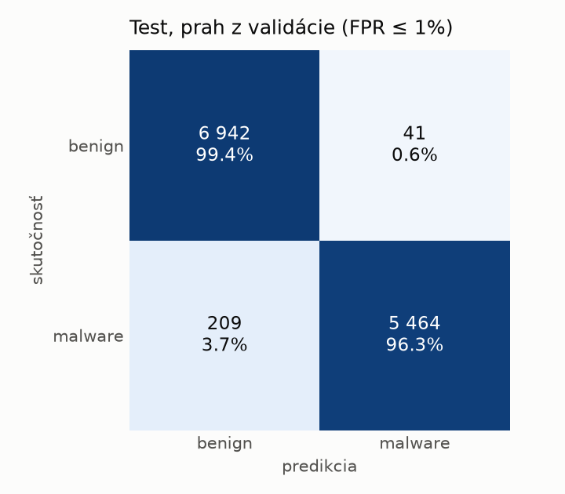
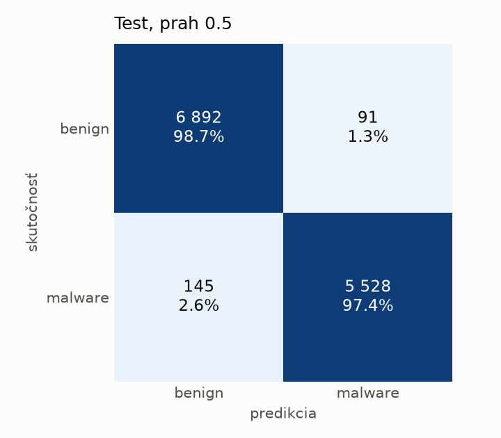
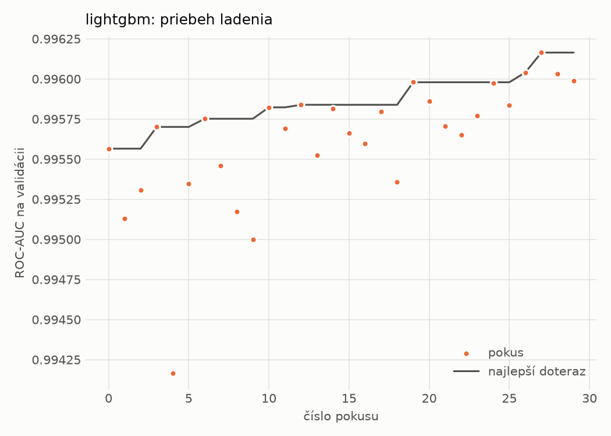
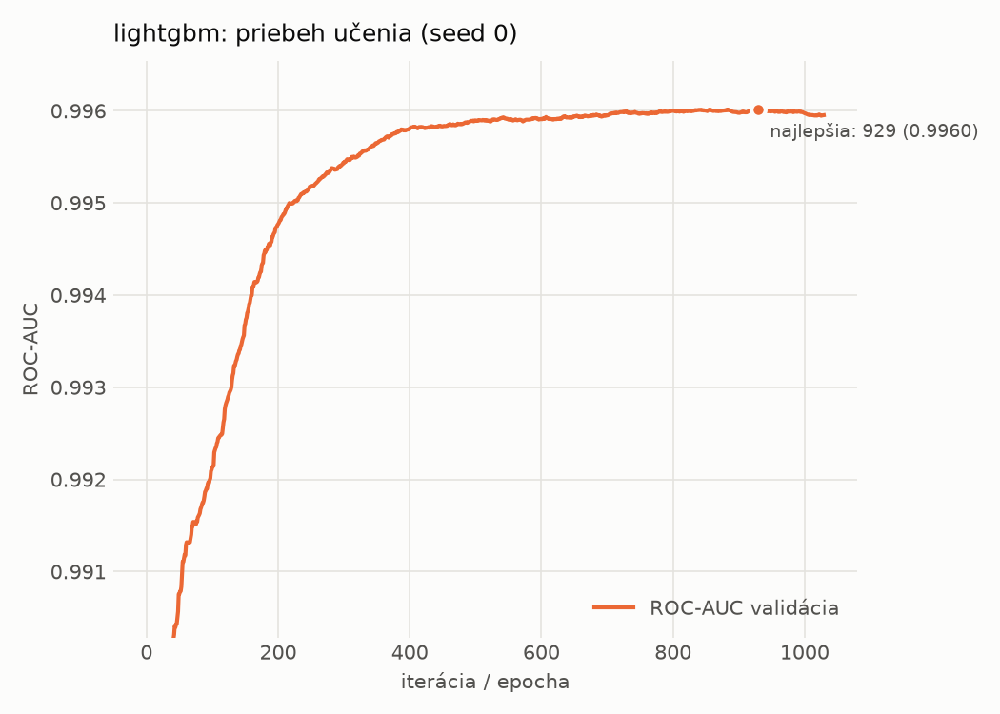

# hybrid/lightgbm – beh `20261123-195420`

> Automaticky generované (`src/training/run_tabular.py`). Konfigurácia: `config.yaml`, protokol: `protocol.yaml`.

- **Model:** `lightgbm` – LightGBM, gradient boosting stromov s early stopping na validácii (pôvodné hodnoty príznakov)
- **Ladenie:** 30 dokončených pokusov (Optuna TPE), cieľ ROC-AUC na validácii, 11.0 min
- **Finálne modely:** seedy [0, 1, 2]; hodnoty sú priemer ± smerodajná odchýlka cez seedy
- **Najlepšie hyperparametre:** `{"num_boost_round": 5000, "early_stopping_rounds": 100, "learning_rate": 0.021805367982090686, "num_leaves": 214, "min_child_samples": 11, "feature_fraction": 0.7934614803684483, "bagging_fraction": 0.9747297177039957, "lambda_l1": 3.6112431454858456e-05, "lambda_l2": 1.814656418208834e-05}`

## Detekčná kvalita (bez prahu)
| metrika | train (podvzorka) | validácia | test |
|---|---|---|---|
| ROC-AUC | 1.0000 ± 0.0000 | 0.9960 ± 0.0000 | 0.9969 ± 0.0000 |
| PR-AUC | 1.0000 ± 0.0000 | 0.9963 ± 0.0000 | 0.9971 ± 0.0000 |
| TPR pri FPR 1 % | 1.0000 ± 0.0000 | 0.9603 ± 0.0017 | 0.9707 ± 0.0018 |
| TPR pri FPR 0,1 % | 1.0000 ± 0.0000 | 0.8663 ± 0.0097 | 0.9134 ± 0.0051 |
| log loss | 0.0008 ± 0.0008 | 0.0778 ± 0.0068 | 0.0669 ± 0.0053 |
| Brier skóre | 0.0000 ± 0.0000 | 0.0172 ± 0.0002 | 0.0151 ± 0.0001 |

Rozdiel ROC-AUC train − validácia: **0.0040** (veľký rozdiel = preučenie).

## Pri prahu z validácie (FPR ≤ 1% na validácii)
| metrika | train (podvzorka) | validácia | test |
|---|---|---|---|
| accuracy | 1.0000 ± 0.0000 | 0.9768 ± 0.0007 | 0.9802 ± 0.0001 |
| balanced accuracy | 1.0000 ± 0.0000 | 0.9753 ± 0.0008 | 0.9786 ± 0.0001 |
| precision | 1.0000 ± 0.0000 | 0.9877 ± 0.0000 | 0.9924 ± 0.0002 |
| recall (TPR) | 1.0000 ± 0.0000 | 0.9603 ± 0.0017 | 0.9632 ± 0.0002 |
| FPR | 0.0000 ± 0.0000 | 0.0097 ± 0.0000 | 0.0060 ± 0.0001 |
| F1 | 1.0000 ± 0.0000 | 0.9738 ± 0.0009 | 0.9775 ± 0.0002 |
| MCC | 1.0000 ± 0.0000 | 0.9533 ± 0.0015 | 0.9601 ± 0.0003 |

## Pri pevnom prahu 0.5
| metrika | train (podvzorka) | validácia | test |
|---|---|---|---|
| accuracy | 1.0000 ± 0.0000 | 0.9788 ± 0.0003 | 0.9813 ± 0.0004 |
| balanced accuracy | 1.0000 ± 0.0000 | 0.9782 ± 0.0003 | 0.9807 ± 0.0004 |
| precision | 1.0000 ± 0.0000 | 0.9800 ± 0.0004 | 0.9835 ± 0.0008 |
| recall (TPR) | 1.0000 ± 0.0000 | 0.9725 ± 0.0004 | 0.9747 ± 0.0003 |
| FPR | 0.0000 ± 0.0000 | 0.0161 ± 0.0003 | 0.0133 ± 0.0006 |
| F1 | 1.0000 ± 0.0000 | 0.9762 ± 0.0004 | 0.9790 ± 0.0004 |
| MCC | 1.0000 ± 0.0000 | 0.9570 ± 0.0007 | 0.9622 ± 0.0008 |

## Výpočtové nároky (seed 0, testovacia množina)
| meranie | hodnota |
|---|---|
| tréning finálneho modelu | 18.3 s (priemer cez seedy) |
| ladenie spolu | 661 s |
| počet parametrov / uzlov | 396 683 |
| veľkosť modelu na disku | 22.29 MB |
| CPU latencia modelu (batch 1, 1 vlákno) | 0.156 ms (p95 0.184) |
| CPU priepustnosť (24 vlákien) | 87 382 vzoriek/s |

## Grafy
| | |
|---|---|
|  |  |
|  |  |
|  |  |
|  |  |

## Súbory
`metrics.json` (všetky metriky po seedoch vrátane rodín), `timing.json`, `hpo_trials.csv`,
`predictions/<časť>_seed<N>.parquet` (sha256, family, label, score), `model/seed_<N>/`, `log.txt`.
