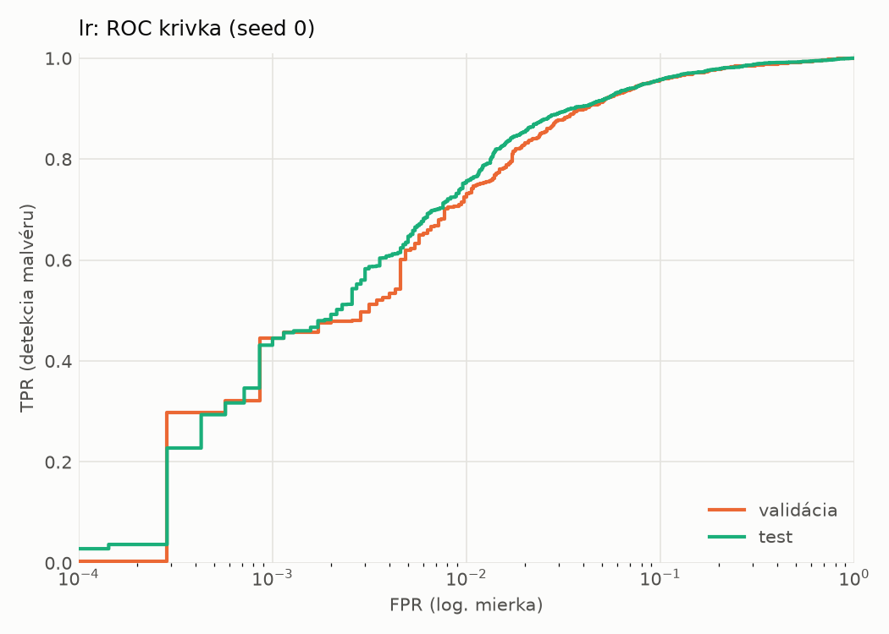
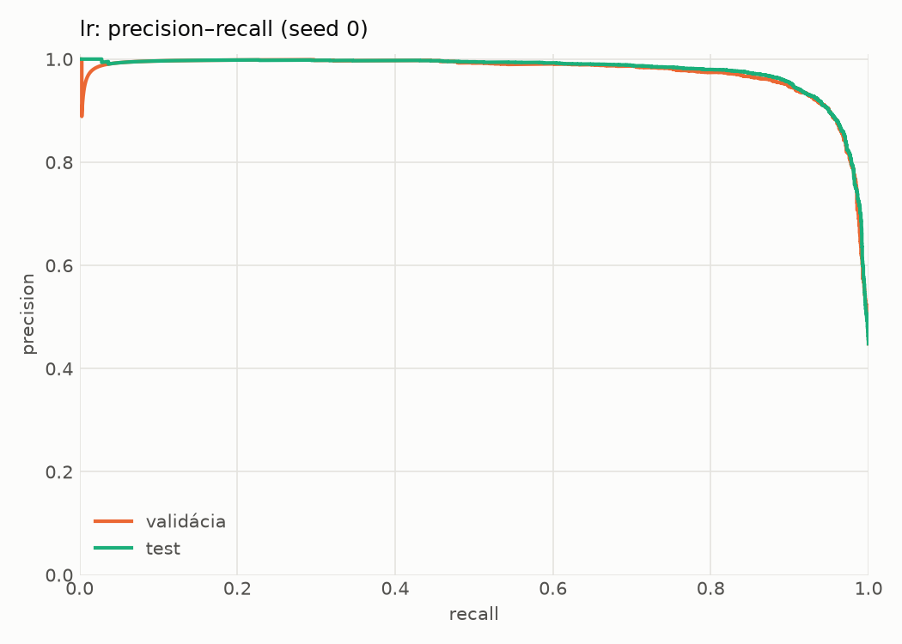
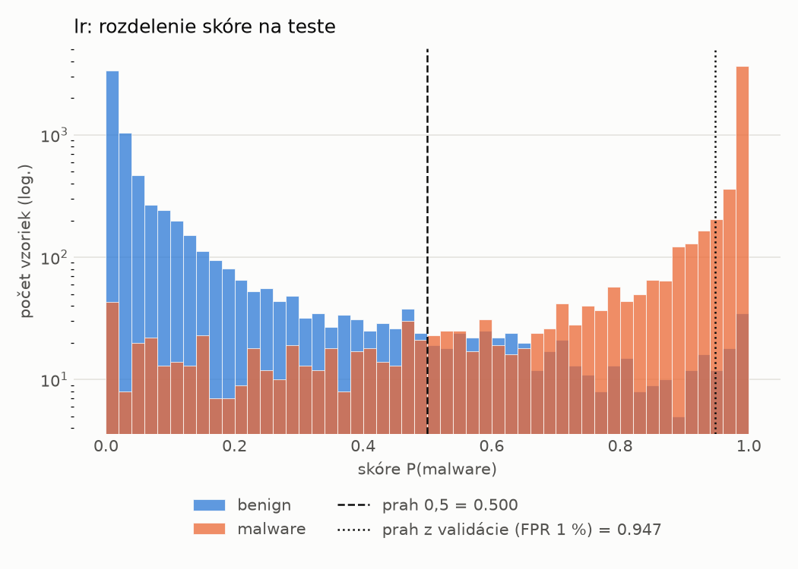
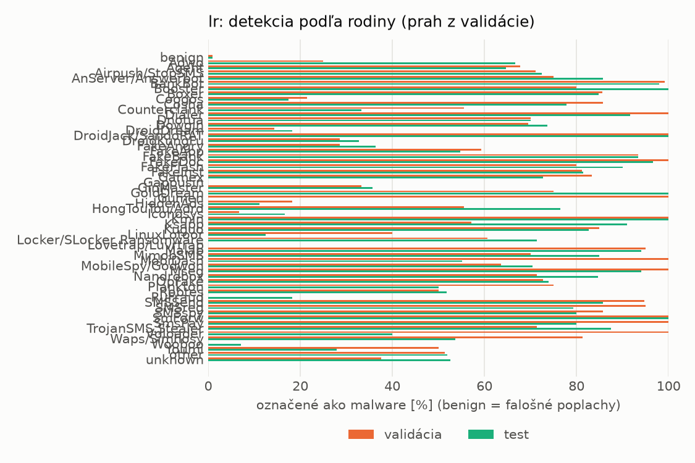
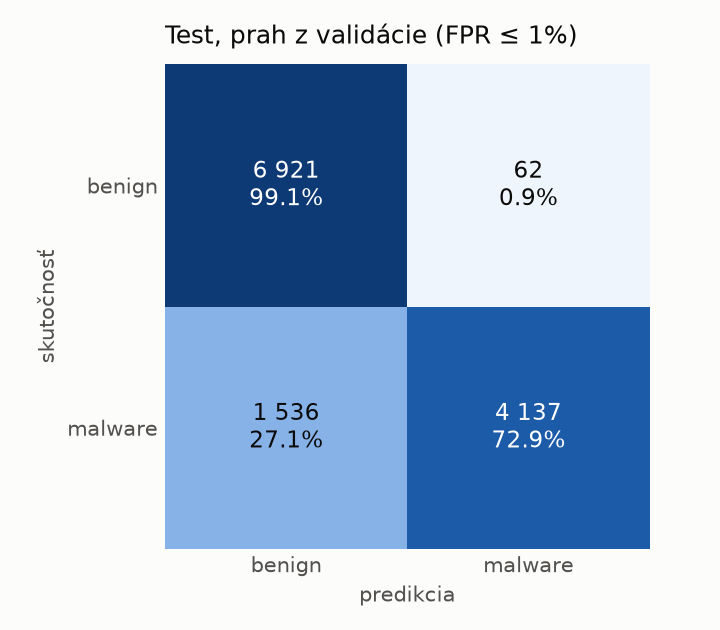
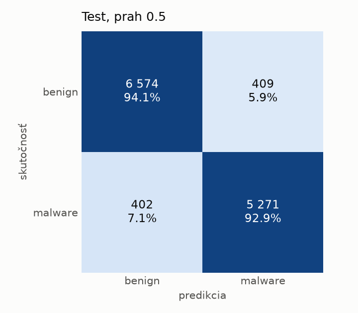
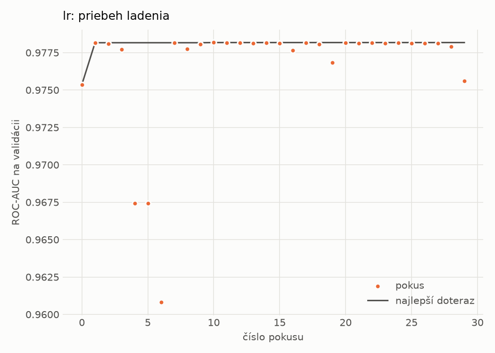

# hybrid/lr – beh `20261123-195300`

> Automaticky generované (`src/training/run_tabular.py`). Konfigurácia: `config.yaml`, protokol: `protocol.yaml`.

- **Model:** `logreg` – logistická regresia s L2 regularizáciou (vstup signed log1p + štandardizácia)
- **Ladenie:** 30 dokončených pokusov (Optuna TPE), cieľ ROC-AUC na validácii, 0.2 min
- **Finálne modely:** seedy [0, 1, 2]; hodnoty sú priemer ± smerodajná odchýlka cez seedy
- **Najlepšie hyperparametre:** `{"max_iter": 2000, "C": 7.106361724509844}`

## Detekčná kvalita (bez prahu)
| metrika | train (podvzorka) | validácia | test |
|---|---|---|---|
| ROC-AUC | 0.9825 ± 0.0000 | 0.9782 ± 0.0000 | 0.9798 ± 0.0000 |
| PR-AUC | 0.9801 ± 0.0000 | 0.9753 ± 0.0000 | 0.9778 ± 0.0000 |
| TPR pri FPR 1 % | 0.7718 ± 0.0000 | 0.7252 ± 0.0000 | 0.7530 ± 0.0000 |
| TPR pri FPR 0,1 % | 0.4268 ± 0.0000 | 0.4451 ± 0.0000 | 0.4313 ± 0.0000 |
| log loss | 0.1637 ± 0.0000 | 0.1836 ± 0.0000 | 0.1764 ± 0.0000 |
| Brier skóre | 0.0449 ± 0.0000 | 0.0501 ± 0.0000 | 0.0483 ± 0.0000 |

Rozdiel ROC-AUC train − validácia: **0.0044** (veľký rozdiel = preučenie).

## Pri prahu z validácie (FPR ≤ 1% na validácii)
| metrika | train (podvzorka) | validácia | test |
|---|---|---|---|
| accuracy | 0.8796 ± 0.0000 | 0.8714 ± 0.0000 | 0.8737 ± 0.0000 |
| balanced accuracy | 0.8630 ± 0.0000 | 0.8577 ± 0.0000 | 0.8602 ± 0.0000 |
| precision | 0.9861 ± 0.0000 | 0.9837 ± 0.0000 | 0.9852 ± 0.0000 |
| recall (TPR) | 0.7339 ± 0.0000 | 0.7252 ± 0.0000 | 0.7292 ± 0.0000 |
| FPR | 0.0080 ± 0.0000 | 0.0097 ± 0.0000 | 0.0089 ± 0.0000 |
| F1 | 0.8415 ± 0.0000 | 0.8349 ± 0.0000 | 0.8381 ± 0.0000 |
| MCC | 0.7690 ± 0.0000 | 0.7564 ± 0.0000 | 0.7608 ± 0.0000 |

## Pri pevnom prahu 0.5
| metrika | train (podvzorka) | validácia | test |
|---|---|---|---|
| accuracy | 0.9406 ± 0.0000 | 0.9349 ± 0.0000 | 0.9359 ± 0.0000 |
| balanced accuracy | 0.9400 ± 0.0000 | 0.9341 ± 0.0000 | 0.9353 ± 0.0000 |
| precision | 0.9291 ± 0.0000 | 0.9279 ± 0.0000 | 0.9280 ± 0.0000 |
| recall (TPR) | 0.9350 ± 0.0000 | 0.9266 ± 0.0000 | 0.9291 ± 0.0000 |
| FPR | 0.0551 ± 0.0000 | 0.0585 ± 0.0000 | 0.0586 ± 0.0000 |
| F1 | 0.9320 ± 0.0000 | 0.9273 ± 0.0000 | 0.9286 ± 0.0000 |
| MCC | 0.8793 ± 0.0000 | 0.8683 ± 0.0000 | 0.8705 ± 0.0000 |

## Výpočtové nároky (seed 0, testovacia množina)
| meranie | hodnota |
|---|---|
| tréning finálneho modelu | 0.5 s (priemer cez seedy) |
| ladenie spolu | 11 s |
| počet parametrov / uzlov | 287 |
| veľkosť modelu na disku | 0.01 MB |
| transformácia vstupu – latencia (1 vlákno) | 0.006 ms |
| transformácia vstupu – priepustnosť | 500 581 vzoriek/s |
| CPU latencia modelu (batch 1, 1 vlákno) | 0.004 ms (p95 0.004) |
| CPU priepustnosť (24 vlákien) | 2 321 180 vzoriek/s |

## Grafy
| | |
|---|---|
|  |  |
|  |  |
|  |  |
|  |  |

## Súbory
`metrics.json` (všetky metriky po seedoch vrátane rodín), `timing.json`, `hpo_trials.csv`,
`predictions/<časť>_seed<N>.parquet` (sha256, family, label, score), `model/seed_<N>/`, `log.txt`.
