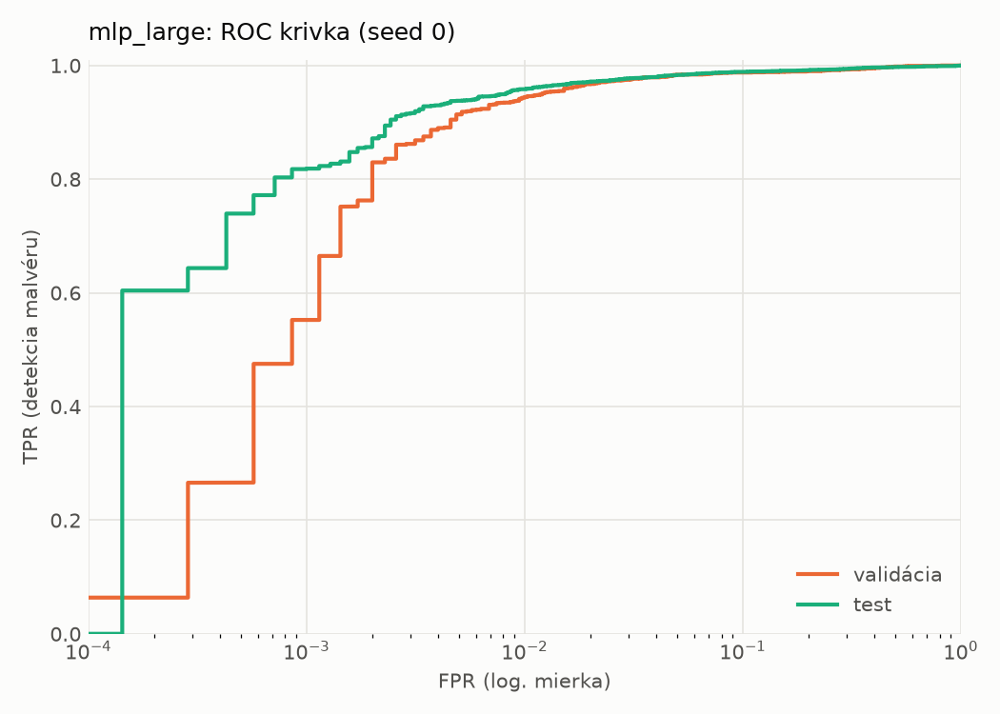
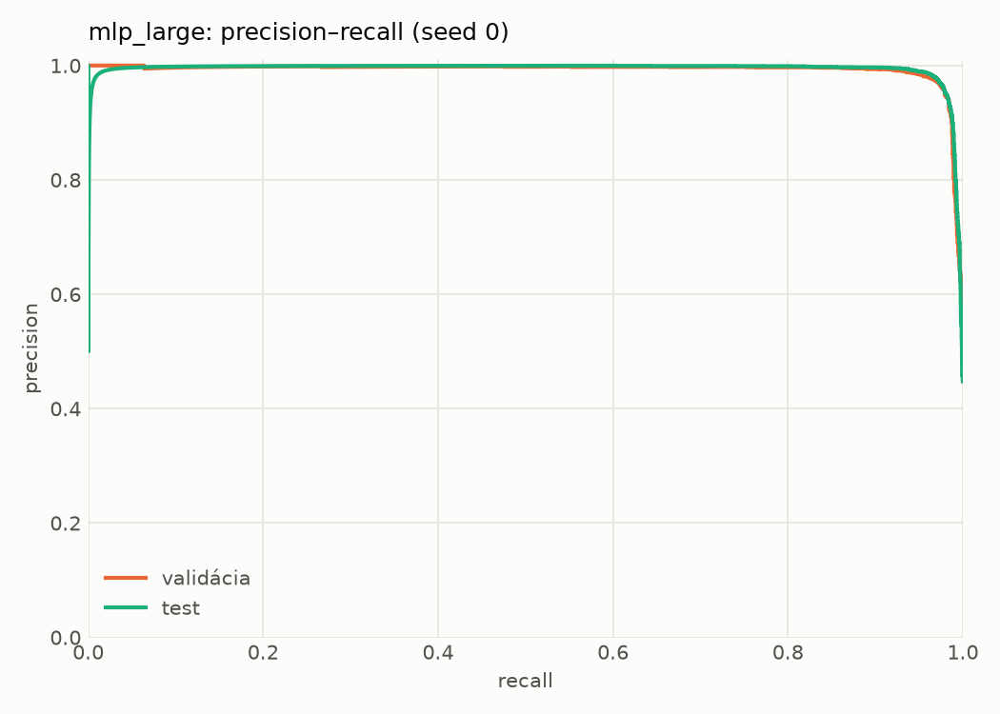
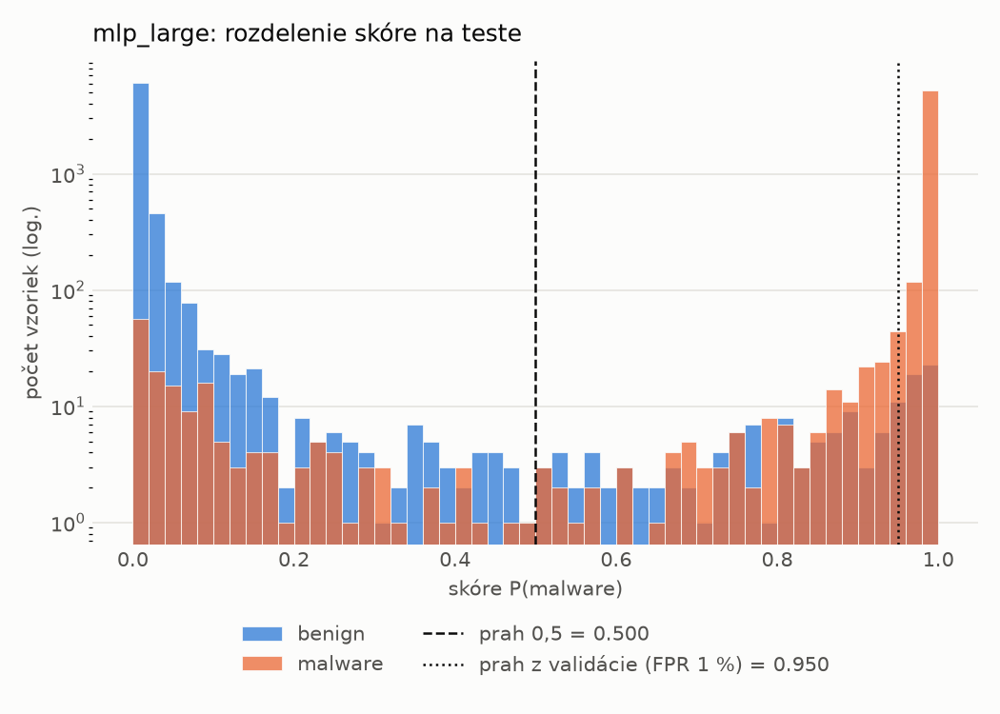
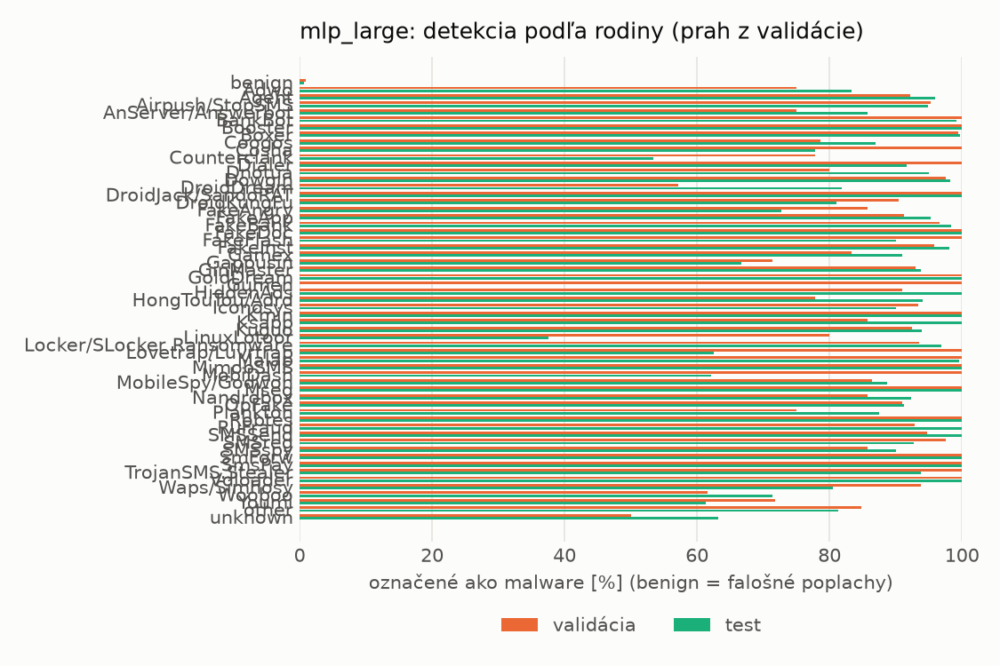
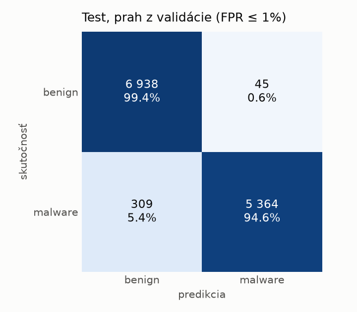
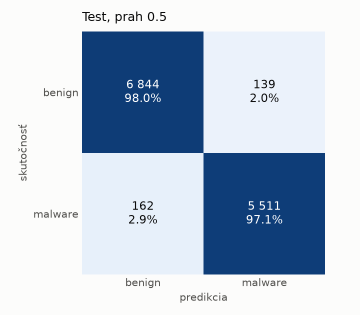
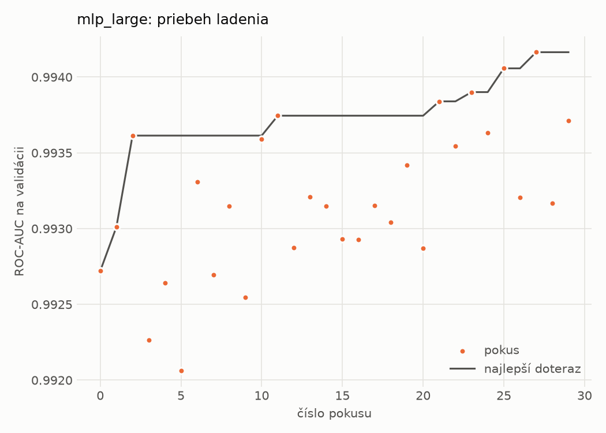
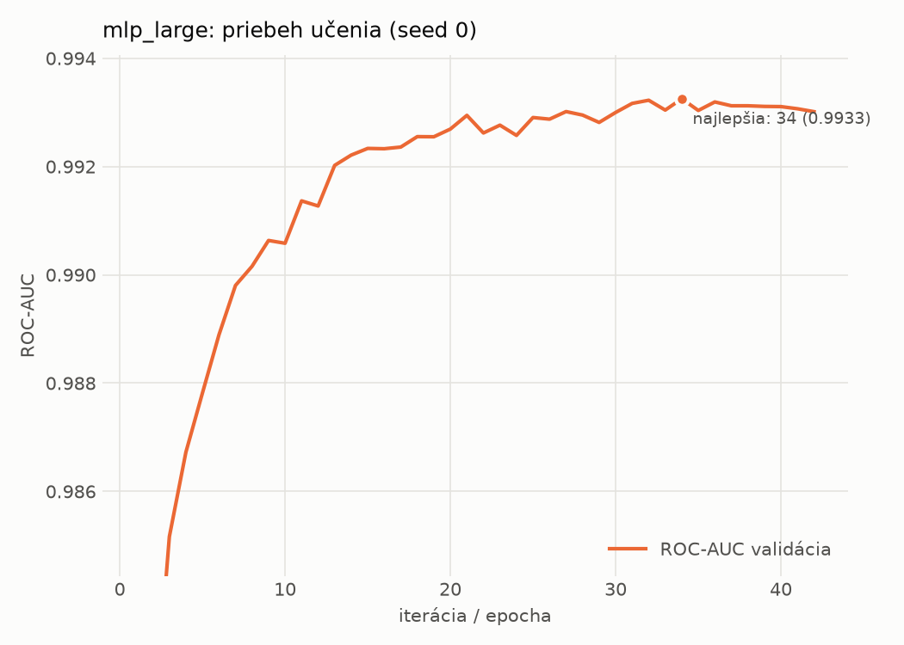

# hybrid/mlp_large – beh `20261123-200933`

> Automaticky generované (`src/training/run_tabular.py`). Konfigurácia: `config.yaml`, protokol: `protocol.yaml`.

- **Model:** `mlp` – veľká neurónová sieť (3–5 skrytých vrstiev, 512–2048 neurónov), kandidát na učiteľa
- **Ladenie:** 30 dokončených pokusov (Optuna TPE), cieľ ROC-AUC na validácii, 3.7 min
- **Finálne modely:** seedy [0, 1, 2]; hodnoty sú priemer ± smerodajná odchýlka cez seedy
- **Najlepšie hyperparametre:** `{"max_epochs": 100, "patience": 8, "hidden_layers": 5, "hidden_width": 512, "width_decay": 0.5, "dropout": 0.18561035972653261, "lr": 0.00013117672209273214, "weight_decay": 3.948210593203141e-06, "batch_size": 512}`

## Detekčná kvalita (bez prahu)
| metrika | train (podvzorka) | validácia | test |
|---|---|---|---|
| ROC-AUC | 0.9988 ± 0.0000 | 0.9933 ± 0.0001 | 0.9942 ± 0.0001 |
| PR-AUC | 0.9989 ± 0.0000 | 0.9932 ± 0.0007 | 0.9943 ± 0.0006 |
| TPR pri FPR 1 % | 0.9927 ± 0.0010 | 0.9427 ± 0.0015 | 0.9566 ± 0.0021 |
| TPR pri FPR 0,1 % | 0.9823 ± 0.0026 | 0.6830 ± 0.1134 | 0.8043 ± 0.0217 |
| log loss | 0.0267 ± 0.0019 | 0.0919 ± 0.0007 | 0.0822 ± 0.0022 |
| Brier skóre | 0.0054 ± 0.0004 | 0.0224 ± 0.0003 | 0.0203 ± 0.0007 |

Rozdiel ROC-AUC train − validácia: **0.0054** (veľký rozdiel = preučenie).

## Pri prahu z validácie (FPR ≤ 1% na validácii)
| metrika | train (podvzorka) | validácia | test |
|---|---|---|---|
| accuracy | 0.9866 ± 0.0002 | 0.9690 ± 0.0007 | 0.9716 ± 0.0005 |
| balanced accuracy | 0.9846 ± 0.0002 | 0.9665 ± 0.0007 | 0.9691 ± 0.0005 |
| precision | 0.9994 ± 0.0003 | 0.9874 ± 0.0000 | 0.9919 ± 0.0003 |
| recall (TPR) | 0.9697 ± 0.0004 | 0.9427 ± 0.0015 | 0.9445 ± 0.0011 |
| FPR | 0.0004 ± 0.0002 | 0.0097 ± 0.0000 | 0.0063 ± 0.0002 |
| F1 | 0.9843 ± 0.0002 | 0.9646 ± 0.0008 | 0.9676 ± 0.0006 |
| MCC | 0.9729 ± 0.0003 | 0.9378 ± 0.0013 | 0.9433 ± 0.0010 |

## Pri pevnom prahu 0.5
| metrika | train (podvzorka) | validácia | test |
|---|---|---|---|
| accuracy | 0.9936 ± 0.0005 | 0.9733 ± 0.0002 | 0.9760 ± 0.0012 |
| balanced accuracy | 0.9931 ± 0.0004 | 0.9732 ± 0.0002 | 0.9754 ± 0.0015 |
| precision | 0.9958 ± 0.0011 | 0.9692 ± 0.0019 | 0.9766 ± 0.0014 |
| recall (TPR) | 0.9894 ± 0.0006 | 0.9714 ± 0.0018 | 0.9697 ± 0.0041 |
| FPR | 0.0032 ± 0.0009 | 0.0251 ± 0.0017 | 0.0189 ± 0.0013 |
| F1 | 0.9926 ± 0.0005 | 0.9703 ± 0.0002 | 0.9732 ± 0.0015 |
| MCC | 0.9869 ± 0.0009 | 0.9461 ± 0.0004 | 0.9515 ± 0.0025 |

## Výpočtové nároky (seed 0, testovacia množina)
| meranie | hodnota |
|---|---|
| tréning finálneho modelu | 9.7 s (priemer cez seedy) |
| ladenie spolu | 219 s |
| počet parametrov / uzlov | 323 521 |
| veľkosť modelu na disku | 1.32 MB |
| transformácia vstupu – latencia (1 vlákno) | 0.017 ms |
| transformácia vstupu – priepustnosť | 289 496 vzoriek/s |
| CPU latencia modelu (batch 1, 1 vlákno) | 0.168 ms (p95 0.191) |
| CPU priepustnosť (24 vlákien) | 608 318 vzoriek/s |
| GPU latencia (batch 1) | 0.589 ms (p95 1.354) |
| GPU priepustnosť | 1 215 883 vzoriek/s |
| GPU špičková pamäť | 184 MB |

## Grafy
| | |
|---|---|
|  |  |
|  |  |
|  |  |
|  |  |

## Súbory
`metrics.json` (všetky metriky po seedoch vrátane rodín), `timing.json`, `hpo_trials.csv`,
`predictions/<časť>_seed<N>.parquet` (sha256, family, label, score), `model/seed_<N>/`, `log.txt`.
