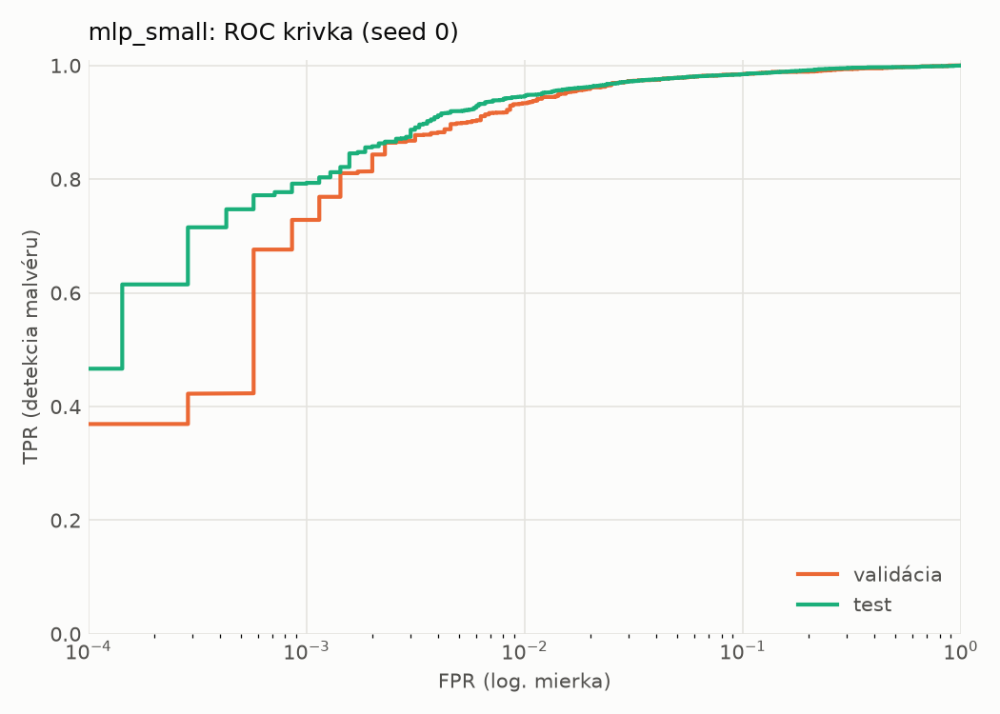
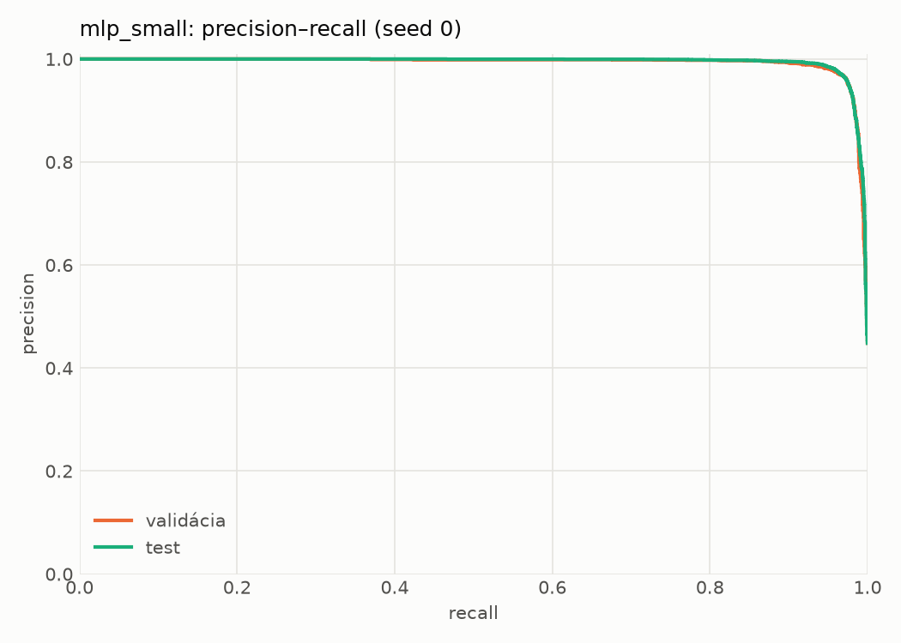
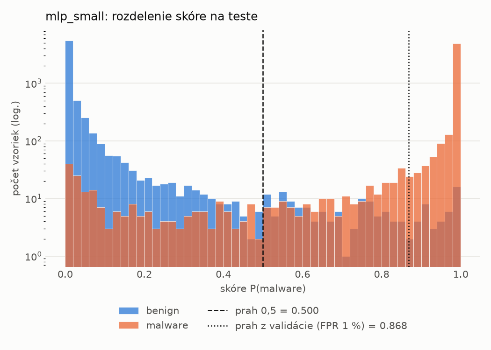
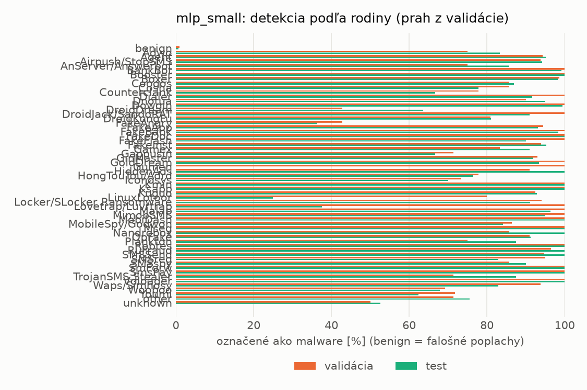
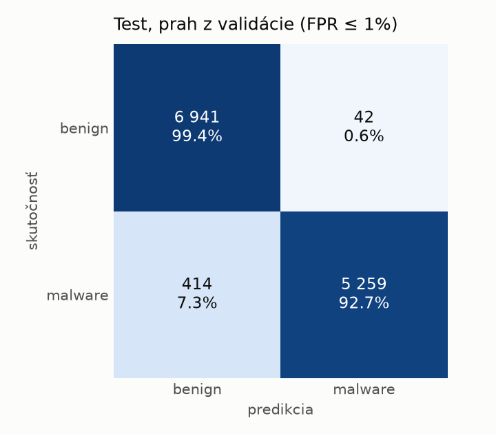
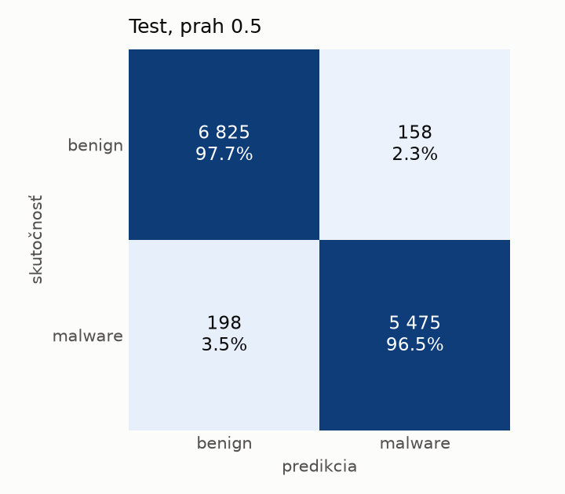
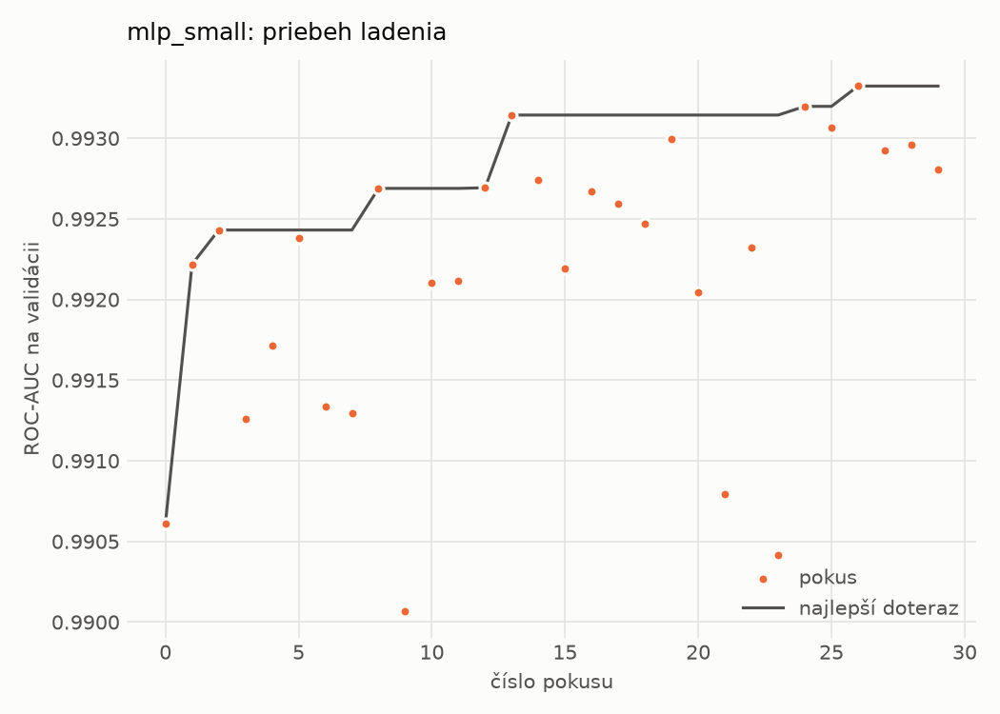
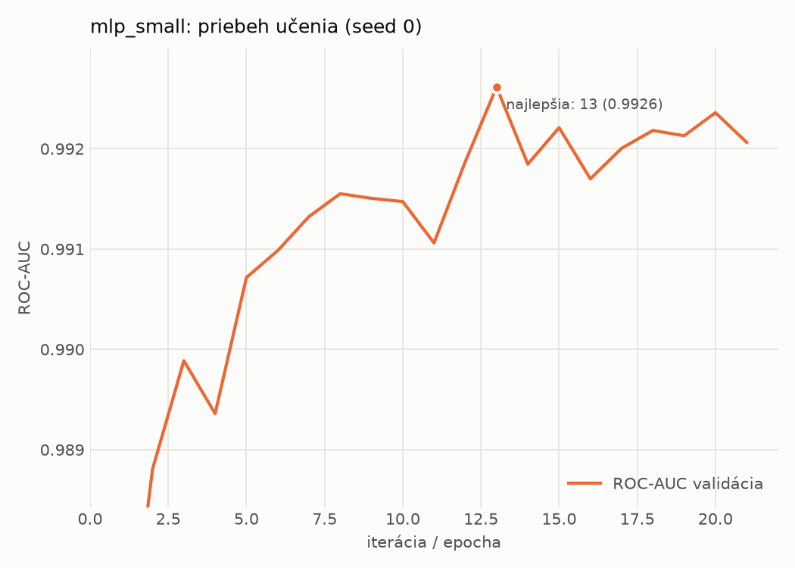

# hybrid/mlp_small – beh `20261123-200627`

> Automaticky generované (`src/training/run_tabular.py`). Konfigurácia: `config.yaml`, protokol: `protocol.yaml`.

- **Model:** `mlp` – malá neurónová sieť (1–2 skryté vrstvy), kandidát na ľahkého študenta
- **Ladenie:** 30 dokončených pokusov (Optuna TPE), cieľ ROC-AUC na validácii, 2.9 min
- **Finálne modely:** seedy [0, 1, 2]; hodnoty sú priemer ± smerodajná odchýlka cez seedy
- **Najlepšie hyperparametre:** `{"width_decay": 0.5, "max_epochs": 100, "patience": 8, "hidden_layers": 2, "hidden_width": 256, "dropout": 0.2736594475747717, "lr": 0.0019631646658614973, "weight_decay": 0.0007425190310675283, "batch_size": 512}`

## Detekčná kvalita (bez prahu)
| metrika | train (podvzorka) | validácia | test |
|---|---|---|---|
| ROC-AUC | 0.9986 ± 0.0006 | 0.9925 ± 0.0002 | 0.9941 ± 0.0005 |
| PR-AUC | 0.9986 ± 0.0006 | 0.9921 ± 0.0008 | 0.9943 ± 0.0004 |
| TPR pri FPR 1 % | 0.9858 ± 0.0074 | 0.9325 ± 0.0092 | 0.9485 ± 0.0074 |
| TPR pri FPR 0,1 % | 0.9607 ± 0.0210 | 0.5912 ± 0.1196 | 0.7763 ± 0.0522 |
| log loss | 0.0352 ± 0.0112 | 0.1040 ± 0.0082 | 0.0873 ± 0.0001 |
| Brier skóre | 0.0089 ± 0.0032 | 0.0228 ± 0.0014 | 0.0206 ± 0.0013 |

Rozdiel ROC-AUC train − validácia: **0.0060** (veľký rozdiel = preučenie).

## Pri prahu z validácie (FPR ≤ 1% na validácii)
| metrika | train (podvzorka) | validácia | test |
|---|---|---|---|
| accuracy | 0.9787 ± 0.0055 | 0.9644 ± 0.0041 | 0.9657 ± 0.0041 |
| balanced accuracy | 0.9757 ± 0.0063 | 0.9614 ± 0.0046 | 0.9624 ± 0.0046 |
| precision | 0.9990 ± 0.0012 | 0.9873 ± 0.0001 | 0.9921 ± 0.0005 |
| recall (TPR) | 0.9522 ± 0.0119 | 0.9325 ± 0.0092 | 0.9309 ± 0.0096 |
| FPR | 0.0008 ± 0.0009 | 0.0097 ± 0.0000 | 0.0060 ± 0.0004 |
| F1 | 0.9750 ± 0.0066 | 0.9591 ± 0.0049 | 0.9605 ± 0.0049 |
| MCC | 0.9574 ± 0.0110 | 0.9288 ± 0.0081 | 0.9318 ± 0.0079 |

## Pri pevnom prahu 0.5
| metrika | train (podvzorka) | validácia | test |
|---|---|---|---|
| accuracy | 0.9888 ± 0.0041 | 0.9727 ± 0.0023 | 0.9744 ± 0.0027 |
| balanced accuracy | 0.9882 ± 0.0042 | 0.9725 ± 0.0024 | 0.9738 ± 0.0027 |
| precision | 0.9905 ± 0.0048 | 0.9693 ± 0.0017 | 0.9748 ± 0.0026 |
| recall (TPR) | 0.9837 ± 0.0050 | 0.9699 ± 0.0035 | 0.9678 ± 0.0035 |
| FPR | 0.0073 ± 0.0037 | 0.0249 ± 0.0013 | 0.0203 ± 0.0021 |
| F1 | 0.9871 ± 0.0048 | 0.9696 ± 0.0026 | 0.9713 ± 0.0030 |
| MCC | 0.9772 ± 0.0084 | 0.9449 ± 0.0047 | 0.9482 ± 0.0054 |

## Výpočtové nároky (seed 0, testovacia množina)
| meranie | hodnota |
|---|---|
| tréning finálneho modelu | 3.5 s (priemer cez seedy) |
| ladenie spolu | 173 s |
| počet parametrov / uzlov | 107 265 |
| veľkosť modelu na disku | 0.45 MB |
| transformácia vstupu – latencia (1 vlákno) | 0.007 ms |
| transformácia vstupu – priepustnosť | 475 323 vzoriek/s |
| CPU latencia modelu (batch 1, 1 vlákno) | 0.085 ms (p95 0.232) |
| CPU priepustnosť (24 vlákien) | 1 246 663 vzoriek/s |
| GPU latencia (batch 1) | 0.601 ms (p95 0.728) |
| GPU priepustnosť | 1 294 347 vzoriek/s |
| GPU špičková pamäť | 107 MB |

## Grafy
| | |
|---|---|
|  |  |
|  |  |
|  |  |
|  |  |

## Súbory
`metrics.json` (všetky metriky po seedoch vrátane rodín), `timing.json`, `hpo_trials.csv`,
`predictions/<časť>_seed<N>.parquet` (sha256, family, label, score), `model/seed_<N>/`, `log.txt`.
