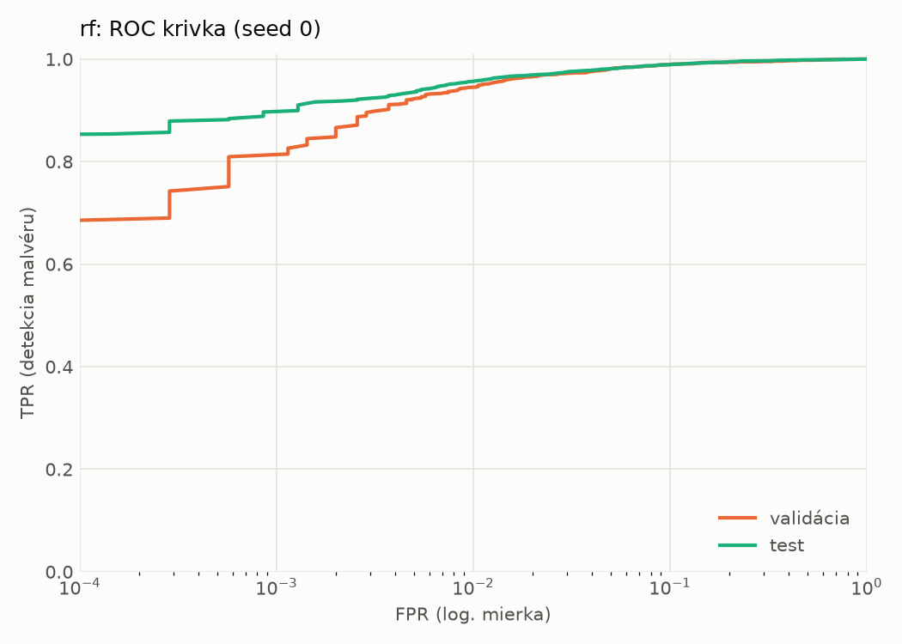
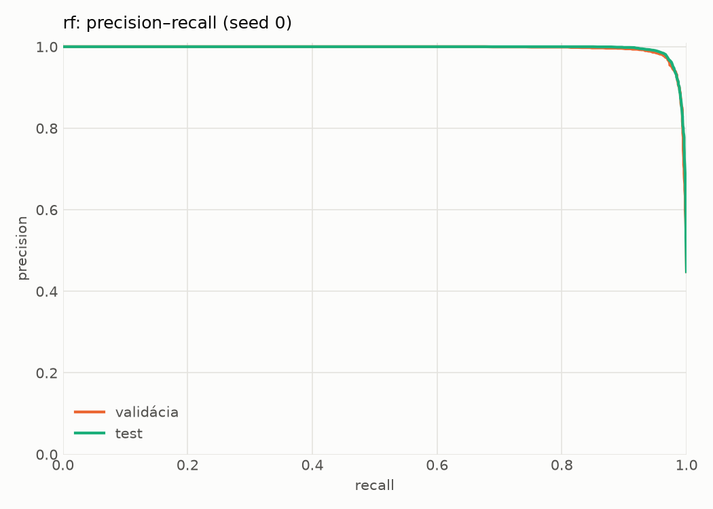
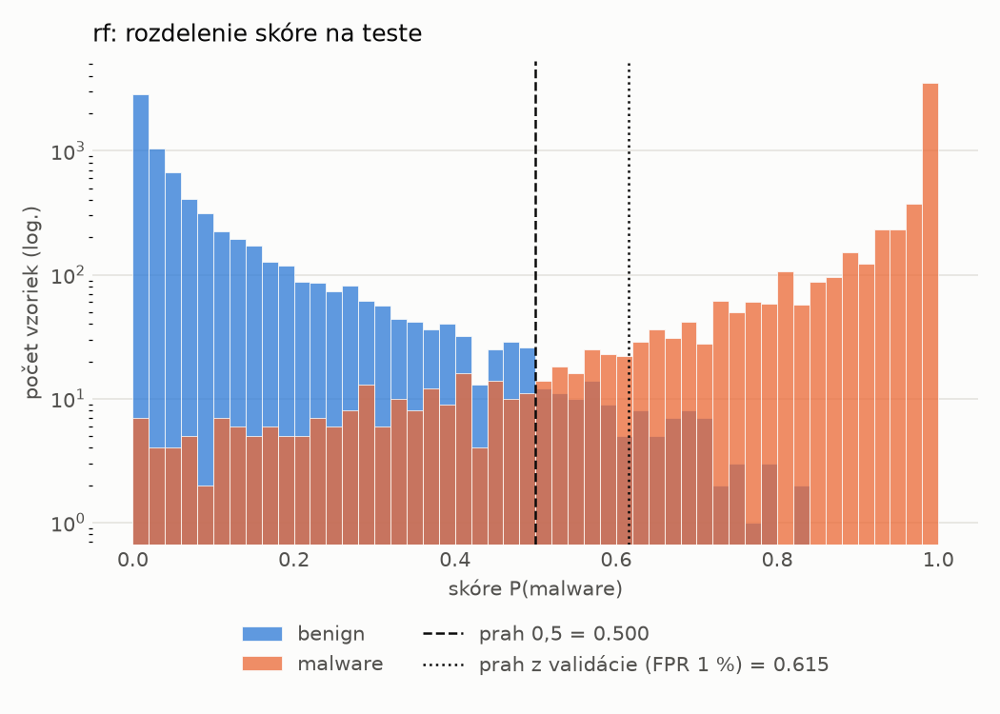
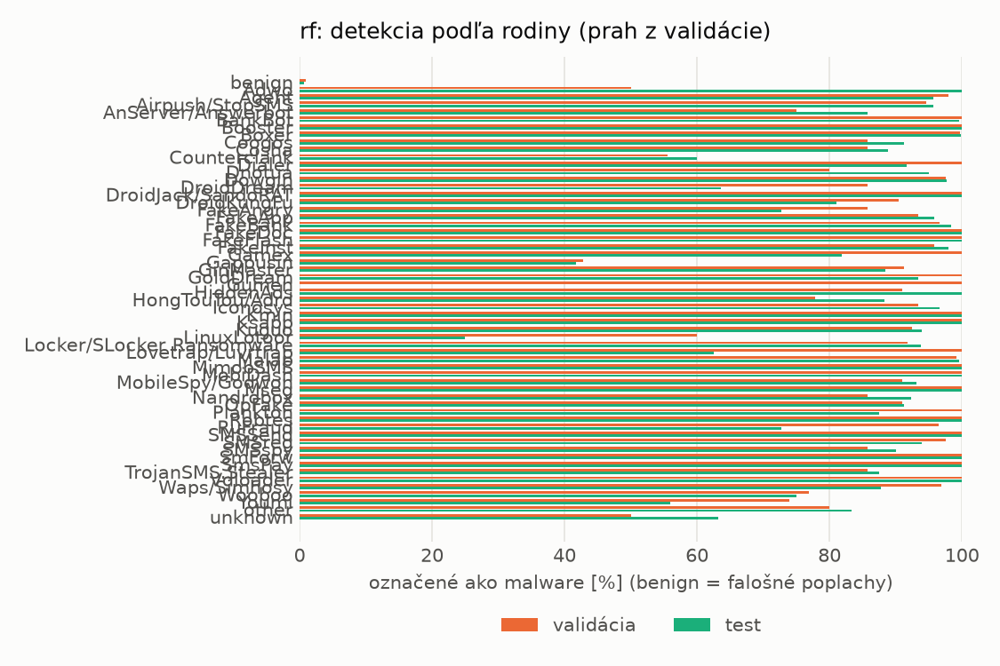
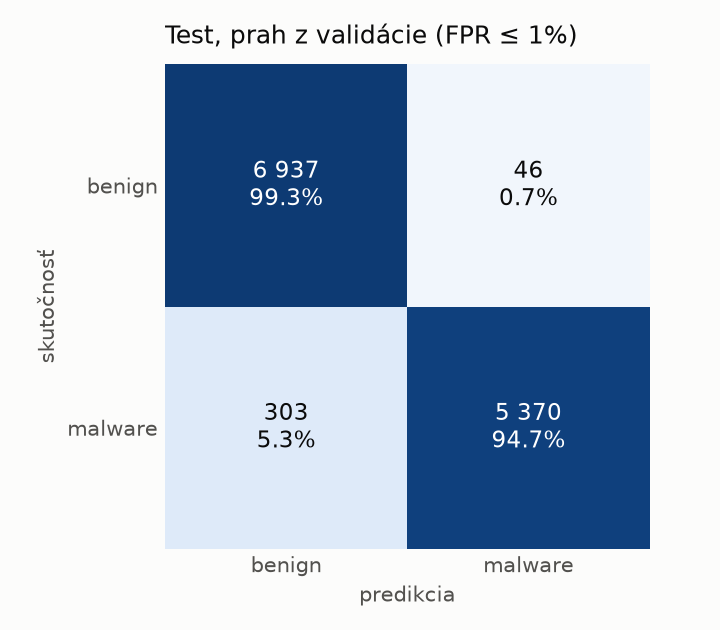
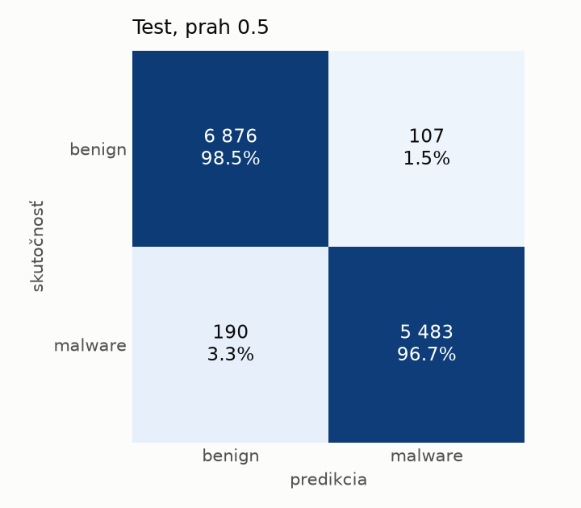
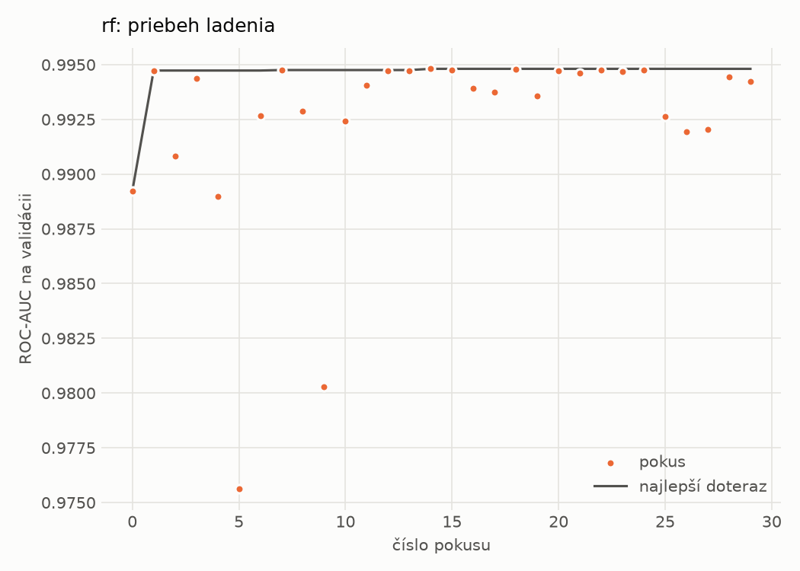

# hybrid/rf – beh `20261123-195313`

> Automaticky generované (`src/training/run_tabular.py`). Konfigurácia: `config.yaml`, protokol: `protocol.yaml`.

- **Model:** `random_forest` – Random Forest (pôvodné hodnoty príznakov)
- **Ladenie:** 30 dokončených pokusov (Optuna TPE), cieľ ROC-AUC na validácii, 1.0 min
- **Finálne modely:** seedy [0, 1, 2]; hodnoty sú priemer ± smerodajná odchýlka cez seedy
- **Najlepšie hyperparametre:** `{"n_estimators": 200, "max_depth": null, "min_samples_leaf": 1, "max_features": "sqrt"}`

## Detekčná kvalita (bez prahu)
| metrika | train (podvzorka) | validácia | test |
|---|---|---|---|
| ROC-AUC | 1.0000 ± 0.0000 | 0.9946 ± 0.0001 | 0.9956 ± 0.0000 |
| PR-AUC | 1.0000 ± 0.0000 | 0.9948 ± 0.0000 | 0.9957 ± 0.0000 |
| TPR pri FPR 1 % | 1.0000 ± 0.0000 | 0.9447 ± 0.0012 | 0.9547 ± 0.0010 |
| TPR pri FPR 0,1 % | 1.0000 ± 0.0000 | 0.8039 ± 0.0052 | 0.8897 ± 0.0064 |
| log loss | 0.0292 ± 0.0001 | 0.1050 ± 0.0008 | 0.1015 ± 0.0007 |
| Brier skóre | 0.0032 ± 0.0000 | 0.0253 ± 0.0001 | 0.0243 ± 0.0000 |

Rozdiel ROC-AUC train − validácia: **0.0054** (veľký rozdiel = preučenie).

## Pri prahu z validácie (FPR ≤ 1% na validácii)
| metrika | train (podvzorka) | validácia | test |
|---|---|---|---|
| accuracy | 1.0000 ± 0.0001 | 0.9700 ± 0.0004 | 0.9720 ± 0.0006 |
| balanced accuracy | 1.0000 ± 0.0001 | 0.9676 ± 0.0005 | 0.9695 ± 0.0006 |
| precision | 1.0000 ± 0.0000 | 0.9878 ± 0.0003 | 0.9915 ± 0.0002 |
| recall (TPR) | 0.9999 ± 0.0001 | 0.9447 ± 0.0012 | 0.9456 ± 0.0012 |
| FPR | 0.0000 ± 0.0000 | 0.0095 ± 0.0003 | 0.0066 ± 0.0001 |
| F1 | 1.0000 ± 0.0001 | 0.9658 ± 0.0005 | 0.9680 ± 0.0007 |
| MCC | 0.9999 ± 0.0001 | 0.9399 ± 0.0008 | 0.9439 ± 0.0012 |

## Pri pevnom prahu 0.5
| metrika | train (podvzorka) | validácia | test |
|---|---|---|---|
| accuracy | 1.0000 ± 0.0000 | 0.9734 ± 0.0005 | 0.9758 ± 0.0007 |
| balanced accuracy | 1.0000 ± 0.0000 | 0.9728 ± 0.0006 | 0.9748 ± 0.0007 |
| precision | 1.0000 ± 0.0000 | 0.9736 ± 0.0002 | 0.9800 ± 0.0007 |
| recall (TPR) | 1.0000 ± 0.0000 | 0.9668 ± 0.0013 | 0.9657 ± 0.0008 |
| FPR | 0.0000 ± 0.0000 | 0.0213 ± 0.0002 | 0.0160 ± 0.0006 |
| F1 | 1.0000 ± 0.0000 | 0.9702 ± 0.0006 | 0.9728 ± 0.0007 |
| MCC | 1.0000 ± 0.0000 | 0.9462 ± 0.0010 | 0.9511 ± 0.0013 |

## Výpočtové nároky (seed 0, testovacia množina)
| meranie | hodnota |
|---|---|
| tréning finálneho modelu | 1.6 s (priemer cez seedy) |
| ladenie spolu | 57 s |
| počet parametrov / uzlov | 1 023 500 |
| veľkosť modelu na disku | 82.14 MB |
| CPU latencia modelu (batch 1, 1 vlákno) | 5.859 ms (p95 6.208) |
| CPU priepustnosť (24 vlákien) | 167 132 vzoriek/s |

## Grafy
| | |
|---|---|
|  |  |
|  |  |
|  |  |
|  |  |

## Súbory
`metrics.json` (všetky metriky po seedoch vrátane rodín), `timing.json`, `hpo_trials.csv`,
`predictions/<časť>_seed<N>.parquet` (sha256, family, label, score), `model/seed_<N>/`, `log.txt`.
