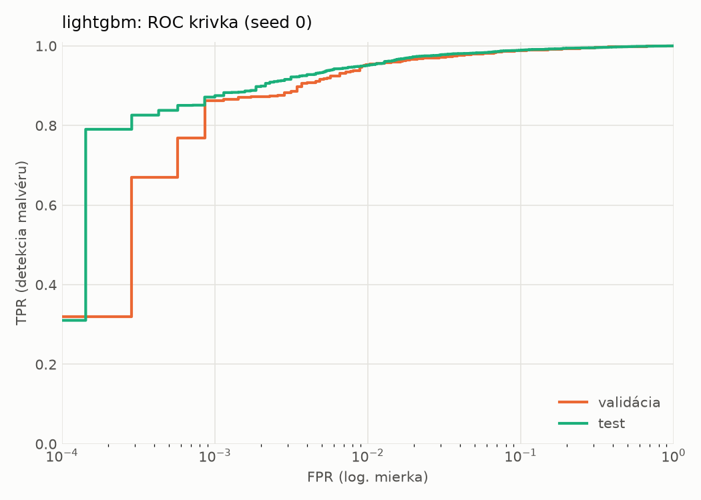
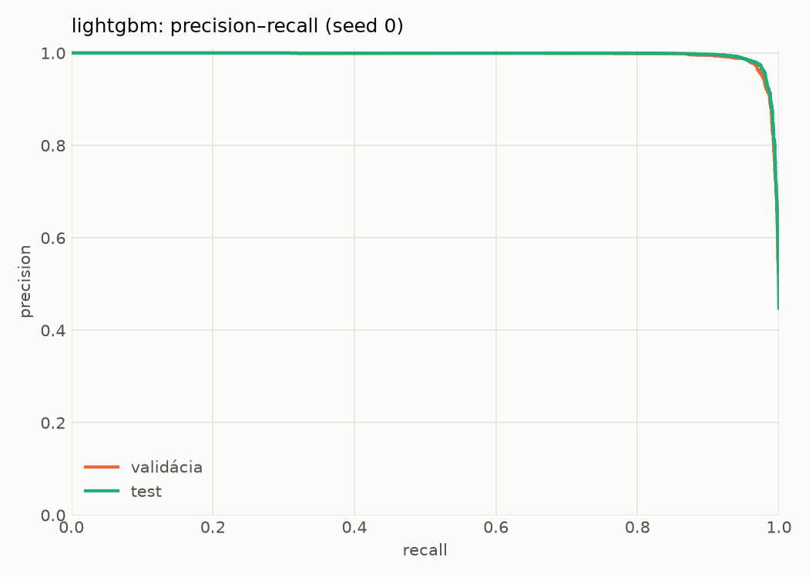
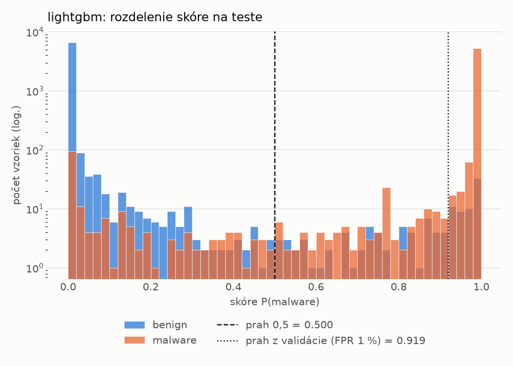
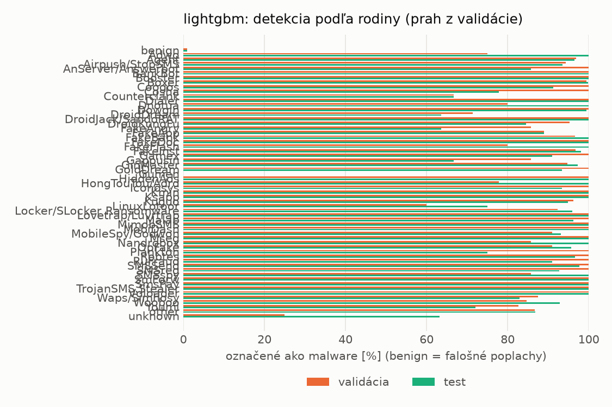
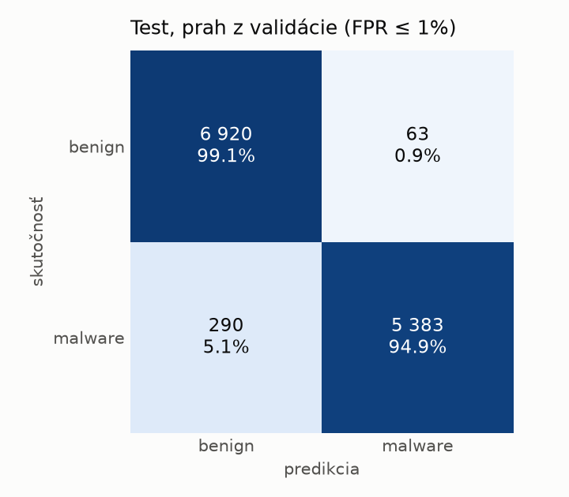
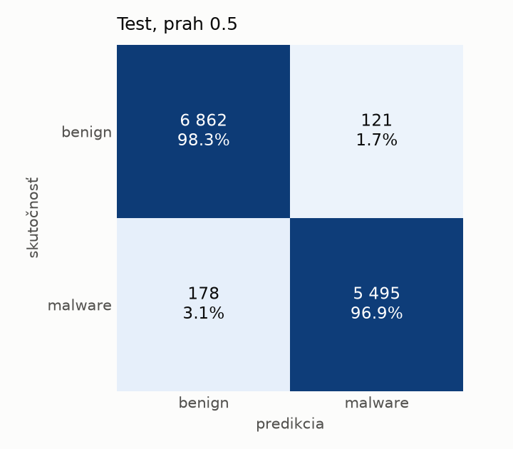
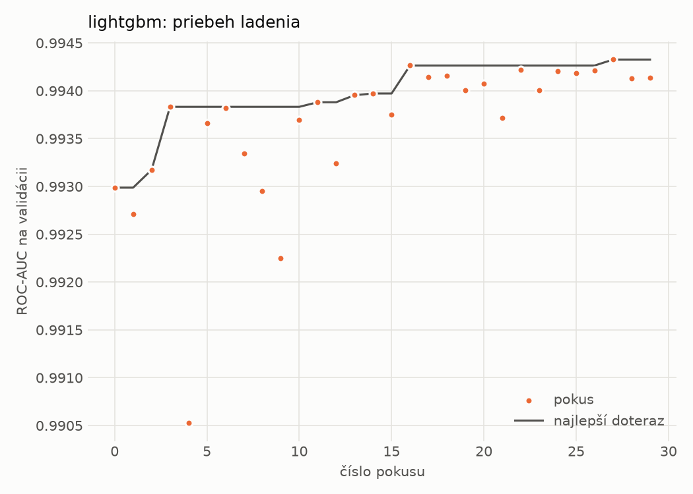
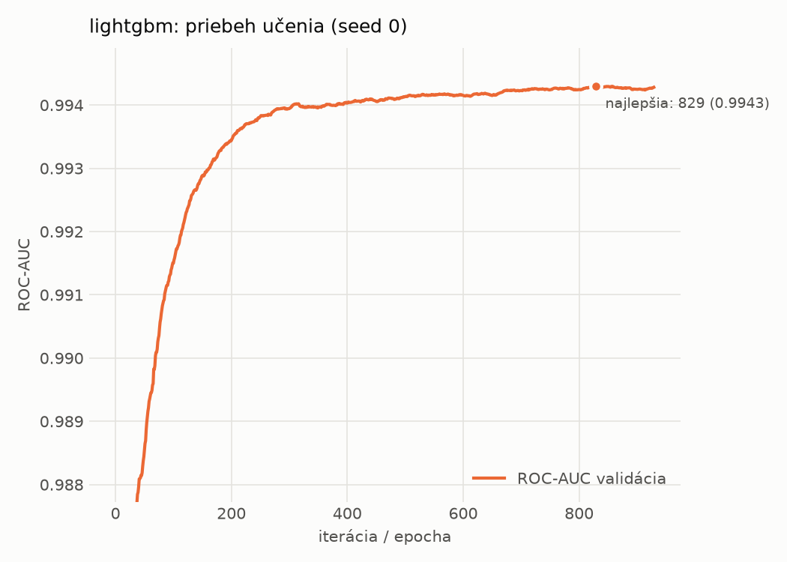

# static/lightgbm – beh `20261122-231010`

> Automaticky generované (`src/training/run_tabular.py`). Konfigurácia: `config.yaml`, protokol: `protocol.yaml`.

- **Model:** `lightgbm` – LightGBM, gradient boosting stromov s early stopping na validácii (pôvodné hodnoty príznakov)
- **Ladenie:** 30 dokončených pokusov (Optuna TPE), cieľ ROC-AUC na validácii, 8.0 min
- **Finálne modely:** seedy [0, 1, 2]; hodnoty sú priemer ± smerodajná odchýlka cez seedy
- **Najlepšie hyperparametre:** `{"num_boost_round": 5000, "early_stopping_rounds": 100, "learning_rate": 0.03701536655085927, "num_leaves": 240, "min_child_samples": 18, "feature_fraction": 0.860319963795015, "bagging_fraction": 0.9949001098214416, "lambda_l1": 1.0205843882460235e-07, "lambda_l2": 0.00015478320101473535}`

## Detekčná kvalita (bez prahu)
| metrika | train (podvzorka) | validácia | test |
|---|---|---|---|
| ROC-AUC | 1.0000 ± 0.0000 | 0.9944 ± 0.0001 | 0.9951 ± 0.0000 |
| PR-AUC | 1.0000 ± 0.0000 | 0.9944 ± 0.0002 | 0.9953 ± 0.0000 |
| TPR pri FPR 1 % | 1.0000 ± 0.0000 | 0.9456 ± 0.0056 | 0.9507 ± 0.0002 |
| TPR pri FPR 0,1 % | 1.0000 ± 0.0000 | 0.8548 ± 0.0103 | 0.8671 ± 0.0063 |
| log loss | 0.0015 ± 0.0010 | 0.1086 ± 0.0091 | 0.0922 ± 0.0076 |
| Brier skóre | 0.0000 ± 0.0001 | 0.0227 ± 0.0001 | 0.0202 ± 0.0002 |

Rozdiel ROC-AUC train − validácia: **0.0056** (veľký rozdiel = preučenie).

## Pri prahu z validácie (FPR ≤ 1% na validácii)
| metrika | train (podvzorka) | validácia | test |
|---|---|---|---|
| accuracy | 0.9988 ± 0.0010 | 0.9702 ± 0.0025 | 0.9706 ± 0.0015 |
| balanced accuracy | 0.9987 ± 0.0012 | 0.9679 ± 0.0028 | 0.9682 ± 0.0017 |
| precision | 1.0000 ± 0.0000 | 0.9875 ± 0.0001 | 0.9897 ± 0.0011 |
| recall (TPR) | 0.9973 ± 0.0023 | 0.9456 ± 0.0056 | 0.9444 ± 0.0043 |
| FPR | 0.0000 ± 0.0000 | 0.0097 ± 0.0000 | 0.0080 ± 0.0009 |
| F1 | 0.9987 ± 0.0012 | 0.9661 ± 0.0030 | 0.9665 ± 0.0018 |
| MCC | 0.9976 ± 0.0021 | 0.9403 ± 0.0050 | 0.9412 ± 0.0028 |

## Pri pevnom prahu 0.5
| metrika | train (podvzorka) | validácia | test |
|---|---|---|---|
| accuracy | 1.0000 ± 0.0000 | 0.9737 ± 0.0005 | 0.9760 ± 0.0003 |
| balanced accuracy | 1.0000 ± 0.0000 | 0.9730 ± 0.0004 | 0.9753 ± 0.0003 |
| precision | 1.0000 ± 0.0000 | 0.9751 ± 0.0009 | 0.9778 ± 0.0006 |
| recall (TPR) | 1.0000 ± 0.0000 | 0.9660 ± 0.0002 | 0.9685 ± 0.0002 |
| FPR | 0.0000 ± 0.0000 | 0.0201 ± 0.0008 | 0.0179 ± 0.0005 |
| F1 | 1.0000 ± 0.0000 | 0.9705 ± 0.0005 | 0.9731 ± 0.0003 |
| MCC | 1.0000 ± 0.0000 | 0.9468 ± 0.0009 | 0.9515 ± 0.0006 |

## Výpočtové nároky (seed 0, testovacia množina)
| meranie | hodnota |
|---|---|
| tréning finálneho modelu | 9.2 s (priemer cez seedy) |
| ladenie spolu | 481 s |
| počet parametrov / uzlov | 397 091 |
| veľkosť modelu na disku | 22.33 MB |
| CPU latencia modelu (batch 1, 1 vlákno) | 0.140 ms (p95 0.163) |
| CPU priepustnosť (24 vlákien) | 101 042 vzoriek/s |

## Grafy
| | |
|---|---|
|  |  |
|  |  |
|  |  |
|  |  |

## Súbory
`metrics.json` (všetky metriky po seedoch vrátane rodín), `timing.json`, `hpo_trials.csv`,
`predictions/<časť>_seed<N>.parquet` (sha256, family, label, score), `model/seed_<N>/`, `log.txt`.
