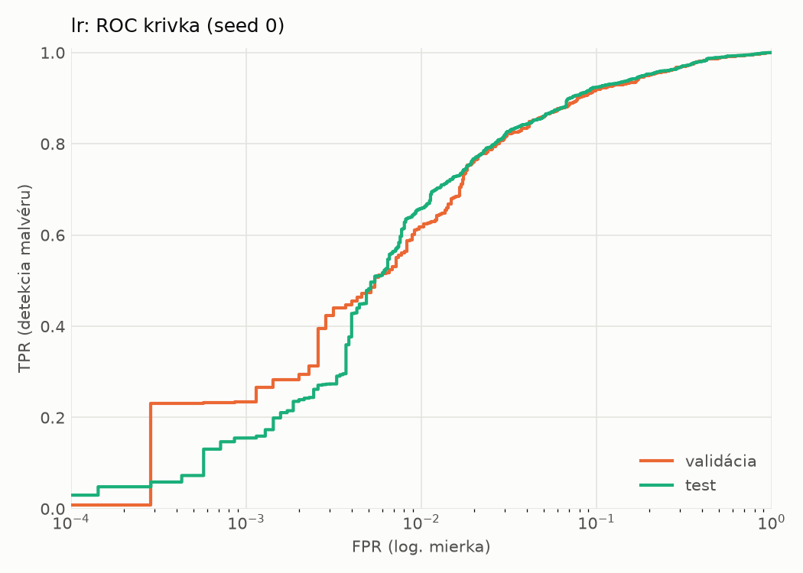
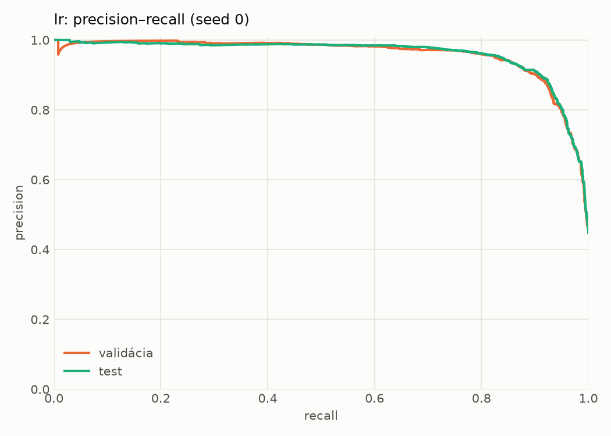
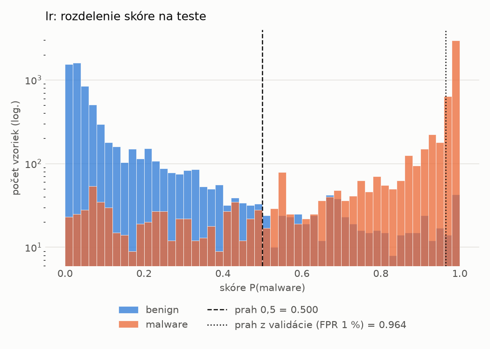
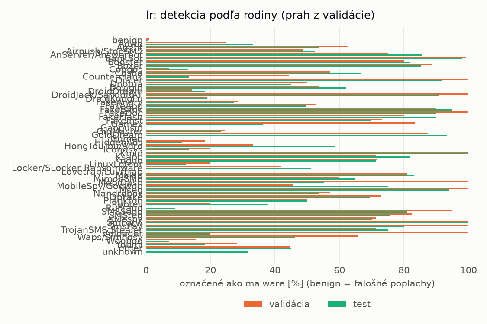
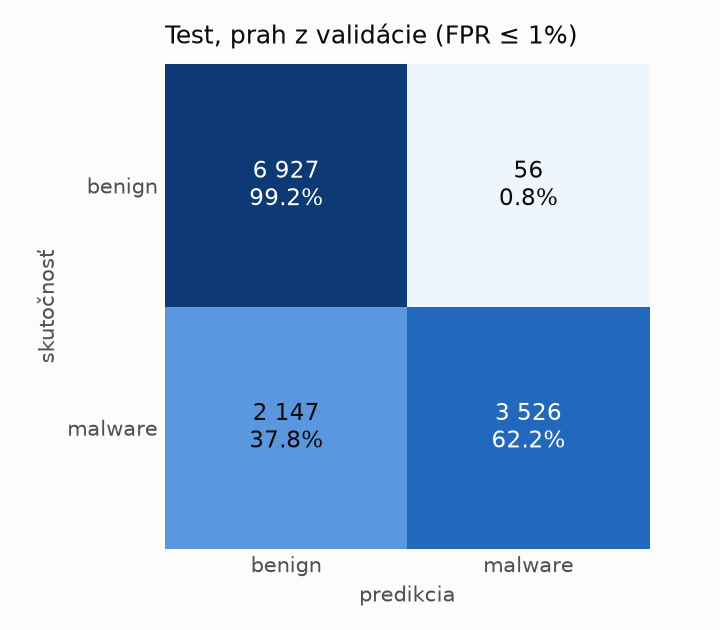
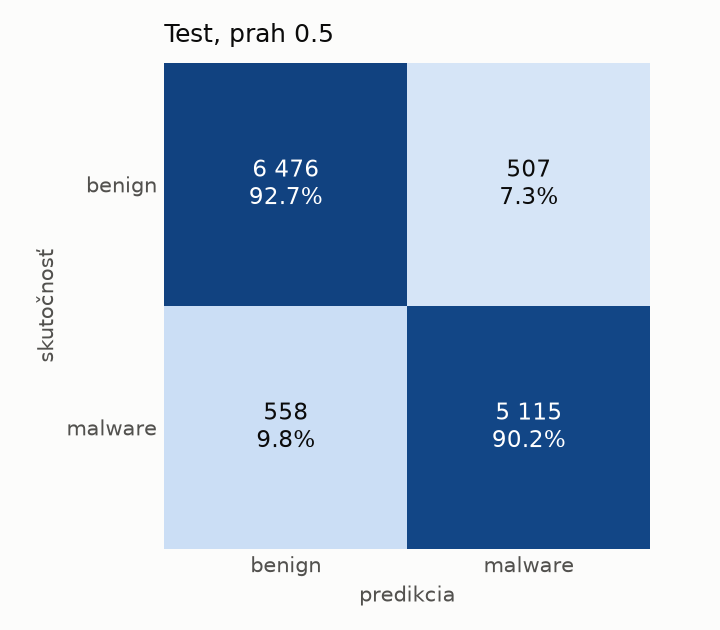
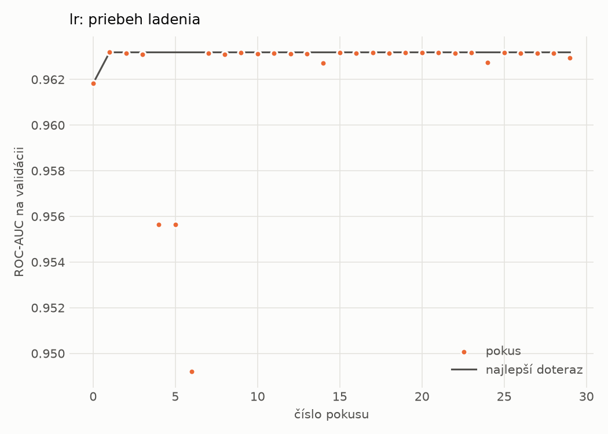

# static/lr – beh `20261122-230905`

> Automaticky generované (`src/training/run_tabular.py`). Konfigurácia: `config.yaml`, protokol: `protocol.yaml`.

- **Model:** `logreg` – logistická regresia s L2 regularizáciou (vstup signed log1p + štandardizácia)
- **Ladenie:** 30 dokončených pokusov (Optuna TPE), cieľ ROC-AUC na validácii, 0.1 min
- **Finálne modely:** seedy [0, 1, 2]; hodnoty sú priemer ± smerodajná odchýlka cez seedy
- **Najlepšie hyperparametre:** `{"max_iter": 2000, "C": 5.669849511478847}`

## Detekčná kvalita (bez prahu)
| metrika | train (podvzorka) | validácia | test |
|---|---|---|---|
| ROC-AUC | 0.9684 ± 0.0000 | 0.9632 ± 0.0000 | 0.9648 ± 0.0000 |
| PR-AUC | 0.9645 ± 0.0000 | 0.9593 ± 0.0000 | 0.9600 ± 0.0000 |
| TPR pri FPR 1 % | 0.6692 ± 0.0000 | 0.6180 ± 0.0000 | 0.6577 ± 0.0000 |
| TPR pri FPR 0,1 % | 0.2539 ± 0.0000 | 0.2346 ± 0.0000 | 0.1549 ± 0.0000 |
| log loss | 0.2207 ± 0.0000 | 0.2413 ± 0.0000 | 0.2357 ± 0.0000 |
| Brier skóre | 0.0623 ± 0.0000 | 0.0685 ± 0.0000 | 0.0666 ± 0.0000 |

Rozdiel ROC-AUC train − validácia: **0.0052** (veľký rozdiel = preučenie).

## Pri prahu z validácie (FPR ≤ 1% na validácii)
| metrika | train (podvzorka) | validácia | test |
|---|---|---|---|
| accuracy | 0.8253 ± 0.0000 | 0.8234 ± 0.0000 | 0.8259 ± 0.0000 |
| balanced accuracy | 0.8003 ± 0.0000 | 0.8041 ± 0.0000 | 0.8068 ± 0.0000 |
| precision | 0.9877 ± 0.0000 | 0.9810 ± 0.0000 | 0.9844 ± 0.0000 |
| recall (TPR) | 0.6065 ± 0.0000 | 0.6180 ± 0.0000 | 0.6215 ± 0.0000 |
| FPR | 0.0058 ± 0.0000 | 0.0097 ± 0.0000 | 0.0080 ± 0.0000 |
| F1 | 0.7515 ± 0.0000 | 0.7583 ± 0.0000 | 0.7620 ± 0.0000 |
| MCC | 0.6728 ± 0.0000 | 0.6719 ± 0.0000 | 0.6773 ± 0.0000 |

## Pri pevnom prahu 0.5
| metrika | train (podvzorka) | validácia | test |
|---|---|---|---|
| accuracy | 0.9205 ± 0.0000 | 0.9103 ± 0.0000 | 0.9159 ± 0.0000 |
| balanced accuracy | 0.9186 ± 0.0000 | 0.9086 ± 0.0000 | 0.9145 ± 0.0000 |
| precision | 0.9128 ± 0.0000 | 0.9065 ± 0.0000 | 0.9098 ± 0.0000 |
| recall (TPR) | 0.9038 ± 0.0000 | 0.8921 ± 0.0000 | 0.9016 ± 0.0000 |
| FPR | 0.0666 ± 0.0000 | 0.0748 ± 0.0000 | 0.0726 ± 0.0000 |
| F1 | 0.9083 ± 0.0000 | 0.8992 ± 0.0000 | 0.9057 ± 0.0000 |
| MCC | 0.8382 ± 0.0000 | 0.8186 ± 0.0000 | 0.8298 ± 0.0000 |

## Výpočtové nároky (seed 0, testovacia množina)
| meranie | hodnota |
|---|---|
| tréning finálneho modelu | 0.2 s (priemer cez seedy) |
| ladenie spolu | 5 s |
| počet parametrov / uzlov | 164 |
| veľkosť modelu na disku | 0.01 MB |
| transformácia vstupu – latencia (1 vlákno) | 0.005 ms |
| transformácia vstupu – priepustnosť | 1 289 902 vzoriek/s |
| CPU latencia modelu (batch 1, 1 vlákno) | 0.004 ms (p95 0.004) |
| CPU priepustnosť (24 vlákien) | 3 410 861 vzoriek/s |

## Grafy
| | |
|---|---|
|  |  |
|  |  |
|  |  |
|  |  |

## Súbory
`metrics.json` (všetky metriky po seedoch vrátane rodín), `timing.json`, `hpo_trials.csv`,
`predictions/<časť>_seed<N>.parquet` (sha256, family, label, score), `model/seed_<N>/`, `log.txt`.
