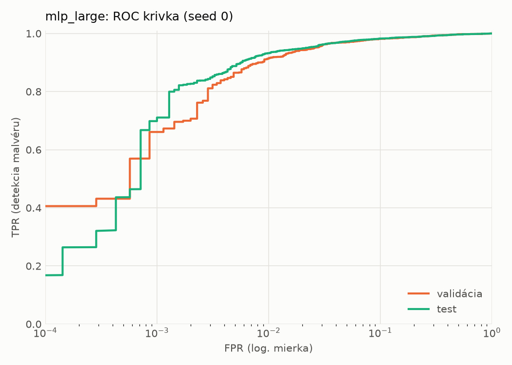
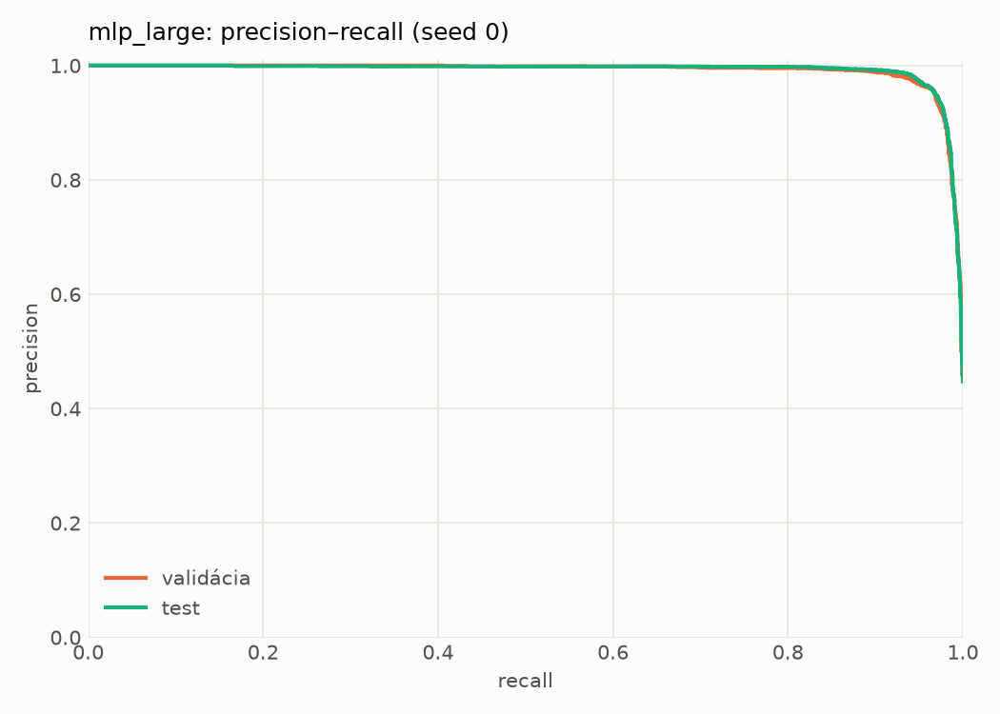
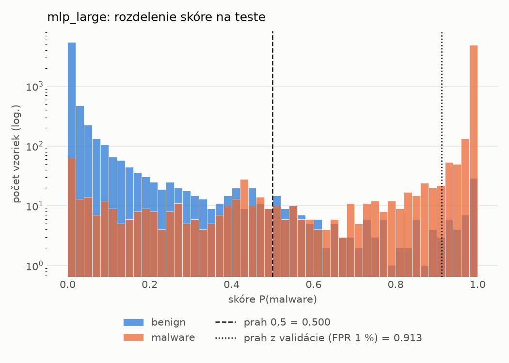
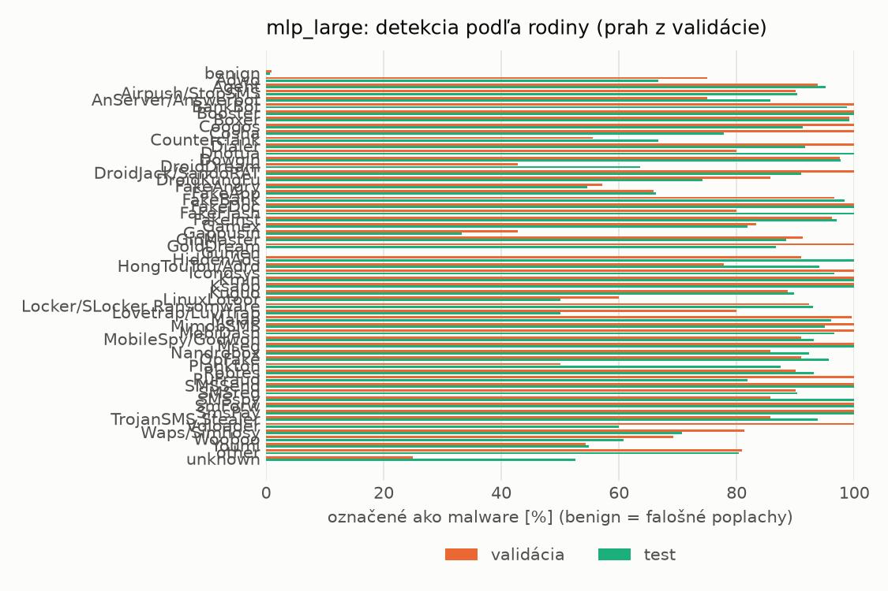
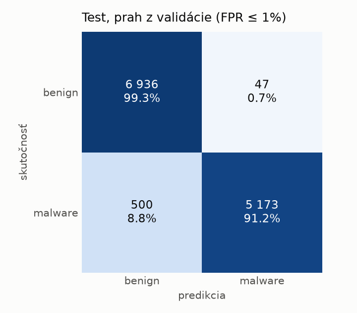
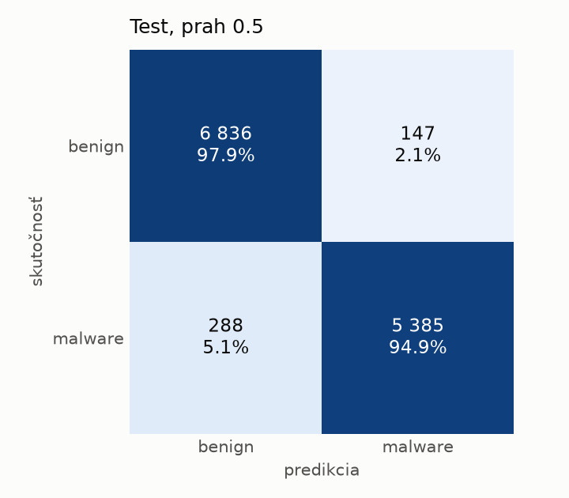
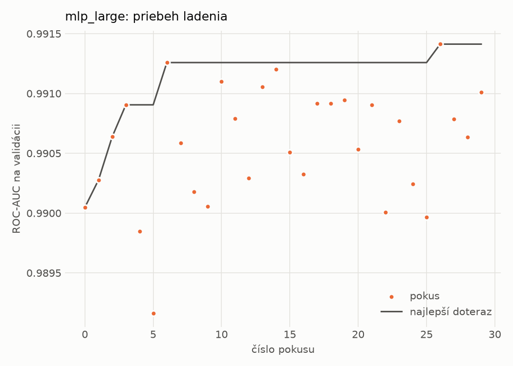
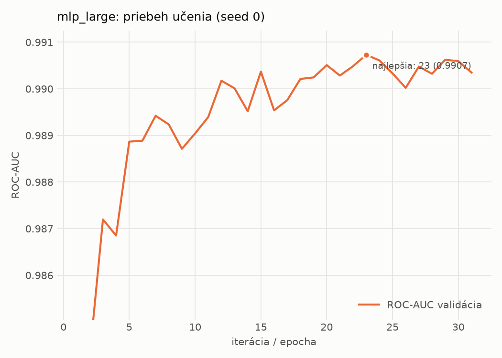

# static/mlp_large – beh `20261122-232356`

> Automaticky generované (`src/training/run_tabular.py`). Konfigurácia: `config.yaml`, protokol: `protocol.yaml`.

- **Model:** `mlp` – veľká neurónová sieť (3–5 skrytých vrstiev, 512–2048 neurónov), kandidát na učiteľa
- **Ladenie:** 30 dokončených pokusov (Optuna TPE), cieľ ROC-AUC na validácii, 6.5 min
- **Finálne modely:** seedy [0, 1, 2]; hodnoty sú priemer ± smerodajná odchýlka cez seedy
- **Najlepšie hyperparametre:** `{"max_epochs": 100, "patience": 8, "hidden_layers": 3, "hidden_width": 2048, "width_decay": 0.5, "dropout": 0.24592095800405475, "lr": 0.0002046278772560144, "weight_decay": 0.007038560648637635, "batch_size": 256}`

## Detekčná kvalita (bez prahu)
| metrika | train (podvzorka) | validácia | test |
|---|---|---|---|
| ROC-AUC | 0.9981 ± 0.0003 | 0.9908 ± 0.0000 | 0.9916 ± 0.0004 |
| PR-AUC | 0.9980 ± 0.0003 | 0.9903 ± 0.0004 | 0.9912 ± 0.0004 |
| TPR pri FPR 1 % | 0.9739 ± 0.0051 | 0.9026 ± 0.0130 | 0.9310 ± 0.0025 |
| TPR pri FPR 0,1 % | 0.9399 ± 0.0070 | 0.5743 ± 0.0789 | 0.6660 ± 0.0689 |
| log loss | 0.0476 ± 0.0042 | 0.1209 ± 0.0045 | 0.1082 ± 0.0019 |
| Brier skóre | 0.0128 ± 0.0011 | 0.0289 ± 0.0007 | 0.0265 ± 0.0010 |

Rozdiel ROC-AUC train − validácia: **0.0074** (veľký rozdiel = preučenie).

## Pri prahu z validácie (FPR ≤ 1% na validácii)
| metrika | train (podvzorka) | validácia | test |
|---|---|---|---|
| accuracy | 0.9675 ± 0.0066 | 0.9510 ± 0.0058 | 0.9526 ± 0.0053 |
| balanced accuracy | 0.9628 ± 0.0076 | 0.9465 ± 0.0065 | 0.9478 ± 0.0061 |
| precision | 0.9994 ± 0.0003 | 0.9869 ± 0.0002 | 0.9915 ± 0.0018 |
| recall (TPR) | 0.9260 ± 0.0155 | 0.9026 ± 0.0130 | 0.9019 ± 0.0134 |
| FPR | 0.0004 ± 0.0002 | 0.0097 ± 0.0000 | 0.0063 ± 0.0014 |
| F1 | 0.9613 ± 0.0082 | 0.9429 ± 0.0072 | 0.9446 ± 0.0067 |
| MCC | 0.9355 ± 0.0128 | 0.9029 ± 0.0111 | 0.9064 ± 0.0100 |

## Pri pevnom prahu 0.5
| metrika | train (podvzorka) | validácia | test |
|---|---|---|---|
| accuracy | 0.9835 ± 0.0019 | 0.9624 ± 0.0014 | 0.9659 ± 0.0013 |
| balanced accuracy | 0.9824 ± 0.0018 | 0.9616 ± 0.0011 | 0.9649 ± 0.0014 |
| precision | 0.9883 ± 0.0035 | 0.9618 ± 0.0048 | 0.9684 ± 0.0047 |
| recall (TPR) | 0.9737 ± 0.0009 | 0.9539 ± 0.0019 | 0.9552 ± 0.0053 |
| FPR | 0.0089 ± 0.0027 | 0.0308 ± 0.0041 | 0.0253 ± 0.0040 |
| F1 | 0.9809 ± 0.0022 | 0.9579 ± 0.0014 | 0.9618 ± 0.0015 |
| MCC | 0.9665 ± 0.0039 | 0.9239 ± 0.0028 | 0.9312 ± 0.0026 |

## Výpočtové nároky (seed 0, testovacia množina)
| meranie | hodnota |
|---|---|
| tréning finálneho modelu | 12.9 s (priemer cez seedy) |
| ladenie spolu | 388 s |
| počet parametrov / uzlov | 2 966 529 |
| veľkosť modelu na disku | 11.91 MB |
| transformácia vstupu – latencia (1 vlákno) | 0.014 ms |
| transformácia vstupu – priepustnosť | 720 434 vzoriek/s |
| CPU latencia modelu (batch 1, 1 vlákno) | 0.295 ms (p95 0.500) |
| CPU priepustnosť (24 vlákien) | 126 662 vzoriek/s |
| GPU latencia (batch 1) | 0.538 ms (p95 0.587) |
| GPU priepustnosť | 809 492 vzoriek/s |
| GPU špičková pamäť | 250 MB |

## Grafy
| | |
|---|---|
|  |  |
|  |  |
|  |  |
|  |  |

## Súbory
`metrics.json` (všetky metriky po seedoch vrátane rodín), `timing.json`, `hpo_trials.csv`,
`predictions/<časť>_seed<N>.parquet` (sha256, family, label, score), `model/seed_<N>/`, `log.txt`.
