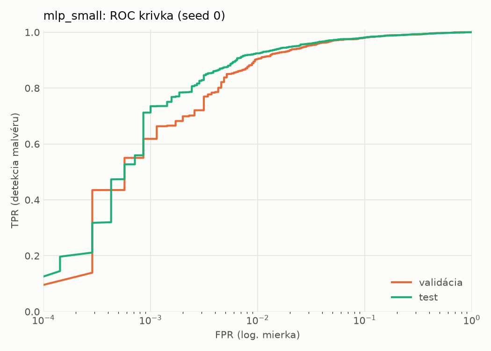
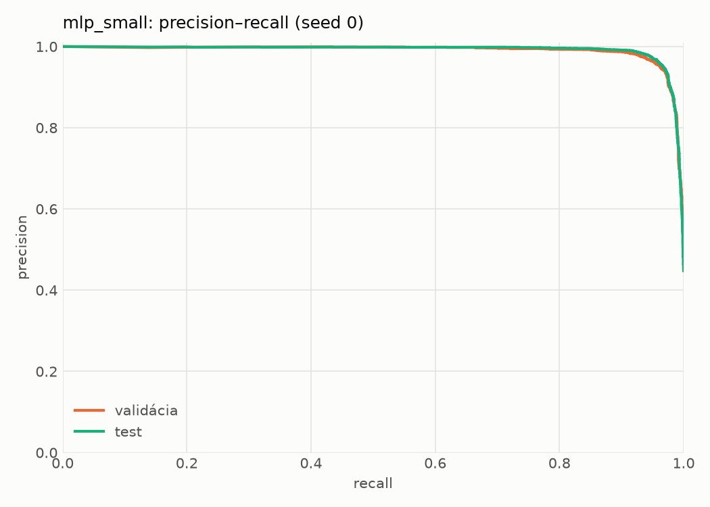
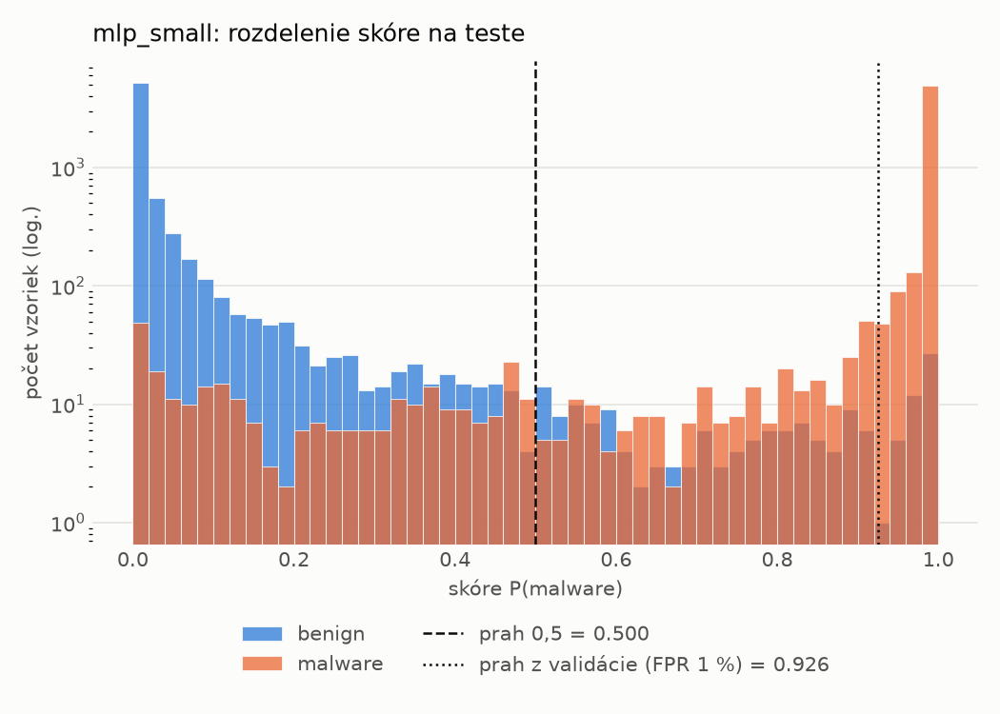
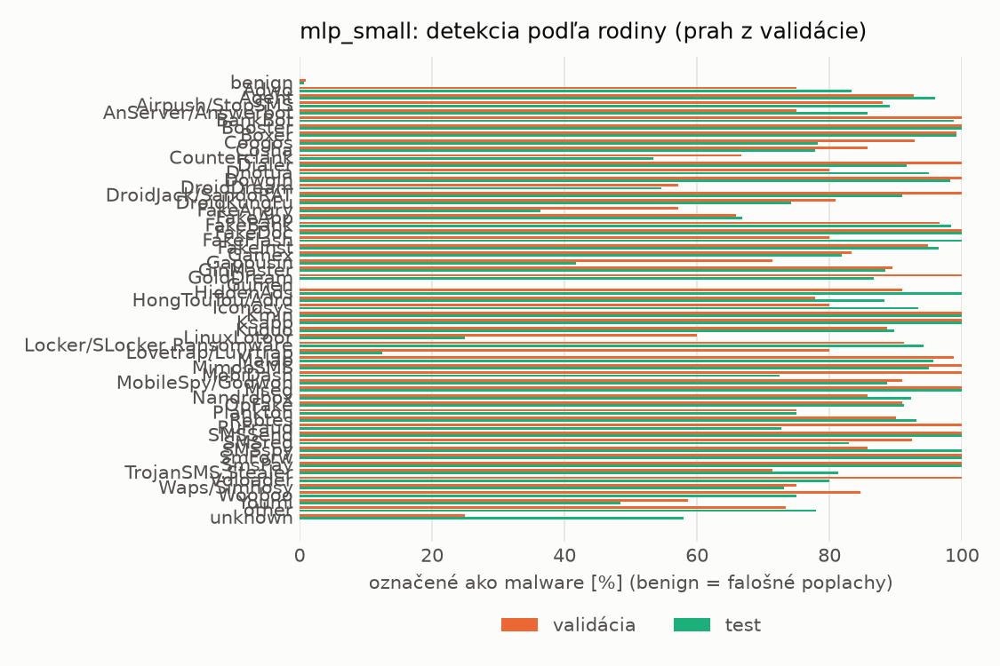
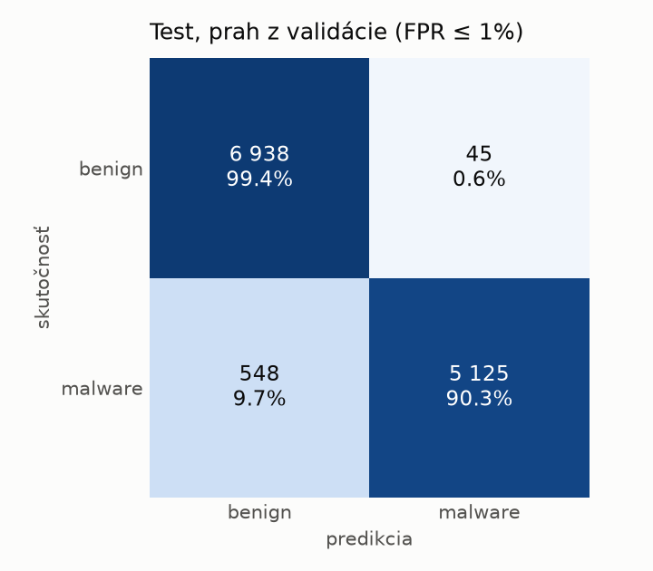
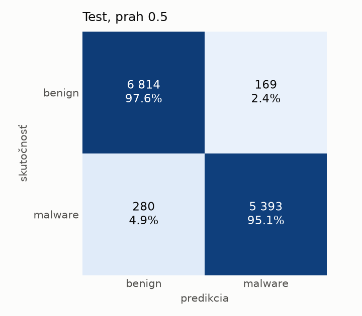
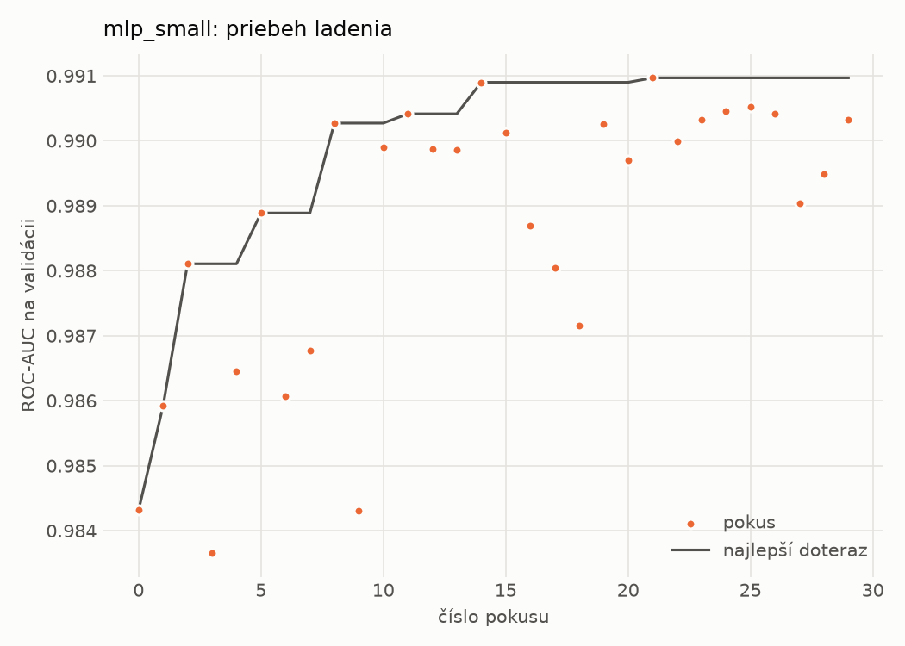
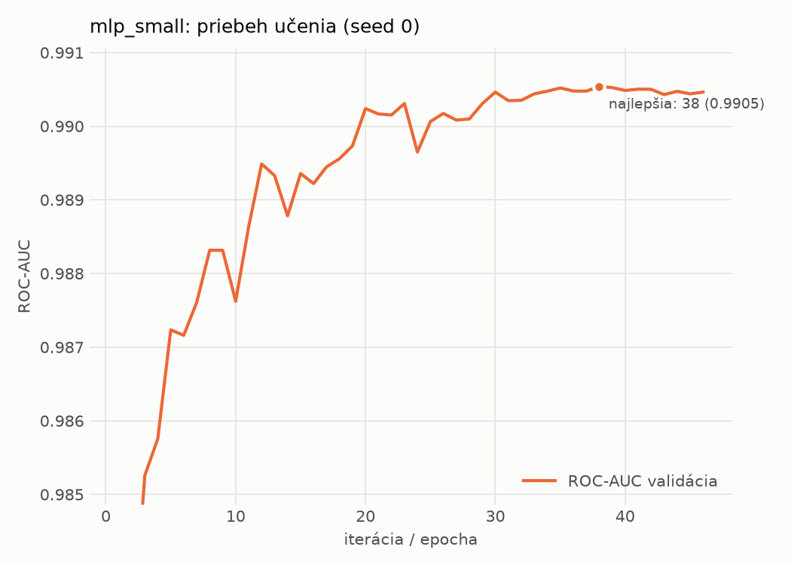

# static/mlp_small – beh `20261122-231849`

> Automaticky generované (`src/training/run_tabular.py`). Konfigurácia: `config.yaml`, protokol: `protocol.yaml`.

- **Model:** `mlp` – malá neurónová sieť (1–2 skryté vrstvy), kandidát na ľahkého študenta
- **Ladenie:** 30 dokončených pokusov (Optuna TPE), cieľ ROC-AUC na validácii, 4.5 min
- **Finálne modely:** seedy [0, 1, 2]; hodnoty sú priemer ± smerodajná odchýlka cez seedy
- **Najlepšie hyperparametre:** `{"width_decay": 0.5, "max_epochs": 100, "patience": 8, "hidden_layers": 2, "hidden_width": 256, "dropout": 0.2770731649287669, "lr": 0.0010447758392925718, "weight_decay": 0.0006745378680415608, "batch_size": 256}`

## Detekčná kvalita (bez prahu)
| metrika | train (podvzorka) | validácia | test |
|---|---|---|---|
| ROC-AUC | 0.9970 ± 0.0002 | 0.9902 ± 0.0004 | 0.9907 ± 0.0006 |
| PR-AUC | 0.9969 ± 0.0002 | 0.9897 ± 0.0001 | 0.9909 ± 0.0001 |
| TPR pri FPR 1 % | 0.9633 ± 0.0038 | 0.9026 ± 0.0043 | 0.9254 ± 0.0034 |
| TPR pri FPR 0,1 % | 0.9188 ± 0.0076 | 0.6206 ± 0.0027 | 0.6727 ± 0.0742 |
| log loss | 0.0598 ± 0.0036 | 0.1221 ± 0.0018 | 0.1135 ± 0.0044 |
| Brier skóre | 0.0161 ± 0.0011 | 0.0305 ± 0.0005 | 0.0275 ± 0.0007 |

Rozdiel ROC-AUC train − validácia: **0.0068** (veľký rozdiel = preučenie).

## Pri prahu z validácie (FPR ≤ 1% na validácii)
| metrika | train (podvzorka) | validácia | test |
|---|---|---|---|
| accuracy | 0.9657 ± 0.0017 | 0.9510 ± 0.0020 | 0.9522 ± 0.0024 |
| balanced accuracy | 0.9608 ± 0.0019 | 0.9465 ± 0.0022 | 0.9474 ± 0.0027 |
| precision | 0.9984 ± 0.0001 | 0.9870 ± 0.0003 | 0.9912 ± 0.0001 |
| recall (TPR) | 0.9228 ± 0.0038 | 0.9026 ± 0.0043 | 0.9013 ± 0.0055 |
| FPR | 0.0011 ± 0.0001 | 0.0096 ± 0.0002 | 0.0065 ± 0.0001 |
| F1 | 0.9591 ± 0.0021 | 0.9429 ± 0.0024 | 0.9441 ± 0.0030 |
| MCC | 0.9318 ± 0.0032 | 0.9030 ± 0.0038 | 0.9056 ± 0.0046 |

## Pri pevnom prahu 0.5
| metrika | train (podvzorka) | validácia | test |
|---|---|---|---|
| accuracy | 0.9786 ± 0.0015 | 0.9605 ± 0.0009 | 0.9642 ± 0.0016 |
| balanced accuracy | 0.9775 ± 0.0011 | 0.9597 ± 0.0005 | 0.9631 ± 0.0014 |
| precision | 0.9812 ± 0.0051 | 0.9595 ± 0.0053 | 0.9662 ± 0.0045 |
| recall (TPR) | 0.9694 ± 0.0019 | 0.9521 ± 0.0040 | 0.9534 ± 0.0024 |
| FPR | 0.0144 ± 0.0040 | 0.0327 ± 0.0046 | 0.0271 ± 0.0038 |
| F1 | 0.9753 ± 0.0016 | 0.9558 ± 0.0008 | 0.9598 ± 0.0017 |
| MCC | 0.9564 ± 0.0030 | 0.9202 ± 0.0017 | 0.9275 ± 0.0033 |

## Výpočtové nároky (seed 0, testovacia množina)
| meranie | hodnota |
|---|---|
| tréning finálneho modelu | 11.3 s (priemer cez seedy) |
| ladenie spolu | 271 s |
| počet parametrov / uzlov | 75 777 |
| veľkosť modelu na disku | 0.32 MB |
| transformácia vstupu – latencia (1 vlákno) | 0.006 ms |
| transformácia vstupu – priepustnosť | 1 017 797 vzoriek/s |
| CPU latencia modelu (batch 1, 1 vlákno) | 0.107 ms (p95 0.239) |
| CPU priepustnosť (24 vlákien) | 2 229 111 vzoriek/s |
| GPU latencia (batch 1) | 0.388 ms (p95 0.425) |
| GPU priepustnosť | 1 480 511 vzoriek/s |
| GPU špičková pamäť | 76 MB |

## Grafy
| | |
|---|---|
|  |  |
|  |  |
|  |  |
|  |  |

## Súbory
`metrics.json` (všetky metriky po seedoch vrátane rodín), `timing.json`, `hpo_trials.csv`,
`predictions/<časť>_seed<N>.parquet` (sha256, family, label, score), `model/seed_<N>/`, `log.txt`.
