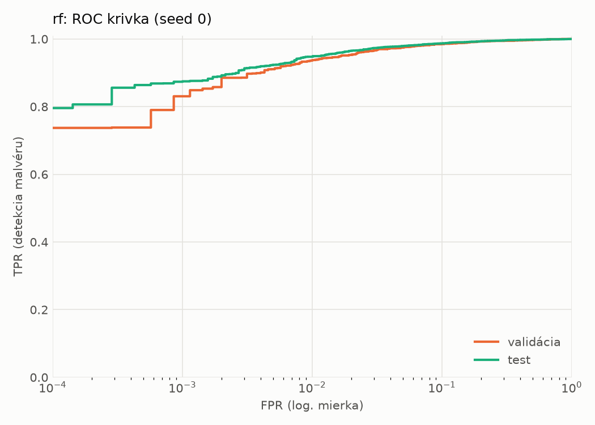
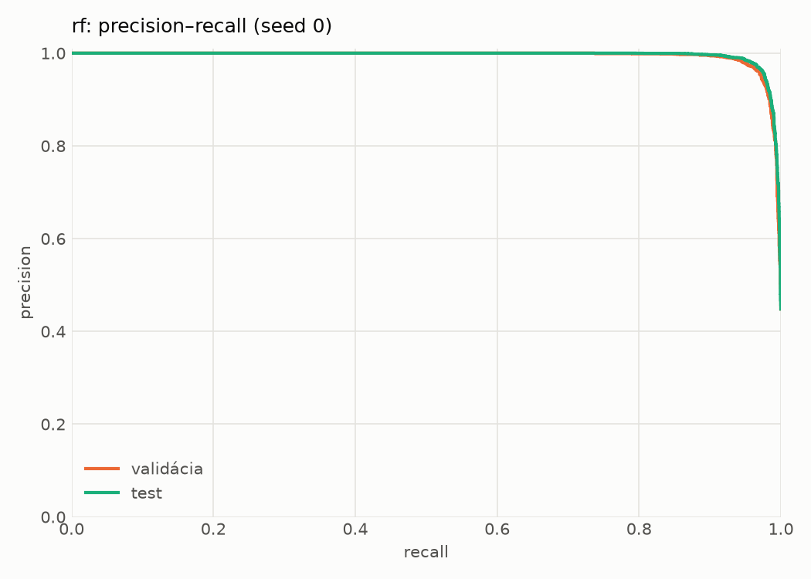
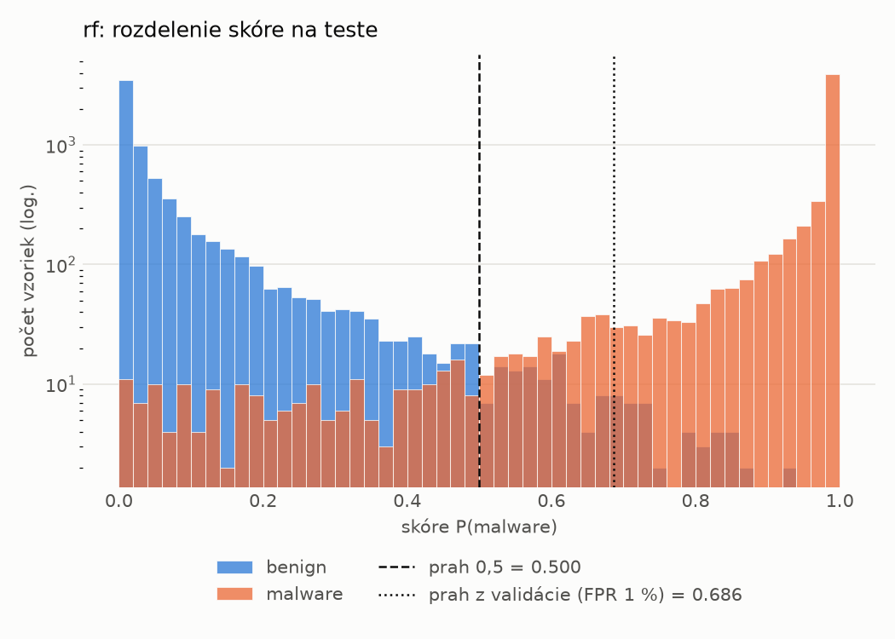
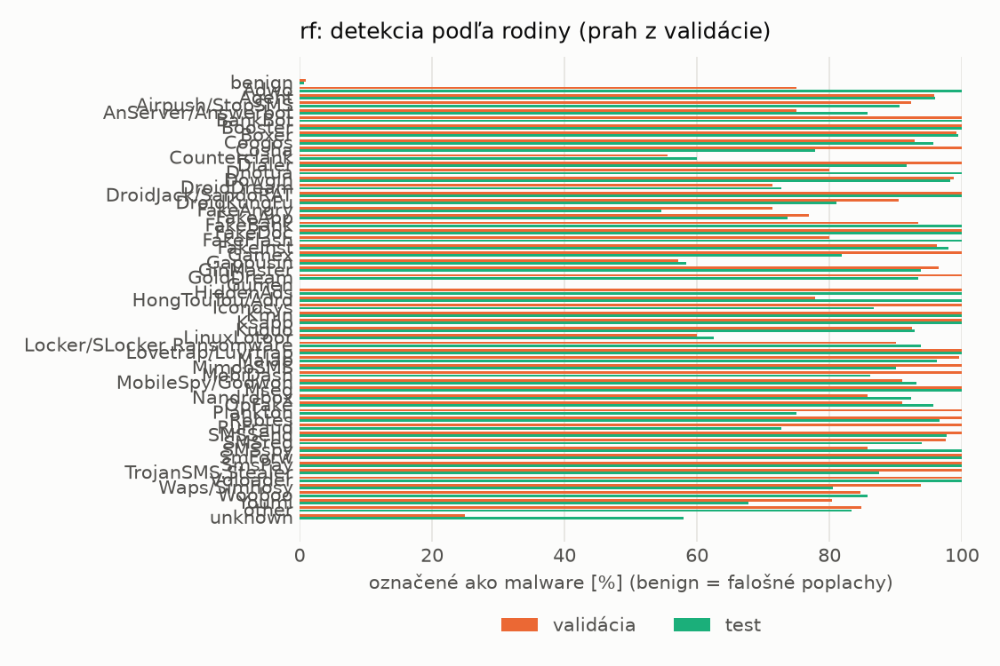
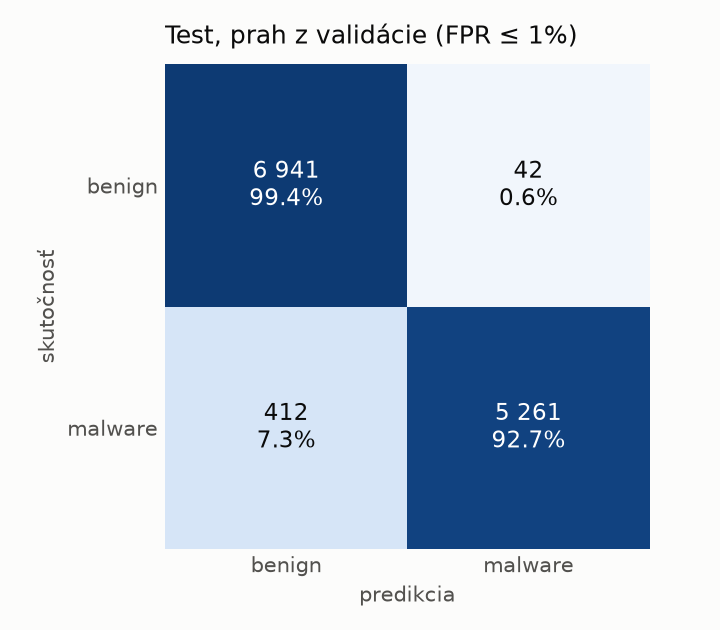
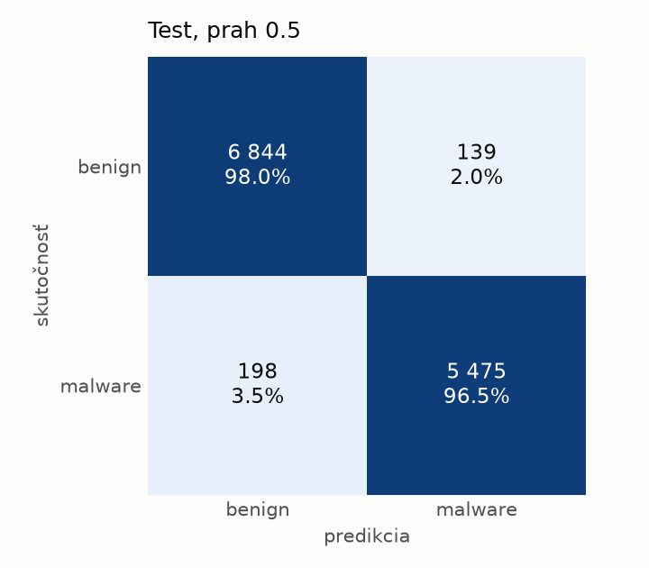
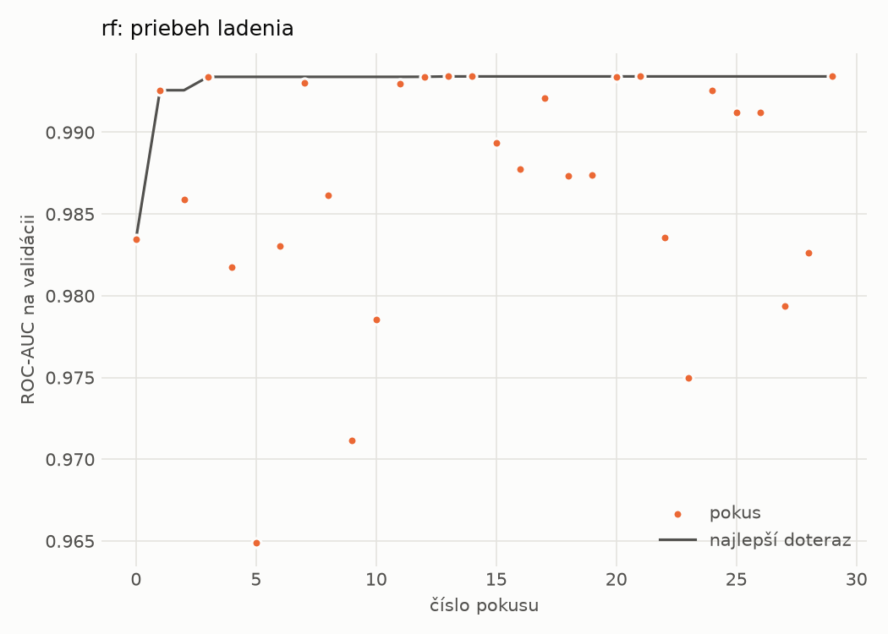

# static/rf – beh `20261122-230914`

> Automaticky generované (`src/training/run_tabular.py`). Konfigurácia: `config.yaml`, protokol: `protocol.yaml`.

- **Model:** `random_forest` – Random Forest (pôvodné hodnoty príznakov)
- **Ladenie:** 30 dokončených pokusov (Optuna TPE), cieľ ROC-AUC na validácii, 0.7 min
- **Finálne modely:** seedy [0, 1, 2]; hodnoty sú priemer ± smerodajná odchýlka cez seedy
- **Najlepšie hyperparametre:** `{"n_estimators": 500, "max_depth": 32, "min_samples_leaf": 1, "max_features": "log2"}`

## Detekčná kvalita (bez prahu)
| metrika | train (podvzorka) | validácia | test |
|---|---|---|---|
| ROC-AUC | 1.0000 ± 0.0000 | 0.9933 ± 0.0001 | 0.9946 ± 0.0001 |
| PR-AUC | 1.0000 ± 0.0000 | 0.9937 ± 0.0001 | 0.9949 ± 0.0000 |
| TPR pri FPR 1 % | 0.9998 ± 0.0002 | 0.9351 ± 0.0013 | 0.9464 ± 0.0015 |
| TPR pri FPR 0,1 % | 0.9985 ± 0.0007 | 0.8242 ± 0.0076 | 0.8745 ± 0.0023 |
| log loss | 0.0363 ± 0.0002 | 0.1000 ± 0.0003 | 0.0949 ± 0.0004 |
| Brier skóre | 0.0055 ± 0.0001 | 0.0259 ± 0.0001 | 0.0240 ± 0.0001 |

Rozdiel ROC-AUC train − validácia: **0.0067** (veľký rozdiel = preučenie).

## Pri prahu z validácie (FPR ≤ 1% na validácii)
| metrika | train (podvzorka) | validácia | test |
|---|---|---|---|
| accuracy | 0.9904 ± 0.0002 | 0.9655 ± 0.0006 | 0.9640 ± 0.0007 |
| balanced accuracy | 0.9890 ± 0.0002 | 0.9627 ± 0.0006 | 0.9605 ± 0.0008 |
| precision | 1.0000 ± 0.0000 | 0.9873 ± 0.0000 | 0.9921 ± 0.0001 |
| recall (TPR) | 0.9780 ± 0.0004 | 0.9351 ± 0.0013 | 0.9270 ± 0.0016 |
| FPR | 0.0000 ± 0.0000 | 0.0097 ± 0.0000 | 0.0060 ± 0.0001 |
| F1 | 0.9889 ± 0.0002 | 0.9605 ± 0.0007 | 0.9585 ± 0.0008 |
| MCC | 0.9807 ± 0.0003 | 0.9310 ± 0.0011 | 0.9284 ± 0.0013 |

## Pri pevnom prahu 0.5
| metrika | train (podvzorka) | validácia | test |
|---|---|---|---|
| accuracy | 0.9971 ± 0.0003 | 0.9691 ± 0.0004 | 0.9729 ± 0.0004 |
| balanced accuracy | 0.9967 ± 0.0004 | 0.9685 ± 0.0004 | 0.9722 ± 0.0004 |
| precision | 0.9999 ± 0.0001 | 0.9677 ± 0.0004 | 0.9744 ± 0.0008 |
| recall (TPR) | 0.9935 ± 0.0008 | 0.9631 ± 0.0005 | 0.9649 ± 0.0002 |
| FPR | 0.0001 ± 0.0001 | 0.0261 ± 0.0003 | 0.0206 ± 0.0006 |
| F1 | 0.9967 ± 0.0004 | 0.9654 ± 0.0004 | 0.9696 ± 0.0005 |
| MCC | 0.9942 ± 0.0006 | 0.9374 ± 0.0008 | 0.9452 ± 0.0008 |

## Výpočtové nároky (seed 0, testovacia množina)
| meranie | hodnota |
|---|---|
| tréning finálneho modelu | 1.8 s (priemer cez seedy) |
| ladenie spolu | 40 s |
| počet parametrov / uzlov | 3 077 138 |
| veľkosť modelu na disku | 246.55 MB |
| CPU latencia modelu (batch 1, 1 vlákno) | 15.178 ms (p95 15.856) |
| CPU priepustnosť (24 vlákien) | 110 496 vzoriek/s |

## Grafy
| | |
|---|---|
|  |  |
|  |  |
|  |  |
|  |  |

## Súbory
`metrics.json` (všetky metriky po seedoch vrátane rodín), `timing.json`, `hpo_trials.csv`,
`predictions/<časť>_seed<N>.parquet` (sha256, family, label, score), `model/seed_<N>/`, `log.txt`.
