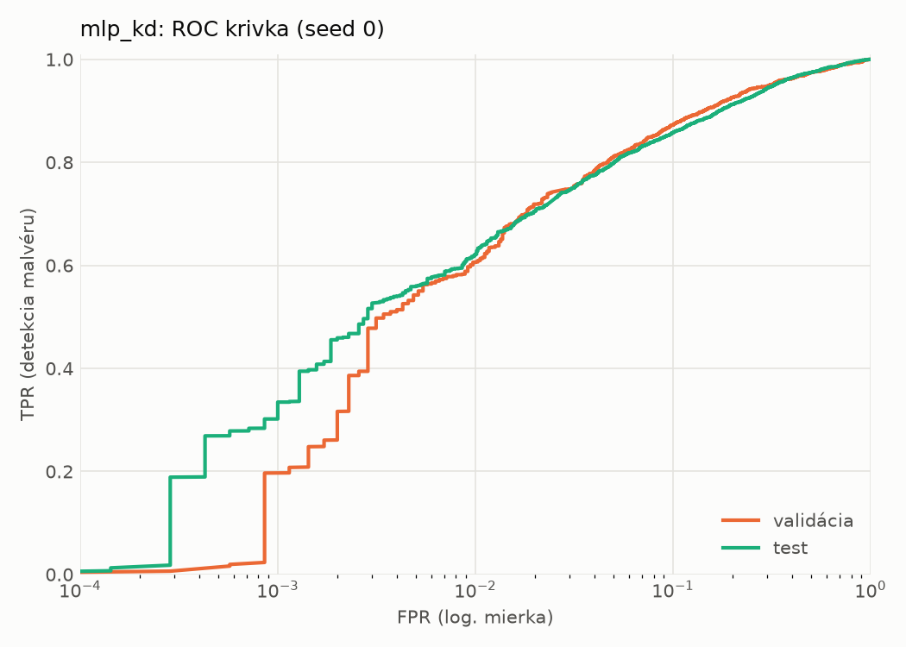
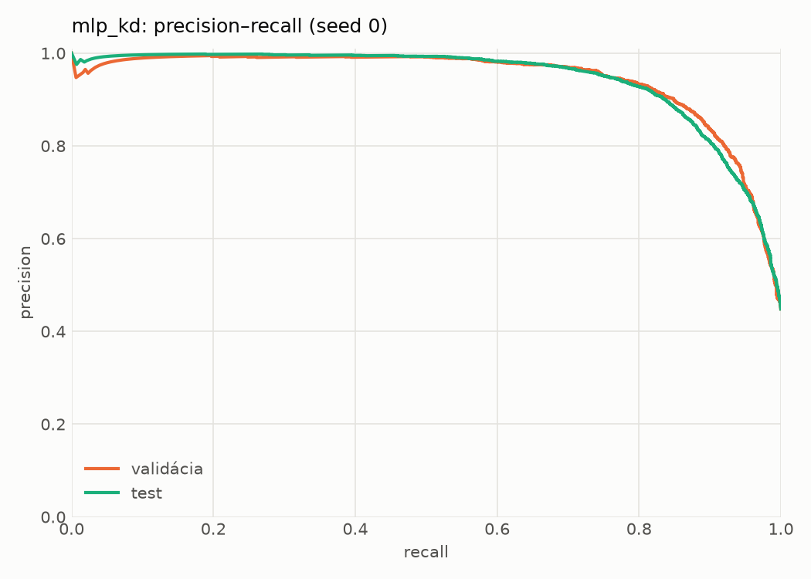
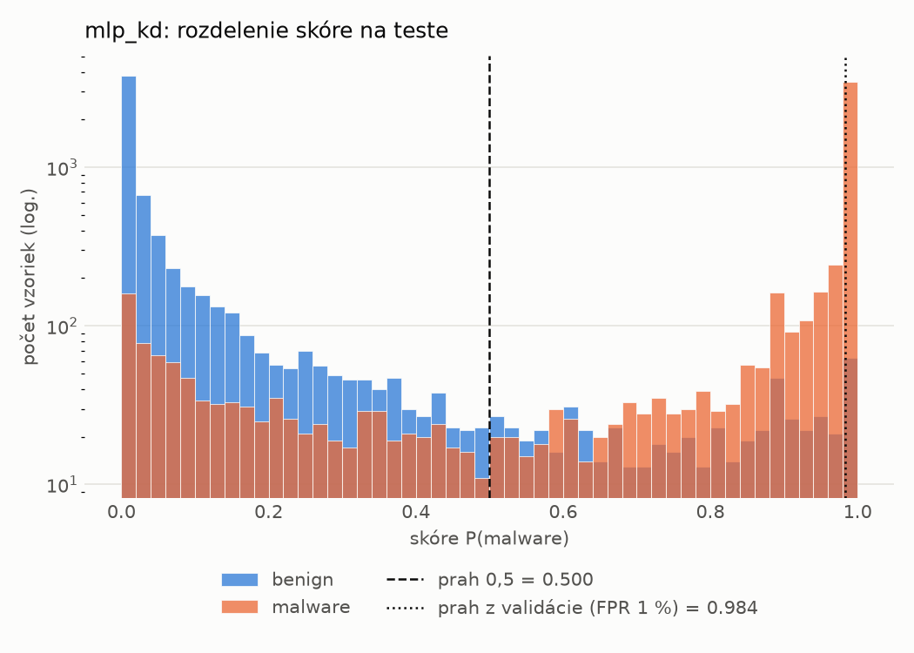
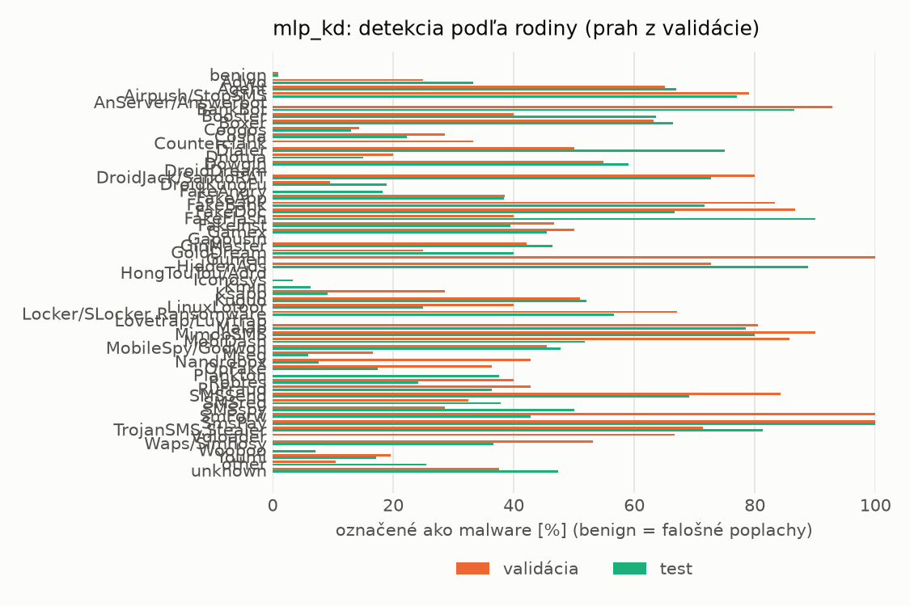
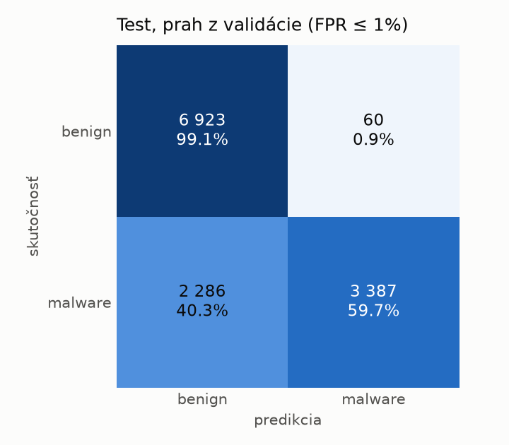
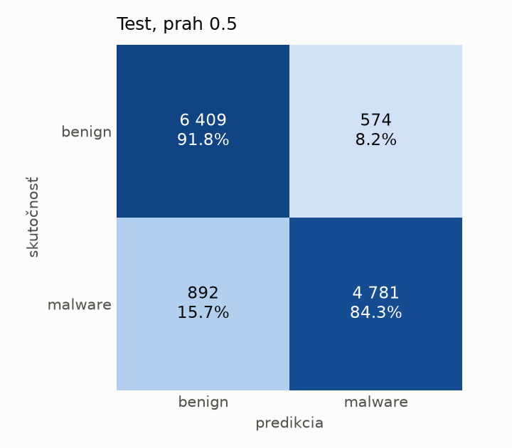
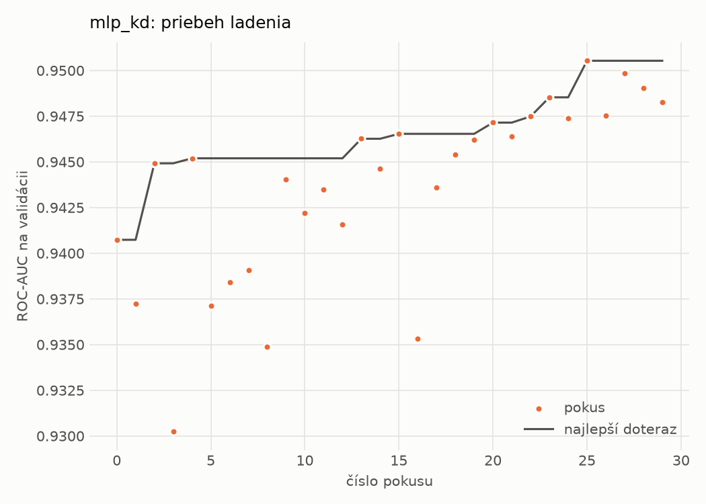
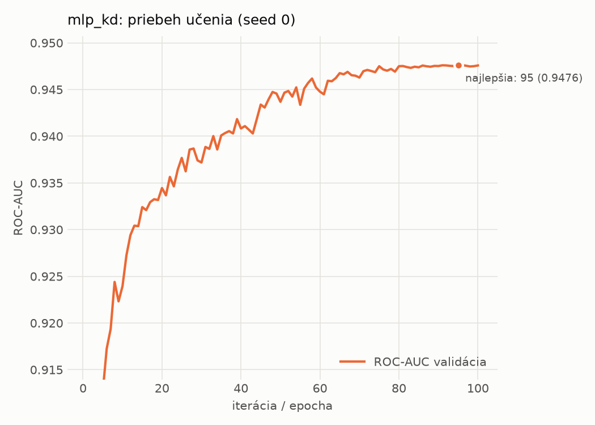

# dynamic/mlp_kd – beh `20261123-204643`

> Automaticky generované (`src/training/run_tabular.py`). Konfigurácia: `config.yaml`, protokol: `protocol.yaml`.

- **Model:** `mlp` – študent – malé MLP učené destiláciou z hybridného učiteľa
- **Ladenie:** 30 dokončených pokusov (Optuna TPE), cieľ ROC-AUC na validácii, 5.4 min
- **Finálne modely:** seedy [0, 1, 2]; hodnoty sú priemer ± smerodajná odchýlka cez seedy
- **Najlepšie hyperparametre:** `{"hidden_layers": 1, "max_epochs": 100, "patience": 8, "hidden_width": 64, "dropout": 0.18336599346560475, "lr": 0.002029071520651615, "weight_decay": 5.085344324013556e-05, "batch_size": 1024, "kd_alpha": 0.6628106947860043, "kd_temperature": 3.3639590927520047}`

## Detekčná kvalita (bez prahu)
| metrika | train (podvzorka) | validácia | test |
|---|---|---|---|
| ROC-AUC | 0.9561 ± 0.0012 | 0.9469 ± 0.0010 | 0.9448 ± 0.0017 |
| PR-AUC | 0.9545 ± 0.0009 | 0.9448 ± 0.0010 | 0.9450 ± 0.0015 |
| TPR pri FPR 1 % | 0.6814 ± 0.0026 | 0.6114 ± 0.0068 | 0.6220 ± 0.0096 |
| TPR pri FPR 0,1 % | 0.5002 ± 0.0131 | 0.1962 ± 0.0069 | 0.3480 ± 0.0469 |
| log loss | 0.2825 ± 0.0040 | 0.3326 ± 0.0026 | 0.3338 ± 0.0055 |
| Brier skóre | 0.0789 ± 0.0014 | 0.0857 ± 0.0012 | 0.0898 ± 0.0016 |

Rozdiel ROC-AUC train − validácia: **0.0092** (veľký rozdiel = preučenie).

## Pri prahu z validácie (FPR ≤ 1% na validácii)
| metrika | train (podvzorka) | validácia | test |
|---|---|---|---|
| accuracy | 0.8353 ± 0.0023 | 0.8204 ± 0.0031 | 0.8170 ± 0.0032 |
| balanced accuracy | 0.8118 ± 0.0027 | 0.8008 ± 0.0034 | 0.7968 ± 0.0035 |
| precision | 0.9888 ± 0.0004 | 0.9808 ± 0.0002 | 0.9830 ± 0.0009 |
| recall (TPR) | 0.6291 ± 0.0053 | 0.6114 ± 0.0068 | 0.6020 ± 0.0066 |
| FPR | 0.0055 ± 0.0002 | 0.0097 ± 0.0000 | 0.0084 ± 0.0004 |
| F1 | 0.7690 ± 0.0040 | 0.7532 ± 0.0052 | 0.7467 ± 0.0053 |
| MCC | 0.6908 ± 0.0042 | 0.6668 ± 0.0053 | 0.6615 ± 0.0057 |

## Pri pevnom prahu 0.5
| metrika | train (podvzorka) | validácia | test |
|---|---|---|---|
| accuracy | 0.8976 ± 0.0023 | 0.8904 ± 0.0024 | 0.8843 ± 0.0030 |
| balanced accuracy | 0.8928 ± 0.0024 | 0.8875 ± 0.0025 | 0.8803 ± 0.0031 |
| precision | 0.9045 ± 0.0019 | 0.8915 ± 0.0025 | 0.8948 ± 0.0042 |
| recall (TPR) | 0.8553 ± 0.0038 | 0.8601 ± 0.0037 | 0.8409 ± 0.0036 |
| FPR | 0.0697 ± 0.0013 | 0.0850 ± 0.0020 | 0.0803 ± 0.0033 |
| F1 | 0.8792 ± 0.0028 | 0.8755 ± 0.0028 | 0.8670 ± 0.0035 |
| MCC | 0.7914 ± 0.0046 | 0.7780 ± 0.0048 | 0.7660 ± 0.0062 |

## Výpočtové nároky (seed 0, testovacia množina)
| meranie | hodnota |
|---|---|
| tréning finálneho modelu | 7.6 s (priemer cez seedy) |
| ladenie spolu | 323 s |
| počet parametrov / uzlov | 8 129 |
| veľkosť modelu na disku | 0.04 MB |
| transformácia vstupu – latencia (1 vlákno) | 0.007 ms |
| transformácia vstupu – priepustnosť | 1 068 206 vzoriek/s |
| CPU latencia modelu (batch 1, 1 vlákno) | 0.052 ms (p95 0.072) |
| CPU priepustnosť (24 vlákien) | 5 045 246 vzoriek/s |
| GPU latencia (batch 1) | 0.268 ms (p95 0.288) |
| GPU priepustnosť | 2 244 569 vzoriek/s |
| GPU špičková pamäť | 53 MB |

## Grafy
| | |
|---|---|
|  |  |
|  |  |
|  |  |
|  |  |

## Súbory
`metrics.json` (všetky metriky po seedoch vrátane rodín), `timing.json`, `hpo_trials.csv`,
`predictions/<časť>_seed<N>.parquet` (sha256, family, label, score), `model/seed_<N>/`, `log.txt`.
