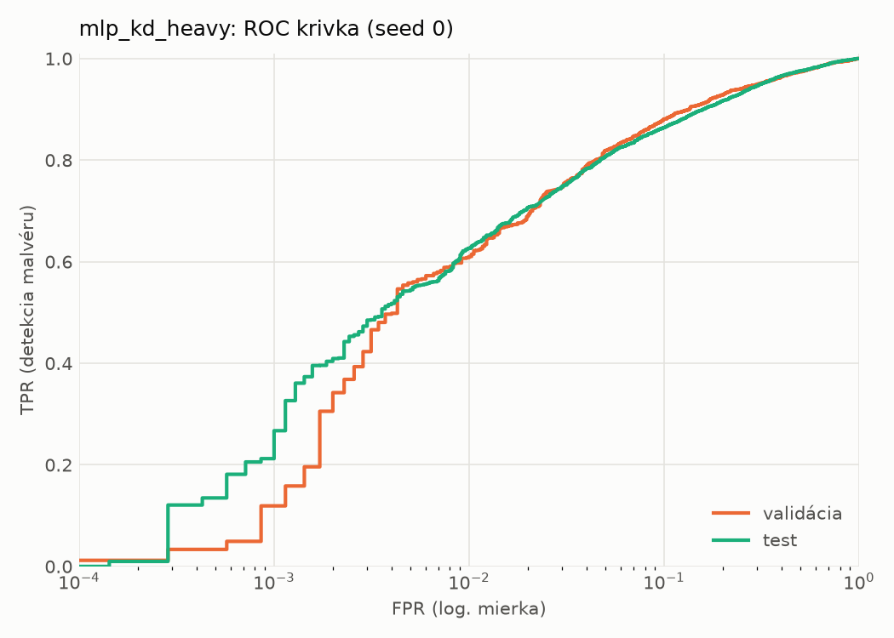
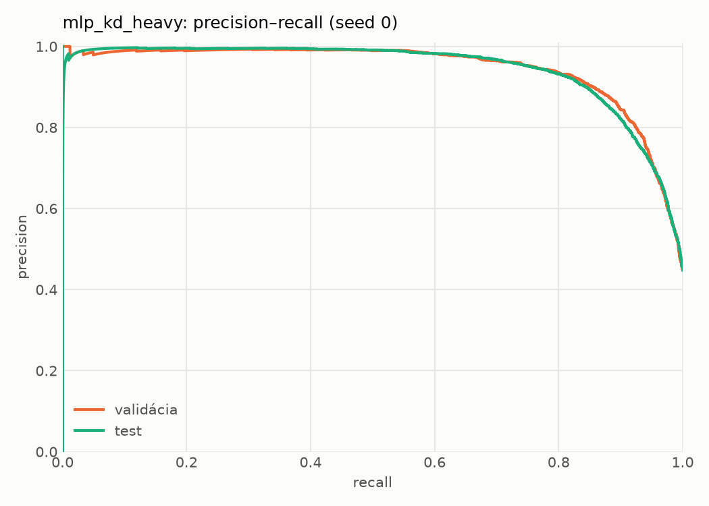
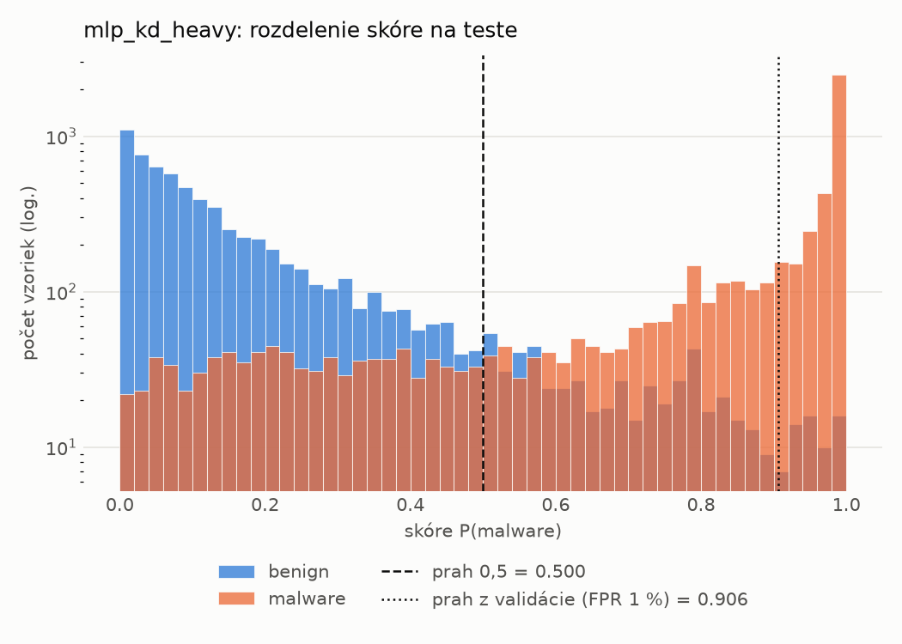
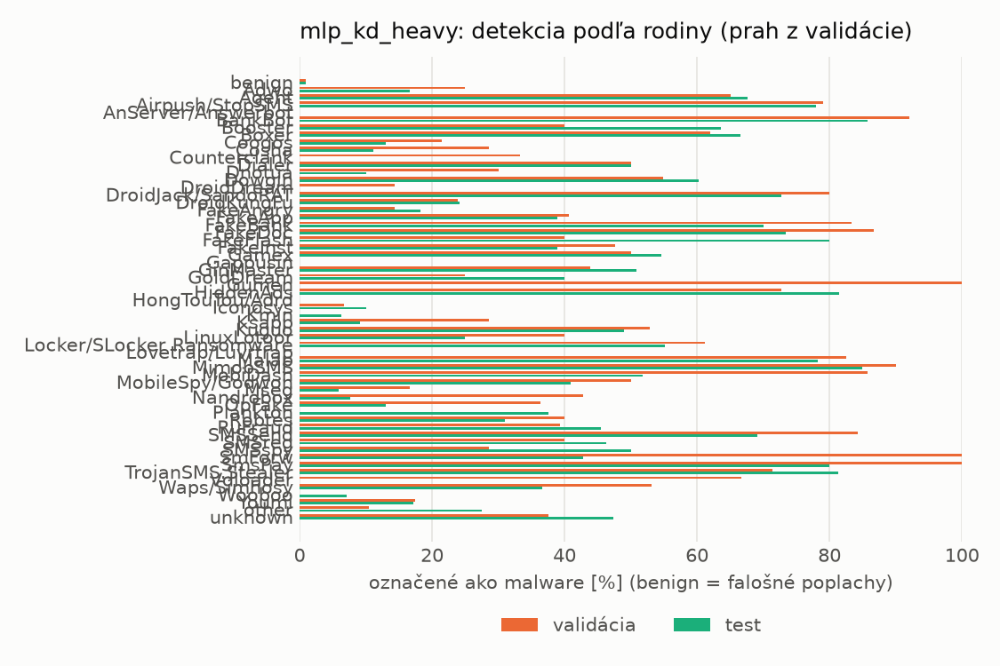
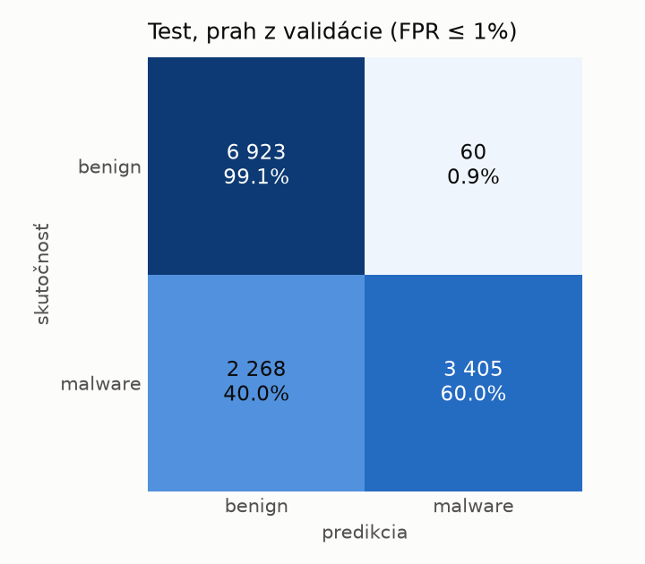
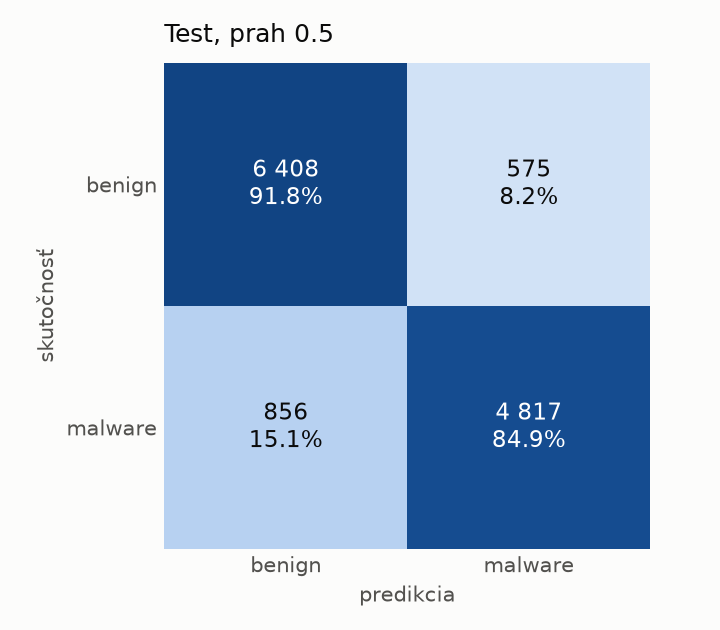
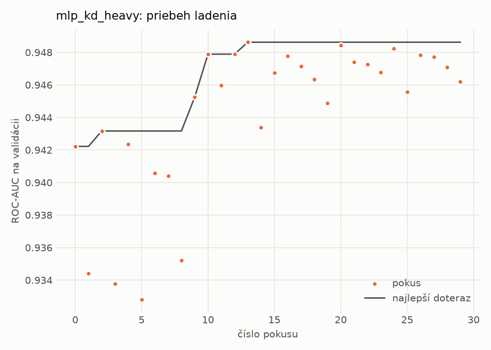
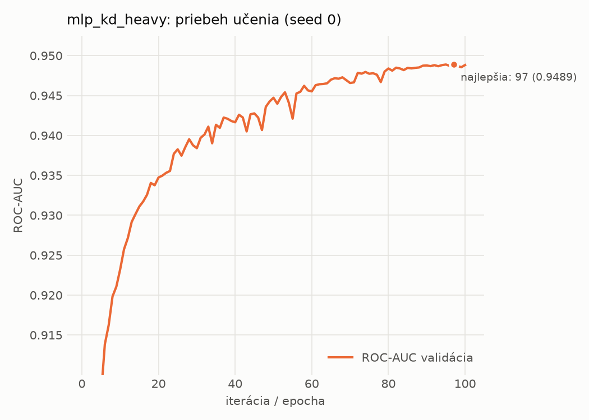

# dynamic/mlp_kd_heavy – beh `20261123-210504`

> Automaticky generované (`src/training/run_tabular.py`). Konfigurácia: `config.yaml`, protokol: `protocol.yaml`.

- **Model:** `mlp` – študent – malé MLP učené destiláciou z mlp_large hybridu (V4)
- **Ladenie:** 30 dokončených pokusov (Optuna TPE), cieľ ROC-AUC na validácii, 4.4 min
- **Finálne modely:** seedy [0, 1, 2]; hodnoty sú priemer ± smerodajná odchýlka cez seedy
- **Najlepšie hyperparametre:** `{"hidden_layers": 1, "max_epochs": 100, "patience": 8, "hidden_width": 64, "dropout": 0.11940169496551375, "lr": 0.0010131280233016235, "weight_decay": 6.964554367863767e-06, "batch_size": 1024, "kd_alpha": 0.5527208987397508, "kd_temperature": 1.1661827551200896}`

## Detekčná kvalita (bez prahu)
| metrika | train (podvzorka) | validácia | test |
|---|---|---|---|
| ROC-AUC | 0.9585 ± 0.0018 | 0.9481 ± 0.0008 | 0.9463 ± 0.0008 |
| PR-AUC | 0.9565 ± 0.0018 | 0.9460 ± 0.0003 | 0.9452 ± 0.0005 |
| TPR pri FPR 1 % | 0.6856 ± 0.0075 | 0.6126 ± 0.0103 | 0.6294 ± 0.0028 |
| TPR pri FPR 0,1 % | 0.4991 ± 0.0300 | 0.0948 ± 0.0273 | 0.2799 ± 0.0749 |
| log loss | 0.2528 ± 0.0052 | 0.2832 ± 0.0015 | 0.2865 ± 0.0022 |
| Brier skóre | 0.0756 ± 0.0017 | 0.0830 ± 0.0007 | 0.0857 ± 0.0009 |

Rozdiel ROC-AUC train − validácia: **0.0104** (veľký rozdiel = preučenie).

## Pri prahu z validácie (FPR ≤ 1% na validácii)
| metrika | train (podvzorka) | validácia | test |
|---|---|---|---|
| accuracy | 0.8364 ± 0.0032 | 0.8209 ± 0.0046 | 0.8189 ± 0.0040 |
| balanced accuracy | 0.8131 ± 0.0038 | 0.8014 ± 0.0051 | 0.7990 ± 0.0045 |
| precision | 0.9879 ± 0.0021 | 0.9808 ± 0.0003 | 0.9832 ± 0.0015 |
| recall (TPR) | 0.6322 ± 0.0087 | 0.6126 ± 0.0103 | 0.6063 ± 0.0097 |
| FPR | 0.0060 ± 0.0011 | 0.0097 ± 0.0000 | 0.0084 ± 0.0009 |
| F1 | 0.7710 ± 0.0058 | 0.7541 ± 0.0079 | 0.7501 ± 0.0071 |
| MCC | 0.6925 ± 0.0050 | 0.6677 ± 0.0080 | 0.6649 ± 0.0067 |

## Pri pevnom prahu 0.5
| metrika | train (podvzorka) | validácia | test |
|---|---|---|---|
| accuracy | 0.8993 ± 0.0024 | 0.8923 ± 0.0014 | 0.8858 ± 0.0018 |
| balanced accuracy | 0.8950 ± 0.0025 | 0.8896 ± 0.0014 | 0.8820 ± 0.0019 |
| precision | 0.9031 ± 0.0026 | 0.8931 ± 0.0015 | 0.8939 ± 0.0024 |
| recall (TPR) | 0.8613 ± 0.0035 | 0.8631 ± 0.0016 | 0.8456 ± 0.0032 |
| FPR | 0.0713 ± 0.0020 | 0.0840 ± 0.0011 | 0.0815 ± 0.0021 |
| F1 | 0.8817 ± 0.0029 | 0.8778 ± 0.0015 | 0.8691 ± 0.0022 |
| MCC | 0.7949 ± 0.0049 | 0.7820 ± 0.0027 | 0.7689 ± 0.0037 |

## Výpočtové nároky (seed 0, testovacia množina)
| meranie | hodnota |
|---|---|
| tréning finálneho modelu | 6.4 s (priemer cez seedy) |
| ladenie spolu | 262 s |
| počet parametrov / uzlov | 8 129 |
| veľkosť modelu na disku | 0.04 MB |
| transformácia vstupu – latencia (1 vlákno) | 0.015 ms |
| transformácia vstupu – priepustnosť | 767 779 vzoriek/s |
| CPU latencia modelu (batch 1, 1 vlákno) | 0.153 ms (p95 0.162) |
| CPU priepustnosť (24 vlákien) | 6 028 963 vzoriek/s |
| GPU latencia (batch 1) | 0.282 ms (p95 0.318) |
| GPU priepustnosť | 3 038 437 vzoriek/s |
| GPU špičková pamäť | 78 MB |

## Grafy
| | |
|---|---|
|  |  |
|  |  |
|  |  |
|  |  |

## Súbory
`metrics.json` (všetky metriky po seedoch vrátane rodín), `timing.json`, `hpo_trials.csv`,
`predictions/<časť>_seed<N>.parquet` (sha256, family, label, score), `model/seed_<N>/`, `log.txt`.
