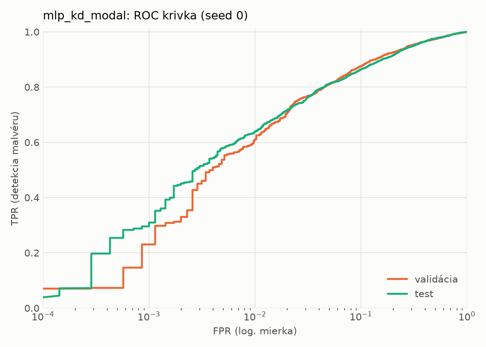
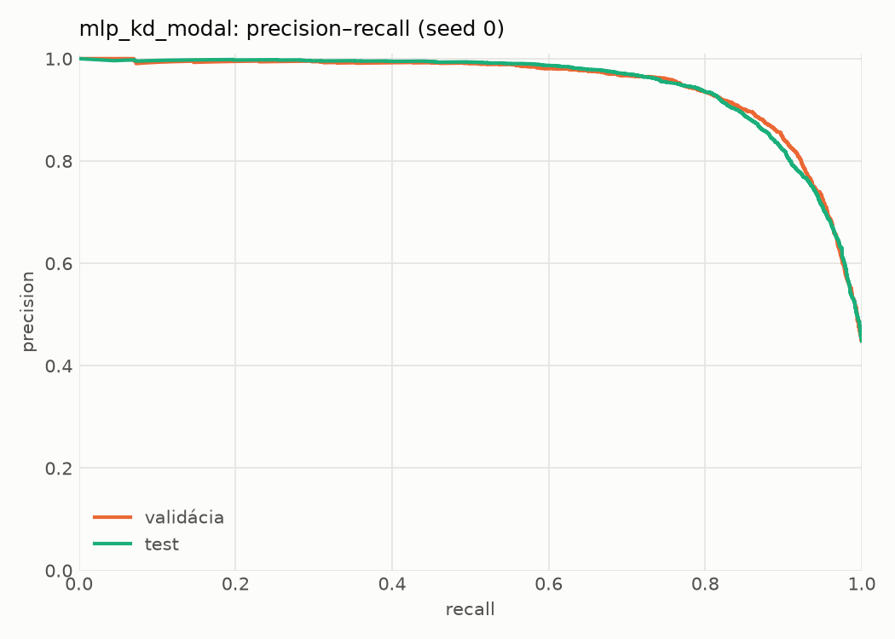
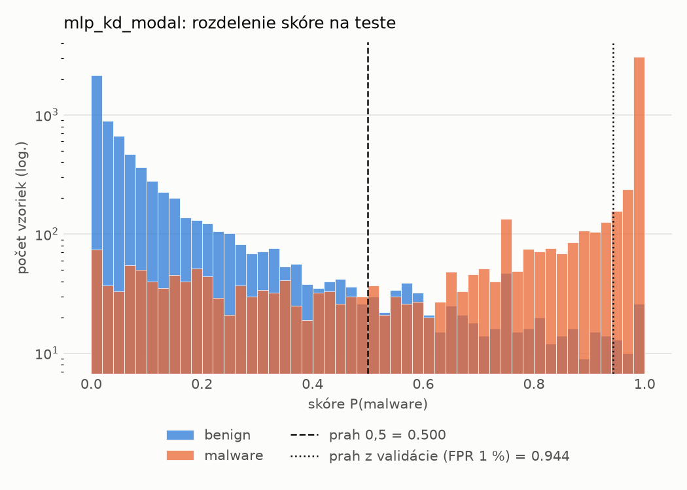
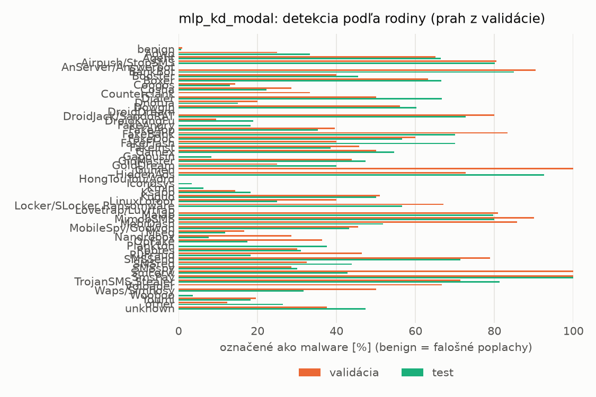
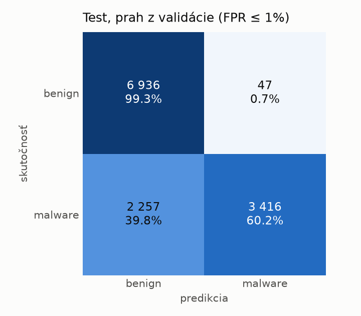
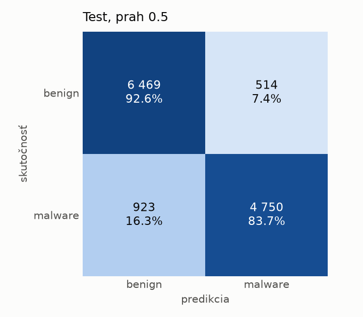
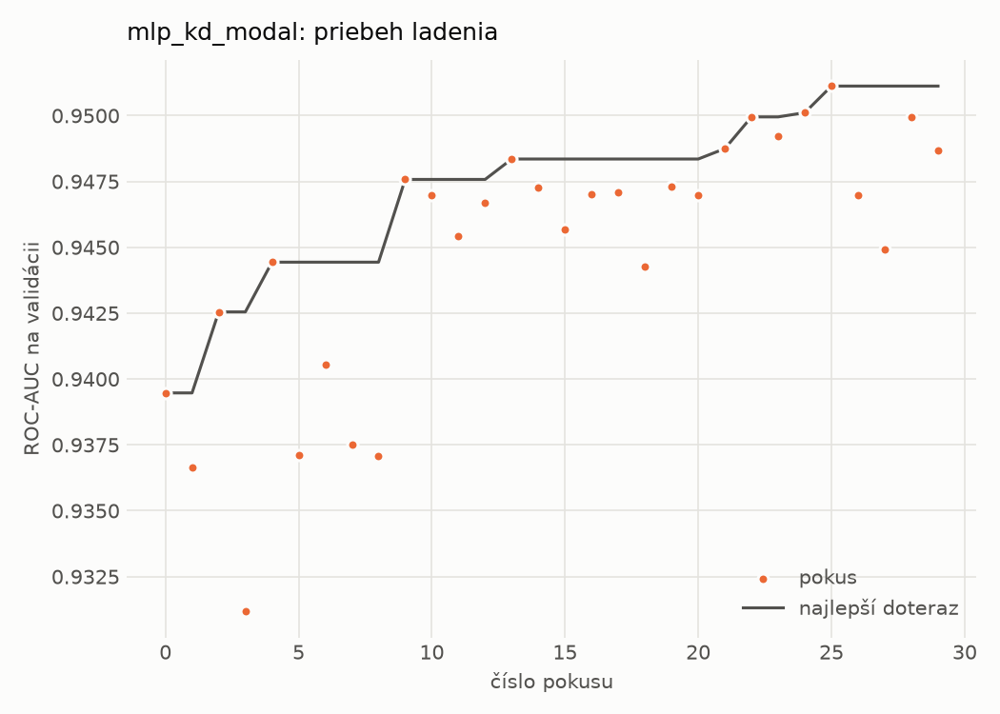
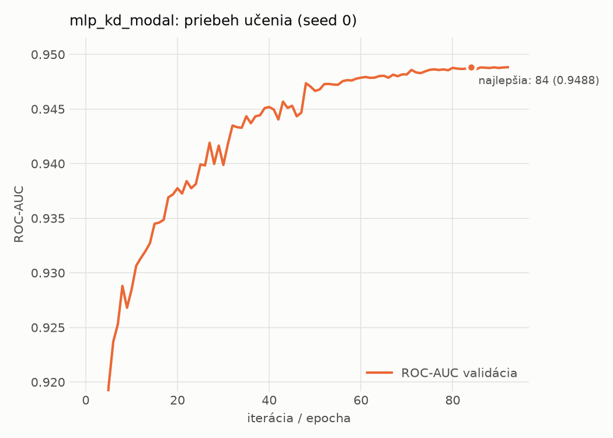

# dynamic/mlp_kd_modal – beh `20261123-210004`

> Automaticky generované (`src/training/run_tabular.py`). Konfigurácia: `config.yaml`, protokol: `protocol.yaml`.

- **Model:** `mlp` – študent – malé MLP učené destiláciou z učiteľa rovnakej modality (variant A)
- **Ladenie:** 30 dokončených pokusov (Optuna TPE), cieľ ROC-AUC na validácii, 4.6 min
- **Finálne modely:** seedy [0, 1, 2]; hodnoty sú priemer ± smerodajná odchýlka cez seedy
- **Najlepšie hyperparametre:** `{"hidden_layers": 1, "max_epochs": 100, "patience": 8, "hidden_width": 64, "dropout": 0.17256398759806554, "lr": 0.00273877224500614, "weight_decay": 0.00015336049950880602, "batch_size": 1024, "kd_alpha": 0.5720540077101433, "kd_temperature": 1.5970216771892711}`

## Detekčná kvalita (bez prahu)
| metrika | train (podvzorka) | validácia | test |
|---|---|---|---|
| ROC-AUC | 0.9593 ± 0.0013 | 0.9499 ± 0.0013 | 0.9474 ± 0.0004 |
| PR-AUC | 0.9575 ± 0.0015 | 0.9494 ± 0.0016 | 0.9480 ± 0.0002 |
| TPR pri FPR 1 % | 0.6919 ± 0.0091 | 0.6289 ± 0.0280 | 0.6371 ± 0.0080 |
| TPR pri FPR 0,1 % | 0.4637 ± 0.0167 | 0.2275 ± 0.0068 | 0.3224 ± 0.0251 |
| log loss | 0.2474 ± 0.0042 | 0.2839 ± 0.0051 | 0.2867 ± 0.0002 |
| Brier skóre | 0.0733 ± 0.0012 | 0.0806 ± 0.0013 | 0.0837 ± 0.0004 |

Rozdiel ROC-AUC train − validácia: **0.0093** (veľký rozdiel = preučenie).

## Pri prahu z validácie (FPR ≤ 1% na validácii)
| metrika | train (podvzorka) | validácia | test |
|---|---|---|---|
| accuracy | 0.8400 ± 0.0079 | 0.8283 ± 0.0125 | 0.8234 ± 0.0068 |
| balanced accuracy | 0.8172 ± 0.0091 | 0.8096 ± 0.0140 | 0.8040 ± 0.0078 |
| precision | 0.9884 ± 0.0015 | 0.9813 ± 0.0008 | 0.9838 ± 0.0029 |
| recall (TPR) | 0.6402 ± 0.0189 | 0.6289 ± 0.0280 | 0.6163 ± 0.0174 |
| FPR | 0.0058 ± 0.0009 | 0.0097 ± 0.0000 | 0.0083 ± 0.0017 |
| F1 | 0.7770 ± 0.0136 | 0.7663 ± 0.0209 | 0.7577 ± 0.0122 |
| MCC | 0.6990 ± 0.0136 | 0.6805 ± 0.0219 | 0.6729 ± 0.0109 |

## Pri pevnom prahu 0.5
| metrika | train (podvzorka) | validácia | test |
|---|---|---|---|
| accuracy | 0.9013 ± 0.0021 | 0.8936 ± 0.0029 | 0.8885 ± 0.0018 |
| balanced accuracy | 0.8960 ± 0.0021 | 0.8900 ± 0.0028 | 0.8838 ± 0.0017 |
| precision | 0.9127 ± 0.0033 | 0.9031 ± 0.0056 | 0.9061 ± 0.0034 |
| recall (TPR) | 0.8552 ± 0.0022 | 0.8544 ± 0.0028 | 0.8382 ± 0.0009 |
| FPR | 0.0631 ± 0.0026 | 0.0745 ± 0.0047 | 0.0706 ± 0.0028 |
| F1 | 0.8830 ± 0.0024 | 0.8781 ± 0.0031 | 0.8708 ± 0.0020 |
| MCC | 0.7991 ± 0.0043 | 0.7848 ± 0.0061 | 0.7749 ± 0.0038 |

## Výpočtové nároky (seed 0, testovacia množina)
| meranie | hodnota |
|---|---|
| tréning finálneho modelu | 6.5 s (priemer cez seedy) |
| ladenie spolu | 278 s |
| počet parametrov / uzlov | 8 129 |
| veľkosť modelu na disku | 0.04 MB |
| transformácia vstupu – latencia (1 vlákno) | 0.015 ms |
| transformácia vstupu – priepustnosť | 776 890 vzoriek/s |
| CPU latencia modelu (batch 1, 1 vlákno) | 0.152 ms (p95 0.162) |
| CPU priepustnosť (24 vlákien) | 5 910 152 vzoriek/s |
| GPU latencia (batch 1) | 0.442 ms (p95 0.465) |
| GPU priepustnosť | 2 197 604 vzoriek/s |
| GPU špičková pamäť | 53 MB |

## Grafy
| | |
|---|---|
|  |  |
|  |  |
|  |  |
|  |  |

## Súbory
`metrics.json` (všetky metriky po seedoch vrátane rodín), `timing.json`, `hpo_trials.csv`,
`predictions/<časť>_seed<N>.parquet` (sha256, family, label, score), `model/seed_<N>/`, `log.txt`.
